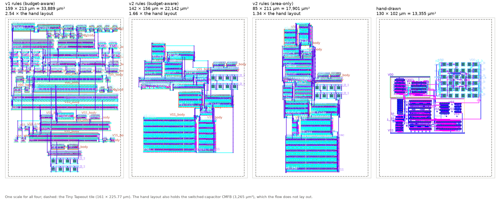
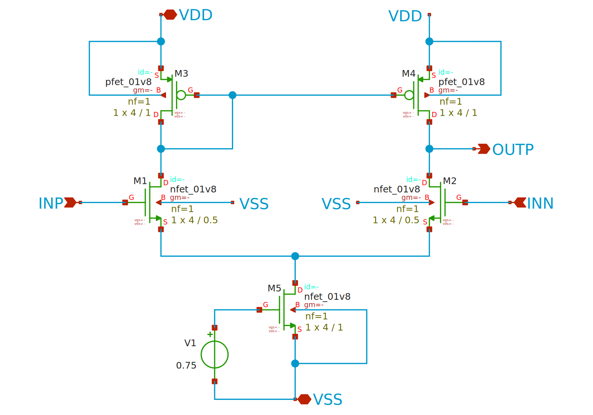
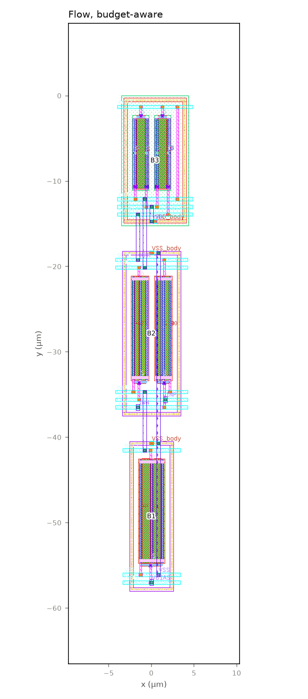
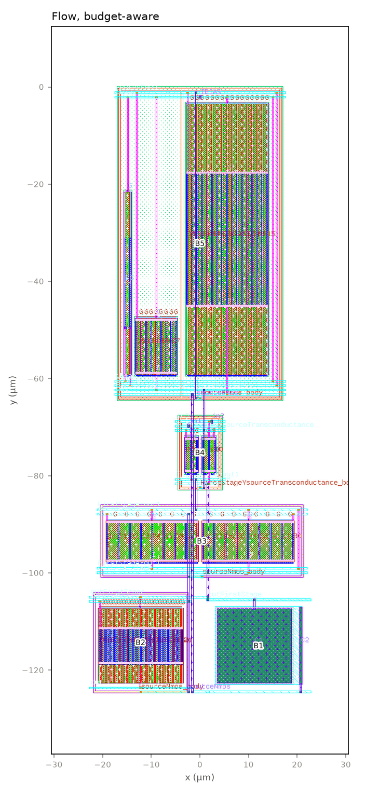
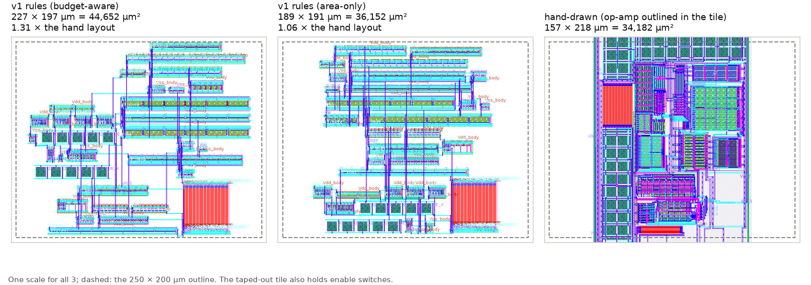
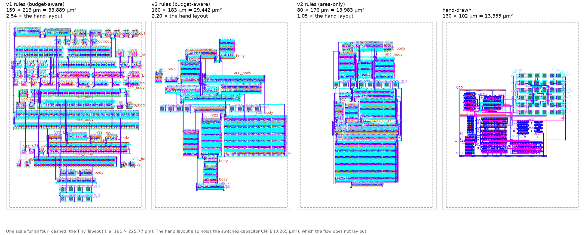
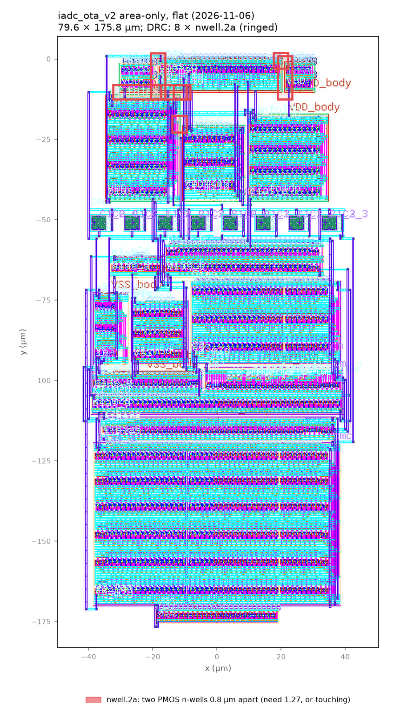

# Electrically informed analog layout automation on SKY130

This flow takes a sized analog circuit and draws its layout for the open SkyWater SKY130 process.
- **What drives it:** the circuit's own electrical model. Before any layout exists, it works out which nodes matter
  and by how much, and turns the specs into budgets: how much capacitance, coupling and resistance each net may
  pick up.
- **How it draws:** it lays out the devices and blocks inside those budgets, places and routes them, and then
  extracts and simulates the layout to check the specs.
- **What checks it:**
  - every drawn block and layout passes Magic DRC and Netgen LVS, and each LVS has a deliberately broken copy that
    must fail;
  - every stage ends with automatic checks (gates);
  - the search settings and hypotheses are fixed in advance (`PREREG.md`).
- **What it needs:** no LLM. It runs on open tools in one pinned Docker image.

<p align="center">
  
</p>
<p align="center"><sub>The OTA of an incremental ADC in a Tiny Tapeout tile. Shown at one scale: the flow's layouts
under the first rule set (v1), under the new rule set (v2), and the designer's hand layout.</sub></p>

## 1. What the flow does

| Stage | Does | Algorithm / method |
|---|---|---|
| **S0 Ingest** | reads and freezes the design (netlist, specs, benches); checks every node and device; binds devices to SKY130 cells | netlist validation; SHA-256 freeze; round-trip LVS; bench re-run; 45 PVT points; 200-run mismatch Monte Carlo |
| **S1 Electrical intent** | finds which nodes matter and how much | operating point (ngspice); exact linear small-signal model; pole per node; sensitivity of every spec to capacitance on every node and node pair, checked against SPICE; matching groups |
| **S2 Requirement compiler** | turns the specs into layout budgets before any layout exists | each spec's allowance (η × margin) shared among nets by max-min fair progressive filling; capacitance, coupling, resistance and wire-length budgets, verified in SPICE with the budgets inserted |
| **S3 Device design** | chooses how each transistor is drawn | every PDK cell option (fingers, contacts, diffusion), built and signed off in Magic; the smallest within budget |
| **S4 Blocks** | draws the matched blocks | common-centroid (1-D and 2-D), cross-quad, interdigitated and mirror arrangements; dummies; packed tracks; tap rings; candidates screened on paper, the best 2–3 signed off |
| **S5 Placement and routing** | places the blocks inside an outline and wires them | enumeration or seeded simulated annealing per sub-circuit; cost = area + wire-budget use (budget-aware) or area alone (baseline); grid A* router (metal3/metal4) that never wires over devices; channels widened until every net routes |
| **S6 Extraction** | reads the layout back with its parasitics | Magic extraction (C-only, R+C where it fits); flat LVS; every budget against what was extracted |
| **S7 Post-layout evaluation** | simulates the layout in the original benches | ngspice on four views: schematic, drawn devices, C-only, R+C; each spec's loss against η × margin |
| S8 Diagnosis and repair | *planned* | trace a failure to nodes with the sensitivities; fix it locally in S3–S5 |
| S9 Selection | *planned* | the smallest layout that meets every verified spec |

Each layout comes in two versions: **budget-aware** (BA), which places against the budgets, and **area-only** (AO),
the compact baseline. Comparing the two measures what the budgets buy.

## 2. What is expected to be new

These ideas are already published, so they are **not** claimed: per-net parasitic budgets in general, mapping specs
to parasitics, choosing a common-centroid pattern, symmetry extraction, and LLM-generated constraints. See
`docs/05_literature_novelty_remap.md`.

| Contribution | In one line | Status |
|---|---|---|
| C1. Intent compiled from the circuit's own model | per-node sensitivities turn the specs into budgets and routing rules **before any layout**, each traceable to a node and its pole | built (S1, S2), checked against SPICE |
| C2. Device cells chosen from the requirements | each transistor cell (fingers, contacts) chosen to keep its node within budget | built (S3) |
| C3. Budget-aware variants and placement | signed-off variants per block, chosen and placed to minimise area **subject to the budgets** | built (S4, S5); on `ttsky25a_fd` the budget-aware layout uses 40 % less of the wire budgets than the area-only baseline |
| C4. LLM decisions grounded in the equations, measured | an LLM proposes and explains decisions over the explicit budgets; what it adds is measured against the rule-only flow | planned (section 5) |
| C5. Open, reproducible SKY130 flow | open tools, every block signed off, seeded searches, golden results | built |

## 3. Layout rule set v2 (2026-11-05)

**Why:** the first rule set (v1) made layouts 1.1–2.5 × the hand layouts' area. Most of that came from values fixed by
hand:
- 3 µm between blocks and between rows;
- 0.6 µm between units;
- a tap ring on every block;
- 8 µm of routing margin;
- a separate block (with its own ring) for each of the designer's dummy transistors.

**What v2 does** (`docs/rules_v2/ruleset_v2.md`). The rules are drawn mainly from Saint & Saint, *IC Mask Design*
(its Case Study 1 in full), from the ASP-DAC 2022 common-centroid review, and from Long et al. (ISCAS 2005) on 2-D
common centroid. Imasha reviewed them and answered ten questions; a PREREG amendment fixed them before any v2 code.
- **Spacing:** every spacing the generator chooses is the SKY130 DRC minimum × 1.10, rounded up to 0.05 µm. The values
  come from the Magic rule deck with their rule ids, and a test checks them against the deck.
- **No wire over any device.** Routing channels are made only as wide as routing needs.
- **Blocks as the designer draws them** (`blocks:` in `layout.yaml`; one coloured box = one block). The designer's
  dummies sit at the row ends of the block they serve.
- **2-D arrangements:** cross-quad, 2-D common centroid with rows paired A B / B A, folded rows, and series strings one
  per row. All candidates are estimated on paper, and only the best 2–3 per block are drawn and signed off.

v2 is opt-in per design (`ruleset: v2`). Every finished design still runs v1 unchanged: the tests regenerate its
committed block plans unit for unit, and the golden comparison still passes.

## 4. Results

| Design | What | Layout (budget-aware) | Hand layout | Specs after layout |
|---|---|---|---|---|
| `example_ota_5t` | 5T OTA | 9 × 58 µm | – | all met |
| `loadbench_miller` | two-stage Miller op-amp (LOADBench) | 46 × 125 µm | – | all met |
| `ttsky25a_fd` | Imasha's fully differential op-amp, taped out on TTSKY25a | 227 × 197 µm (1.31 ×); area-only 1.06 × | 34,182 µm² | all met |
| `iadc_ota` (v1) | folded-cascode OTA of an incremental ADC, in a Tiny Tapeout tile | 159 × 213 µm (2.54 ×) | 13,355 µm² | GBW misses (assumed spec) |
| `iadc_ota_v2` (v2) | the same with rule set v2 and Imasha's drawn blocks | 142 × 156 µm (1.66 ×); area-only 1.34 × | 13,355 µm² | GBW misses (assumed spec) |

Every layout here is DRC-clean (0 errors) and LVS-matched. The gate verdicts are in section 6 and in each design's
report. The FAILs that remain are budget gates (the layouts exceed S2's budgets) and the assumed GBW spec of iadc;
no stage crashes.

**Time taken** (minutes per stage, the committed run of each design, one Windows PC in Docker):

| Design | S0 | S1 | S2 | S3 | S4 | S5 | S6 | S7 | Total |
|---|---|---|---|---|---|---|---|---|---|
| `example_ota_5t` | 20 | 0.3 | 8 | 21 | 0.5 | 1 | 0.4 | 2 | **53** (0.9 h) |
| `loadbench_miller` | 11 | 0.3 | 8 | 57 | 1 | 2 | 2 | 34 | **115** (1.9 h) |
| `ttsky25a_fd` | 23 | 4 | 77 | 53 | 4 | 6 | 4 | 1 | **172** (2.9 h) |
| `iadc_ota` (v1) | 40 | 2 | 73 | 46 | 6 | 16 | 20 | 2 | **203** (3.4 h) |
| `iadc_ota_v2` | 26 | 64 | 38 | 16 | 4 | 20 | 41 | 1 | **212** (3.5 h) |

Most of the time goes to S0 (45 PVT points and a 200-run Monte Carlo), S2 (SPICE checks of the budgets) and S3
(building and signing off every cell option). The layout stages, S4–S7, take minutes on the small designs and under an
hour on the large ones. Two v2 times are inflated:
- its S1 ran while test blocks were being built on the same PC;
- 30 of its S6's 41 minutes were the information-only kpex cross-check reaching its time limit.

### 5T OTA (`example_ota_5t`)

<p align="center">
  
  &nbsp;&nbsp;&nbsp;&nbsp;
  
</p>

The schematic drawing is the unsized template; the flow lays out the sized netlist (pair 24/0.5, mirror 8/1, tail
24/1 µm). After layout (R+C):

| Spec | Limit | Schematic | Budget-aware | Area-only |
|---|---|---|---|---|
| Gain (dB) | ≥ 30 | 31.7 | 31.69 ✓ | 31.68 ✓ |
| GBW (MHz) | ≥ 20 | 104.5 | 101.3 ✓ | 100.7 ✓ |
| Phase margin (°) | ≥ 60 | 80.9 | 79.4 ✓ | 79.2 ✓ |
| Power (µW) | ≤ 1000 | 152.6 | 150.5 ✓ | 150.5 ✓ |
| Input noise (nV/√Hz) | ≤ 400 | 339.1 | 339.5 ✓ | 339.5 ✓ |

### Two-stage Miller op-amp (`loadbench_miller`)

<p align="center">
  
</p>

After layout (R+C):

| Spec | Limit | Schematic | Budget-aware | Area-only |
|---|---|---|---|---|
| Gain (dB) | ≥ 57 | 58.0 | 57.98 ✓ | 57.98 ✓ |
| GBW (MHz) | ≥ 21.05 | 23.39 | 22.12 ✓ | 22.12 ✓ |
| Phase margin (°) | ≥ 60 | 65.3 | 65.3 ✓ | 65.3 ✓ |
| Power (µW) | ≤ 614.2 | 558.4 | 553.3 ✓ | 553.3 ✓ |

### Imasha's fully differential op-amp, taped out (`ttsky25a_fd`)

<p align="center">
  
</p>

The hand layout is of a slightly different circuit: the tile adds enable switches. So the area and the wiring's cost
are what compare fairly. The wiring's cost is measured as one layout simulated with and without its wiring.

| | Flow, budget-aware | Flow, area-only | Hand layout |
|---|---|---|---|
| Area | 44,652 µm² (1.31 ×) | 36,152 µm² (1.06 ×) | 34,182 µm² |
| GBW lost to the wiring | 6.0 % | 6.1 % | 6.8 % |
| Phase margin lost to the wiring | 4.4° | 4.8° | 3.0° |

After layout (C-only):

| Spec | Limit | Schematic | Budget-aware | Area-only |
|---|---|---|---|---|
| Gain (dB) | ≥ 97.4 | 98.4 | 98.25 ✓ | 98.25 ✓ |
| GBW (MHz) | ≥ 1.847 | 2.052 | 1.922 ✓ | 1.918 ✓ |
| Phase margin (°) | ≥ 60 | 78.2 | 73.7 ✓ | 73.3 ✓ |
| Power (µW) | ≤ 497.2 | 452.0 | 456.3 ✓ | 456.3 ✓ |

The full report is `docs/ttsky25a_fd_report.html`. ttsky under rule set v2 is in progress (section 5).

### OTA of an incremental ADC, in a Tiny Tapeout tile (`iadc_ota`, v1 and v2)

<p align="center">
  
</p>

| | v1, budget-aware | v2, budget-aware | v2, area-only | Hand layout |
|---|---|---|---|---|
| Size | 158.7 × 213.5 µm | 141.7 × 156.2 µm | 84.7 × 211.2 µm | 130.4 × 102.4 µm |
| Area | 33,889 µm² | 22,142 µm² (−35 %) | 17,901 µm² (−45 % against v1's area-only) | 13,355 µm² (10,090 without its CMFB) |
| Against the hand layout (whole / without its CMFB) | 2.54 × / 3.36 × | 1.66 × / 2.19 × | 1.34 × / 1.77 × | – |
| Blocks | 67 | 19 | 19 | – |
| Total route length | 2,830 µm | 1,597 µm | 1,986 µm | – |
| GBW drawn → after layout (C-only) | 204.8 → 180.3 MHz | 204.8 → 176.8 MHz | 204.8 → 175.9 MHz | 171.9 → 156.2 MHz |
| GBW lost to the wiring | 12.0 % | 13.7 % | 14.1 % | 9.1 % |

Gain (53.6 dB) and phase margin (72.7–73.0°) are met in every layout. GBW misses its spec of 188.9 MHz, which is an
ASSUMPTION waiting for confirmation, in v1 and v2 alike. The hand layout also holds the switched-capacitor CMFB, which
the flow does not lay out (its bench keeps an ideal CMFB). Like for like, the comparison is with the hand layout
without its CMFB.

**What v2 achieved:**
- 35–45 % less area than v1;
- 19 blocks instead of 67;
- a route 44 % shorter;
- every block, and both whole layouts, DRC-clean and LVS-matched.

**What it has not achieved yet** (PREREG 2026-11-05):
- the target of 1.3 × the hand layout: the area-only layout is 1.34 × the whole hand layout and 1.77 × it without
  its CMFB;
- no extra wiring loss: v2 loses 13.7 % of GBW against v1's 12.0 %, although its route is shorter. The likely cause
  is the denser blocks, but this is not yet measured net by net.

**Where the rest of the area goes** (area-only layout):
- the blocks themselves are 10,658 µm²;
- channels and arrangement inside the three sub-circuit macros add 31 %;
- stacking the macros in a column, with the capacitors on a row of their own, adds another 28 %.

The picture and table above are **v2, phase 2** (2026-11-05). Both layouts are DRC-clean and LVS-matched, the
committed result (commit `6c92fdee1`).

#### v2, phase 3 step 1: flat packing (2026-11-06, not yet DRC-clean)

**What changed in the approach** (one S5 option, `packing: flat` in `inputs/iadc_ota_v2/layout.yaml`; PREREG
amendment of 2026-11-06):
- **Phase 2** placed each sub-circuit as its own macro (x1 bias, x2 core, and a top-level macro with the capacitors
  and rail dummies), then arranged the three macros in the tile.
- **Phase 3, step 1** places all 19 blocks as one group, so the annealer can put any block next to any other.
- **Nothing else changed:** the same blocks and arrangements (S0–S4 untouched), the same spacing and routing rules,
  the same search settings.
- **The choice came from a placement-only dry run** comparing five packings (`docs/rules_v2/phase3_plan.md`). Flat
  was the smallest for area-only.
- **After this run, one rule was fixed** for the next run (below).

<p align="center">
  
</p>
<p align="center"><sub>The same comparison with the phase 3 flat layouts: the v2 panels are the flat budget-aware
layout (29,442 µm², clean) and the flat area-only layout (13,983 µm², 8 DRC errors).</sub></p>

<p align="center">
  
</p>

- **Area-only, flat:** 79.6 × 175.8 µm = **13,983 µm²**. That is 1.05 × the whole hand layout (1.39 × without its
  CMFB), against 17,901 µm² with macros and 32,698 µm² in v1. Gain and phase margin are met; GBW loses 14.7 % to the
  wiring.
  - **What made it smaller:** the annealer packs all 19 blocks at once, so small blocks fill the gaps beside big
    ones. The blocks now fill 81 % of the layout's box (64 % with macros). The capacitors no longer take a row of
    their own, and routing needed only a 0.8 µm channel.
  - **Why it does not count yet: 8 DRC errors, all n-well spacing (nwell.2a), ringed above.** Two PMOS blocks on the
    same supply must either touch (their n-wells merge) or keep 1.27 µm. The 0.8 µm channel left them 0.8 µm apart.
    LVS matches.
  - **Fixed for the next run** (`src/common/ruleset.py`, flow record row 107, with a test): such blocks now touch, or
    keep 1.40 µm. The layout must be re-run (section 6, "Continuing this work yourself") to get a DRC-clean version.
    It may grow slightly where blocks are pushed to 1.40 µm.
- **Budget-aware, flat:** 29,442 µm², DRC 0, LVS match, but larger than with macros (22,142 µm²). Its wire-budget term
  outweighs area, so it keeps the macros. GBW loses 12.6 % to the wiring.
- The phase-2 layouts in the table are in commit `6c92fdee1`. The failed layout's GDS, DRC report and error boxes
  are kept in `outputs/report/iadc_ota_v2/flat_drc_failed/`.

The full reports are `docs/iadc_ota_report.html` (v1, with the tools' DRC and LVS reports) and
`docs/reports/iadc_ota_v2_report.html` (v2).

## 5. Next plan

Work was put on hold on 2026-11-06 for a week. **`docs/HANDOFF.md`** says how to continue, on another PC or with
another assistant, and **`docs/rules_v2/phase3_plan.md`** is the plan for phase 3.

0. **First:** re-run iadc_ota_v2 from S5 with the n-well fix, to get the DRC- and LVS-clean flat layout (section 6),
   then analyse its PEX against v1 and the hand layout: which nets pick up the extra capacitance.
   **After this week:** ttsky under the new rules, including its PEX against the taped-out tile; then the LLM part
   (item 4).
1. **Rule set v2, phase 3** (next):
   - pack the sub-circuit macros side by side, with the capacitors and rail dummies in the free space;
   - make channels only in the gaps where routing needs them;
   - give each stack one ring, with shared edges, plus the outer ring Imasha asked for.
   - The target stays 1.3 × the hand layout with every spec met.
2. **Wiring loss under v2:** measure, net by net, where the extra coupling comes from; widen only those spacings.
3. **v2 on the other designs:**
   - `ttsky25a_fd_v2` is a GUI copy with `ruleset: v2`. Its S0 passed and it was stopped at S1;
     `scripts/finish_ttsky_v2.sh` resumes it.
   - The 5T and LOADBench need v2's routing on their smaller layouts.
4. **LLM integration** (Claude CLI; waiting for the supervisor's permission):
   - the LLM proposes and explains decisions over S2's explicit budgets: block grouping, matching level, placement
     hints, and repairs (S8);
   - every proposal is checked by the same gates;
   - its value is measured against the rule-only flow (same designs, with and without).
5. **S8 (diagnosis and repair) and S9 (selection).**
6. **Open questions for Imasha** (in `docs/STATUS.md`):
   - iadc's GBW spec, and the other ASSUMPTIONs;
   - R+C extraction for ttsky.

## 6. How to run it

### Continuing this work yourself (no assistant needed)

Every step below is a command; nothing needs Claude Code. Open **PowerShell** in the repository folder
(`C:\Users\suind\Documents\GitHub\layout-automation-s0-s3`) with Docker Desktop running.

1. **Start the container:**

   ```powershell
   docker start layout-s0s3
   $env:FLOW_CONTAINER="layout-s0s3"
   ```

2. **Get the DRC-clean flat iadc layout.** This re-runs S5–S7 with the n-well fix and takes about 1.5 hours. Keep the
   window open; the PC must stay on.

   ```powershell
   .\flow.ps1 run iadc_ota_v2 --from S5
   ```

   To run it in the background instead, so you can close the window, start it detached; it logs to
   `runs\logs\gui_iadc_ota_v2_S5S7.log` and writes the `.exit` file when done:

   ```powershell
   docker exec -d layout-s0s3 bash -lc "cd /foss/designs && source scripts/env.sh && python3 -u -m src.flow run iadc_ota_v2 --from S5 > runs/logs/gui_iadc_ota_v2_S5S7.log 2>&1; echo `$? > runs/logs/gui_iadc_ota_v2_S5S7.log.exit"
   ```

3. **Check it:** S5's gates G5.2 (DRC) and G5.3 (LVS) should now say True for both layouts. G5.4 (budgets) and S7's
   GBW still fail, as before.

   ```powershell
   .\flow.ps1 status iadc_ota_v2
   ```

4. **Refresh the report and the pictures** (a few minutes). Then open `docs\reports\iadc_ota_v2_report.html` and look
   at `outputs\report\readme\iadc_ota_compare.png`.

   ```powershell
   docker exec layout-s0s3 bash -lc "cd /foss/designs && source scripts/env.sh && python3 scripts/make_design_report.py iadc_ota_v2 && python3 scripts/make_readme_figures.py && python3 scripts/make_progress_report.py"
   ```

5. **Resume ttsky under v2** (about 4 hours, in the background). It runs the missing stages and refreshes the
   reports. It is done when `runs\logs\finish_ttsky_v2.done` exists.

   ```powershell
   docker exec -d layout-s0s3 bash -lc "bash /foss/designs/scripts/finish_ttsky_v2.sh"
   ```

6. **Run the tests** (about a minute). Expect 213 passed and every golden OK.

   ```powershell
   .\flow.ps1 test
   ```

7. **Commit** with GitHub Desktop.
   - Update the numbers in section 4 by hand from `docs/progress_report.md` section 5, which refreshes itself.
   - Add a line to `docs/progress_log.md`.

To see what is running: `docker exec layout-s0s3 ps -eo pid,args | findstr python3`. To stop a run: `docker exec
layout-s0s3 kill <pid>`, using the PID from that list. Never kill by pattern.

### Running the flow in general

You need Docker (Docker Desktop on Windows) and about 20 GB for the EDA image `hpretl/iic-osic-tools:2026.10`.
Nothing else is installed; everything runs in that image, with this repository at `/foss/designs`.
- **On Imasha's PC:** the container `layout-s0s3` already exists (`docker start layout-s0s3` if it is stopped).
- **On another PC:** `docs/HANDOFF.md` section 3. Without `FLOW_CONTAINER`, `flow.ps1` starts a throwaway container
  from the image.

```powershell
$env:FLOW_CONTAINER="layout-s0s3"
.\flow.ps1 list                               # the designs in inputs/
.\flow.ps1 status all                         # gate verdicts of the committed runs, per stage
.\flow.ps1 run example_ota_5t                 # S0 -> S7 end to end (about an hour; ttsky and iadc about 3 hours)
.\flow.ps1 run example_ota_5t --from S4       # from one stage to the end
.\flow.ps1 test                               # 211 unit tests + golden comparison with the committed outputs
.\gui\gui.ps1                                 # the local GUI: http://localhost:8765/ (edit a copy, run, report; no LLM)
```

From bash or Linux, `./flow` takes the same arguments.

**Each stage alone** (`--stage S0` … `S7`) reads only the earlier stages' outputs:

| Stage | Command | Main outputs |
|---|---|---|
| S0 | `.\flow.ps1 run <d> --stage S0` (`--no-pvt` skips the PVT sweep and Monte Carlo) | `outputs/S0/<d>/` (circuit IR, frozen package, PVT) |
| S1 | `.\flow.ps1 run <d> --stage S1` | `outputs/S1/<d>/s1_report.json` (model, sensitivities, matching groups) |
| S2 | `.\flow.ps1 run <d> --stage S2` | `outputs/S2/<d>/budgets.json`, `constraints.json` |
| S3 | `.\flow.ps1 run <d> --stage S3` | `outputs/S3/<d>/device_decisions.json`; cells in `outputs/S3/_cells/` |
| S4 | `.\flow.ps1 run <d> --stage S4` | `outputs/S4/<d>/blocks.json`, every block's GDS, DRC and LVS |
| S5 | `.\flow.ps1 run <d> --stage S5` | `outputs/S5/<d>/placement.json`, the routed GDS of both layouts |
| S6 | `.\flow.ps1 run <d> --stage S6` | `outputs/S6/<d>/` (extracted netlists, budgets against extraction) |
| S7 | `.\flow.ps1 run <d> --stage S7` | `outputs/S7/<d>/metrics.json` (every spec on every view) |

**Status of a stage:**
- **PASS:** every gate passed (exit code 0).
- **FAIL:** a gate failed, but the stage finished and wrote its report (exit code 3).
- **ERROR:** the stage did not finish (any other exit code).

Logs are in `runs/logs/flow/<d>/`, and the run summary is `outputs/flow/<d>/flow_summary.json`. A run rewrites the
design's output folders; discarding the changes in GitHub Desktop returns to the committed run.

**Layout options** (`inputs/<d>/layout.yaml`, read only by S4–S7):
- `matching`, `dummies`, `outline_um`, `hierarchy: upstream`, `fold_row_um`;
- `ruleset: v2` with `blocks:`.

All are described in `docs/flow_details.md`. Your own design: use the GUI (a copy of a design, or a new SPICE
netlist), or copy `inputs/_template/` (fields in `docs/INPUTS.md`).

**Reports**, all generated from the committed outputs (inside the container, after `source scripts/env.sh`):
- `python3 scripts/make_design_report.py <d>`: the short report of any design;
- `make_ttsky_report.py`, `make_iadc_report.py`: the detailed reports;
- `make_progress_report.py`: the reviewers' summary;
- `make_readme_figures.py`: the pictures above.

## 7. Documents

| Document | What it gives |
|---|---|
| `docs/progress_report.html` | the reviewers' summary: stages, novelty, results, the LLM plan, risks |
| `docs/ttsky25a_fd_report.html`, `docs/iadc_ota_report.html` | the detailed reports: schematics with every block marked, the algorithms, who decides what, comparisons with the hand layouts |
| `docs/reports/<d>_report.html` | the short report of each design (also for GUI copies) |
| `docs/rules_v2/ruleset_v2.md` | layout rule set v2: sources, rules, Imasha's answers |
| `docs/flow_details.md` | every stage's options, outputs and history (moved from this README) |
| `docs/flow_record.md` | the journey: every problem found (106 so far), how it was found, what changed |
| `PREREG.md` | hypotheses, thresholds and fixed search settings, with dated amendments |
| `docs/STATUS.md`, `docs/progress_log.md` | what is running, what changed, open questions |

Third-party material and licences are listed in `THIRD_PARTY.md`. Inputs the upstream designs did not provide are
labelled PREDICTED, and assumptions ASSUMPTION (`circuits/<d>/SOURCE.md`).
