# Flow record: PCell-exact analog layout flow (living document)

This is the running record of the flow, kept up to date as each stage is built and run. For every
step it shows what went in, what came out (with excerpts of the generated JSON), the DRC/LVS
evidence with pictures, and the problems met on the way and how they were fixed.

- Every number here is copied from a file in this repository, and the file is named next to it.
- **ASSUMPTION** marks a choice that is not backed by a given input.
- Pictures are in [`flow_record/img/`](flow_record/img/). They are regenerated by
  `python3 scripts/make_record_figures.py <design> ...`.
- How to run each stage: [`../README.md`](../README.md). Chronological notes: [`progress_log.md`](progress_log.md).
- To get a self-contained HTML copy (pictures embedded), run from `docs/`: `pandoc flow_record.md --standalone --embed-resources -c flow_record/record.css -o ../runs/tmp/flow_record.html`.

**Last updated:** 2026-10-26 (evening). Adds section 7: plan v2 on five designs (two development, three new), the journey of the day (what went wrong, how it was found, what changed), corners and mismatch, the budget baselines, the hand-drawn layouts of TTSKY25a and iadc, and two independent reviews. Runs still in progress are marked as such.

> **Decisions of 2026-10-25 (night), from you:**
> - The stress variant gives layout **90 % of each margin** (η = 0.9, package key `eta`). The example design keeps η = 0.5.
> - **Electromigration (EM) is ignored for now** for SKY130: the EM rules stay `not_evaluated`; no further search.
> - **S3 is on hold** as it stands. Open S3 items are listed in Supervisor review 3, not worked on.
> - **S4 starts on Monday, 2026-10-26.**

### Where everything is on your PC

The repository is `C:\Users\suind\Documents\GitHub\layout-automation-s0-s3`.

- If the File Explorer "Documents" shortcut opens `C:\Users\suind\OneDrive\Documents`, that is a different folder. Paste the path above into the address bar instead.
- The `Desktop\Layout_automation` folder has two shortcuts, `Open_layout-automation-s0-s3_repo.url` and `Open_flow_record.url`.

| What | Where in the repo |
|---|---|
| Code, per stage | `src\s0`, `src\s1`, `src\s2`, `src\s3`, `src\common` |
| Tests | `tests\` |
| Results, per stage and design | `outputs\S0\<design>`, `outputs\S1\<design>`, `outputs\S2\<design>`, `outputs\S3\<design>` |
| PCell option cells (shared by the designs) | `outputs\S3\_cells\<type>__<option>\` (GDS, PNG, DRC, LVS, PEX) |
| This record and its pictures | `docs\flow_record.md`, `docs\flow_record\img\` |
| Logs of every run | `runs\logs\` |

In VS Code, open `docs\flow_record.md` and press Ctrl+Shift+V to see it with the pictures.

---

## Status at a glance

| Stage | What it produces | example_ota_5t | ota5t_stress | DRC | LVS |
|---|---|---|---|---|---|
| Step 0 | Baselines: ALIGN (SKY130), MAGICAL (mock PDK) | done | n/a | ALIGN 0 errors | ALIGN: topology match, **L/W property errors** (not equivalent) |
| **S0** | Frozen circuit IR, device map, reproduced testbenches | **PASS** (G0.1–G0.7) | **PASS** (G0.1–G0.7) | **0 errors** on all 5 PCell devices | **match, no property errors**, 5/5 |
| **S1** | Operating point, exact linear model, C and R sensitivities, intent | **PASS** (G1.1–G1.6) | **PASS** (G1.1–G1.6) | n/a | n/a |
| S1 add-on | Pole drop-out study: patched copy of the upstream equations (3.9) | PM error 10.4° → 0.7° | PM error 25.5° → 0.1° | n/a | n/a |
| **S2** | Measured PDK parasitics, joint budgets, rule IR, SPICE-verified | **PASS** (G2.1–G2.6), η = 0.5 | **PASS** (G2.1–G2.6), **η = 0.9**; G2.0: a compact layout would use 90 % of the GBW margin | n/a | n/a |
| **S3** (on hold) | Option library (84 cells), decision per device type, sign-off | **PASS** (G3.1–G3.6) | η = 0.9: **G3.3 PASS**, **G3.5 FAIL** for 2 of 3 types (on the feasibility boundary; see 5.5 and R19); input pair 61.1 → 36.3 µm²; specs met | **0 errors**, chosen cells and 80/84 library cells | **match (W, L, nf)**, chosen cells and 80/84 library cells |
| S4 | Sub-block layout variants (diff pair, mirror, tail) | starts Mon 2026-10-26 | starts Mon 2026-10-26 | per variant | per variant |
| S5–S9 | Placement, routing, verification, evaluation, repair, selection | pending | pending | full layout | full layout vs. sized netlist |

> **What "passes DRC and LVS" covers right now.** Up to S3 the layout objects are the individual
> transistors, each drawn by the SKY130 PCell at its exact sized W/L (S3 adds the finger straps for nf > 1). Each one is checked by
> Magic DRC and by Netgen LVS against its own line of the sized netlist, and both checks are run
> against a negative control to prove they can fail. The full OTA layout first exists at S4–S6.
> The same gate then applies to the whole design: **0 DRC errors**, and **"Circuits match uniquely"
> with no property errors** against the sized netlist. This record will show that evidence when it
> exists.

### What each stage does (S0–S9), in one table

| Stage | Question it answers | Input → output | How it is checked |
|---|---|---|---|
| **S0 Ingest and bind** | "What exactly are we laying out?" | Sized netlist, specs, testbenches, upstream hierarchy → frozen `circuit_ir.json`, the exact PCell call per transistor, the LVS reference | Re-simulated specs equal upstream; each PCell device DRC 0 and LVS match (negative controls) |
| **S1 Electrical intent** | "Where does extra C or R hurt, and by how much?" | Circuit IR + operating point → sensitivity of every spec to fF at each net/pair and Ω at each terminal; matching groups; currents | Exact linear model vs SPICE; every slope vs a SPICE finite difference |
| **S2 Requirement compiler** | "How much may each net/terminal receive?" | Sensitivities + margins + PDK per-µm values → budgets (fF, Ω), rules (max length, parallel run, proximity, symmetry) | All budgets inserted at once in SPICE, per spec, must stay within η × margin |
| **S3 Device design** | "Which PCell options for each transistor?" | Budgets + 84 signed-off option cells → one cell per device type | Each chosen cell DRC 0 + LVS (W, L, nf); all cells + access R in the circuit within the allowance |
| **S4 Sub-block variants** | "How can each block (pair, mirror, tail) be drawn?" | S3 cells + matching/budget rules → several DRC/LVS-clean layouts per block (ABAB, ABBA, common centroid, dummies) with their extracted parasitics | Variant DRC/LVS; predicted vs simulated effect on specs |
| **S5 Placement and routing** | "Which variant where, and how to wire it?" | Block variants + rules → full OTA placement and routes | Every routing rule checked by script |
| **S6 Verify** | "Is the full layout legal and the same circuit?" | Full GDS → DRC, LVS, extraction with coupling | Magic DRC 0; Netgen "Circuits match uniquely" vs the sized netlist |
| **S7 Evaluate** | "Does it still meet the specs?" | Extracted netlist + the same testbenches → specs, used budget per net | Specs met; each net within its budget |
| **S8 Repair** | "If not, what to change?" | S7 failures + S1 sensitivities → ranked suspects, local fix | Counterfactual simulation confirms the cause; back to S6 |
| **S9 Select** | "Which layout to keep?" | All passing layouts → the smallest one | — |

---

## 0. Environment

| Item | Value | Source |
|---|---|---|
| Container | `layout-s0s3`, image `hpretl/iic-osic-tools:2026.10` (306585de35d1); repo mounted at `/foss/designs` | `docker_status` |
| magic / netgen / klayout / ngspice | 8.3.685 / 1.5.324 / 0.30.12 / ngspice-47 | `runs/env/tool_versions.txt` |
| PDK | sky130A, open_pdks 1689ac3f | `outputs/S0/*/pdk_config.yaml` |
| Python | 3.12.3, packages pinned in `requirements.txt` | |
| DRC | Magic `drc(full)`, euclidean, on the flattened cell; negative control = a 0.05 µm met1 sliver that must be flagged | `scripts/magic_drc.sh` |
| LVS | Magic extraction + Netgen with `sky130A_setup.tcl`. A pass needs "Circuits match uniquely" **and** no property errors **and** no pin mismatch. | `scripts/magic_lvs.sh` |

Rule: one heavy job at a time in Docker. Long jobs run in the background, and their logs are in `runs/logs/`.

---

## 1. Step 0 — baselines (before S0)

**Purpose.** Check that an existing open flow can take the sized OTA to a clean SKY130 layout before we build our own flow.

**Input.** The sized OTA `circuits/example_ota_5t/source/example_ota_5t_sized.spice`:

| Devices | Type | W | L |
|---|---|---|---|
| XM1, XM2 (input pair) | nfet | 24 µm | 0.5 µm |
| XM3, XM4 (load mirror) | pfet | 8 µm | 1 µm |
| XM5 (tail) | nfet | 24 µm | 1 µm |

The tail gate is held at 0.75 V by the internal source V1.

| Run | Picture | DRC | LVS |
|---|---|---|---|
| ALIGN 0.9.8 + ALIGN-pdk-sky130, ALIGN's own `five_transistor_ota` | 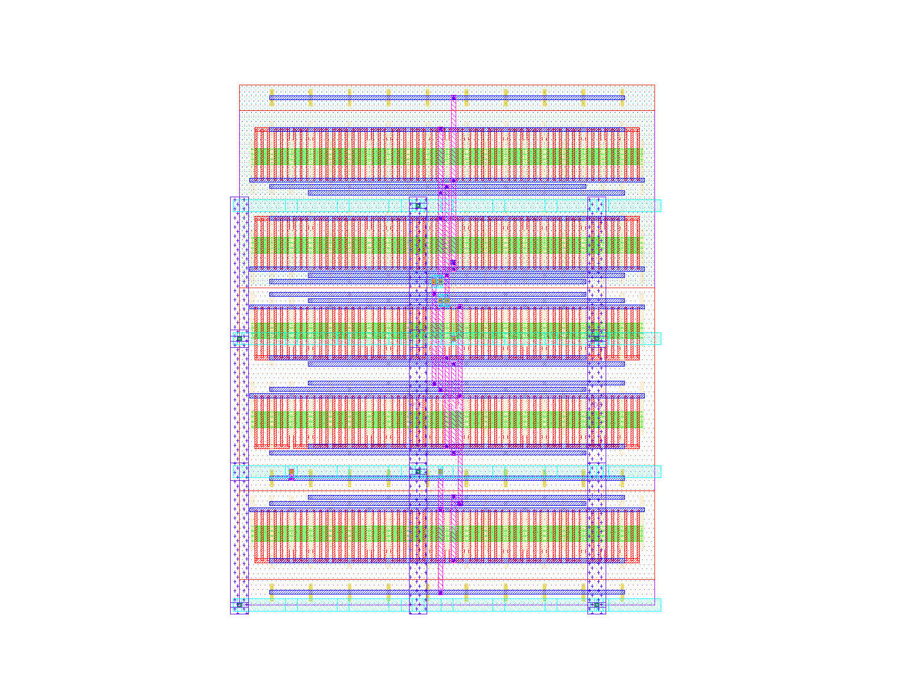 | 0 | match uniquely (300 devices after stack expansion) |
| ALIGN on **our** sized OTA | 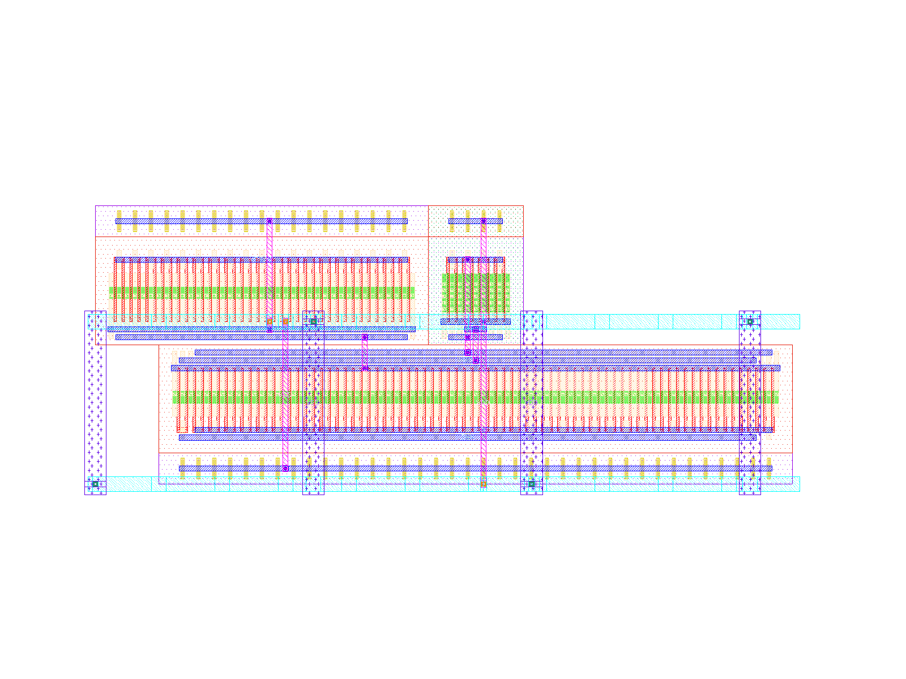 | 0 | topology match, **property errors**: every L drawn as 0.15 µm (sized: 0.5 / 1.0 µm); load W 8.4 vs 8 µm |
| MAGICAL on our sized OTA (mock PDK, not SKY130) | 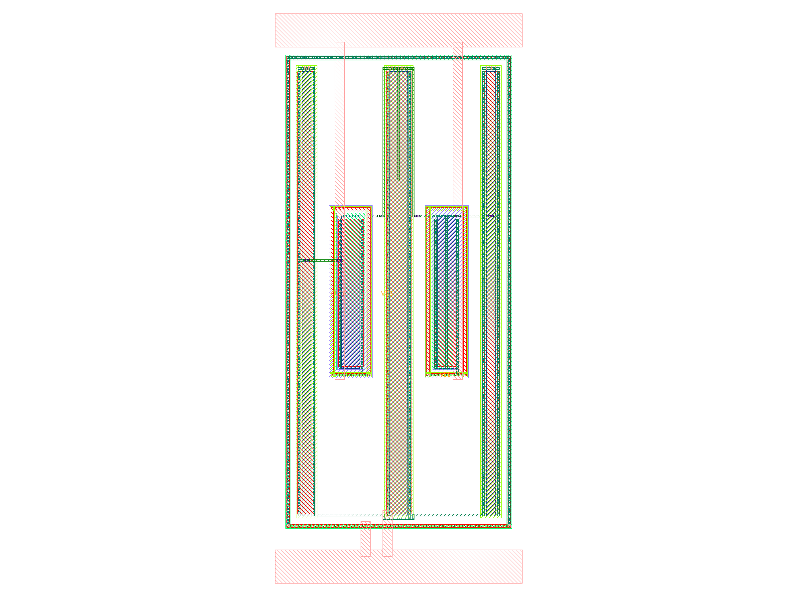 | not possible (mock PDK) | not possible |

**Conclusion.** ALIGN's SKY130 PDK draws a fixed 0.15 µm gate, so its layout of our OTA is DRC-clean but **not the sized circuit**. This led to decision D9: transistors are drawn by the SKY130 PCells themselves (Magic open_pdks), and ALIGN and MAGICAL are used only as references. Details: `docs/progress_log.md` (2026-10-23).

---

## 2. S0 — ingest, freeze, bind

**Purpose.** Turn the design package into one frozen, validated description:

- the circuit IR;
- every device bound to its SKY130 PCell;
- the upstream testbenches reproduced to every digit.

This is the reference for every later stage.

### 2.1 Inputs

| Input | File |
|---|---|
| Design package (the contract) | `inputs/example_ota_5t/package.yaml`; the stress variant `inputs/ota5t_stress/package.yaml` inherits it |
| Sized netlist | `circuits/example_ota_5t/source/example_ota_5t_sized.spice` |
| Specs and conditions | `circuits/example_ota_5t/source/config.yaml` |
| Schematic-simulated results | `circuits/example_ota_5t/source/measurements.json` |
| Testbenches | `circuits/example_ota_5t/testbenches/diso_amp_{AC,OP,NOISE}.spice` |
| Upstream hierarchy and symbolic equations (made for the 6-transistor `5t-ota`) | `circuits/5t-ota/source/{hierarchy,primitives,5t-ota_differential_equations}.json` |
| Name map from upstream onto our OTA | `inputs/example_ota_5t/name_map.yaml` |

The name map holds one **ASSUMPTION**. The upstream bias mirror {XM6, XM5} is mapped by hand onto our single tail device XM5, which takes its gate from V1.

The stress variant is the same circuit with **CL = 200 fF** and **ASSUMPTION** specs derived from what is achieved:

| Spec | Achieved | Spec limit | Margin |
|---|---|---|---|
| Gain | 31.697 dB | 31.197 dB | 0.5 dB |
| GBW | 373.65 MHz | 336.29 MHz | 37.4 MHz |
| PM | 65.08° | 60.08° | 5.0° |

The purpose of these tight margins is that layout parasitics will matter.

### 2.2 Commands

```bash
python3 -m src.s0.ingest inputs/example_ota_5t/package.yaml      # G0.1-G0.6
python3 -m src.s0.pcell_binding outputs/S0/example_ota_5t        # G0.7 (PCell DRC/LVS)
```

### 2.3 Outputs (`outputs/S0/<design>/`)

| File | Content |
|---|---|
| `circuit_ir.json` | Ports with roles, nets with connections, devices, internal sources, hierarchy blocks, conditions, specs, achieved values, margins, pending inputs, provenance (SHA-256 of every input) |
| `device_map.json` | Each device bound to its PCell (`magic::gencell sky130::...`), with the netlist-to-PCell parameter conventions |
| `pdk_config.yaml` | PDK, tool versions, rule decks, unit conventions |
| `ref/<design>_full.spice`, `ref/<design>_layout.spice` | Netlist written from the IR, plus the layout view (V1 removed, its node exposed as port VBIAS) |
| `tb/*.spice` | Upstream testbenches with the IR netlist substituted for the DUT |
| `pcell/XM*.gds`, `.png`, `drc_*/`, `lvs_*/` | PCell devices and their DRC/LVS runs |
| `pcell_binding.json` | G0.7 detail |
| `s0_report.json` | All gates, with evidence |

**Excerpt: `circuit_ir.json`** (one device, the internal source, one margin):

```json
"devices": [{"name": "XM3", "type": "pmos", "model": "sky130_fd_pr__pfet_01v8",
             "terminals": {"d": "net3", "g": "net3", "s": "VDD", "b": "VDD"},
             "W_um": 8.0, "L_um": 1.0, "nf": 1, "m": 1,
             "extra_params": {"AD": "2.32", "AS": "2.32", "PD": "16.58", "PS": "16.58", ...}, "source_line": 8}, ...],
"internal_sources": [{"name": "V1", "p": "net2", "n": "VSS", "value": "0.75",
                      "layout_handling": "removed in layout view; node exposed as port VBIAS"}],
"margins": {"pm_deg": {"kind": "min", "limit": 60, "achieved": 80.9348, "margin": 20.93, "units": "deg", "meets": true}, ...},
"pending_inputs": {"variation_ranges": "not provided (awaiting PSO range format)",
                   "net_symbol_map": "not provided by upstream (requested); S1 derives it from the level-0 netlist"}
```

**Excerpt: `device_map.json`:**

```json
{"device": "XM3", "polarity": "pmos", "model": "sky130_fd_pr__pfet_01v8",
 "netlist": {"W_um": 8.0, "L_um": 1.0, "nf": 1, "m": 1, "W_total_um": 8.0},
 "pcell": {"generator": "magic::gencell", "cell": "sky130::sky130_fd_pr__pfet_01v8",
           "params": {"w": 8.0, "l": 1.0, "nf": 1, "m": 1},
           "options": "defaults until S3 decides (guard, topc/botc, diffcov/polycov, via coverage)"},
 "conventions": {"netlist_W": "total width of one instance (xschem sky130); PCell w = W/nf per finger"}}
```

**Excerpt: `s0_report.json`** (gate G0.6, upstream results against our re-run):

```json
"G0.6_testbench_reproduction": {"pass": true, "tolerance_rel": 0.001, "compare": {
   "gain_db": {"upstream": 31.697, "rerun": 31.697, "ok": true},
   "gbw_mhz": {"upstream": 104.455, "rerun": 104.455, "ok": true},
   "pm_deg":  {"upstream": 80.9348, "rerun": 80.9348, "ok": true},
   "isup_ua": {"upstream": 84.7774, "rerun": 84.7774, "ok": true},
   "vnoise_nv_rthz": {"upstream": 339.064, "rerun": 339.064, "ok": true}, ...}}
```

### 2.4 Gates

| Gate | Check | example_ota_5t | ota5t_stress |
|---|---|---|---|
| G0.1 | Inventory: 5 MOSFETs, 1 source, 0 passives | PASS | PASS |
| G0.2 | Validation: models, W/L, no dangling nets or unconnected ports | PASS | PASS |
| G0.3 | Hash freeze: inputs unchanged since copied | PASS | PASS |
| G0.4 | Name map checked terminal by terminal; 3 blocks; bias block = manual ASSUMPTION | PASS | PASS |
| G0.5 | Round-trip LVS: netlist written from the IR vs. original, "match uniquely" | PASS | PASS |
| G0.6 | Upstream testbenches re-run on the IR netlist: identical to every digit | PASS | PASS (generated) |
| **G0.7** | **Every device drawn by its PCell: DRC 0, LVS match, both negative controls behave** | **PASS** | **PASS** |

Negative controls:

- **G0.5:** rewiring XM4's gate to INP makes the round-trip LVS fail (`runs/S0_negctl`).
- **G0.7:** a met1 sliver must give 1 DRC error, and a reference with L + 0.1 µm must be rejected by LVS.

### 2.5 G0.7: the DRC/LVS evidence for each device

The PCells are drawn with default options (S3 will choose guard rings, contact coverage and so on per device). The picture is the GDS rendered by KLayout with the SKY130 layer colours. Under each device is its verdict, read from `pcell_binding.json`.

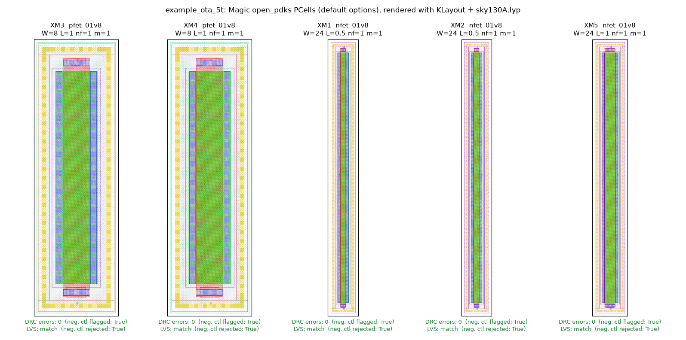

Below are the tool output lines themselves, copied verbatim from the Magic and Netgen logs:

- the positive run must show 0 DRC errors and "match uniquely" with no property differences;
- the negative controls must show 1 DRC error, and for LVS, property errors that the flow rejects.

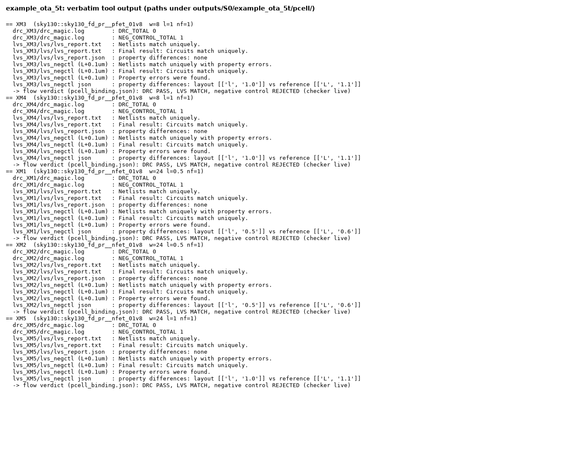

The stress variant uses the same five devices; its runs are in `outputs/S0/ota5t_stress/pcell/`:

- [montage](flow_record/img/ota5t_stress_pcell_montage.png)
- [evidence](flow_record/img/ota5t_stress_pcell_evidence.png)

**Excerpt: `pcell_binding.json`** (one device):

```json
{"device": "XM1", "pcell": "sky130::sky130_fd_pr__nfet_01v8", "params": {"w": 24.0, "l": 0.5, "nf": 1, "m": 1},
 "drc": {"errors": 0, "neg_control_flagged": true, "pass": true, "report": ".../pcell/drc_XM1/drc_report.txt"},
 "lvs": {"match": true, "neg_control_rejected": true, "pass": true, "pcell_instance": "sky130_fd_pr__nfet_01v8_LZQSHP",
         "report": ".../pcell/lvs_XM1/lvs/lvs_report.txt", "extracted": ".../pcell/lvs_XM1/lvs/extracted.spice"},
 "extracted": {"ad": "6.96", "pd": "48.58", "as": "6.96", "ps": "48.58", "w": "24", "l": "0.5"}, "pass": true}
```

The extracted netlist of XM1 (`lvs_XM1/lvs/extracted.spice`) shows that the drawn geometry gives back exactly the sized device:

```
.subckt sky130_fd_pr__nfet_01v8_LZQSHP B D S G
X0 S G D B sky130_fd_pr__nfet_01v8 ad=6.96 pd=48.58 as=6.96 ps=48.58 w=24 l=0.5
.ends
```

The extracted AD/PD/AS/PS also equal the values in the sized netlist (6.96 / 48.58). The diffusion areas and perimeters that S0 simulated are therefore the same ones the layout will have.

### 2.6 Problems met in S0, and fixes

| # | Problem | Fix |
|---|---|---|
| S0-1 | xschem netlists use `**.subckt` and `*.ipin/*.opin` comment lines | The parser accepts these explicitly; any other unknown element is a hard error |
| S0-2 | The source folder moved (Desktop\01_Research_Projects\Layout_Automation_LLM) | Access granted again; SHA-256 of the sources re-checked against `circuits/SOURCE_SHA256.txt`: identical |
| S0-3 | A first LVS of the PCell devices failed, although the devices were correct: in top-cell mode Magic prefixes the pins with the instance name (`M1_pc.D`) | `scripts/magic_lvs.sh` gained `LVS_MODE=subcell`, which compares the PCell subcell itself. The negative control is still rejected. |
| S0-4 | LVS false failures in Step 0: the reference was in metres; the extracted cell had no pins | Reference in µm (sky130 convention); `port makeall` in Magic |

---

## 3. S1 — electrical intent

**Purpose.** For every net and pair of nets, find out how much added capacitance moves each spec, how much would use up its margin, and why. This is the evidence that S2 turns into layout budgets.

### 3.1 Inputs

- `outputs/S0/<design>/circuit_ir.json`
- The S0 testbenches (`tb/diso_amp_OP.spice`, `tb/diso_amp_AC.spice`)
- The upstream equations and name map, as listed in `package.yaml`

### 3.2 Command

```bash
python3 -m src.s1.run inputs/example_ota_5t/package.yaml     # ~4 min first time (about 90 ngspice runs, 4 in parallel); reruns reuse identical runs
python3 -m src.s1.run inputs/ota5t_stress/package.yaml
python3 -m pytest -q tests/                                    # 21 tests: S0 (14) + S1 (7)
```

`tests/test_s1.py` checks the following without a simulator:

- the linear-model stamps against a hand-solved common-source stage (gain −gm/gds, 1/gds, CL);
- the GBW/PM definitions against the one-pole formula;
- that a feed-forward capacitance lowers PM;
- the charge-matrix convention check, which must reject the positive-capacitance form;
- deck editing (the capacitor goes only into the DUT);
- the name-map symbol mapping.

### 3.3 Method

1. **Operating point.** ngspice `op` on the S0 OP testbench. For each device it reads 32 BSIM4 instance values, including the full 4×4 intrinsic charge matrix and the overlap and junction capacitances.
2. **Exact linear model.** A nodal model of the whole circuit at that operating point:
   - each device contributes gm, gmbs, gds, the non-reciprocal charge matrix C_ij = dQ_i/dV_j, and its overlap and junction capacitances;
   - INP is driven with +0.5 and INN with −0.5, exactly as in the AC testbench;
   - gain, GBW and PM are computed with the same definitions and the same 40-points-per-decade grid as the testbench.
3. **Sensitivities.** From the linear model: central differences of ±1 fF, from every solved net to ground, and between every pair of signal nets.
4. **Ground truth.** A capacitor is inserted into the transistor-level DUT and the unchanged AC testbench is re-run, at +5 fF and +20 fF. This is done for every solved net and for the three coupling pairs that would use up a margin with the fewest fF.
5. **Upstream symbolic check.** The upstream hierarchical equations are evaluated with this operating point, mapped through the name map. This is reported only, not gated.

### 3.4 Outputs (`outputs/S1/<design>/`)

| File | Content |
|---|---|
| `operating_point.json` | Per-device operating-point values, saturation check, check of the capacitance-matrix convention |
| `linear_model.json` | Linear model against SPICE (gain, GBW, PM) |
| `sensitivity.json` | For each net and pair: linear-model, SPICE and symbolic slopes, plus the fF that would use up the margin |
| `node_classes.json` | Dominant and non-dominant pole nodes, mirror node, tail, bias, supplies |
| `currents.json` | Branch currents per net (input to the EM width rules in S2) |
| `intent.json` | Matching groups; nets and coupling pairs ranked by the fF that would use up a margin |
| `symbolic_check.json` | Upstream equations against SPICE |
| `plots/*.png` | Pictures below |
| `s1_report.json` | Gates G1.1–G1.5 with evidence |

### 3.5 Results

**G1.1 — operating point.**

- All 5 devices are in saturation.
- The supply current is 84.777 µA, the same as upstream.
- The charge matrix obeys charge conservation: rows and columns sum to zero within 3×10⁻⁶ of C_gg. This confirms the convention C_ij = dQ_i/dV_j.

**Excerpt: `operating_point.json`** (XM1; and XM5's saturation entry):

```json
"XM1": {"id": 4.239e-05, "vgs": 0.7189, "vds": 0.2194, "vdsat": 0.08938, "vth": 0.6647,
        "gm": 7.287e-04, "gds": 1.795e-05, "gmbs": 1.437e-04,
        "cgg": 5.966e-14, "cgs": -5.234e-14, "cgd": -1.407e-15, "cgso": 5.912e-15, "cgdo": 5.912e-15, "capbd": 1.296e-14, ...}
"saturation": {"XM5": {"vds": 0.18, "vdsat": 0.1604, "vds_minus_vdsat_V": 0.01957, "saturated": true}, ...}
```

> **Finding for S2:** the tail device XM5 is only **19.6 mV** inside saturation, and it carries 84.8 µA (`currents.json`, net1). A series resistance of about 230 Ω in the tail's source/drain path (VSS or net1 wiring) would use up that headroom. S2 needs an IR-drop budget for net1 and for the VSS connection of XM5, and not only capacitance budgets.

**G1.2 — the linear model reproduces transistor-level SPICE.**

| Design | | Gain (dB) | GBW (MHz) | PM (°) |
|---|---|---|---|---|
| example_ota_5t | SPICE (S0) | 31.697 | 104.455 | 80.935 |
| | linear model | 31.693 | 105.007 | 80.946 |
| | difference | −0.004 | +0.53 % | +0.011 |
| ota5t_stress | SPICE (S0) | 31.697 | 373.654 | 65.081 |
| | linear model | 31.693 | 375.698 | 65.101 |
| | difference | −0.004 | +0.55 % | +0.020 |

The tolerances are 0.2 dB, 3 % and 2°.

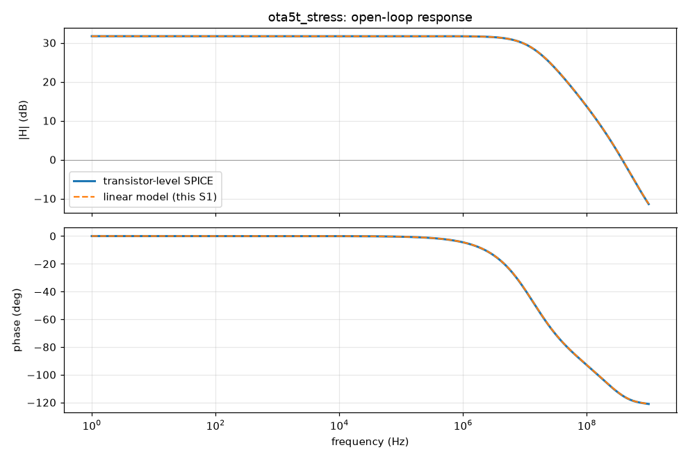

The same plot for example_ota_5t: [link](flow_record/img/example_ota_5t_s1_bode_linear_vs_spice.png).

**G1.3 — linear-model sensitivities against transistor-level SPICE.** The ten measurable checks for each design all pass.

| Design | Worst error | Where |
|---|---|---|
| example_ota_5t | 1.0 % | |
| ota5t_stress | ≤ 2.4 %, except one | net3 → PM: 17.6 %, a near-zero slope of 0.004–0.005 °/fF |

The error is measured against the SPICE slope extrapolated to zero step. Gain is a 1 Hz quantity and does not depend on any capacitance; it is listed as below resolution.

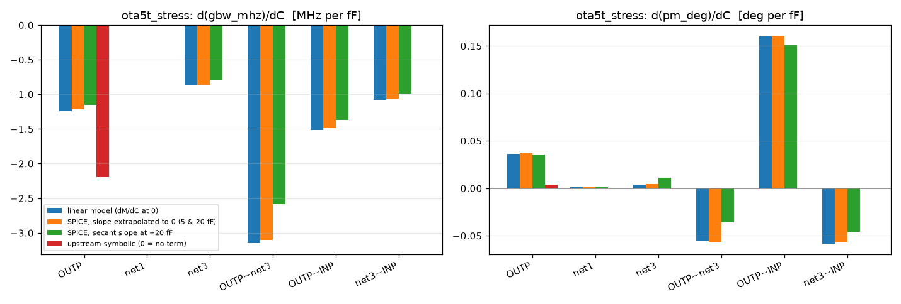

The same plot for example_ota_5t: [link](flow_record/img/example_ota_5t_s1_sensitivity_comparison.png).

**Excerpt: `sensitivity.json`** (stress; net3 and the tightest pair):

```json
"net3":      {"gbw_mhz": {"linear_per_fF": -0.8747, "symbolic_per_fF": 0.0,
                          "symbolic_note": "no element for this node in the level-2 performance expressions",
                          "spice_per_fF": {"5fF": -0.8444, "20fF": -0.7948}, "fF_to_consume_margin": 42.72},
              "pm_deg":  {"linear_per_fF": 0.003969, "spice_per_fF": {"5fF": 0.0064, "20fF": 0.01116}}, ...}
"OUTP~net3": {"gbw_mhz": {"linear_per_fF": -3.152, "spice_per_fF": {"5fF": -2.974, "20fF": -2.589}, "fF_to_consume_margin": 11.85},
              "pm_deg":  {"linear_per_fF": -0.05575, "spice_per_fF": {"5fF": -0.05182, "20fF": -0.03596}, "fF_to_consume_margin": 89.68}}
```

**Electrical intent — what S2 must protect** (`intent.json`). The tables give the first-order fF that would use up the margin of the most limiting spec.

Nets, capacitance to ground:

| Rank | Net | Role (`node_classes.json`) | ota5t_stress | example_ota_5t |
|---|---|---|---|---|
| 1 | OUTP | output, dominant pole (CL = 200 fF already on it) | 30 fF (GBW) | 892 fF (GBW) |
| 2 | net3 | mirror node, non-dominant pole (≈ 313 MHz; corrected from 614 MHz, see 3.9) | 43 fF (GBW) | **329 fF (PM)** |
| 3 | net1 | tail (source-coupled); virtual ground for differential signals | 12 pF | 331 pF |

Coupling pairs (ranked for the stress design; the example column gives the same pair's value):

| Rank | Pair | Mechanism | ota5t_stress | example_ota_5t |
|---|---|---|---|---|
| 1 | **OUTP~net3** | output fed back to the mirror gate | **12 fF (GBW)** | 178 fF (PM) |
| 2 | OUTP~INP | feed-forward and Miller coupling around the gain stage | 25 fF (GBW) | 817 fF (GBW) |
| 3 | net3~INP | input coupled to the mirror node | 35 fF (GBW) | 240 fF (PM) |

The matching groups agree with MAGICAL's own constraint extraction in Step 0:

- {XM1, XM2}, diff pair: equal size, gm spread 0.00 %;
- {XM3, XM4}, mirror: equal size, gm spread 0.00 %.

**Excerpt: `intent.json`:**

```json
"critical_nets": [{"net": "OUTP", "most_limiting_spec": "gbw_mhz", "fF_to_consume_margin": 30.09,
                   "per_fF": {"gain_db": 0.0, "gbw_mhz": -1.242, "pm_deg": 0.03596},
                   "classes": ["signal_output", "dominant_pole"], "rank": 1}, ...],
"coupling_pairs_ranked": [{"pair": "OUTP~net3", "most_limiting_spec": "gbw_mhz", "fF_to_consume_margin": 11.85,
                           "per_fF": {"gain_db": 0.0, "gbw_mhz": -3.152, "pm_deg": -0.05575}, "rank": 1}, ...]
```

**G1.5 — the upstream symbolic model, checked against SPICE.** Reported, not gated.

| Design | | Gain (dB) | GBW (MHz) | PM (°) | d(GBW)/dCL (MHz/fF) |
|---|---|---|---|---|---|
| example_ota_5t | symbolic | 31.36 | 108.4 | 91.3 | −0.106 |
| | SPICE / linear | 31.70 | 104.5 | 80.9 | −0.095 |
| ota5t_stress | symbolic | 31.36 | 493.7 | **90.6** | **−2.19** |
| | SPICE / linear | 31.70 | 373.7 | **65.1** | **−1.24** |

The level-2 expressions of the upstream model have no element for the mirror node, so:

- its prediction of PM is optimistic by 10° (example) and **25° (stress)**;
- its sensitivity to net3 is zero.

In SPICE, net3 is the second most critical net, and part of the tightest coupling pair. This is the measured cost of the missing Ioutn→Ioutp term. That term is already an open request to the upstream stage, and novelty point N2 (symbolic recomposition) depends on it. **Section 3.9 explains the problem and shows a fix on a patched copy of the equations.**

### 3.6 Problems met in S1, and fixes

| # | Problem | Fix |
|---|---|---|
| S1-1 | Reading the BSIM4 instance values with `echo $&@dev[param]` is not reliable in ngspice batch mode | `let s1v = @dev[param]`, then `echo`, with `set numdgt=12`. All 27 essential and 5 optional values are read for each device. |
| S1-2 | PMOS values are reported in the device's own frame (Id > 0, Vds > 0) | The saturation check uses magnitudes. The small-signal stamps do not change (gm and C are derivatives, so they are invariant to the sign flip). Both are confirmed by G1.2. |
| S1-3 | The Bode plot was missing on the first run (the work folder had not been created) | `mkdir`, plus an explicit error if the AC deck has no `write` line to anchor on |
| S1-4 | **The first G1.3 criterion failed on one case.** It compared the linear slope with the SPICE secant slope at +20 fF, within 20 %. Stress, net3 → PM: linear 0.0040 °/fF against SPICE 0.0112 °/fF (+20 fF) and 0.0064 °/fF (+5 fF). The two SPICE step sizes disagree by 43 %, because the slope is near zero and dominated by curvature. | The criterion now compares like with like. The linear model gives dM/dC at C = 0, so it is compared with the SPICE slope extrapolated to zero step, s₀ = (4·s₅ − s₂₀)/3 (net3 → PM: 0.0048, error 17.6 %). A second, budget-relevant criterion is reported next to it: the error of the first-order prediction at +20 fF as a fraction of the spec margin (≤ 5 %). The rule is applied to both designs, and every check reports both numbers. |
| S1-5 | The SPICE cross-check first picked coupling pairs by \|dPM/dC\|. It missed the tightest pair of the stress design, OUTP~net3 (12 fF uses up the GBW margin). | Pairs are now picked by the fF that would use up a margin, the same ranking as `intent.json` |
| S1-6 | A file sent to the PC under a name used before arrived as the old version, so one S1 run used old code | Each upload now gets a new file name, and its md5 is checked before use. The runs were then repeated. |

### 3.7 What S1 hands to S2

1. **Budgets come from the linear model, and SPICE checks them.**
   - The linear model reproduces SPICE to 0.004 dB, 0.6 % and 0.02°.
   - Its slopes are within 2.4 % of SPICE, except for one near-zero slope.
   - The first-order prediction is **conservative** for the tightest coupling: OUTP~net3, GBW, −3.15 MHz/fF predicted against −2.59 MHz/fF at +20 fF.
   - Even so, S2 will verify the joint budget by inserting every budgeted capacitance at once and re-running SPICE.
2. **Stress-design budgets are tens of fF**, in this order:

   | Element | First-order fF that use up the margin |
   |---|---|
   | OUTP~net3 | 12 |
   | OUTP~INP | 25 |
   | OUTP to ground | 30 |
   | net3~INP | 35 |
   | net3 to ground | 43 |

   These must be shared out jointly (N1), because they all draw on the same GBW margin.
3. **There is an IR-drop budget for the tail.** XM5 has 19.6 mV of saturation headroom at 84.8 µA.
4. **Matching groups** for S4: {XM1, XM2} and {XM3, XM4}.

---

### 3.8 S1 extension: series resistance at device terminals (added 2026-10-25 evening)

**Why it was added.** In my own review of S1, two things were missing:

- **Resistance was not covered at all.** Wiring and PCell access resistance sit in series with every transistor terminal. S3's PCell options (fingers, gate contacts, contact coverage) change exactly these resistances.
- **Noise and DC headroom were not covered.** The tail transistor XM5 has only 19.6 mV of headroom.

**Method** (`src/s1/resistance.py`, `linear.py`, `run.py`):

1. **Pair variables for matched devices.** Matched devices are wired symmetrically (an S2 hard rule). So the resistance at a matched terminal is varied on both devices together, e.g. `XM1+XM2.s`. That gives 9 terminal groups.
2. **Linear model.** The device terminal is split onto a new node, with the resistor between it and the net.
3. **Transistor-level SPICE** at 20 Ω and 100 Ω:
   - AC (gain, GBW, PM);
   - NOISE (thermal noise of the resistor included);
   - DC operating point (Vds − Vdsat of every device, supply current).

   The slope is extrapolated to zero, as for capacitance.
4. **Offset from a one-sided resistor** on one device of a pair, measured in a **unity-gain follower** (Vinn tied to OUT). This gives the systematic input offset per Ω.

**Finding: half of the resistance effects are bias shifts, not small-signal effects.** For several terminals the linear model at the original operating point disagrees with SPICE, e.g. tail source XM5.s on GBW: −0.0002 against −0.24 MHz/Ω. The reason: I·R moves the DC operating point, which changes gm and gds.

This was proved, not assumed. The linear model was re-solved at the operating point that SPICE finds with the resistor inserted. It then reproduces the SPICE change for every case, e.g. XM5.s at 100 Ω: GBW −23.1 MHz (model) against −22.9 MHz (SPICE).

From this follow two rules:

- S2 takes resistance rates from SPICE.
- The linear model explains them.

| G1.6 (resistance) | example_ota_5t | ota5t_stress |
|---|---|---|
| Measurable checks | 16 | 20 |
| Passed | 16 | 20 |
| Small-signal (linear model agrees directly) | 4 | 5 |
| Bias shift, confirmed by re-solving at the shifted operating point | 12 | 15 |
| Unexplained | 0 | 0 |

**Critical terminals in the stress design** (`intent.json`), by the resistance that alone uses up a margin. Resistances are per device; both devices of a pair get it.

| Rank | Terminal group | Ω | Limiting check |
|---|---|---|---|
| 1 | XM1+XM2.s (pair sources) | 151 | GBW |
| 2 | XM5.s (tail source) | 154 | GBW (tail current drops) |
| 3 | XM3+XM4.s (mirror sources) | 174 | gain |
| 4 | XM1+XM2.d | 211 | gain |
| 5 | XM5.d | 244 | DC headroom of XM5 |
| 6 | XM1+XM2.g (input gates) | 522 | PM (gate RC pole) |

**Systematic offset of a one-sided resistor** (follower bench; `sensitivity_r.json` → `mismatch_offset`):

| Terminal | Offset | Ω per mV of offset |
|---|---|---|
| XM1.s / XM2.s | −50.6 / +50.2 µV/Ω | ≈ 20 |
| XM3.s / XM4.s | +14.2 / −15.4 µV/Ω | ≈ 65–70 |
| Drains | ≤ 1 µV/Ω | |
| Gates | 0 | |

There is no offset spec in the design package, so S2 records these as "Ω per mV" rules with status `not_evaluated`. **Request:** an offset spec.

### 3.9 The pole drop-out problem, and an input-side fix (added 2026-10-25 night)

**What the problem is.** In the 5T OTA the input signal reaches the output by two paths:

- **direct:** the input transistor on the output side (XM2) pushes its signal current straight into OUTP;
- **mirrored:** the other input transistor (XM1) pushes its current into the diode-connected PMOS XM3 at net3, and XM4 copies it into OUTP.

The mirrored half must first charge the capacitance at net3 (the two PMOS gates and the drains there, 116.5 fF) through the diode's resistance (1/gm₃ ∥ ro ≈ 4.36 kΩ). That is a pole at f_m = 1/(2π · 4.36 kΩ · 116.5 fF) ≈ **313 MHz**. Because only half of the signal goes through it, a zero comes with it at about twice that frequency: a **pole–zero doublet**. Above f_m the mirrored half fades: the gain falls faster and the phase lags more.

The upstream level-2 template keeps the mirrored path's **DC value** (it is folded into G2_X1) but drops its **dynamics**: the coupling Ioutn → Ioutp (G12_X1_X1) is listed under `"missing"` in the file itself. So the mirror pole "drops out" of the closed-form gain, GBW and PM. The measured cost (G1.5):

| | example_ota_5t | ota5t_stress |
|---|---|---|
| PM error (symbolic − SPICE) | +10.4° | **+25.5°** |
| GBW error | +3.8 % | **+32 %** |
| d(GBW)/dCL, symbolic vs SPICE | −0.106 vs −0.094 MHz/fF | −2.19 vs −1.20 MHz/fF |
| Sensitivity to net3 | 0 (by construction) | 0 (by construction) |

The stress design suffers most because its crossover (374 MHz) lies above f_m; in the example it lies at 104 MHz, three times below.

**Can it be fixed from the input side, by adding a known equation to the file?** Yes. The file already builds the mirror node's elements at level 2, it only never uses them in its performance block:

| Level-2 symbol (already in the file) | Meaning |
|---|---|
| `R1_X1` = R1_X1_X1 ∥ R1_X1_X2 | resistance at Ioutn (= net3): diode 1/gm ∥ ro |
| `C2_X1` = C12_X1_X1 + C1_X1_X1 + C2_X1_X2 | capacitance at Ioutn to ground |
| `C5_X1` | capacitance from Ioutn to Vinn (input Cgd) |
| `G2_X1` = G12·G1·R1 + G2_X1_X2 | total DC transconductance: mirrored + direct |

Two textbook corrections were written into **copies** of the file (`inputs/example_ota_5t/upstream_patched/`); the original is unchanged (md5 `7560056733d7be440f1112f46bb3a45f`, no git change):

- **P1, mirror doublet** (only symbols the file already defines):
  `Gm(s) = G2_X1_X2 + (G2_X1 − G2_X1_X2) / (1 + s·τm)`, with `τm = R1_X1·(C2_X1 + C5_X1)`.
  The direct half is instant; the mirrored half passes the mirror pole. PM gains the terms `− atan(ωu·τm) + atan(ωu·τz)`, τz = τm/(1 + G12·R1) (zero at ≈ 2 f_m). ωu is solved exactly for this magnitude model (a quadratic in ω²).
- **P2, + transcapacitance.** BSIM4 charges are not reciprocal: in saturation the drain charge follows the gate (C_dg = −20.0 fF for the input device, while C_gd = −1.4 fF). The level-0 primitive (C1–C5, G1, G2, R1) has no element for this. The quasi-static textbook result is `gm(s) = gm − s·Cm`, with `Cm = Cdg − Cgd ≈ (2/5)·Cgs` in saturation. It is written with C2 (gate-source), a level-0 symbol the file already has. It adds `− atan(ωu·Cm/gm)` to PM and shifts the doublet zero.

**Excerpt: patched copy P2** (`5t-ota_differential_equations.P2.json`, `performance.terms` and `pm_deg`; the original block is kept as `performance_original`, and a `patch` block records the reason, the changes, the assumptions and the references):

```json
"tau_m": "R1_X1*(C2_X1 + C5_X1)",
"Cm_in": "2*C2_XM3/5",  "Cm_p": "2*C2_XM2/5",
"tau_z": "(tau_m - Cm_p*R1_X1)/(1 + G12_X1_X1*R1_X1)",
"wu_d":  "sqrt((-(1 - wu0**2*tau_z**2) + sqrt((1 - wu0**2*tau_z**2)**2 + 4*tau_m**2*wu0**2))/(2*tau_m**2))",
"wu":    "wu_d*sqrt(1 + (wu_d*Cm_in/G1_X1_X2)**2)",
"pm_deg": "180 - 180*(atan(C6_X1*wu/G2_X1) + atan(R2_X1*wu*(C4_X1 + C6_X1 + CL)) + atan(wu*tau_m) - atan(wu*tau_z) + atan(wu*Cm_in/G1_X1_X2))/pi"
```

**Results** (`outputs/S1/<design>/symbolic_patch_check.json`; the same evaluator as G1.5 reads every copy):

| Design | Quantity | Upstream original | P1 + doublet | P2 + transcap. | SPICE |
|---|---|---|---|---|---|
| example_ota_5t | PM (°) | 91.34 | 82.84 | **80.23** | 80.93 |
| | GBW (MHz) | 108.43 | **104.41** | 104.04 | 104.46 |
| | d(GBW)/dCL (MHz/fF) | −0.106 | −0.095 | −0.094 | −0.094 |
| | d(GBW)/dC_net3 (MHz/fF) | 0 | −0.059 | −0.062 | −0.059 |
| | d(PM)/dC_net3 (°/fF) | 0 | −0.059 | −0.057 | −0.063 |
| ota5t_stress | PM (°) | 90.62 | 73.20 | **65.21** | 65.08 |
| | GBW (MHz) | 493.69 | **373.58** | 363.71 | 373.65 |
| | d(GBW)/dCL (MHz/fF) | −2.19 | −1.27 | **−1.19** | −1.20 |
| | d(GBW)/dC_net3 (MHz/fF) | 0 | −0.76 | −0.75 | −0.84 |

SPICE slopes are the S1 finite differences at +5 fF. Gain is unchanged by both patches (−0.33 dB vs SPICE in all three); that offset is a separate DC effect, not diagnosed yet.

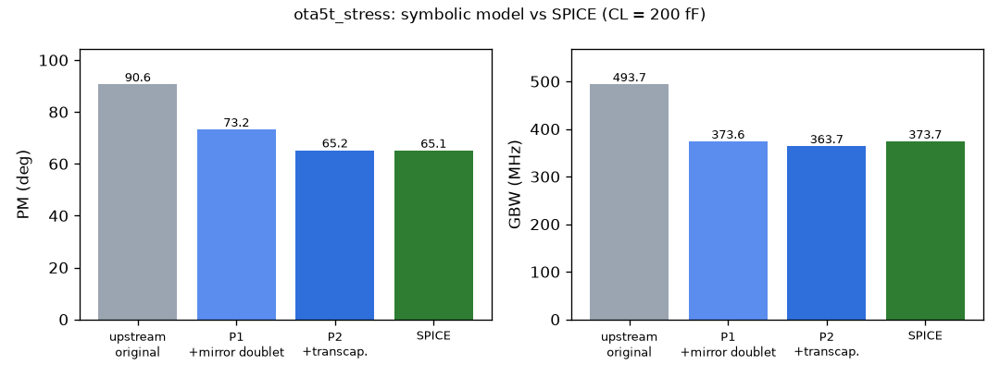

The same plot for example_ota_5t: [link](flow_record/img/example_ota_5t_s1_symbolic_patch.png).

**How much of the agreement is real** (checks in the same file):

- **Closed form vs exact.** The same patched H(s) solved exactly (rational function, |H| = 1 found numerically) gives stress P1 375.0 MHz / 73.0°, P2 365.3 MHz / 65.0°. The closed-form ωu and PM are therefore within 0.4 % and 0.2° of their own model.
- **The (2/5)·Cgs shortcut.** From the OP, Cm = |cdg| − |cgd| = 18.6 fF (input) and 15.4 fF (PMOS), against (2/5)·Cgs = 23.3 and 17.5 fF. With the OP values, P2 gives 66.3° (stress) and 80.6° (example). The fair accuracy claim for P2 is therefore **about ±1.5° in PM and −2 to −3 % in GBW**; the 0.1° agreement on the stress design is partly luck.
- **Cross-check with the exact nodal model of S1.** With reciprocal capacitances (the symbolic convention) instead of the BSIM4 charge matrix, the exact model gives 72.0° (stress) and 82.2° (example). P1 reproduces these within 1.2°, so P1 captures the topology. The remaining ~7° (stress) are the transcapacitance, which P2 adds.

**Correction of an earlier statement.** Sections 3.5 and the previous status note gave the mirror pole as ≈ 614 MHz. That figure used the DC driving-point resistance at net3 in the full model (2.58 kΩ). That value includes a loop through the output (output → gds of the input device → tail → the other input device → net3), which the output capacitance shorts out at high frequency. It also used the diagonal of the BSIM4 charge matrix (100.6 fF), which already contains the transcapacitance. The pole that predicts the response is **≈ 313 MHz**: adding it reproduces SPICE's GBW to 0.01 % (example) and 0.35 % (stress).

**What this means for the flow:**

1. The upstream equations can be repaired **on the input side**: P1 uses no new symbols, P2 uses one textbook relation on an existing symbol. The original file stays read-only.
2. The exact fix remains the upstream request: model the Ioutn → Ioutp coupling in the level-2 template, and give the level-0 primitive a transcapacitance element (Cm). P1/P2 are what that fix should reproduce.
3. The S1 gates still use the original file (G1.5 reports it), and the budgets come from the exact linear model. The patched copies are reported next to them, so nothing downstream changed.
4. For N2 (symbolic recomposition), P2 is the first version that gives the right sign and size of the mirror-node sensitivity. This is needed before symbolic budgets can replace the linear model.

Command (inside `layout-s0s3`):

```bash
python3 -m src.s1.symbolic_patch inputs/example_ota_5t/package.yaml inputs/ota5t_stress/package.yaml
```

---

## Supervisor review 1 (after S1, before S2/S3)

I reviewed the work myself, then asked an independent reviewer (a separate agent that saw only the code and the stage goals, not my conclusions) to find faults. All findings and what was done about them:

| # | Finding | Severity | Action |
|---|---|---|---|
| R1 | No resistance, noise or DC-headroom sensitivities in S1 | high | Added (section 3.8) |
| R2 | A one-sided resistor on a matched pair looked like a large gain change. It is an offset, which the open-loop bench turns into an output shift | high | Pair variables for the budgets; offset measured separately in a follower bench |
| R3 | Gates could pass when a simulation failed (empty lists, `all([]) == True`) | high | Missing measurements or a non-zero exit code now FAIL. S3 asserts that every device was really replaced in the deck |
| R4 | The S2 budget check tested only "spec still met" (100 % of the margin) with all parasitics inserted, so helpful ones offset harmful ones | high | Per check, only the parasitics harmful for it are inserted. Use must be ≤ η·margin (+10 % model tolerance). A closure iteration rescales if not |
| R5 | The S3 allowance was not in S2's terms; a smaller junction capacitance could earn credit | high | Resistance checked in Ω against the S2 budget. Cell capacitance charged harmful-only against the net-capacitance margins. The unused Ω are handed to S5 |
| R6 | "Bias shift" label assigned by elimination | medium | Proved by re-solving the linear model at the shifted operating point (section 3.8) |
| R7 | Budgets could grow without limit; elements that are free in every check got no rule | medium | Cap at κ = 10 × expected need (ASSUMPTION), plus default rules |
| R8 | Max-route-length rules used over-field C, which is the minimum, so they are not conservative | medium | Also measured over a plate of the layer below (≈ 2× larger); rules use the larger value |
| R9 | Silent zeros: unknown net names grounded; a failed ngspice `let` kept the previous value; missing Miller overlap capacitances defaulted to 0; ground hard-coded as "VSS" | medium | Names asserted; one vector per value; `cgso/cgdo/cgbo` made essential; ground taken from the port role |
| R10 | The bias node is ideal AC ground in the testbench | medium | Labelled ASSUMPTION; `route.bias_net` rule `not_evaluated` |
| R11 | Access-R model missed li spreading for reduced contact coverage; `rgatemod = 0` stated, not checked | medium | li term added; gate G3.6 now reads `rgatemod` from the model cards |
| R12 | Supply-net currents were halved (sum/2 used for VDD/VSS) | low | `trunk_A` = sum for supply/ground nets, sum/2 for internal nets |
| R13 | Single-block nets double-counted in the hierarchy split | low (latent) | Top-level share 0; the sum check is exact |
| R14 | Robustness: the diso bench names (`Vinn`, `OUT`, `vsup`, `x1.xdut`) are hard-coded | low | Kept; documented as a limit for new benches |
| R16 | (found while checking the first S3 results) S2's expected need held only wiring, yet the device cells themselves put about 1 fF of gate-drain coupling on the pair, more than the stress coupling budgets. S3's fixed 50 % share of every budget did not match S2's split either | high | The S3 option library is built before S2. S2's expected need = wiring + the measured default cells. S3's share of each budget = the cells' share of that need. Margin S2 leaves unallocated is shared by the device types. G2.0 reports the margin a compact default layout would use |
| R17 | (found by checking a suspicious number: a PMOS cell raised the supply current by 10 µA) Magic's substrate node VSUBS floated inside the cell subcircuit, ngspice's gmin stepping then converged to a wrong operating point | high | VSUBS becomes a port tied to ground. Any run whose log reports numerical trouble (singular matrix, failed gmin/source stepping, no convergence) counts as failed in S1–S3. Unit tests cover both |
| R18 | (S3) In the relaxation case the "largest slack" option could be one that changes the device model a lot, e.g. XM5 with nf = 8 moves GBW by 22 MHz | medium | When nothing fits, the default PCell (the device exactly as sized) is kept, and the type is flagged |

**Self-review of the allocation policy** (after the first S2 run, R15):

- **What I saw.** Max-min fairness froze elements whose rate in the binding check was negligible. Example: the PMOS drain resistance costs 1.5e-4 °/Ω of PM, yet it was held to the same 0.86 × need as the critical elements. In S3 this would have forced an impossible requirement on the PMOS (585 Ω per pdiff contact).
- **Fix.** A phase 2 keeps at least 95 % of every max-min budget and maximises Σ log(x/w) (proportional fairness) over what is left (`budgets.refine`; δ = 5 % is an ASSUMPTION).

## 4. S2 — requirement compiler: budgets and rules

**Purpose.** Turn S1's sensitivities into numbers a layout tool must obey and a checker can verify:

- how many fF each net and each net pair may receive;
- how many Ω each device terminal may have in series;
- the rules derived from these.

Every budget is checked in SPICE before it is handed on.

### 4.1 Inputs

| Input | File |
|---|---|
| Sensitivities | S1 `sensitivity.json` (capacitance, linear model) and `sensitivity_r.json` (resistance: SPICE, incl. noise and DC headroom) |
| Margins | S0 `circuit_ir.json` |
| Matching groups, currents | S1 `intent.json`, `currents.json` |
| Device cell sizes (for the expected-need estimate) | S0 PCell GDS |
| Per-µm interconnect parasitics | `outputs/S2/pdk/parasitics.json` (below) |

### 4.2 Commands

```bash
python3 -m src.s2.pdk_parasitics                         # once per PDK (Magic test wires)
python3 -m src.s2.run inputs/ota5t_stress/package.yaml   # about 1 min (16 ngspice runs); eta 0.9 from the package
python3 -m src.s2.run inputs/example_ota_5t/package.yaml # eta 0.5 (default)
```

η is taken from `--eta` if given, else from the package key `eta`, else 0.5. The value used and where it came from are written to `budgets.json` (`eta`, `eta_source`).

### 4.3 Interconnect parasitics measured on the PDK (`outputs/S2/pdk/parasitics.json`)

- **Widths and spacings** are read from the Magic DRC rules (rule ids in the file).
- **Sheet and contact resistance** are read from the extract section of `sky130A.tech`.
- **Capacitance** is measured by extracting 50 µm and 100 µm wires with Magic. The per-µm value is the difference divided by 50, which removes the end effects. Each wire is measured in two environments:
  - over field;
  - over a plate of the layer below.

| Layer | Min W / S (µm) | R (Ω/µm at min W) | C over field (aF/µm) | C over the layer below (aF/µm) | Coupling at min S (aF/µm) |
|---|---|---|---|---|---|
| li1 | 0.17 / 0.17 | 75.3 | 87.7 | 133.4 (poly) | 41.1 |
| met1 | 0.14 / 0.14 | 0.893 | 84.8 | 158.4 (li1) | 56.4 |
| met2 | 0.14 / 0.14 | 0.893 | 78.0 | 183.2 (met1) | 56.8 |
| met3 | 0.30 / 0.30 | 0.157 | 85.7 | 198.5 (met2) | 52.9 |
| met4 | 0.30 / 0.30 | 0.157 | 75.9 | 198.5 (met3) | 54.0 |

Contact resistances from the tech file:

| Contact | Ω per contact |
|---|---|
| licon on n-diffusion | 185 |
| licon on p-diffusion | **585** |
| licon on poly | 152 |
| mcon | 9.3 |
| via1 | 4.5 |

Poly sheet resistance: 48.2 Ω/□. Length rules use the larger of the two capacitance environments.

### 4.4 Method

1. **Elements.** There are 21 per design:
   - 3 nets to ground;
   - 9 coupling pairs;
   - 9 terminal-resistance groups (matched pairs varied together).
2. **Expected need of every element.** This is what a compact layout would put there. It has two parts:
   - **wiring**, estimated from the PCell sizes and the measured per-µm values;
   - **the default device cells themselves**, measured: the capacitances Magic extracts inside each default cell (nf = 1, both gate contacts, full contacts) are mapped onto the circuit's nets, and the cell's access resistance comes from the S3 option library.

   The second part was added after supervisor finding R16 (below). That is why the S3 option library (design independent) is now built **before** S2.
3. **Constraints.** Gain, GBW, PM, input noise, and the DC headroom of each of the 5 transistors. Each gets Σ (harmful rate × budget) ≤ η × margin. η = 0.5 by default (ASSUMPTION, accepted); **the stress variant uses η = 0.9** (your decision, 2026-10-25; key `eta: 0.9` in `inputs/ota5t_stress/package.yaml`).
4. **Allocation.**
   - **Phase 1:** max-min fair progressive filling in units of expected need, cross-checked by an LP (HiGHS) for the first round.
   - **Phase 2:** keep ≥ 95 % of every phase-1 budget and maximise Σ log(budget/need), so cheap elements get more.
   - **Cap:** 10 × need (κ, ASSUMPTION).
5. **Hierarchical split (N1).** Each net budget is shared between the blocks that touch the net (their port share) and the top-level route (`hierarchy.json`).
6. **Rule IR** (`constraints.json`):

   | Class | Count |
   |---|---|
   | budgets | 21 |
   | derived routing rules (max route length per layer, max parallel run at min spacing, max series R) | 57 |
   | hard and soft rules | 23 |

   It also contains:
   - matching rules;
   - offset rules (`not_evaluated`: no offset spec);
   - EM width rules (`not_evaluated`: no SKY130 EM data; currents recorded);
   - the latch-up rule (ASSUMPTION);
   - the bias-net rule (`not_evaluated`).
7. **Verification in SPICE (H1).** For every check, all the parasitics harmful to it are inserted at their full budget at once. The margin used must be ≤ η·margin (+10 % for first-order model error), and the spec must still be met. If not, a closure iteration scales the check's elements down.

### 4.5 Results

**G2.0, before any layout: the fraction of each margin a compact layout with the default device cells would use** (Σ rate × expected need). This is the D6 "layout sensitivity" metric, obtained analytically:

| Check | example_ota_5t | ota5t_stress |
|---|---|---|
| GBW | 0.06 | **0.90** |
| PM | 0.08 | **0.66** |
| Gain | 0.08 | 0.29 |
| Noise | 0.02 | 0.02 |
| XM5 headroom | 0.13 | 0.13 |

For the stress design, a compact layout is expected to use 90 % of the GBW margin and 66 % of the PM margin. G2.0 does not depend on η. What η changes is how the budgets compare with this need:

| Stress run | Budgets ÷ expected need (binding elements) | Outcome in S3 |
|---|---|---|
| η = 0.5 (previous run, commit 4cf69ba) | 0.53 | no option of any device type fits |
| **η = 0.9 (current)** | **0.948** (phase 1 gives 0.998; phase 2 trims to 95 %, see R19) | input pair optimised; PMOS mirror and tail miss by 5.5 % |

S2 says this before any layout is drawn, and S3 confirms it (section 5).

| Gate | example_ota_5t | ota5t_stress |
|---|---|---|
| G2.0 expected layout use | INFO | INFO (GBW 0.90 ≈ η = 0.9) |
| G2.1 every target resolves | PASS | PASS |
| G2.2 units and provenance on every rule | PASS | PASS |
| G2.3 allocation feasible, LP cross-check equal, reproducible, phase 2 converged | PASS | PASS |
| G2.4 first-order vs exact linear model | INFO | INFO |
| **G2.5 SPICE verification, every check** | **PASS** (no closure) | **PASS** (no closure) |
| G2.6 hierarchy shares sum exactly | PASS | PASS |

**SPICE verification** (`verification.json`; each check with its harmful budgets inserted at once):

| Check | Stress η = 0.9: allowed | predicted | SPICE | fraction of margin | Stress η = 0.5 (previous): fraction | Example η = 0.5: fraction |
|---|---|---|---|---|---|---|
| GBW | 33.63 MHz | 33.63 | 31.46 | **0.84** | 0.48 | 0.34 |
| PM | 4.50° | 3.84 | 3.68 | **0.74** | 0.45 | 0.40 |
| Gain | 0.45 dB | 0.192 | 0.195 | 0.39 | 0.21 | **0.54** (predicted 0.50; inside the 10 % tolerance) |
| Noise | 54.8 nV/√Hz | 0.89 | 0.87 | 0.01 | 0.01 | 0.09 |
| XM5 headroom | 17.6 mV | 2.57 | 2.56 | 0.13 | 0.07 | 0.49 |

At η = 0.9 every check still passes in SPICE without a closure iteration, and the first-order prediction stays conservative (GBW: 33.6 predicted, 31.5 simulated).

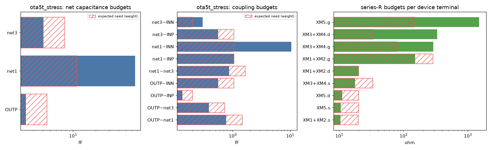

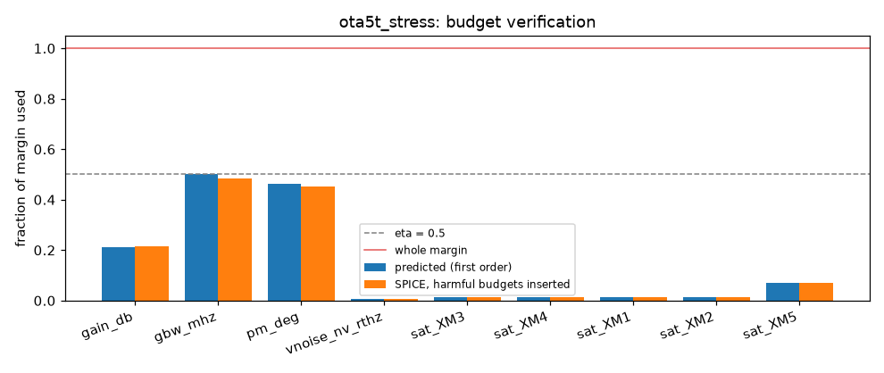

**Budgets** (`budgets.json`; ×need = budget ÷ expected need; "cell" = the part of the need inside the default device cells):

| Element | Expected need (cell + wiring) | Stress η = 0.9 budget | ×need | Stress η = 0.5 budget (previous) | Example budget |
|---|---|---|---|---|---|
| OUTP to ground | 2.80 + 1.76 fF | 4.32 fF | 0.95 | 2.40 fF | 45.6 fF |
| net3 to ground | 4.89 + 2.87 fF | 7.36 fF | 0.95 | 4.09 fF | 45.2 fF |
| OUTP~net3 coupling | 0.44 + 0.29 fF | 0.69 fF | 0.95 | 0.38 fF | 5.5 fF |
| XM1+XM2 gate R | 273 + 13 Ω | 271 Ω | 0.95 | 151 Ω | 1665 Ω |
| XM1+XM2 source R | 7.1 + 12.7 Ω | 18.8 Ω | 0.95 | 10.4 Ω | 84.7 Ω |
| XM5 source R | 7.1 + 12.9 Ω | 19.0 Ω | 0.95 | 10.5 Ω | 200 Ω |
| XM3+XM4 source R (pdiff contacts: 585 Ω each) | 27.3 + 5.9 Ω | 31.4 Ω | 0.95 | 17.5 Ω | 146 Ω |
| XM3+XM4 drain R (low GBW rate) | 27.3 + 5.9 Ω | 332 Ω | **10.0** (cap κ) | — | — |
| net1 to ground (low rate) | 7.5 + 3.6 fF | 111 fF | **10.0** (cap κ) | — | — |

Derived rules for the stress design (η = 0.9; in brackets η = 0.5):

- OUTP may have at most **9.1 µm** (5.1) of met1 in the worst-case environment.
- The devices on net3 (XM1, XM3, XM4) must be within **9.3 µm** (5.2) (`place.proximity.net3`, hard).
- OUTP and net3 may run in parallel at minimum spacing for at most **12.2 µm** (6.8).

For the example design the same rules allow 96 µm, 57 µm and 98 µm.

**Finding R19 (supervisor, on this run): phase 2 takes from the binding elements.** Phase 1 gives every binding element 0.998 × its need. Phase 2 (maximise Σ log(budget/need), keep ≥ 95 % of phase 1) then trims every GBW-bound element to 0.948 × need and gives the freed GBW margin to elements with a tiny GBW rate, which grow to the 10 × cap (net1, net1~INN, XM3+XM4.d, XM5.g). The log utility rewards a 10 × growth of an element that does not need it more than it costs to take 5 % from the elements that do. At η = 0.5 this was invisible (everything was far below need); at η = 0.9 it alone decides S3 (section 5.5). **Proposed fix (not applied; S3 is on hold):** (a) in phase 2, never trim an element below min(phase-1 budget, expected need); (b) give S2 the option library's lowest achievable cell value per element (e.g. 27.3 Ω for the PMOS source) as a lower bound, so the budgets are never below what any cell can do. (a) alone still leaves the PMOS default 0.2 % short at η = 0.9; (b) removes it by construction. To be decided before S4 uses the budgets.

**Excerpt: `constraints.json`** (stress design, η = 0.5 run of commit 4cf69ba; copied from the file; `inputs` lists shortened to "..."):

```json
{"id": "budget.OUTP~net3", "class": "budget", "type": "coupling", "targets": ["OUTP", "net3"], "value": 0.3830761847612343, "units": "fF",
 "derived_from": {"equation": "progressive-filling max-min allocation of eta*margin (budgets.py)", "binding": ["gbw_mhz"], "inputs": "..."}, "status": "evaluated"}
{"id": "route.max_parallel.OUTP~net3.metal1", "class": "budget_derived", "type": "max_parallel_run_at_min_spacing", "targets": ["OUTP", "net3"],
 "value": 6.79, "units": "um", "derived_from": {"equation": "L_par = C_coupling_budget / C_coupling_per_um(layer, min spacing)",
 "C_budget_fF": 0.3830761847612343, "Cc_per_um_fF": 0.056410400000000006, "inputs": "..."}, "status": "evaluated"}
{"id": "place.proximity.net3", "class": "hard", "type": "max_pin_distance", "targets": ["XM1", "XM3", "XM4"], "value": 5.16, "units": "um",
 "derived_from": {"equation": "the route of the net must fit its met1 length budget", "net": "net3", "hard_if_below_um": 50},
 "status": "evaluated", "note": "ASSUMPTION: hard below 50 um (a few device pitches), soft above"}
{"id": "match.max_R_difference.XM1.s", "class": "hard", "type": "max_resistance_mismatch_in_pair", "targets": ["XM1.s"], "value": 19.76,
 "units": "ohm per mV of allowed systematic offset", "derived_from": {"equation": "systematic input offset per ohm, measured in a unity-gain
 follower (S1)", "offset_uV_per_ohm": -50.60000000001175, "inputs": "..."}, "status": "not_evaluated",
 "note": "absolute limit needs an offset spec (not in the design package): requested"}
{"id": "route.em_width.net1", "class": "hard", "type": "min_width_from_current", "targets": ["net1"], "value": null, "units": "um",
 "derived_from": {"trunk_current_A": 8.47774e-05, "max_branch_A": 8.47774e-05, "equation": "W >= I / J_max(layer, T)"},
 "status": "not_evaluated", "note": "SKY130 electromigration limits were not found in the PDK files or docs searched; requested from you. ..."}
```

### 4.6 Problems met in S2, and fixes

| # | Problem | Fix |
|---|---|---|
| S2-1 | Rule lines in `sky130A.tech` continue over two lines (li.3 spacing), so the regex missed them | Backslash continuations are joined before parsing |
| S2-2 | A key renamed in S1 (`input_offset_uV_per_ohm`) crashed the rule builder | Fixed; plus a unit test that builds the rule IR from synthetic stage outputs, so key mismatches are caught by the tests |
| S2-3 | Review findings R4, R7, R8, R13, R15, R16 | See Supervisor review 1 |


## 5. S3 — device design: PCell options, decisions, DRC/LVS sign-off

**Purpose.** For each transistor, choose the SKY130 PCell options:

- number of fingers;
- gate contacts on one or both ends;
- contact coverage;
- which strips are the source.

The choice is made against the S2 budgets, at the smallest area. Every candidate is signed off with DRC and LVS before it can be chosen.

### 5.1 Inputs

| Input | File |
|---|---|
| Devices and types | S0 `circuit_ir.json` |
| Budgets with their need split (device cells / wiring) and the margin each uses | S2 `budgets.json` |
| Contact and sheet resistances | `outputs/S2/pdk/parasitics.json` |
| Testbenches | S0 `tb/` |

### 5.2 Commands

```bash
python3 -m src.s3.run inputs/ota5t_stress/package.yaml --cells-only   # option library, design independent (before S2)
python3 -m src.s3.run inputs/ota5t_stress/package.yaml                # decisions (after S2)
python3 -m src.s3.run inputs/example_ota_5t/package.yaml
```

### 5.3 Method

1. **Option grid** (`options.py`). For each of the 3 device types, every combination of the options below, as long as each finger stays ≥ 0.42 µm wide:

   | Option | Values |
   |---|---|
   | nf | 1, 2, 4, 8 |
   | Gate contacts | both ends / top only |
   | S/D contact and via coverage | 100 % / 50 % |
   | Which strips are the source (even nf) | outer / inner |

   That gives 84 cells (24 PMOS + 2 × 28 NMOS).
2. **Device cell** (`strap.py`). The Magic PCell draws the fingers but does not connect their sources and drains. The cell generator adds:
   - one via1 per strip and a met2 bar per terminal;
   - the labels D, G, S, B in the wrapper cell.

   Which strips are the source is a legal relabelling, because the MOSFET is symmetric. With the outer strips as source, the drain gets the smaller (shared) diffusion.
3. **Sign-off of every cell:**
   - Magic DRC (0 errors; the met1-sliver negative control must be flagged);
   - Netgen LVS of the whole cell against the sized netlist line, comparing W, L and nf (an L + 0.1 µm reference must be rejected);
   - Magic extraction of the cell (`cthresh 0`): finger devices with ad/as/pd/ps, and the capacitances inside the cell.
4. **Access resistance per terminal**, from measured geometry plus PDK resistances:
   - **Gate:** BSIM4 distributed gate resistance Rsh·W_f/(3·ngcon²·L·nf), plus the poly contacts and mcons counted on the GDS. The model cards set `rgatemod = 0` (checked by gate G3.6), so this is not counted twice.
   - **Source/drain:** per strip, the licon and mcon contacts in parallel, plus the met1 strip (1/3 rule), the li1 beyond the met1, and the strap via; the strips of a terminal are in parallel.
5. **Allowance, in S2's own terms.** S2 split every element's expected need into the default cells' part and the wiring part. The cells get the same fraction of each budget.
   - **Resistance:** R_access ≤ (cell fraction) × S2 Ω budget. The remainder is handed to S5.
   - **Cell effect** (cell extraction in the circuit, without access R): this may use the cells' fraction of the margin given to the capacitance budgets, plus the cell's share of the margin S2 left unallocated. Only harmful changes count.
   - **Device model change.** A multi-finger option puts each finger into another SKY130 W bin, which changes Vth, gm and noise. This is part of the in-circuit effect, and `device_model_change` reports it separately.
6. **Choice.** The smallest area within the allowance (near-ties within 2 % go to the larger slack). If nothing fits, the default PCell is kept (the device exactly as sized) and the type is flagged.
7. **Verification (G3.3).** All chosen cells with their access resistances in the circuit at once: the specs must be met and the margin used must be within the summed allowances.

### 5.4 DRC/LVS evidence for the chosen cells

On the left of each pair is the default PCell; on the right, the chosen cell (finger straps on met2, light blue):

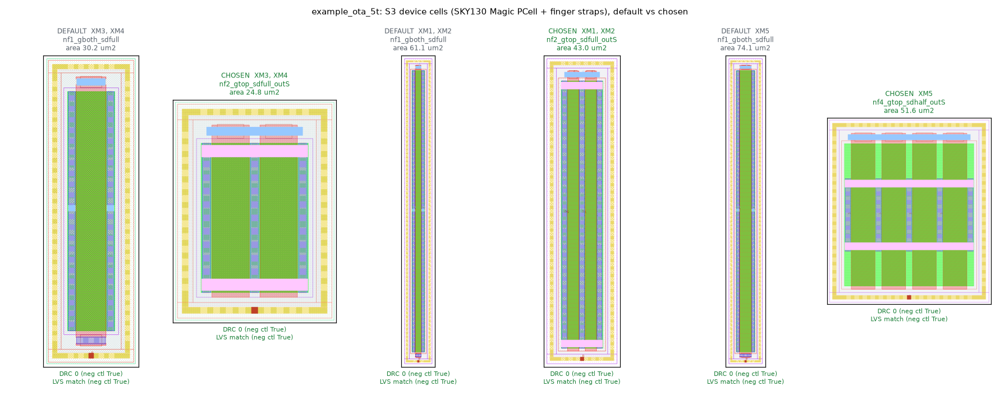

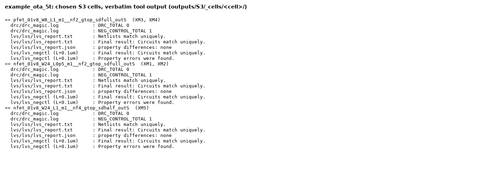

For the stress design at η = 0.9 the input pair uses nf = 4 and the other two types keep the default PCell (see 5.5): [cells](flow_record/img/ota5t_stress_s3_cells.png), [evidence](flow_record/img/ota5t_stress_s3_evidence.png).

**Option library** (`outputs/S3/_cells/`):

- 80 of 84 cells pass DRC 0 + LVS (W/L/nf) + both negative controls.
- The 4 that do not are PMOS nf = 8 with 50 % coverage. The 1 µm fingers are too short for separate source and drain bars, and LVS showed the resulting S–D short ("Netlists do not match", 3 nets instead of 4).
- The generator now detects this before drawing and records "strap does not fit" (problem S3-4).

### 5.5 Results

| Gate | example_ota_5t (η = 0.5) | ota5t_stress, η = 0.9 (current) | ota5t_stress, η = 0.5 (previous) |
|---|---|---|---|
| G3.1 DRC of the chosen cells (0 errors, negative control) | PASS | PASS | PASS |
| G3.2 LVS of the chosen cells (W, L, nf; negative control) | PASS | PASS | PASS |
| G3.3 all chosen cells + access R in the circuit: specs met and within the allowance | **PASS** | **PASS** | FAIL (specs met, allowance exceeded) |
| G3.4 option table complete | PASS | PASS | PASS |
| G3.5 no relaxation | PASS | **FAIL** (PMOS mirror, tail) | FAIL (all 3 types) |
| G3.6 the model cards add no gate resistance (rgatemod = 0) | PASS | PASS | PASS |

**example_ota_5t: decisions** (`device_decisions.json`):

| Devices | Chosen | Area (µm²), default → chosen | R access d / g / s (Ω) | Allowed d / g / s (Ω) | Device-model change (cell only) |
|---|---|---|---|---|---|
| XM3, XM4 (PMOS mirror) | nf2, gate top, full, outer = S | 30.2 → **24.8** | 59.2 / 72.5 / 29.6 | 273 / 725 / 120 | Id +0.03 %, ΔVth −16 mV |
| XM1, XM2 (input pair) | nf2, gate top, full, outer = S | 61.1 → **43.0** | 12.0 / 273.5 / 6.0 | 64 / 1591 / 30.5 | Id −0.02 % |
| XM5 (tail) | nf4, gate top, 50 %, outer = S | 74.1 → **51.6** | 13.5 / 44.3 / 9.0 | 27 / 1367 / 71 | **Id −3.0 %**, gm −2.2 % |

With all chosen cells and access R in the circuit:

| Spec | Value | Change |
|---|---|---|
| Gain | 32.88 dB | +1.19 dB |
| GBW | 101.9 MHz | −2.6 MHz |
| PM | 79.84° | −1.09° |
| Noise | 340.7 nV/√Hz | +1.6 |

All stay within the allowances, and the device area drops by 27 % (256.6 → 187.2 µm² for the five transistors).

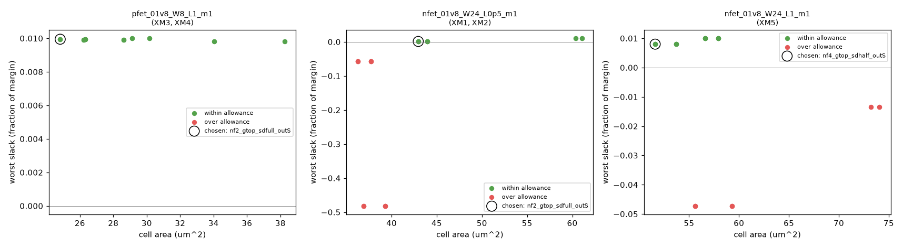

**Supervisor note on the example decisions.** The tail cell (nf = 4) moves XM5 into another W bin, and its current drops by 3.0 %. The allowance permits this, because the example design has plenty of unallocated margin. Still, it is a change to the sized device, not a layout parasitic. It is reported in `device_model_change`, and the sizing stage should be told. One option for the future is to require device-model changes to stay below a set fraction, so that S3 never re-sizes silently.

**ota5t_stress at η = 0.9 (current run): decisions** (`device_decisions.json`):

| Devices | Chosen | Area (µm²), default → chosen | R access d / g / s (Ω) | Allowed d / g / s (Ω) | Why |
|---|---|---|---|---|---|
| XM3, XM4 (PMOS mirror) | default (nf1, both gates, full) | 30.2 → 30.2 | 27.3 / 72.5 / **27.3** | 273 / 520 / **25.9** | no option fits: no cell has a lower source R; the budget was trimmed (R19) |
| XM1, XM2 (input pair) | **nf4, gate top, full, outer = S** | 61.1 → **36.3** | 8.5 / 88.5 / 5.6 | 14.2 / 259 / 6.8 | smallest of 3 feasible options |
| XM5 (tail) | default (nf1, both gates, full) | 74.1 → 74.1 | 7.1 / 136.7 / **7.1** | 7.8 / 1367 / **6.8** | no option fits: the default's source R misses by 5.5 % (R19); the nf = 4 options would re-size the tail |

All chosen cells with their access R in the circuit at once (G3.3, PASS):

| Spec | Value | Limit | Margin used by the cells (allowed) |
|---|---|---|---|
| Gain | 32.22 dB | ≥ 31.20 | −0.52 dB (improves) |
| GBW | 369.2 MHz | ≥ 336.3 | 4.43 MHz (19.6) |
| PM | 63.65° | ≥ 60.08 | 1.44° (4.10) |
| Noise | 342.0 nV/√Hz | ≤ 400 | 2.96 (54.3) |

Device area: 256.6 → 206.9 µm² (−19 %). The input pair's nf = 4 cell puts each 6 µm finger in another W bin: Id −0.14 %, gm −0.76 %, ΔVth +2.3 mV (`device_model_change`); its higher output resistance is why the gain goes up.

**Diagnosis.** In the circuit the cells use well under their allowance (GBW 4.4 of 19.6 MHz). What fails is the per-type check:

- **PMOS mirror.** The default cell's source R is 27.3 Ω; the cells may have 25.9 Ω. No option has a lower source R (the default already has full contact coverage, and each p-diffusion contact is 585 Ω). The 25.9 Ω is 0.948 × the default's value: S2's phase 2 trimmed the budget to 94.8 % of the need (finding R19). Without that trim it would be 0.998 × (G2.0 for GBW is 0.902, just above η = 0.9), so the default would still miss, by 0.2 %.
- **Tail.** Its source R misses by the same 5.5 %. The options with a lower source R (nf = 4, 5.6 Ω) move each finger into another W bin. That changes the tail current by about 3 % and costs 6.7 MHz of GBW, against the 0.12 MHz the tail cell is allowed. S3 correctly refuses this, because it would be re-sizing (review 2, point 2).

So at η = 0.9 the stress variant sits on the feasibility boundary that G2.0 predicted (0.902 of the GBW margin for a compact layout). The in-circuit check passes comfortably, because the wiring part of the need is not spent yet. The flagged types are the allocation artefact R19 (PMOS) plus a real limit (tail). They are left as they are, because S3 is on hold.

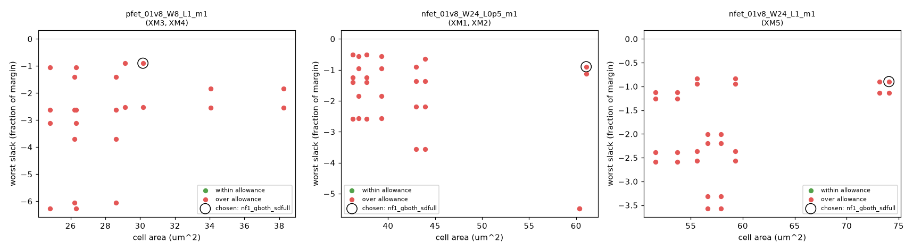

**ota5t_stress at η = 0.5 (previous run, commit 4cf69ba): decisions and diagnosis.** No option of any type fits the allowance, so the default PCells are kept and flagged. With them:

- **Specs:** still met. GBW 356.3 MHz against a limit of 336.3; PM 62.4° against 60.08.
- **Margin used by the cells alone, before any wiring:**

  | Check | Used | Allowed | Share of margin |
  |---|---|---|---|
  | GBW | 17.3 MHz | 10.9 | 46 % |
  | PM | 2.67° | 2.25 | 53 % |

- **Resistance:** the input-pair gate needs 273 Ω (allowed 144). The PMOS source needs 27 Ω (allowed 14.4; each p-diffusion contact is 585 Ω). The Ω left for routing is negative.

This is the outcome S2 predicted with G2.0: a compact default layout would use 90 % of the GBW margin. **Conclusion at that point:** the stress variant cannot be laid out within η = 0.5 of its margin. Either (you chose the first, η = 0.9, above):

- give layout more of the margin (η ≈ 0.9), or
- relax the stress specs, or
- re-size with layout in the loop. This is the O3 → O2 loop: the measured option table and these budgets are the inputs a layout-aware sizer needs.

**Excerpt: `device_decisions.json`** (example design, input pair). The fields are copied from the file and regrouped; nothing else is changed:

```json
{"devices": ["XM1", "XM2"],
 "chosen": {"id": "nf2_gtop_sdfull_outS", "nf": 2, "gate_contacts": "top", "sd_cov": "full", "outer": "S",
            "magic": {"topc": 1, "botc": 0, "diffcov": 100, "viasrc": 100, "viadrn": 100, "guard": 1, "conn_gates": 1}},
 "area_um2": 42.955, "access_resistance_ohm": {"d": 11.990609390609391, "g": 273.45000000000005, "s": 5.995304695304695},
 "budget_check_resistance_g": {"group": "XM1+XM2.g", "R_access_ohm": 273.45000000000005, "allowed_ohm": 1590.9098499935599,
                               "ok": true, "remaining_for_routing_ohm": 1391.0669098321591, "slack_frac": 0.8281172248690855},
 "device_model_change_XM1": {"id_rel": -0.0001816521856061737, "gm_rel": -0.000507740991714356, "vth_shift_V": 0.00020699999999995722},
 "drc": {"errors": 0, "neg_control_flagged": true, "pass": true},
 "lvs": {"match": true, "neg_control_rejected": true, "pass": true}}
```

The 4 PMOS cells that do not fit are recorded in `outputs/S3/_cells/<cell>/record.json`, e.g.
`"ok": false, "error": "strap does not fit: strips too short for two met2 bars: 1.100..1.560 um"`.

### 5.6 Problems met in S3, and fixes

| # | Problem | Fix |
|---|---|---|
| S3-1 | The Magic PCell leaves nf > 1 fingers unconnected; LVS against the sized device failed | Finger-strap generator (`strap.py`); LVS now in top mode, on the wrapper's own D/G/S/B labels |
| S3-2 | First straps: 40 DRC errors (via1 enclosure in one direction, via.5a / met2.5) | via contacts 0.26 × 0.32 µm (0.085 µm enclosure in one direction), bars 0.32 µm tall |
| S3-3 | Labels placed over a child cell's metal were moved to "space" by Magic, so they connected to nothing | A small patch of the same layer under each label |
| S3-4 | PMOS nf = 8 with 50 % coverage: strips too short, so the S and D bars shorted (caught by LVS) | The generator checks the bar spacing first and records "strap does not fit" |
| S3-5 | Floating VSUBS → wrong operating point (R17) | VSUBS tied to ground; numerical warnings fail a run |
| S3-6 | The cell PEX first had no `.subckt` ports (`ext2spice hierarchy off`) | `ext2spice subcircuit top on` |
| S3-7 | Magic's lumped extresist cross-check gives no value at tolerance 1: these nets are not split | Recorded as a limitation; the access R comes from the geometry model above. A finer field-solver cross-check is future work |
| S3-8 | Allocation inconsistency between S2 and S3 (R16) and the relaxation choice (R18) | See Supervisor review 1 |

## Supervisor review 2 (after S3): what is good, what is weak, what comes next

**Good:**

- **Every number is measured or derived, and every check can fail.**
  - DRC and LVS use negative controls.
  - Simulator runs with numerical trouble count as failures.
  - Missing measurements fail a gate.
  - Budgets are verified in SPICE per check, harmful parasitics only.
- **The linear model is exact where it should be, and explains where it is not.**
  - Capacitance: within 2.4 % of SPICE.
  - Resistance: bias-shift effects are confirmed by re-solving at the shifted operating point.
- **The flow says, before any layout, whether a design is layout-feasible** (G2.0). It said so correctly for both designs, and S3 confirmed it with real cells.
- **N3 is shown on the example design.** Requirement-driven PCell options give −27 % device area while staying inside the budgets, and every chosen cell is DRC/LVS clean.

**Weak, or not done yet:**

1. **η = 0.5 and κ = 10 are policy choices** (ASSUMPTIONS). The stress variant shows that η decides feasibility. A sweep of η, or a per-spec η, should be reported.
2. **Multi-finger options change the SKY130 device model** (W bins): the tail current moves 3 % with nf = 4. That is re-sizing. It is reported, but not limited. Proposal: limit the device-model change to a fraction of the margin, or hand it back to the sizer.
3. **The access-resistance model** is geometric and analytic (BSIM4 gate formula, contact counts). Magic's extresist gave no cross-check at this tolerance. A finer extraction is needed to validate the source/drain values, which matter in the stress design.
4. **Still `not_evaluated`, waiting on data from you:**
   - EM widths (no SKY130 EM data found; **ignored for now by your decision of 2026-10-25**);
   - the offset budget (no offset spec);
   - the bias-net impedance;
   - variation ranges.
5. **Expected need** still uses a rough wiring estimate (one device-crossing stub per pin). S4 templates will give real geometry; S2 should be re-run with it.
6. **Only two circuits, both the same 5T OTA.** The LOADBench two-stage designs are fetched but not yet packaged (S0 extension).

**Next steps proposed:**

- **S4 templates** for the diff pair and the mirror, built from the chosen S3 cells. The straps already exist.
- **LOADBench packages:** 2 two-stage designs.
- **An η sweep for the stress variant.**
- **A limit on device-model changes in S3.**

## Supervisor review 3 (after the η = 0.9 rerun and the pole drop-out study)

**Good:**

- **η is now a recorded input, not a hidden flag.** It comes from the package (`eta: 0.9` for the stress variant), and `budgets.json` records the value and its source. A unit test covers the order of precedence (command line > package > default).
- **The η = 0.9 rerun behaved as G2.0 predicted.** The budgets landed at the expected need (0.998 before phase 2), and SPICE verification stayed conservative (GBW: 33.6 MHz predicted, 31.5 simulated).
- **The pole drop-out has a measured cause and an input-side fix** that never touches the original file (3.9). PM error drops from 25.5° to 0.1° (stress) and from 10.4° to 0.7° (example). The CL and net3 sensitivities now match SPICE in sign and size.
- **The study corrected one of my own earlier numbers** (R20 below), because the patched model was cross-checked against two independent references: the exact rational H(s) and the exact nodal model.

**Weak, or found in this round:**

| # | Finding | Status |
|---|---|---|
| R19 | S2 phase 2 trims every binding element to 95 % of phase 1 to inflate elements that do not need it (up to κ = 10). At η = 0.9 this alone makes the PMOS default fail in S3 (section 4.5) | Fix proposed (phase-2 floor + cell lower bounds from the option library); **not applied: S3 on hold**. Decide before S4 consumes budgets |
| R20 | I gave the mirror pole as ≈ 614 MHz. That used the DC driving-point resistance (2.58 kΩ, which includes a loop through the output) and the BSIM4 charge-matrix diagonal. The pole that predicts the response is ≈ 313 MHz | **Corrected** in 3.5 and 3.9. Lesson: quote poles from the response, not from R_dc·C |
| R21 | S3 checks resistance per element, but the circuit has room as a whole (GBW: the cells use 4.4 of 19.6 MHz). A per-element check can fail while the circuit passes | Open. For S4: judge block variants against the block-port budgets (N1) *and* the in-circuit total, and report both |
| R22 | The symbolic gain is 0.33 dB low in all versions (original, P1, P2) | Open, not diagnosed. Candidate: the output → tail → mirror feedback through the input devices' gds, which the template omits |
| R23 | P2 uses Cm ≈ (2/5)·Cgs, a long-channel value; from the OP it is 20 % smaller for the input device | Reported. The fair accuracy claim for P2 is about ±1.5° in PM |
| R24 | The background script ran S2 → S3 → figures with `set -e`. S3 exits 1 when it flags a type, so the figures were skipped | Figures re-run separately. Scripts that chain stages now must not stop on a legitimate FAIL exit |

**Decisions recorded (from you, 2026-10-25):** stress η = 0.9; EM ignored for now; S3 on hold; S4 from Monday.

## 6. S4 — sub-block variants (starts Monday, 2026-10-26)

> **2026-10-26:** S4 did not start. The day went to plan v2 (section 7). Following project doc 12, S3 becomes
> a design-independent unit library and S4 starts as S4a, a block planner on those unit cells; the plan below
> is kept as the original S4 idea.

**Purpose.** For each block, several DRC/LVS-clean layouts that the placer (S5) can choose from, each with its measured parasitics and its effect on the specs.

**Blocks of the 5T OTA, from the S0 hierarchy and the S1 matching groups:**

| Block | Devices | Cell from S3 (example / stress) | Arrangements to generate |
|---|---|---|---|
| Differential pair | XM1, XM2 | nf2 / nf4 (input pair) | side by side, interdigitated ABAB, ABBA, 2-D common centroid; with and without dummies |
| PMOS mirror load | XM3, XM4 | nf2 / default nf1 | side by side, interdigitated, common centroid |
| Tail | XM5 | nf4 / default nf1 | single, with dummies |

**Method (planned):**

1. One template generator per block type, placing the S3 cells (already DRC/LVS clean, with finger straps) on a fixed track grid. The internal wiring is drawn by the template, so it is correct by construction.
2. For every variant: Magic DRC (0 errors, negative control), Netgen LVS against the block's own sub-netlist (W, L, nf), and extraction with coupling capacitance.
3. The extracted block replaces its devices in the full testbench (the S3 mechanism), so each variant gets its effect on gain, GBW, PM and noise. The block-port budgets from `hierarchy.json` (N1) and the in-circuit total are both reported (R21).
4. Output: `variants.json`, a Pareto set per block (area, aspect ratio, pin positions, symmetry error, budget slack, predicted specs).

**Check:** every variant DRC 0 and LVS match; on a sample, the predicted effect is confirmed by full simulation (hypothesis H2).

The full-layout DRC/LVS evidence (Magic DRC 0, Netgen "Circuits match uniquely" against the sized netlist, negative controls) will be recorded in S6.

---

<!-- section7:start -->
## 7. Plan v2 (2026-10-26): new circuits, generality fixes, corners, baselines and hand layouts

This section is the whole story of 2026-10-26: what we set out to do, what we ran, what went wrong, how
each problem was found, what was changed, and what the numbers became. "Before" is the flow as it was on
the morning of 2026-10-26 (variant v1, still runnable as `--variant v1`); "after" is v2. Every number comes
from `outputs/compare/<design>/{before,after}.json`, `docs/before_after.md` or the file named next to it.

### 7.0 What plan v2 set out to do

The external review (project doc 11) and the decisions taken on it (project doc 12) asked for: real
circuits beyond the 5T OTA (two fully differential designs with hand-drawn layouts, and a LOADBench op-amp),
run first with the flow as it was ("before") and then with the updates ("after"); PVT corners and mismatch;
the R19 fix and library floors in S2; baselines (per-net budgets, equal split, an LP, the hand-drawn layouts);
an S3 that keeps fingers in the sized device's model bin; a pre-registration; and an independent review.

Decisions of the day, from you:

- TTSKY25a: the flow's DUT stays `Opamp_with_bias.sch` (the tile's bias switch block hardly changes the
  area), and its specs are the schematic's own performance (gain -1 dB, GBW x 0.9, power x 1.1, PM >= 60 deg,
  as for LOADBench). The ICM 2026 paper's post-layout figures are a reported reference only.
- Git: you commit and push with GitHub Desktop; the flow's sessions do not run git while `.git/index.lock`
  exists.
- Work continues while your laptop is on, with hourly updates; decisions are asked as FEEDBACK NEEDED.

### 7.1 The journey: what went wrong, how it was found, what changed

In order of discovery. "Found by" says which mechanism caught it: a gate (the flow checking itself), a crash,
a run that took too long, reading the code, a comparison with SPICE or with a hand layout, or one of the two
independent reviews (7.9). Effects are on the numbers reported later in this section.

| # | Stage | What went wrong | Found by | What we changed | Effect |
|---|---|---|---|---|---|
| 1 | S0 | The old flow refused LOADBench (`unsupported element 'Ibias'`) | a clean refusal (correct behaviour) | current sources and passives in the parser and the IR | LOADBench ingests |
| 2 | S0/S1 | The Miller capacitor would have vanished: the IR recorded no passives, so the model's guard never fired | reading the code behind 1 | passives in the IR, the linear model, the layout view and the binding | Miller model vs SPICE 0.017 dB, 0.36 %, 0.03 deg |
| 3 | S1 | A current source's node was treated as AC ground | reading the code behind 1 | only voltage-source nodes are AC ground | correct AC model with ideal bias currents |
| 4 | S0 | m > 1 PCells are drawn as unconnected copies; 95 of 96 TTSKY25a bindings failed LVS | G0.7 | LVS of the copies as drawn (extracted connectivity, W/L/nf, count, negative control) | bindings pass |
| 5 | S0 | The designers' TTSKY25a bench saved only `i(vmeas)` | G0.8 reproduction failed | `save all` in the re-run | 98.401 / 2.0515 / 78.236 reproduced |
| 6 | S0 | iadc bias current on the wrong node; an off-chip element's exposed node was VDD | G0.8 / reading the IR | the exposed node is the non-port terminal | correct bias |
| 7 | S0 | The PDK PCell at the netlist size fails met1.6 (minimum area): LOADBench's 484 um finger, iadc's 1.2/0.2 um LVT devices | G0.7 | kept as a FAIL (a real PDK finding); S3 must fold them | open |
| 8 | S0 | 45 PVT points took too long one process at a time | run time | one ngspice process per corner looping over VDD and T, checked equal to separate runs | minutes, not hours |
| 9 | S2 | The dual method for phase 2 on large problems was wrong | a check against SLSQP | interior-point (trust-constr) above 200 elements, checked against SLSQP | same optimum |
| 10 | all | Review A, 17 findings on the v2 code before any run | review A (7.9) | 10 applied, 2 not (see 7.9) | |
| 11 | S2/S3 | First 5T after-run relaxed the input pair and tail: the expected need took each element's minimum over different cells, which no single cell achieves | S3 G3.5 FAIL, traced | the need comes from ONE representative cell per device type | 5T after: S3 PASS |
| 12 | S2 | S2 crashed: a baseline's huge resistance left no DC solution and ngspice hung for 600 s | S2 ERROR (TimeoutExpired) | a timed-out run is a failed run; scenarios time out at 180 s | S2 completes |
| 13 | hand layout | The extracted tile would not simulate: header continuation lines, ground on the `ena` pin, floating PEX metal | failed simulations | continuation lines joined, ports mapped, 1 Tohm shunts on every node (all netlists) | 18 runs, no warnings |
| 14 | git | GitHub Desktop could not join the repository's two-commit history (README created on GitHub) and stashed all uncommitted work, reverting fixes and deleting run logs mid-run | reverted code found in the container, then `git reflog` / `git stash list` | `git merge --allow-unrelated-histories origin/main` (no file changed, no force-push), stash restored into the working tree, runs restarted | your push went through |
| 15 | S1 | iadc S1 crashed in G1.4 (division by zero): the recogniser had put 24 of 38 dummies into 6 false mirrors | S1 ERROR, traced | dummies assigned first; iadc package regenerated (TTSKY25a output unchanged, checked) | G1.4 PASS |
| 16 | S0 | Your spec decision changed `config.yaml`; G0.3 refused the changed file | G0.3 (hash freeze) | the frozen hash updated on purpose, with the reason | G0.3 PASS |
| 17 | hand layout | Our "designers' conditions" run of the tile passed `MF=100` only, which in this PDK scales mismatch, not capacitance: 1 load unit instead of 100 | reading the PDK model while chasing 20, checked with ngspice | `MF=100 M=100`, re-run | tile PEX at ff/20 C: 1.43 MHz, 78.0 deg |
| 18 | all | Review B, 11 findings on the code and on this section's first draft | review B (7.9) | all 11 addressed | 7.5-7.8 rewritten |
| 19 | S2 | The baseline comparison was tilted: a failed SPICE run counted as a violation, the LP had no floors, only ours' worst corners were simulated | review B items 1-3 | failed runs apart; `lp_floor` baseline; each method's own worst corners; outcome words defined (PREREG amendment) | 7.6 re-run |
| 20 | S3 | Our explanation of the 5T area increase was wrong (we blamed gate resistance) | review B item 7, then the option table | the binding terminals are drain and source (8.0 ohm allowed; folded cells 8.5-17 ohm on one side) | 7.5 corrected |
| 21 | S2 | iadc phase 2 ran 2.5 hours: elements with zero need made the objective NaN | run time, NaN warnings in the log | objective without the need, strictly positive x, 300 s cap | minutes |
| 22 | S1 | A PDK capacitor's multiplier counted twice (ngspice reports C already x M); iadc model GBW = half of SPICE | G1.1 passive cross-check and G1.2 | value read as reported for C (R / M stays), checked with an ngspice test | iadc model vs SPICE 0.09 dB, 2.8 %, 0.18 deg; TTSKY25a 0.07 dB, 0.09 %, 0.06 deg |
| 23 | S1 | G1.1 counted dummies as unsaturated devices | iadc G1.1, reading the list | dummies excluded | 21 functional devices remain (triode by design, open question) |
| 24 | S2 | Saturation constraints for devices not saturated before layout: negative margins forced budgets to zero | inspecting iadc's constraints (83 sat constraints, many with b < 0) | only saturated devices get one; the others are listed in G2.0 | iadc budgets |
| 25 | S2 | G2.1 failed: placement rules may name a capacitor | iadc G2.1 | passives are valid names | G2.1 PASS |
| 26 | S3 | S3 stopped on iadc: cells of m > 1 devices were drawn with unconnected copies, none signed off | S3 ERROR | one unit cell per option, scaled to the device (area x m, R / m, C x m, `m=` in the circuit) | S3 runs on iadc and TTSKY25a |
| 27 | S0 | 18 TTSKY25a bindings failed their own negative control: L + 0.1 um is within Netgen's tolerance on 10-20 um channels | G0.7 | L + 10 % (at least 0.1 um) | G0.7 PASS |
| 28 | hand layout | iadc layout: separately drawn pieces of a labelled net come out as `VDD_uq3`, `p1_uq0` | unmapped ports in the run record | tied to their net | 6 runs, no warnings |
| 29 | hand layout | The R+C extraction read the C-only `.ext` and ignored the resistances | 0 resistors in the netlist, nonsense results | the R+C extraction runs in its own folder | 324 k resistors |
| 30 | hand layout | The R+C AC run of the iadc layout (324 k resistors) took over 4 GB next to the main queue and nearly pushed the container out of memory | memory check (260 MB left) | run stopped; KLU sparse solver, only the output vectors saved, a 2.6 GB cap per run, extresist tolerance as a parameter | runs at about 1.3 GB |
| 31 | S1 | TTSKY25a G1.4 failed: its bias mirrors are ratioed by channel length (L = 2, 10, 20 um on one gate), which the rule "a mirror shares L" calls inconsistent; S2 would then have asked for identical cells across different L | G1.4 | an L-ratioed mirror is recorded as such and its equal-L subsets are checked as mirrors | TTSKY25a re-run from S1 |
| 32 | infra | A queue waited forever on a stopped run whose process had become a zombie (`kill -0` succeeds on zombies) | the queue log did not move | queues wait on a log line, not a pid | |
| 33 | infra | A second agent (Claude Code on the laptop) and Cowork's deploys could silently overwrite each other's edits: Cowork unpacks its copy over the repo | your question about working with both, then reading the deploy step | `CLAUDE.md` (shared rules and protocol), `docs/STATUS.md` (live handoff), and a deploy step that refuses to overwrite a file changed since Cowork last saw it | no silent overwrite |
| 34 | S2 | After review B's fixes, the LP with floors came out "ok" on the 5T like ours, and the table could not tell them apart | reading the re-run table | budget / need (min and geometric mean) added: the LP with floors gives every element exactly its need, ours 3.2 x on the geometric mean | 7.6 |
| 35 | hand layout | The iadc R+C run gave 19.4 dB with gmin-stepping failures: the R+C netlist exposes the CMFB sub-cell's clock ports separately, and the bench left them floating | the run's own warnings (recorded per run since review B) and an implausible gain; Magic's "electrically shorted" warnings | `--map-shorted`: a port Magic reports as shorted to a mapped port is tied to that port's node | clean R+C run (7.8) |
| 36 | infra | The PC had to go off at 01:30 with about 6 h of runs left; the queues could not resume, and two of them set outputs aside in the container's /tmp | planning the overnight stop | `scripts/plan_v2_resume.sh`: every step writes a `.done` marker and is skipped next time, outputs set aside go to `runs/tmp/aside/` and are restored after an interruption, two lanes side by side; `scripts/plan_v2_stop.sh` stops everything in a safe order | runs continue with Claude Code (docs/HANDOFF.md) |

### 7.2 New designs and what had to be predicted

| Design | Upstream gave | We predicted (labelled PREDICTED / ASSUMPTION) | Reproduction check |
|---|---|---|---|
| `loadbench_miller` (LOADBench, row 546 of 1024, chosen by a fixed rule) | sized netlist, ~1000 Pareto points with metrics, structure recognition, OP/AC/DC/tran benches | specs (gain −1 dB, GBW ×0.9 of our own simulation, PM ≥ 60°, power ≤ 1.1× LOADBench), noise bench, textbook two-stage Miller equations, MIM binding of the ideal Miller capacitor | G0.8: gain 58.00 vs 58.0 dB, GBW 23.39 vs 23.41 MHz, PM 65.32 vs 65.33°, power 558.4 vs 558.4 µW |
| `ttsky25a_fd` (your TTSKY25a op-amp) | xschem schematics, the designers' testbench, the taped-out GDS, README post-layout figures | flat netlist (xschem + `scripts/flatten_spice.py`), dido benches, specs from the schematic's own performance (gain -1 dB, GBW x 0.9, power x 1.1, PM >= 60 deg, as for LOADBench; the README/paper figures are post-layout results, and the designer chose the schematic as the reference), rule-based primitives, textbook two-stage FD equations | G0.8 against your own bench `Opamp_with_Bias_tb.sch` re-run (tt, 27 C default, open loop, 200 x 1x1 um MIM units per output; ours: chokes, 529 fF ideal): gain 98.401 vs 98.401 dB, GBW 2.0517 vs 2.0515 MHz, PM 78.234 vs 78.236°, power 451.98 vs 451.98 µW |
| `iadc_ota` (r09g/iadc) | netlist, hand-drawn layout with LVS/PEX netlists, transient benches only | AC model of the switched-capacitor CMFB (ideal CMFB with its steady-state law, C3/C4 kept), specs, primitives, textbook folded-cascode equations | no upstream AC figures exist (G0.8 not applicable) |

The rule-based structure recogniser (`scripts/recognize_structures.py`) was checked on the Miller against
LOADBench's own recognition: same differential pair and NMOS mirror; the two PMOS mirrors that share their
diode are one 3-device mirror in ours; the CS driver is a single device in ours and part of an "inverter"
in theirs.

**Which devices the flow treats as matched (TTSKY25a).** The upstream stage that would say which devices form
a differential pair, a mirror or a matched pair did not exist for this design, so the flow predicted it from
the netlist (`scripts/recognize_structures.py`, PREDICTED). The pictures are your own xschem schematics with
each group boxed and tagged (G1, G2, ...) under its SPICE name; the table maps each flat SPICE name to its
schematic instance (`XX1_M5` = M5 of Diff_opamp, `XX2_M7` = M7 of Common_source_stage, `XM33` = M33 of
Opamp_with_bias). You accepted these groups on 2026-10-26. G6-G8 and G14-G15 are the two mirrors whose
devices differ in channel length (journey #31): the flow matches only devices of equal length within them.
Regenerate with `python3 scripts/schematic_groups.py ttsky25a_fd`.

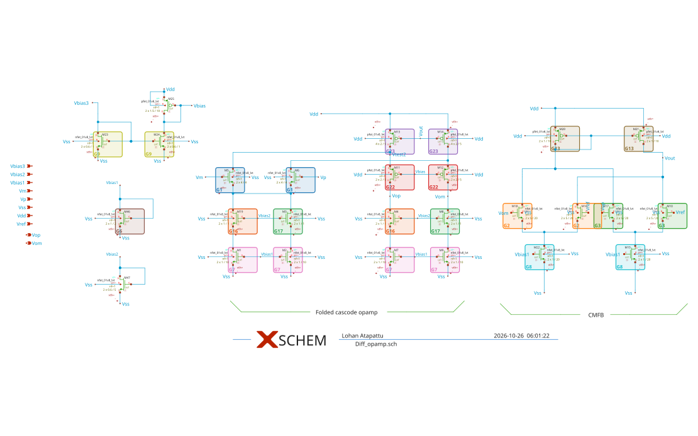

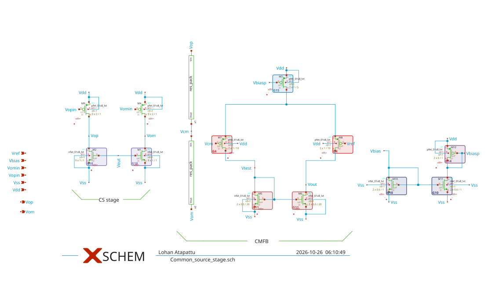

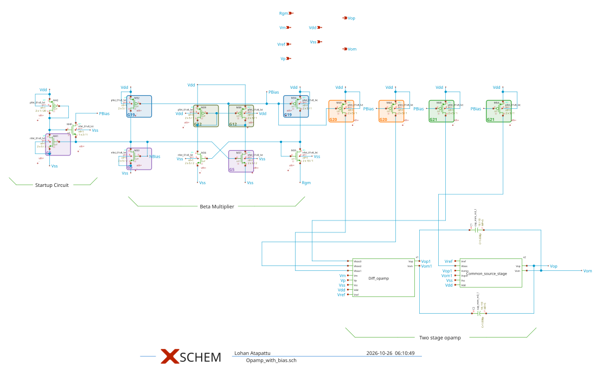

| G | kind | devices (SPICE name -> schematic instance) | sheet |
|---|---|---|---|
| G1 | nmos-differential-pair | XX1_M5 -> M5, XX1_M6 -> M6 | Diff_opamp |
| G2 | nmos-differential-pair | XX1_M18 -> M18, XX1_M16 -> M16 | Diff_opamp |
| G3 | nmos-differential-pair | XX1_M10 -> M10, XX1_M17 -> M17 | Diff_opamp |
| G4 | pmos-differential-pair | XX2_M7 -> M7, XX2_M8 -> M8 | Common_source_stage |
| G5 | nmos-current-mirror | XM33 -> M33, XM37 -> M37, XM41 -> M41 | Opamp_with_bias |
| G6 | nmos-current-mirror ratioed by L, subset 1 (single device: nothing to match) | XX1_M46 -> M46 (L = 2 um, the reference diode) | Diff_opamp |
| G7 | nmos-current-mirror ratioed by L, subset 2 | XX1_M1 -> M1, XX1_M2 -> M2, XX1_M7 -> M7, XX1_M9 -> M9 (L = 10 um) | Diff_opamp |
| G8 | nmos-current-mirror ratioed by L, subset 3 | XX1_M22 -> M22, XX1_M15 -> M15 (L = 20 um) | Diff_opamp |
| G9 | nmos-current-mirror | XX1_M23 -> M23, XX1_M24 -> M24 | Diff_opamp |
| G10 | nmos-current-mirror | XX2_M10 -> M10, XX2_M11 -> M11 | Common_source_stage |
| G11 | nmos-current-mirror-load | XX2_M5 -> M5, XX2_M6 -> M6 | Common_source_stage |
| G12 | pmos-current-mirror | XM39 -> M39, XM38 -> M38 | Opamp_with_bias |
| G13 | pmos-current-mirror-load | XX1_M20 -> M20, XX1_M21 -> M21 | Diff_opamp |
| G14 | pmos-current-mirror ratioed by L, subset 1 (single device) | XX2_M12 -> M12 (6/1 um, diode) | Common_source_stage |
| G15 | pmos-current-mirror ratioed by L, subset 2 (single device) | XX2_M3 -> M3 (1/5 um) | Common_source_stage |
| G16 | nmos-matched-cascode-pair | XX1_M19 -> M19, XX1_M4 -> M4 | Diff_opamp |
| G17 | nmos-matched-cascode-pair | XX1_M3 -> M3, XX1_M8 -> M8 | Diff_opamp |
| G18 | nmos-matched-current-source-pair | XX2_M2 -> M2, XX2_M1 -> M1 | Common_source_stage |
| G19 | pmos-matched-current-source-pair | XM32 -> M32, XM34 -> M34 | Opamp_with_bias |
| G20 | pmos-matched-current-source-pair | XM43 -> M43, XM44 -> M44 | Opamp_with_bias |
| G21 | pmos-matched-current-source-pair | XM45 -> M45, XM54 -> M54 | Opamp_with_bias |
| G22 | pmos-matched-cascode-pair | XX1_M11 -> M11, XX1_M12 -> M12 | Diff_opamp |
| G23 | pmos-matched-current-source-pair | XX1_M13 -> M13, XX1_M14 -> M14 | Diff_opamp |

### 7.3 What the old flow did on the new circuits, and the generality fixes

The v1 code stopped in S0 on LOADBench (`unsupported element 'Ibias'`): correct behaviour, because the
parser refuses what it does not model. Reading the code behind that refusal found two silent bugs that would
have followed:

1. **The Miller capacitor would have vanished.** S0's IR did not record passives at all, so the linear
   model's guard (`if ir.get("passives")`) could never fire, and the layout view dropped every passive.
2. **An ideal current source's node was AC ground.** The linear model grounded the nodes of every internal
   source; that is right for a voltage source and wrong for a current source (open circuit).

Fixed without changing any algorithm: current sources; ideal and PDK passives (MIM, poly resistors) in the
IR, the linear model, the layout view and the PCell binding; off-chip test elements; port roles; external
reference gate G0.8; differential outputs and dido benches; benches found by name; PDK passive values read
from the simulator; dummies skipped in the resistance sensitivities. After these, the Miller's linear model
matches SPICE to 0.017 dB, 0.36 % GBW and 0.03° PM (G1.2), with the Miller capacitor stamped.

Further findings while ingesting:

- **The PDK PCell at the netlist's own size is not always DRC-clean.** LOADBench's single-finger NMOS
  (W = 484 µm, L = 0.24 µm) gives 6 × met1.6 (minimum area) violations with default options (G0.7 FAIL).
  S3 must finger it.
- **m > 1 PCells are drawn as unconnected copies.** All TTSKY25a devices are m = 2; S0's device LVS assumed
  one connected device and failed 95 of 96 bindings. Fixed by checking the copies as drawn (extracted
  connectivity, netlist W/L/nf, device count, negative control with L changed). S3 had the same problem one
  stage later: its option cells were drawn with the m copies unconnected, so none signed off and S3 stopped
  on iadc_ota. S3 now builds one unit cell (m = 1) per option and scales it to the device: area x m (an upper
  bound until S4 places the copies), access resistance / m, the cell's capacitance x m in S2's floors and
  needs, and an `m=` instance multiplier when the cell replaces the device in the circuit simulations.
- **The textbook models (our predictions of the upstream symbolic stage) are optimistic** in the same way
  as the 5T "pole drop-out": Miller PM 82.3° predicted vs 65.3° SPICE, GBW +29 %.
- **A negative control that cannot fail.** The device LVS negative control changed L by a fixed 0.1 um; on
  TTSKY25a's long-channel devices (L = 10 and 20 um) that is within Netgen's relative tolerance, so the wrong
  reference matched and 18 bindings failed their own control. The change is now 10 % of L (at least 0.1 um).
- **The rule-based recogniser had put dummies into mirrors.** A dummy with drain, gate and source on one net
  looks diode-connected, so on iadc_ota 24 of the 38 dummies formed 6 false blocks (one a 10-device "PMOS
  mirror load"), and S1's matching check divided by their zero gm. Dummies (gate tied to source, or all
  terminals on the rails) are now assigned first; the iadc package was regenerated (48 -> 67 blocks). The
  TTSKY25a output is unchanged (checked), LOADBench uses its own recognition, and S1's matching check now
  reports a device that is off instead of crashing.
- **A PDK capacitor's multiplier was counted twice.** ngspice reports a MIM capacitor's value already
  multiplied by the instance multiplier M (four 4.8 x 4.8 um units read 196 fF), and S1 multiplied by M
  again. On iadc_ota the CMFB capacitors C3/C4 became 784 fF and the linear model's GBW was half of SPICE's
  (105 vs 210 MHz). G1.1's cross-check of every PDK passive against the simulator flagged it (rel. diff
  -0.75). Fixed in `op.passive_value` (resistors are reported per copy, so R / M stays); after the fix the
  model matches SPICE to 0.09 dB, 2.8 % GBW and 0.18 deg. TTSKY25a's Miller capacitors (M = 5) would have
  been hit the same way; its runs are after the fix.
- **Saturation constraints for devices that are not saturated.** S2 made one per device, so a dummy or a
  MOS resistor (iadc_ota: 21 functional devices below BSIM's vdsat, 15 of them in five series stacks with the
  gate at cm, i.e. triode by design) gave a negative "margin" that forces every budget touching it to zero.
  Now only devices saturated before layout get one; the others are listed in G2.0. G1.1 still fails on
  iadc_ota for those 21 devices (dummies are no longer counted): it is the BSIM vds > vdsat test, and the
  design intent of each device is the designer's to state, not ours to assume.
- **The large phase-2 solver could run for hours.** With more than 200 elements (iadc_ota: 756) phase 2 uses
  an interior-point solver; elements with zero expected need made its objective NaN. The objective no longer
  depends on the need, and the solve is capped at 300 s (the phase-1 budgets are kept past it).
- **The repository's schematic is not the taped-out circuit.** The TTSKY25a tile layout extracts to 86
  merged devices vs 58 in `Opamp_with_bias.sch` (a bias switch block, bias dummies, more MIM units and
  resistors). See 7.6.

### 7.4 What v2 changes (code)

| Stage | Change | Gate |
|---|---|---|
| S0 | 45 PVT points (5 corners × VDD ±10 % × −40/27/85 °C), run as one ngspice process per corner (checked equal to separate runs); 200-run mismatch Monte Carlo (tt_mm, one seed per run) | G0.9, G0.10 (info) |
| S2 | Library floors: no element below what the cheapest cell of the S3 library (main mode A-bin) puts on it; expected need from ONE representative cell per type (not per-element minima, which no single cell achieves) | G2.7 |
| S2 | R19 fix: phase 2 never trims an element below min(phase-1 budget, need) nor below its floor | G2.3 |
| S2 | One constraint per spec and PVT point where the sized circuit meets the spec (exact linear model at that point's operating point; resistance rates: nominal + change); SPICE checks of the binding corners | G2.9, G2.5 |
| S2 | Three other budget rules on the same sensitivities and the same eta, scored first order and in SPICE: per-net (SpiceXplorer's rule), equal split, a plain LP (maximise the sum of budget/need) and the same LP with the library floors and budgets capped at need; eta sweep 0.3–1.0 | G2.8 |
| S3 | Option modes B / A-bin / A-free + rule-of-thumb folding (finger 4 µm); wide-device nf 16–64; v2 R allowance (a cell may use the library's lowest access R of its terminal) | G3.7 |

An independent review agent read the v2 code before the runs; its 17 findings and what was done with each
are in 7.9.

### 7.5 Results before and after

**example_ota_5t** (before = v1, after = v2; both S2 and S3 PASS):

| | before (v1) | after (v2) |
|---|---|---|
| S3 cells (PMOS load / input pair / tail) | nf2 / nf2 / nf4 | nf1 / nf1 / nf2 |
| total device area | 187.2 um2 | 237.0 um2 (+27 %) |
| final gain / GBW / PM (cells in the circuit) | 32.88 dB / 101.9 MHz / 79.84 deg | 31.80 dB / 102.4 MHz / 79.63 deg |
| fingers outside the sized device's W bin | (not checked in v1) | none (A-bin) |

Why v2 costs area here: S2's round 1 is now bound by a PVT point, GBW at tt, VDD −10 %, 27 C (point tt_v0.9_t27, G2.9), not by
the nominal margins, so every budget sits at its need (t = 1.05). The input pair's gate then gets only the
library's lowest gate resistance (273 ohm), which one of its 12 cells has: the unfolded default. In v2's other
modes: B (nf as in the netlist) 254.5 um2 with the tail relaxed; A-free 232.0 um2 but the tail's 6 um fingers
leave the sized W bin; rule-of-thumb folding 190.5 um2 with all three types over their allowances. So the area
v1 saved came from nominal-only budgets and, for the tail (nf4, 6 um fingers), from a finger in another model bin.

**ota5t_stress** (eta 0.9; the 5T with a 200 fF load and tight specs):

| | before (v1) | after (v2) |
|---|---|---|
| S2 gates | PASS | G2.7 FAIL: the library's cheapest cells do not fit |
| S2 round-1 t (budget / need) / elements starved | 1.00 / 11 of 21 | 0.26 / 20 of 21 |
| PVT constraints | none | 83 |
| budgets in SPICE, worst use / allowed | 0.84 (GBW, nominal) | 0.89 (GBW at ss, 1.1 V, 85 C) |
| S3 | G3.5 FAIL: 2 device types relaxed | G3.5 FAIL: 3 device types relaxed |
| total device area | 206.9 um2 | 256.6 um2 |
| final gain / GBW / PM | 32.22 dB / 369.2 MHz / 63.65 deg | 31.75 dB / 356.3 MHz / 62.41 deg |

Both versions end with S3 relaxing cells: at eta 0.9 this design does not fit. The difference is where the
flow says so. v1's S2 passed with 11 of 21 budgets below their expected need, and S3 found out by relaxing two device types.
v2's S2 fails G2.7 before any cell is chosen, names the binding point (GBW at ss, 1.1 V, 85 C, where the
margin is 7.8 MHz against 37.4 MHz nominal), and gives the number: the cheapest library cells alone use
1.26 x eta x that margin.

(loadbench_miller, ttsky25a_fd, iadc_ota: filled when their after-runs end)

### 7.6 Joint vs per-net budgets: the three-outcome result

Five budget rules on the same sensitivities, the same eta and the same constraints (nominal + PVT points),
scored two ways: first order (the sum the rule assumed) and in SPICE (every budget that hurts a spec inserted
into the transistor netlist at once, at each rule's own most-used PVT points; one common set of checks per
design). The words follow PREREG's amendment (review B, item 3):

- **unsafe**: use / allowed > 1 in SPICE or first order (the layout would eat more than eta x margin);
- **infeasible**: an element budgeted below its library floor, i.e. below what the cheapest S3 cell already
  adds there, so no layout can meet it ("starved" = below the expected need, a softer signal);
- **ok**: neither. A SPICE run that fails (no DC solution, timeout) is listed apart and marks the outcome
  "unverified", never a violation (review B, item 1).

The last numeric column says how much room a rule leaves the layout: budget / expected need, minimum and
geometric mean over the budgeted elements. The tables below are the re-runs after review B
(`docs/before_after.md`); the first version of the 5T table counted per-net's one failed run as a GBW violation.

**example_ota_5t** (eta 0.5, 21 elements, 103 PVT constraints, 19 SPICE checks):

| Rule | Use / allowed, 1st order | Use / allowed, SPICE | Failed runs | Starved | Below floor | Budget / need, min / geomean | Outcome |
|---|---|---|---|---|---|---|---|
| per-net (SpiceXplorer's rule) | 4.21 | 1.71 | 1 | 0 | 0 | 1.77 / 8.68 | **unsafe** |
| equal split | 0.62 | 1.21 | 0 | 4 | 2 | 0.11 / 3.53 | **unsafe + infeasible** |
| plain LP (max sum of budget / need) | 1.00 | 1.77 | 1 | 4 | 4 | 0 / 0.03 | **unsafe + infeasible** |
| LP with floors, capped at need | 0.95 | 0.29 | 0 | 0 | 0 | 1.00 / 1.00 | **ok** |
| ours (joint max-min, floors, PVT) | 1.00 | 0.65 | 0 | 0 | 0 | 1.00 / 3.19 | **ok** |

Two rules are safe and feasible on the 5T. The LP with floors reaches that by giving every element exactly its
expected need (it is capped there, as review B asked, so that it does not sit on vertices at 0 or 10 x need):
any net that comes out above its estimate breaks it. Ours is as safe in SPICE (0.65 of the allowance) and leaves
the layout 3.2 x the expected need on the geometric mean; the elements at 1.0 are the ones the GBW point at tt,
0.9 V, 27 C binds. Per-net budgets each net as if it were alone and overshoots the allowance 1.7 x in SPICE;
equal split and the plain LP put elements below the cheapest library cell.

**ota5t_stress** (eta 0.9, 21 elements, 83 PVT constraints, 22 SPICE checks): no rule works, and S2 says so
before any layout (G2.7 FAIL). At ss, VDD +10 %, 85 C the GBW margin is 7.8 MHz (37.4 MHz nominal), and the
cheapest library cells alone use 1.26 x eta x that margin, so the LP with floors falls back to no floors.

| Rule | Use / allowed, 1st order | Use / allowed, SPICE | Specs violated in SPICE | Failed runs | Starved | Below floor | Budget / need, min / geomean | Outcome |
|---|---|---|---|---|---|---|---|---|
| per-net | 10.5 | 8.96 | GBW nominal and at 6 PVT points, PM at 5, gain at 1 | 0 | 1 | 0 | 0.90 / 5.16 | **unsafe** |
| equal split | 0.76 | 0.74 | none | 0 | 13 | 11 | 0.06 / 0.73 | **infeasible** |
| plain LP | 1.00 | 11.2 | GBW at sf, 1.0 V, 27 C | 8 | 11 | 11 | 0 / 0.00 | **unsafe + infeasible** (unverified) |
| LP with floors (floors dropped) | 1.00 | 9.02 | GBW at 2 points | 9 | 6 | 4 | 0 / 0.005 | **unsafe + infeasible** (unverified) |
| ours | 1.00 | 0.98 | none | 0 | 20 | 15 | 0.26 / 0.31 | **infeasible** |

Ours is the only rule that stays inside the allowance in SPICE here, and it reports the design as infeasible
instead of handing out budgets that a layout cannot meet. Equal split also stays inside, but by starving 13 of
21 elements; the two LPs put many elements at zero, and those circuits often have no DC solution in SPICE.

(other designs: to be filled)

### 7.7 The hand-drawn TTSKY25a layout measured the flow's way

`scripts/reference_ttsky25a.sh` extracts the taped-out tile `tt_um_diff` with Magic (an LVS netlist, and a PEX
netlist with every capacitance, cthresh 0, no wire resistance) and simulates three netlists in the flow's own
dido benches (DC feedback through chokes, differential output, 1 Tohm shunts on every node in all three runs):
the flow's DUT (`Opamp_with_bias.sch`), the tile's drawn devices without parasitics, and the tile's PEX. Tile
pins: en_1 = 1.8 V, en_2 = 0. All 18 simulations ended with rc 0 and no numerical warnings
(`outputs/reference_layout/ttsky25a_fd/reference_layout*.json`, key `runs`).

| Conditions | Netlist | Gain (dB) | GBW (MHz) | PM (deg) | Power (uW) |
|---|---|---|---|---|---|
| flow bench: tt, 27 C, ideal 529 fF loads | schematic (flow DUT) | 98.39 | 2.052 | 78.23 | 452.0 |
| | tile, drawn devices only | 108.12 | 1.530 | 80.56 | 481.2 |
| | tile, PEX | 108.11 | 1.426 | 77.60 | 481.2 |
| designers' `gain_and_phase.sch`: ff, 20 C, 100 x (1x1 um) MIM units per output | schematic | 97.53 | 2.073 | 78.66 | 588.3 |
| | tile, drawn devices only | 108.49 | 1.537 | 80.87 | 618.8 |
| | tile, PEX | 108.47 | 1.430 | 77.98 | 618.8 |
| tt, 27 C, the same 100 MIM units | schematic | 98.39 | 2.052 | 78.84 | 452.0 |
| | tile, drawn devices only | 108.12 | 1.529 | 81.16 | 481.2 |
| | tile, PEX | 108.11 | 1.424 | 78.18 | 481.2 |

ICM 2026 paper / README (post-layout simulation, reported): gain ~100 dB, GBW 2.3 MHz, PM 52 deg, CMRR ~91 dB at
1 kHz, power ~500 uW.

What this says, and what it does not:

1. **Drawn -> PEX (capacitance only) costs** GBW -6.8 to -6.9 %, PM -2.9 to -3.0 deg, gain -0.01 dB, power 0,
   at all three condition sets. This is the hand layout's wiring capacitance, the quantity S2 budgets. Wire
   resistance is not extracted, so it is a lower bound of the layout's cost.
2. **The tile is not the repository's schematic.** LVS of the tile against the flow's layout view fails (86
   merged devices against 58: a bias switch block, bias dummies, and a MIM network of four groups of 8 x
   10x10 um units plus 3 units per output, against 5 units per Miller capacitor). Without any parasitic, the
   tile's devices give +9.7 dB gain, -25 % GBW and +29 uW against the schematic at the same conditions.
   The designer kept the schematic as the flow's DUT (2026-10-26).
3. **Under the flow's specs the tile fails GBW before any wiring.** The specs are the schematic's own
   performance (GBW >= 0.9 x 2.052 = 1.85 MHz), and the tile's drawn devices give 1.53 MHz. Its wiring loss,
   0.104 MHz, is 51 % of the schematic's 0.205 MHz GBW margin, above eta = 0.5: a layout of the tile's wiring
   quality would not fit the budget of this spec rule. This depends on the x 0.9 rule, so the comparison with
   S2's G2.0 prediction is read as a ratio of losses, not as pass or fail.
4. **The paper's 2.3 MHz / 52 deg is not reproduced** by either netlist, even at the designers' own bench
   conditions (1.43 MHz / 78.0 deg for the tile's PEX, 2.07 MHz / 78.7 deg for the schematic). How that run
   was set up (extraction tool, wire resistance, which netlist) is not in the repository: open question.
5. With en_2 = 1.8 V the drawn devices still give 108.4 dB but the PEX gives 3.8 dB: a different DC solution
   (start-up / bias bistability or a numerical artefact), not a capacitance effect. Not investigated; with
   both enables at 0 neither netlist converged.

Correction recorded here: the first runs of the MIM-load condition sets (14:14) passed only `MF=100`, which in
this PDK scales the mismatch term, not the capacitance, so they had one 1x1 um unit (2.6 fF) per output. The
table above is from the corrected runs (`MF=100 M=100`); the PEX loss changed by less than 0.003 MHz.

### 7.8 The hand-drawn iadc_ota layout, and a first test of G2.0

`scripts/reference_iadc.sh` measures the upstream layout (`layout/ota/ota.gds`, cell `ota`) the same way. The
layout contains the switched-capacitor CMFB; in the AC benches its clocks are held in phase 1 (p1 = VDD,
p2 = 0) and its output node cmc is driven by the same ideal CMFB law as the flow's AC model (ASSUMPTION), so
the outputs see C3/C4 to cmc as in the model. Magic names separately drawn pieces of a labelled net
`<name>_uqN` (VDD_uq3, p1_uq0); they are tied to their net. 6 runs, rc 0, no warnings. LVS against the flow's
layout view fails as expected (the layout has the CMFB's switches and capacitors).

| tt, 27 C, 0.3 pF loads | Gain (dB) | GBW (MHz) | PM (deg) | Power (uW) |
|---|---|---|---|---|
| schematic AC model (flow DUT) | 53.47 | 209.9 | 77.2 | 757.9 |
| layout, drawn devices only | 53.60 | 171.9 | 82.1 | 757.2 |
| layout, PEX (all capacitance) | 53.60 | 156.2 | 81.2 | 757.2 |

- **Wiring capacitance (drawn -> PEX): GBW -15.6 MHz (-9.1 %), PM -0.9 deg, gain 0.**
- **Drawn devices vs the schematic model: GBW -18 %.** This is not only layout: the drawn circuit also has the
  CMFB's switches and sampling capacitors on its nodes and the as-drawn diffusion areas. Not separated yet.
- **G2.0, wiring part (the 'before' S2 run, v1):** S2 predicts, before any layout, that the estimated wiring
  capacitance of a compact layout costs GBW 15.5 MHz (0.74 of the 21 MHz margin), PM 2.4 deg and gain 0. The
  hand layout's wiring costs 15.6 MHz, 0.9 deg and 0. GBW agrees to 1 %, PM is over-predicted 2.7 x. One
  circuit and one number each: a first data point for the G2.0 validity hypothesis (PREREG: within 25 %), not
  a confirmation. G2.0's total (3.7 margins of GBW) is dominated by the expected terminal resistances (3.0
  margins), which this capacitance-only PEX cannot test.

**R+C extraction of the same layout** (Magic extresist, tolerance 100; 324 k resistors; KLU;
`outputs/reference_layout/iadc_ota/reference_layout_rc100s.json`). The first run was not usable: gmin stepping
failed and it gave 19.4 dB of gain. The cause was in the netlist, not in the solver. The R+C netlist exposes
the CMFB sub-cell's ports (`sc_cmfb_0.p1`, the transmission gates' enables, ...) as separate ports. Magic
reports them as electrically shorted to the top-level clocks, but the bench left them unconnected, so switch
gates floated. With `--map-shorted` each such port is tied to the node of the port it is shorted to; the
re-run has rc 0 and no warnings.

| tt, 27 C, 0.3 pF loads | Gain (dB) | GBW (MHz) | PM (deg) | Power (uW) | Output CM (V) |
|---|---|---|---|---|---|
| layout, drawn devices only | 53.60 | 171.9 | 82.1 | 757.2 | 0.924 |
| layout, capacitance only | 53.60 | 156.2 | 81.2 | 757.2 | 0.924 |
| layout, R + C | 57.24 | 153.7 | 78.7 | 773.4 | 0.856 |

| Loss from the drawn devices | G2.0 'before' predicts: C / R | layout: C only | layout: R + C | layout's R part (R+C − C) |
|---|---|---|---|---|
| GBW (MHz) | 15.5 / 62.1 | 15.6 | 18.2 | 2.5 |
| PM (deg) | 2.38 / 2.53 | 0.88 | 3.34 | 2.46 |
| gain (dB) | 0 / 2.88 | 0 | −3.64 (a gain increase) | −3.64 |

- **The resistance moves the operating point.** Output common mode drops by 68 mV and supply current rises
  2 %: IR drop on the hand layout's bias and supply wiring. The 3.6 dB gain *increase* comes with that DC
  shift, so the gain row is not a parasitic loss in G2.0's sense. G2.0's linear rates cannot predict a DC
  shift of this size. S2's DC saturation constraints cover part of it, but only per device.
- **PM: the R part agrees** (2.53 predicted, 2.46 measured).
- **GBW: the R part is over-predicted 25 x** (62.1 MHz predicted, 2.5 MHz measured). 52 of the 62 MHz come
  from the access resistance of v1's expected cells: the as-sized single-finger default PCell, whose gate
  and straps run the full width of one long finger. The hand layout draws its wide devices with many fingers. That is what v2 changes:
  the expected need comes from the S3 library's representative cell (7.4). Whether v2's G2.0 is closer is
  read from the 'after' run (below).
- One circuit, one layout. The C part of GBW agreeing to 1 % is encouraging; the R part shows that G2.0 is
  only as good as its assumed cells.

### 7.9 Independent reviews of v2

Two independent review agents read the code, with no access to our conclusions beyond what the files say.
Code comments cite their items as "review item N" (review A, before the runs) and "review B, item N" (after the
first runs, on the code and on this section's first draft).

**Review A (before the runs, 17 findings).** Applied: phase 2 keeps a hair of room above pinned elements (1);
the constraint check's tolerance is the solver's (2); S3's per-device share comes from the same cell (3); an
option that adds nothing to an element counts as 0 there (4); S3's cache is written back so S2's floors read the
same values (5); nets that touch only passives get a wiring estimate (7); a PVT point without a linear-model
rate gives no constraint instead of a vacuous one (8); corner resistance rates are the nominal rate plus the
linear-model change (9); corner checks break ties by the smaller margin (10); only options of S3's main mode
set the floors (15). Not applied: S3 still checks at the nominal point only (a limitation, 7.10), and the
concern about MF and m on PDK passives, where we kept the rule "value x M" and relied on G1.1's cross-check of
every PDK passive against the simulator. That cross-check then failed on iadc_ota (C3/C4 read as 784 fF
against 196 fF): ngspice already reports a capacitor's value multiplied by M, so S1 counted M twice (fixed,
`op.passive_value`; resistors are reported per copy, so R / M stays).

**Review B (after the first runs, 11 findings).**

| # | Finding | Done |
|---|---|---|
| 1 | A failed SPICE run (timeout, no DC solution) was counted as a spec violation, and plotted as 0 | failed runs are listed apart and never counted as violations; missing values are not drawn; 7.5 re-run |
| 2 | Baselines did not get the library floors, and the plain LP sits on vertices (budgets at 0 or 10 x need) | new baseline `lp_floor`: same LP with floors and budgets capped at need; the plain LP kept and renamed (no "Choudhury-style") |
| 3 | SPICE checks were picked from ours' binding corners; outcome words did not follow the stated rule | each method's own most-used corners are checked (one common set); outcome = unsafe / infeasible / ok from use / allowed, floors and SPICE |
| 4 | `reference_layout` compared off-nominal runs with nominal margins; MIM-load regex could silently do nothing | no comparison off nominal; drawn - PEX loss reported per run; rc and warnings recorded; the load replacement must match; MF=100 alone gave 1 unit (re-run) |
| 5 | The hand-layout section (now 7.7) overstated (PEX trust, LVS not reported, tile vs schematic, spec rule) | rewritten: LVS result, 18 runs without warnings, the tile fails the derived GBW spec before wiring |
| 6 | Recogniser: rail-gated off devices missed, native / MOS-cap devices mis-labelled, case-sensitive rails | polarity-aware off test, native excluded, MOS capacitors, no rail-gated device in a pair; TTSKY25a and iadc outputs unchanged (checked) |
| 7 | The results section (now 7.5) attributed the 5T area to PVT budgets without the ablation, and the gate-R story contradicted 1/nf^2 | ablation without PVT constraints run; rewritten from the option table (the binding terminals are drain and source, not gate) |
| 8 | `specs_from_achieved` silently skipped missing values and replaced config specs | a missing value or two rules for one spec stop S0; each spec's source is recorded in G0.6 |
| 9 | G1.4 passed matched groups with a nearly-off member | a member below 1e-3 of the group's largest gm makes the group inconsistent |
| 10 | Before/after snapshots could pick up a stale report after a crash | a report older than the start of an ERROR stage is marked stale |
| 11 | Minor: timeout decoding, silent `with_conditions`, G0.8 bench, block count | decode with replacement, stderr kept, `timed_out` flag; `with_conditions` raises when a line is missing; 48 - 6 + 24 + 1 = 67 blocks (XX1_M3 left its false cascode pair as a single) |

### 7.10 Limitations and open questions

- **S3 checks at the nominal point only.** S2's budgets cover the PVT points; S3's in-circuit check of the
  chosen cells does not yet (review A).
- **The hand-layout comparisons rest on two layouts, and on one R+C extraction.** iadc has a clean R+C run (7.8,
  rows 29, 30, 35); the TTSKY25a tile's is next. G2.0's resistance part has one data point.
- **The TTSKY25a tile is a later circuit than the schematic** (7.7); only its drawn -> PEX loss is comparable.
- **The ICM 2026 paper's 2.3 MHz / 52 deg** is not reproduced: how was that post-layout run set up? (to you)
- **iadc G1.1:** 21 functional devices are below BSIM's vdsat (15 in MOS-resistor stacks, 6 current sources
  at vds 0.10-0.21 V). Is each intended? The flow does not assume design intent (to the iadc authors' docs).
- **PREREG headline eta:** the SPICE-scored baseline comparison runs at each design's eta, not at 0.9 for all
  (amendment); a run at 0.9 is still to do.
- **Area of m > 1 devices** is m x the unit cell, an upper bound until S4 places the copies.
<!-- section7:end -->

---

## Problems log (all stages)

| # | Stage | Problem | Fix / decision |
|---|---|---|---|
| 1 | Step 0 | ALIGN install: gdspy has no cp312 wheel and needs `Python.h` | `python3-dev` in `scripts/setup_align.sh` |
| 2 | Step 0 | ALIGN needs even NF × 2–12 fins | **ASSUMPTION** (ALIGN only): widths legalised; load +5 % |
| 3 | Step 0 | ALIGN-pdk-sky130 draws L = 0.15 µm only, so LVS has property errors | ALIGN is not the device generator (decision D9) |
| 4 | Step 0 | ALIGN examples: current_mirror_ota DRC 50, telescopic DRC 8, buffer/inverter out of memory | More evidence against ALIGN as the SKY130 engine |
| 5 | Step 0 | MAGICAL image pull exceeded the 60 s bridge timeout | You pulled it manually |
| 6 | Step 0 | MAGICAL `run.sh` calls Python 2 | Run `Magical.py` with python3 |
| 7 | Step 0 | MAGICAL has a mock PDK only | Used for its constraint extraction only, not for layout |
| 8 | Step 0 | gLayout pins numpy ≤ 1.24 (no Python 3.12) | Not used |
| 9 | Infra | Docker froze while heavy jobs ran in parallel (together with your Monte Carlo run) | One job at a time; more Docker memory requested |
| 10 | Infra | Committing a file to the PC does not overwrite an existing file | Upload to `.incoming/`, then move inside the container |
| 11 | Infra | git in the PC's shell leaves lock files (no delete permission) | git runs inside the container, then `chown 1000:1000` |
| 12 | Infra | A heredoc inside a background container command breaks the wrapper | Scripts go in files |
| 13–16 | S0 | See section 2.6 | |
| 17–22 | S1 | See section 3.6 | |
| 23–35 | Review | Supervisor review 1, R1–R18 (incl. the floating-substrate bug and the S2/S3 allocation inconsistency) | See the review table |
| 36–38 | S2 | See section 4.6 | |
| 39–46 | S3 | See section 5.6 | |
| 47 | S1 add-on | The mirror pole was quoted as ≈ 614 MHz (R20) | Corrected to ≈ 313 MHz (3.9) |
| 48 | S2 | Phase 2 takes budget from binding elements (R19) | Fix applied in v2 (2026-10-26, section 7.4) |
| 49 | Infra | A chained run script with `set -e` skipped the figures after a legitimate S3 FAIL (R24) | Figures re-run separately |
| 50+ | all | Plan v2, 2026-10-26: every problem of the day, from the Miller capacitor that would have vanished to the R+C extraction reading the wrong file | Each with how it was found and what changed: the journey table, section 7.1 |

## Changelog of this document

- 2026-10-25: created. Covers Step 0, S0 (G0.1–G0.7 on both designs) and S1 (G1.1–G1.5 on both designs).
- 2026-10-25 (evening): added where-to-find, S1 resistance extension (G1.6), supervisor review 1 (R1–R18), S2 and S3 with results on both designs.
- 2026-10-25 (night): your decisions (stress η = 0.9, EM ignored, S3 on hold, S4 from Monday); the stage table S0–S9; S2/S3 stress results at η = 0.9 (η = 0.5 kept as the previous run); section 3.9, the pole drop-out problem and its input-side fix on patched copies; supervisor review 3 (R19–R24); the 614 MHz correction; the S4 plan.
- 2026-10-26: section 7 (plan v2): new designs, generality fixes, PVT and Monte Carlo, library floors and the R19 fix, budget baselines, S3 option modes, hand-drawn layouts of TTSKY25a and iadc, two independent reviews, and the journey table (7.1); section 6 note (S4 not started); R19 marked applied.
