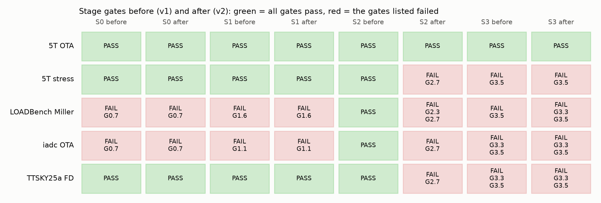
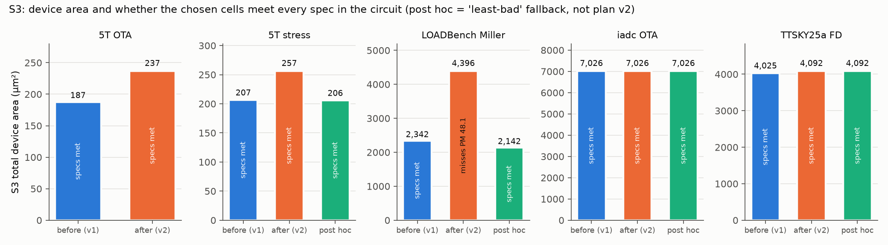
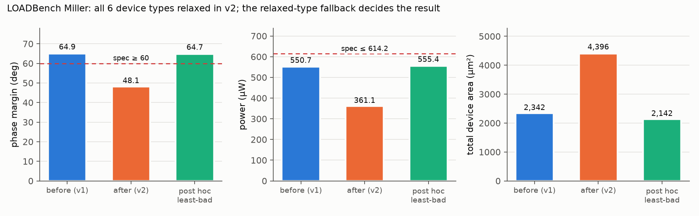
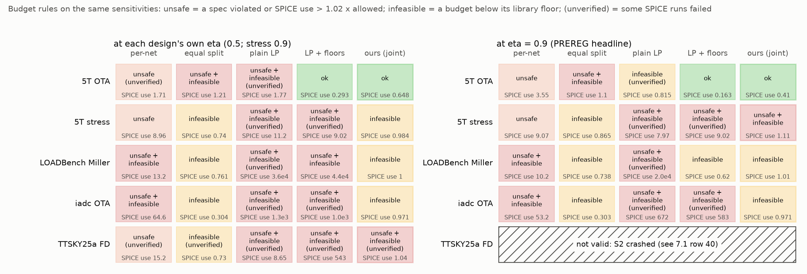
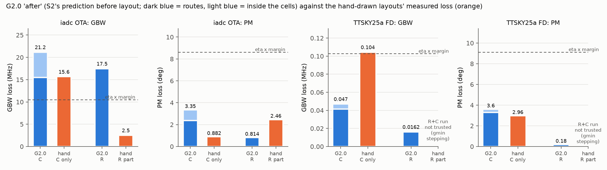

## 7. Plan v2 (2026-10-26 and 27): new circuits, generality fixes, corners, baselines and hand layouts

This section is the whole story of plan v2 (runs on 2026-10-26 and 27, written up on 2026-10-27): what we set
out to do, what we ran, what went wrong, how each problem was found, what was changed, and what the numbers
became. The short answer is in 7.11. "Before" is the flow as it was on
the morning of 2026-10-26 (variant v1, still runnable as `--variant v1`); "after" is v2. Every number comes
from `outputs/compare/<design>/{before,after}.json`, `docs/before_after.md` or the file named next to it.

### 7.0 What plan v2 set out to do

The external review (project doc 11) and the decisions taken on it (project doc 12) asked for: real
circuits beyond the 5T OTA (two fully differential designs with hand-drawn layouts, and a LOADBench op-amp),
run first with the flow as it was ("before") and then with the updates ("after"); PVT corners and mismatch;
the R19 fix and library floors in S2; baselines (per-net budgets, equal split, an LP, the hand-drawn layouts);
an S3 that keeps fingers in the sized device's model bin; a pre-registration; and an independent review.

Decisions of the day, from you:

- TTSKY25a: the flow's DUT stays `Opamp_with_bias.sch` (the tile's bias switch block hardly changes the
  area), and its specs are the schematic's own performance (gain -1 dB, GBW x 0.9, power x 1.1, PM >= 60 deg,
  as for LOADBench). The ICM 2026 paper's post-layout figures are a reported reference only.
- Git: you commit and push with GitHub Desktop; the flow's sessions do not run git while `.git/index.lock`
  exists.
- Work continues while your laptop is on, with hourly updates; decisions are asked as FEEDBACK NEEDED.

Decisions of 2026-10-27 (the runs continued with Claude Code, then this write-up with Cowork):

- S3's met1.6 failure of short-L gate pads is fixed with a met1 patch on the pad (your suggestion; row 37).
- Lane A restarted as a side run next to lane B, so iadc and LOADBench did not wait for TTSKY25a.
- LOADBench's 'after' result is kept as it is; a 'least-bad' fallback for relaxed types was tested separately
  as a post-hoc S3 run (row 38), and then adopted as S3's default for later runs (PREREG amendment). Plan v2's
  results keep the old rule.
- The eta 0.9 S2 runs of the 5T and LOADBench were repeated with the PC awake (row 39).

### 7.1 The journey: what went wrong, how it was found, what changed

In order of discovery. "Found by" says which mechanism caught it: a gate (the flow checking itself), a crash,
a run that took too long, reading the code, a comparison with SPICE or with a hand layout, or one of the two
independent reviews (7.9). Effects are on the numbers reported later in this section.

| # | Stage | What went wrong | Found by | What we changed | Effect |
|---|---|---|---|---|---|
| 1 | S0 | The old flow refused LOADBench (`unsupported element 'Ibias'`) | a clean refusal (correct behaviour) | current sources and passives in the parser and the IR | LOADBench ingests |
| 2 | S0/S1 | The Miller capacitor would have vanished: the IR recorded no passives, so the model's guard never fired | reading the code behind 1 | passives in the IR, the linear model, the layout view and the binding | Miller model vs SPICE 0.017 dB, 0.36 %, 0.03 deg |
| 3 | S1 | A current source's node was treated as AC ground | reading the code behind 1 | only voltage-source nodes are AC ground | correct AC model with ideal bias currents |
| 4 | S0 | m > 1 PCells are drawn as unconnected copies; 95 of 96 TTSKY25a bindings failed LVS | G0.7 | LVS of the copies as drawn (extracted connectivity, W/L/nf, count, negative control) | bindings pass |
| 5 | S0 | The designers' TTSKY25a bench saved only `i(vmeas)` | G0.8 reproduction failed | `save all` in the re-run | 98.401 / 2.0515 / 78.236 reproduced |
| 6 | S0 | iadc bias current on the wrong node; an off-chip element's exposed node was VDD | G0.8 / reading the IR | the exposed node is the non-port terminal | correct bias |
| 7 | S0 | The PDK PCell at the netlist size fails met1.6 (minimum area): LOADBench's 484 um finger, iadc's 1.2/0.2 um LVT devices | G0.7 | kept as a FAIL (a real PDK finding); S3 patches the gate pad (row 37) | S3 cells sign off (row 37); G0.7 still reports the bare PCell |
| 8 | S0 | 45 PVT points took too long one process at a time | run time | one ngspice process per corner looping over VDD and T, checked equal to separate runs | minutes, not hours |
| 9 | S2 | The dual method for phase 2 on large problems was wrong | a check against SLSQP | interior-point (trust-constr) above 200 elements, checked against SLSQP | same optimum |
| 10 | all | Review A, 17 findings on the v2 code before any run | review A (7.9) | 10 applied, 2 not (see 7.9) | |
| 11 | S2/S3 | First 5T after-run relaxed the input pair and tail: the expected need took each element's minimum over different cells, which no single cell achieves | S3 G3.5 FAIL, traced | the need comes from ONE representative cell per device type | 5T after: S3 PASS |
| 12 | S2 | S2 crashed: a baseline's huge resistance left no DC solution and ngspice hung for 600 s | S2 ERROR (TimeoutExpired) | a timed-out run is a failed run; scenarios time out at 180 s | S2 completes |
| 13 | hand layout | The extracted tile would not simulate: header continuation lines, ground on the `ena` pin, floating PEX metal | failed simulations | continuation lines joined, ports mapped, 1 Tohm shunts on every node (all netlists) | 18 runs, no warnings |
| 14 | git | GitHub Desktop could not join the repository's two-commit history (README created on GitHub) and stashed all uncommitted work, reverting fixes and deleting run logs mid-run | reverted code found in the container, then `git reflog` / `git stash list` | `git merge --allow-unrelated-histories origin/main` (no file changed, no force-push), stash restored into the working tree, runs restarted | your push went through |
| 15 | S1 | iadc S1 crashed in G1.4 (division by zero): the recogniser had put 24 of 38 dummies into 6 false mirrors | S1 ERROR, traced | dummies assigned first; iadc package regenerated (TTSKY25a output unchanged, checked) | G1.4 PASS |
| 16 | S0 | Your spec decision changed `config.yaml`; G0.3 refused the changed file | G0.3 (hash freeze) | the frozen hash updated on purpose, with the reason | G0.3 PASS |
| 17 | hand layout | Our "designers' conditions" run of the tile passed `MF=100` only, which in this PDK scales mismatch, not capacitance: 1 load unit instead of 100 | reading the PDK model while chasing 20, checked with ngspice | `MF=100 M=100`, re-run | tile PEX at ff/20 C: 1.43 MHz, 78.0 deg |
| 18 | all | Review B, 11 findings on the code and on this section's first draft | review B (7.9) | all 11 addressed | 7.5-7.8 rewritten |
| 19 | S2 | The baseline comparison was tilted: a failed SPICE run counted as a violation, the LP had no floors, only ours' worst corners were simulated | review B items 1-3 | failed runs apart; `lp_floor` baseline; each method's own worst corners; outcome words defined (PREREG amendment) | 7.6 re-run |
| 20 | S3 | Our explanation of the 5T area increase was wrong (we blamed gate resistance) | review B item 7, then the option table | the binding terminals are drain and source (8.0 ohm allowed; folded cells 8.5-17 ohm on one side) | 7.5 corrected |
| 21 | S2 | iadc phase 2 ran 2.5 hours: elements with zero need made the objective NaN | run time, NaN warnings in the log | objective without the need, strictly positive x, 300 s cap | minutes |
| 22 | S1 | A PDK capacitor's multiplier counted twice (ngspice reports C already x M); iadc model GBW = half of SPICE | G1.1 passive cross-check and G1.2 | value read as reported for C (R / M stays), checked with an ngspice test | iadc model vs SPICE 0.09 dB, 2.8 %, 0.18 deg; TTSKY25a 0.07 dB, 0.09 %, 0.06 deg |
| 23 | S1 | G1.1 counted dummies as unsaturated devices | iadc G1.1, reading the list | dummies excluded | 21 functional devices remain (triode by design, open question) |
| 24 | S2 | Saturation constraints for devices not saturated before layout: negative margins forced budgets to zero | inspecting iadc's constraints (83 sat constraints, many with b < 0) | only saturated devices get one; the others are listed in G2.0 | iadc budgets |
| 25 | S2 | G2.1 failed: placement rules may name a capacitor | iadc G2.1 | passives are valid names | G2.1 PASS |
| 26 | S3 | S3 stopped on iadc: cells of m > 1 devices were drawn with unconnected copies, none signed off | S3 ERROR | one unit cell per option, scaled to the device (area x m, R / m, C x m, `m=` in the circuit) | S3 runs on iadc and TTSKY25a |
| 27 | S0 | 18 TTSKY25a bindings failed their own negative control: L + 0.1 um is within Netgen's tolerance on 10-20 um channels | G0.7 | L + 10 % (at least 0.1 um) | G0.7 PASS |
| 28 | hand layout | iadc layout: separately drawn pieces of a labelled net come out as `VDD_uq3`, `p1_uq0` | unmapped ports in the run record | tied to their net | 6 runs, no warnings |
| 29 | hand layout | The R+C extraction read the C-only `.ext` and ignored the resistances | 0 resistors in the netlist, nonsense results | the R+C extraction runs in its own folder | 324 k resistors |
| 30 | hand layout | The R+C AC run of the iadc layout (324 k resistors) took over 4 GB next to the main queue and nearly pushed the container out of memory | memory check (260 MB left) | run stopped; KLU sparse solver, only the output vectors saved, a 2.6 GB cap per run, extresist tolerance as a parameter | runs at about 1.3 GB |
| 31 | S1 | TTSKY25a G1.4 failed: its bias mirrors are ratioed by channel length (L = 2, 10, 20 um on one gate), which the rule "a mirror shares L" calls inconsistent; S2 would then have asked for identical cells across different L | G1.4 | an L-ratioed mirror is recorded as such and its equal-L subsets are checked as mirrors | TTSKY25a re-run from S1 |
| 32 | infra | A queue waited forever on a stopped run whose process had become a zombie (`kill -0` succeeds on zombies) | the queue log did not move | queues wait on a log line, not a pid | |
| 33 | infra | A second agent (Claude Code on the laptop) and Cowork's deploys could silently overwrite each other's edits: Cowork unpacks its copy over the repo | your question about working with both, then reading the deploy step | `CLAUDE.md` (shared rules and protocol), `docs/STATUS.md` (live handoff), and a deploy step that refuses to overwrite a file changed since Cowork last saw it | no silent overwrite |
| 34 | S2 | After review B's fixes, the LP with floors came out "ok" on the 5T like ours, and the table could not tell them apart | reading the re-run table | budget / need (min and geometric mean) added: the LP with floors gives every element exactly its need, ours 3.2 x on the geometric mean | 7.6 |
| 35 | hand layout | The iadc R+C run gave 19.4 dB with gmin-stepping failures: the R+C netlist exposes the CMFB sub-cell's clock ports separately, and the bench left them floating | the run's own warnings (recorded per run since review B) and an implausible gain; Magic's "electrically shorted" warnings | `--map-shorted`: a port Magic reports as shorted to a mapped port is tied to that port's node | clean R+C run (7.8) |
| 36 | infra | The PC had to go off at 01:30 with about 6 h of runs left; the queues could not resume, and two of them set outputs aside in the container's /tmp | planning the overnight stop | `scripts/plan_v2_resume.sh`: every step writes a `.done` marker and is skipped next time, outputs set aside go to `runs/tmp/aside/` and are restored after an interruption, two lanes side by side; `scripts/plan_v2_stop.sh` stops everything in a safe order | runs continue with Claude Code (docs/HANDOFF.md) |
| 37 | S3 | iadc 'before' S3 stopped: its two 1.2/0.2 um LVT types had no signed-off cell. Every option iadc builds for them (nf = 1, in the sized W bin) failed met1.6, because the PCell's gate contact pad stays 0.290 x 0.230 um = 0.067 um2 at short L (also LOADBench's 484/0.24 nf = 1 cells) | S3 ERROR (`no built option`), then every met1 island of the failing cells measured: only the gate pads are below 0.083 um2 | the strap step widens a gate pad below the minimum area along the gate, away from the S/D strips, to 0.370 x 0.230 = 0.085 um2 (Imasha's suggestion); cells that failed DRC before the patch are rebuilt, signed-off cells are not | iadc 88 of 88 options signed off (was 80): DRC 0, LVS match, negative control still caught, cell size unchanged |
| 38 | S3 | LOADBench 'after' missed PM: 48.1° against ≥ 60° ('before' 64.9°). S2's budgets were starved at the PVT points, so all 6 types were relaxed, and a relaxed type keeps its default PCell. The 484/0.24 and 887/0.74 um devices became single fingers with 8.2 and 4.9 kohm of gate R. The 484 um cell only passed DRC after row 37's patch; before that, the fallback took nf = 8 | G3.3 FAIL, then the chosen cells' access R in `device_decisions.json`: the cells alone cost about 1° of PM, all cells with their access R 17.3° | none in the flow: the 'after' result stands. A 'least-bad' fallback (`--relax-fallback least-bad`: largest min_slack, access R included) is tested post hoc after the queue, in its own folder and snapshot column (Imasha's decision) | post hoc, not pre-registered, same inputs: LOADBench PM 64.7° (spec met), G3.3 passes, area 4396 → 2142 um2, the wide devices at nf = 64 (gate R 2–3 ohm); ota5t_stress area 257 → 206 um2 with GBW and PM slightly up; iadc and TTSKY unchanged (the least-bad option is the default cell). Adopted as the S3 default for later runs (PREREG amendment 2026-10-27; Imasha's decision); plan v2's results keep the old rule |
| 39 | infra | Windows put the PC into Modern Standby on idle timeout five times during the runs (06:59–11:16). The container slowed or paused, and a SPICE check slowed past its 180 s limit would count as a failed run ("unverified", a violation possibly hidden). The eta 0.9 runs of the 5T and LOADBench ran almost entirely in standby, and their logs were gone | the processes' run times were 28–32 min shorter than the wall clock; the Windows event log (Kernel-Power 506/507) | timeouts checked against the standby windows: one possible case (an iadc lp_floor check, no outcome change). The two eta 0.9 runs were re-run with the PC awake (app keep-awake), keeping their logs and a wall-clock vs uptime record | identical results: gates, outcomes, failed-run counts and worst use. For long runs, keep the PC awake |
| 40 | S2 / infra | The TTSKY25a S2 run at eta 0.9 crashed (`OSError: [Errno 22] Invalid argument` while writing an ngspice log in the mounted folder, 12:36), but the resume script snapped it anyway: a crash and a gate FAIL both exit with code 1, and review B's stale-report guard (item 10) only covers stages run through `./flow`. The snapshot mixes the crashed run's `budgets.json` (eta 0.9: eta, starved count, minimum budget / need) with the 'after' run's eta 0.5 report (round-1 t, verification, every budget-rule number, G2.7) | Cowork, writing up 7.6: TTSKY25a's round-1 t and all its budget-rule numbers were identical at eta 0.5 and 0.9, while the round-1 t of the other eta 0.5 designs grew about 1.8 x; then the traceback in `runs/logs/plan_v2_resume.log` | nothing in this documentation pass: the row is marked 'not valid' in 7.6 and in `v2_budget_rules.png`; the re-run and the script fix are open (7.10) | the PREREG headline at eta 0.9 has 4 of 5 designs |
| 41 | S3 | For a device already below vdsat before layout, S3 takes its negative vds − vdsat as the margin, so the check `use <= allowance + 1 % x margin` fails for every option; every iadc type is relaxed whatever its cells, and the least-bad slack flips sign | review C (finding 6), confirmed in `src/s3/run.py` (`mg_of`, the `ok` test, G3.3's `within`) | nothing yet (documentation pass); fix and re-run iadc S3 are open (7.10) | iadc's S3 'before', 'after' and post-hoc results are artefacts of the check |
| 42 | S2 | The 5T's binding PVT constraint (GBW at tt, 0.9 V, 27 C) is contradicted by SPICE: first order says ours uses all of its allowance there, SPICE measures −0.16 of the margin (GBW rises). G2.5 cannot see it: it checks use <= 1.1 x allowed and never compares SPICE with first order | review C (finding 3), confirmed in the 5T snapshot (`verify`) and `src/s2/run.py` | nothing yet; checking the corner's rates and baseline, and a gate on SPICE vs first order, are open | "PVT constraints cost the 5T 36 um2" is qualified (7.5) |
| 43 | infra | Variant S2 runs (no-PVT ablation, eta 0.9) reuse the 'after' S2 folder without clearing it, so files the variant does not write stay behind: the `after_nopvt` snapshots carry the 'after' run's `baseline_budget_over_need` (from a stale `baselines.json`), and the TTSKY25a eta 0.9 snapshot mixed files (row 40) | review C (finding 9), confirmed in both `after_nopvt.json` files (ours' geomean 3.1935 = 'after') | nothing yet; clearing the folder and an identity check in `snap` are open | the stale field is not shown in any table; row 40 as above |
| 44 | S2 | G2.0's route part still uses route lengths from S0's as-sized PCells (single 484 and 887 um fingers on LOADBench; m unconnected copies for m > 1), while v2 changed only the cell part to the representative cell | review C (finding 7), confirmed in `src/s2/run.py` (`unit` = half-perimeter of `device_sizes(s0)`) | nothing yet; route stubs from the representative cells is open | LOADBench's G2.0 is mostly this route R; the claim that G2.0 "flagged" LOADBench's problem is withdrawn (7.8) |
| 45 | infra | A Cowork deploy reused an archive name from 2026-10-26 (`docs_c`); the bridge delivered the old archive, which had no `__prev_md5.txt`, and `apply.sh` extracted it anyway, overwriting `PREREG.md` and `docs/flow_record_section7_draft.md` with their 2026-10-26 18:22 versions for about 5 minutes (no run used them) | the archive's md5 printed by `apply.sh` differed from the one built; then its file list | both files restored from Cowork's copy (md5 checked); `apply.sh` now refuses an archive whose md5 differs from the expected one or that has no `__prev_md5.txt`; archive names carry a timestamp | no lasting change |

### 7.2 New designs and what had to be predicted

| Design | Upstream gave | We predicted (labelled PREDICTED / ASSUMPTION) | Reproduction check |
|---|---|---|---|
| `loadbench_miller` (LOADBench, row 546 of 1024, chosen by a fixed rule) | sized netlist, ~1000 Pareto points with metrics, structure recognition, OP/AC/DC/tran benches | specs (gain −1 dB, GBW ×0.9 of our own simulation, PM ≥ 60°, power ≤ 1.1× LOADBench), noise bench, textbook two-stage Miller equations, MIM binding of the ideal Miller capacitor | G0.8: gain 58.00 vs 58.0 dB, GBW 23.39 vs 23.41 MHz, PM 65.32 vs 65.33°, power 558.4 vs 558.4 µW |
| `ttsky25a_fd` (your TTSKY25a op-amp) | xschem schematics, the designers' testbench, the taped-out GDS, README post-layout figures | flat netlist (xschem + `scripts/flatten_spice.py`), dido benches, specs from the schematic's own performance (gain -1 dB, GBW x 0.9, power x 1.1, PM >= 60 deg, as for LOADBench; the README/paper figures are post-layout results, and the designer chose the schematic as the reference), rule-based primitives, textbook two-stage FD equations | G0.8 against your own bench `Opamp_with_Bias_tb.sch` re-run (tt, 27 C default, open loop, 200 x 1x1 um MIM units per output; ours: chokes, 529 fF ideal): gain 98.401 vs 98.401 dB, GBW 2.0517 vs 2.0515 MHz, PM 78.234 vs 78.236°, power 451.98 vs 451.98 µW |
| `iadc_ota` (r09g/iadc) | netlist, hand-drawn layout with LVS/PEX netlists, transient benches only | AC model of the switched-capacitor CMFB (ideal CMFB with its steady-state law, C3/C4 kept), specs, primitives, textbook folded-cascode equations | no upstream AC figures exist (G0.8 not applicable) |

The rule-based structure recogniser (`scripts/recognize_structures.py`) was checked on the Miller against
LOADBench's own recognition: same differential pair and NMOS mirror; the two PMOS mirrors that share their
diode are one 3-device mirror in ours; the CS driver is a single device in ours and part of an "inverter"
in theirs.

**Which devices the flow treats as matched (TTSKY25a).** The upstream stage that would say which devices form
a differential pair, a mirror or a matched pair did not exist for this design, so the flow predicted it from
the netlist (`scripts/recognize_structures.py`, PREDICTED). The pictures are your own xschem schematics with
each group boxed and tagged (G1, G2, ...) under its SPICE name; the table maps each flat SPICE name to its
schematic instance (`XX1_M5` = M5 of Diff_opamp, `XX2_M7` = M7 of Common_source_stage, `XM33` = M33 of
Opamp_with_bias). You accepted these groups on 2026-10-26. G6-G8 and G14-G15 are the two mirrors whose
devices differ in channel length (journey #31): the flow matches only devices of equal length within them.
Regenerate with `python3 scripts/schematic_groups.py ttsky25a_fd`.

| G | kind | devices (SPICE name -> schematic instance) | sheet |
|---|---|---|---|
| G1 | nmos-differential-pair | XX1_M5 -> M5, XX1_M6 -> M6 | Diff_opamp |
| G2 | nmos-differential-pair | XX1_M18 -> M18, XX1_M16 -> M16 | Diff_opamp |
| G3 | nmos-differential-pair | XX1_M10 -> M10, XX1_M17 -> M17 | Diff_opamp |
| G4 | pmos-differential-pair | XX2_M7 -> M7, XX2_M8 -> M8 | Common_source_stage |
| G5 | nmos-current-mirror | XM33 -> M33, XM37 -> M37, XM41 -> M41 | Opamp_with_bias |
| G6 | nmos-current-mirror ratioed by L, subset 1 (single device: nothing to match) | XX1_M46 -> M46 (L = 2 um, the reference diode) | Diff_opamp |
| G7 | nmos-current-mirror ratioed by L, subset 2 | XX1_M1 -> M1, XX1_M2 -> M2, XX1_M7 -> M7, XX1_M9 -> M9 (L = 10 um) | Diff_opamp |
| G8 | nmos-current-mirror ratioed by L, subset 3 | XX1_M22 -> M22, XX1_M15 -> M15 (L = 20 um) | Diff_opamp |
| G9 | nmos-current-mirror | XX1_M23 -> M23, XX1_M24 -> M24 | Diff_opamp |
| G10 | nmos-current-mirror | XX2_M10 -> M10, XX2_M11 -> M11 | Common_source_stage |
| G11 | nmos-current-mirror-load | XX2_M5 -> M5, XX2_M6 -> M6 | Common_source_stage |
| G12 | pmos-current-mirror | XM39 -> M39, XM38 -> M38 | Opamp_with_bias |
| G13 | pmos-current-mirror-load | XX1_M20 -> M20, XX1_M21 -> M21 | Diff_opamp |
| G14 | pmos-current-mirror ratioed by L, subset 1 (single device) | XX2_M12 -> M12 (6/1 um, diode) | Common_source_stage |
| G15 | pmos-current-mirror ratioed by L, subset 2 (single device) | XX2_M3 -> M3 (1/5 um) | Common_source_stage |
| G16 | nmos-matched-cascode-pair | XX1_M19 -> M19, XX1_M4 -> M4 | Diff_opamp |
| G17 | nmos-matched-cascode-pair | XX1_M3 -> M3, XX1_M8 -> M8 | Diff_opamp |
| G18 | nmos-matched-current-source-pair | XX2_M2 -> M2, XX2_M1 -> M1 | Common_source_stage |
| G19 | pmos-matched-current-source-pair | XM32 -> M32, XM34 -> M34 | Opamp_with_bias |
| G20 | pmos-matched-current-source-pair | XM43 -> M43, XM44 -> M44 | Opamp_with_bias |
| G21 | pmos-matched-current-source-pair | XM45 -> M45, XM54 -> M54 | Opamp_with_bias |
| G22 | pmos-matched-cascode-pair | XX1_M11 -> M11, XX1_M12 -> M12 | Diff_opamp |
| G23 | pmos-matched-current-source-pair | XX1_M13 -> M13, XX1_M14 -> M14 | Diff_opamp |

### 7.3 What the old flow did on the new circuits, and the generality fixes

The v1 code stopped in S0 on LOADBench (`unsupported element 'Ibias'`): correct behaviour, because the
parser refuses what it does not model. Reading the code behind that refusal found two silent bugs that would
have followed:

1. **The Miller capacitor would have vanished.** S0's IR did not record passives at all, so the linear
   model's guard (`if ir.get("passives")`) could never fire, and the layout view dropped every passive.
2. **An ideal current source's node was AC ground.** The linear model grounded the nodes of every internal
   source; that is right for a voltage source and wrong for a current source (open circuit).

Fixed without changing any algorithm: current sources; ideal and PDK passives (MIM, poly resistors) in the
IR, the linear model, the layout view and the PCell binding; off-chip test elements; port roles; external
reference gate G0.8; differential outputs and dido benches; benches found by name; PDK passive values read
from the simulator; dummies skipped in the resistance sensitivities. After these, the Miller's linear model
matches SPICE to 0.017 dB, 0.36 % GBW and 0.03° PM (G1.2), with the Miller capacitor stamped.

Further findings while ingesting:

- **The PDK PCell at the netlist's own size is not always DRC-clean.** LOADBench's single-finger NMOS
  (W = 484 µm, L = 0.24 µm) gives 6 × met1.6 (minimum area) violations with default options (G0.7 FAIL).
  S3 must finger it.
- **m > 1 PCells are drawn as unconnected copies.** All TTSKY25a devices are m = 2; S0's device LVS assumed
  one connected device and failed 95 of 96 bindings. Fixed by checking the copies as drawn (extracted
  connectivity, netlist W/L/nf, device count, negative control with L changed). S3 had the same problem one
  stage later: its option cells were drawn with the m copies unconnected, so none signed off and S3 stopped
  on iadc_ota. S3 now builds one unit cell (m = 1) per option and scales it to the device: area x m (an upper
  bound until S4 places the copies), access resistance / m, the cell's capacitance x m in S2's floors and
  needs, and an `m=` instance multiplier when the cell replaces the device in the circuit simulations.
- **The textbook models (our predictions of the upstream symbolic stage) are optimistic** in the same way
  as the 5T "pole drop-out": Miller PM 82.3° predicted vs 65.3° SPICE, GBW +29 %.
- **A negative control that cannot fail.** The device LVS negative control changed L by a fixed 0.1 um; on
  TTSKY25a's long-channel devices (L = 10 and 20 um) that is within Netgen's relative tolerance, so the wrong
  reference matched and 18 bindings failed their own control. The change is now 10 % of L (at least 0.1 um).
- **The rule-based recogniser had put dummies into mirrors.** A dummy with drain, gate and source on one net
  looks diode-connected, so on iadc_ota 24 of the 38 dummies formed 6 false blocks (one a 10-device "PMOS
  mirror load"), and S1's matching check divided by their zero gm. Dummies (gate tied to source, or all
  terminals on the rails) are now assigned first; the iadc package was regenerated (48 -> 67 blocks). The
  TTSKY25a output is unchanged (checked), LOADBench uses its own recognition, and S1's matching check now
  reports a device that is off instead of crashing.
- **A PDK capacitor's multiplier was counted twice.** ngspice reports a MIM capacitor's value already
  multiplied by the instance multiplier M (four 4.8 x 4.8 um units read 196 fF), and S1 multiplied by M
  again. On iadc_ota the CMFB capacitors C3/C4 became 784 fF and the linear model's GBW was half of SPICE's
  (105 vs 210 MHz). G1.1's cross-check of every PDK passive against the simulator flagged it (rel. diff
  -0.75). Fixed in `op.passive_value` (resistors are reported per copy, so R / M stays); after the fix the
  model matches SPICE to 0.09 dB, 2.8 % GBW and 0.18 deg. TTSKY25a's Miller capacitors (M = 5) would have
  been hit the same way; its runs are after the fix.
- **Saturation constraints for devices that are not saturated.** S2 made one per device, so a dummy or a
  MOS resistor (iadc_ota: 21 functional devices below BSIM's vdsat, 15 of them in five series stacks with the
  gate at cm, i.e. triode by design) gave a negative "margin" that forces every budget touching it to zero.
  Now only devices saturated before layout get one; the others are listed in G2.0. G1.1 still fails on
  iadc_ota for those 21 devices (dummies are no longer counted): it is the BSIM vds > vdsat test, and the
  design intent of each device is the designer's to state, not ours to assume.
- **The large phase-2 solver could run for hours.** With more than 200 elements (iadc_ota: 756) phase 2 uses
  an interior-point solver; elements with zero expected need made its objective NaN. The objective no longer
  depends on the need, and the solve is capped at 300 s (the phase-1 budgets are kept past it).
- **The repository's schematic is not the taped-out circuit.** The TTSKY25a tile layout extracts to 86
  merged devices vs 58 in `Opamp_with_bias.sch` (a bias switch block, bias dummies, more MIM units and
  resistors). See 7.6.

### 7.4 What v2 changes (code)

| Stage | Change | Gate |
|---|---|---|
| S0 | 45 PVT points (5 corners × VDD ±10 % × −40/27/85 °C), run as one ngspice process per corner (checked equal to separate runs); 200-run mismatch Monte Carlo (tt_mm, one seed per run) | G0.9, G0.10 (info) |
| S2 | Library floors: no element below what the cheapest cell of the S3 library (main mode A-bin) puts on it; expected need from ONE representative cell per type (not per-element minima, which no single cell achieves) | G2.7 |
| S2 | R19 fix: phase 2 never trims an element below min(phase-1 budget, need) nor below its floor | G2.3 |
| S2 | One constraint per spec and PVT point where the sized circuit meets the spec (exact linear model at that point's operating point; resistance rates: nominal + change); SPICE checks of the binding corners | G2.9, G2.5 |
| S2 | Three other budget rules on the same sensitivities and the same eta, scored first order and in SPICE: per-net (SpiceXplorer's rule), equal split, a plain LP (maximise the sum of budget/need) and the same LP with the library floors and budgets capped at need; eta sweep 0.3–1.0 | G2.8 |
| S3 | Option modes B / A-bin / A-free + rule-of-thumb folding (finger 4 µm); wide-device nf 16–64; v2 R allowance (a cell may use the library's lowest access R of its terminal) | G3.7 |

An independent review agent read the v2 code before the runs; its 17 findings and what was done with each
are in 7.9.

### 7.5 Results before and after

The numbers in 7.5 and 7.6 come from the snapshots `outputs/compare/<design>/<tag>.json` (also tabulated in
`docs/before_after.md`) or from the run outputs named next to them (`outputs/S2/<design>/budgets.json`,
`s2_report.json`, `outputs/S3/<design>/device_decisions.json`). The figures are drawn from the snapshots by
`scripts/make_v2_figures.py`. 'before' is v1 (the
flow as it was, `--variant v1`), 'after' is v2. The **post hoc** column is a separate S3 re-run on the 'after' budgets
with the 'least-bad' rule for relaxed types (7.1 row 38, PREREG amendment of 2026-10-27). It is not a plan-v2 result,
and nothing in the 'after' columns uses it.

What the two figures show at a glance:

- **No design passes S2 or S3 in v2 except the 5T.** The 5T passes everything, before and after. The other four
  fail S2's new gate G2.7 in v2: the S3 library's cheapest cells alone use more than eta x margin of some
  constraint (worst: ota5t_stress 1.26x, TTSKY25a 2.32x, LOADBench 2.80x, iadc 12.7x; `floor_use_of_allowed` in G2.7). v1 had no such
  gate and passed S2 on all five.
- **S0 and S1 are the same before and after** (v2 only adds the PVT points to S0). Their failures are about the
  designs, not the flow version: G0.7 on LOADBench and iadc (PDK PCells at the netlist size fail met1.6, row 7), G1.6
  on LOADBench (one nonlinear resistance case) and G1.1 on iadc (21 functional devices below vdsat, open question).
- **Every final circuit meets every spec, except LOADBench 'after'** (PM 48.1 deg against >= 60). There the
  relaxed-type fallback, not the budgets, decided the result (below and 7.1 row 38).

**example_ota_5t** (before = v1, after = v2; both S2 and S3 PASS):

| | before (v1) | after (v2) |
|---|---|---|
| S3 cells (PMOS load / input pair / tail) | nf2 / nf2 / nf4 | nf1 / nf1 / nf2 |
| total device area | 187.2 um2 | 237.0 um2 (+27 %) |
| final gain / GBW / PM (cells in the circuit) | 32.88 dB / 101.9 MHz / 79.84 deg | 31.79 dB / 102.4 MHz / 79.63 deg |
| fingers outside the sized device's W bin | (not checked in v1) | none (A-bin) |

Why v2 costs area here: S2's round 1 is now bound by a PVT point, GBW at tt, VDD −10 %, 27 C (point tt_v0.9_t27,
G2.9; margin 4.97 MHz against 84.5 MHz nominal), not by the nominal margins, so the binding elements' budgets sit
at their need (round-1 t = 1.05; other elements get more in phase 2, geometric mean 3.2 x need). The input
pair's drain and source may then carry 8.0 ohm of access resistance, and its folded cells have 8.5–17 ohm on one
side, so only the unfolded cell fits (row 20; the first draft blamed gate resistance, which was wrong). In v2's
other modes: B (nf as in the netlist) 254.5 um2 with the tail relaxed; A-free 232.0 um2 but the tail's 6 um
fingers leave the sized W bin; rule-of-thumb folding 190.5 um2 with all three types over their allowances.
Without the PVT constraints the area is 200.8 um2 (ablation).

**Caveat (review C, finding 3): the binding PVT constraint is contradicted by SPICE.** At tt_v0.9_t27 the first-
order model says ours' budgets use all of their allowance (0.5 of the margin), but SPICE, with every harmful
budget inserted, measures −0.16 of the margin: GBW goes *up* (−0.27 at eta 0.9). G2.5 does not catch this,
because it only checks use <= 1.1 x allowed. Until the corner's rates or its baseline are explained, "the PVT
constraints cost the 5T 36 um2" rests on a constraint SPICE does not confirm.

**ota5t_stress** (eta 0.9; the 5T with a 200 fF load and tight specs):

| | before (v1) | after (v2) |
|---|---|---|
| S2 gates | PASS | G2.7 FAIL: the library's cheapest cells do not fit |
| S2 round-1 t (budget / need) / elements starved | 1.00 / 11 of 21 | 0.26 / 20 of 21 |
| PVT constraints | none | 83 |
| budgets in SPICE, worst use as a fraction of the margin (/ allowed at eta 0.9) | 0.84 / 0.94 (GBW, nominal) | 0.89 / 0.98 (GBW at ss, 1.1 V, 85 C) |
| S3 | G3.5 FAIL: 2 device types relaxed | G3.5 FAIL: 3 device types relaxed |
| total device area | 206.9 um2 | 256.6 um2 |
| final gain / GBW / PM | 32.22 dB / 369.2 MHz / 63.65 deg | 31.75 dB / 356.3 MHz / 62.41 deg |

Both versions end with S3 relaxing cells: at eta 0.9 this design does not fit. The difference is where the
flow says so. v1's S2 passed with 11 of 21 budgets below their expected need, and S3 found out by relaxing two device types.
v2's S2 fails G2.7 before any cell is chosen, names the binding point (GBW at ss, 1.1 V, 85 C, where the
margin is 7.8 MHz against 37.4 MHz nominal), and gives the number: the cheapest library cells alone use
1.26 x eta x that margin.

- **Without the PVT constraints** (ablation `after_nopvt`): S2 passes (G2.7 too), S3 relaxes nothing, 200.8 um2,
  31.80 dB / 368.5 MHz / 61.94 deg. So the PVT points are what make this design not fit.
- **Post hoc, least-bad fallback** (not plan v2): the same 3 types relaxed, 2 of them now nf = 2; area 206 um2,
  31.80 dB / 370.2 MHz / 63.76 deg.

**loadbench_miller** (two-stage Miller, held out; eta 0.5; specs gain >= 57.0 dB, GBW >= 21.05 MHz, PM >= 60 deg,
power <= 614.2 uW):

| | before (v1) | after (v2) | post hoc (least-bad S3; not plan v2) |
|---|---|---|---|
| S2 gates | PASS | FAIL G2.7 (cheapest cells use 1.16–2.80 x eta x margin at 4 PVT points) and G2.3 (phase 2 did not converge; the max-min budgets are kept) | as 'after' (same budgets) |
| S2 round-1 t (budget / need) / starved | 0.076 / 21 of 40 | 0.00094 / 39 of 42 | – |
| PVT constraints | none | 122 | – |
| G2.0, expected use of the margins (gain / GBW / PM) | 6.57 / 0.97 / 6.26 | 6.64 / 0.91 / 3.74 | – |
| S3 relaxed types | 3 of 6 | 6 of 6 | 6 of 6 (5 change cell) |
| total device area | 2342 um2 | 4396 um2 | 2142 um2 |
| final gain / GBW / PM / power | 57.99 dB / 22.96 MHz / **64.9 deg** / 550.7 uW | 57.74 dB / 22.55 MHz / **48.1 deg** / 361.1 uW | 57.99 dB / 22.74 MHz / **64.7 deg** / 555.4 uW |
| specs met | all | **PM fails** (G3.3 FAIL) | all |

What happened:

1. **S2 says, before any layout, that this design cannot fit.** G2.0's expected use is 6.6 margins of gain and
   3.7 of PM. Almost all of it is route resistance (6.55 of the 6.64 gain margins, 17.7 of 19.9 deg of PM), with
   route lengths taken from the as-sized single-finger PCells (7.8, review C finding 7). The gain spec is only
   1 dB below the sized circuit (our PREDICTED spec rule, 7.2), and at sf, 0.9 V, −40 C only 0.014 dB (7.6). v2 adds the PVT
   points and floors, and round 1 ends at t = 0.00094: almost every budget is a small fraction of its need.
2. **So S3 relaxes all six types, and the rule for a relaxed type decides the result.** The plan-v2 rule kept
   the default PCell, the device as sized. For the 484.2/0.24 and 887.03/0.74 um devices that is one finger with
   8.2 and 4.9 kohm of gate resistance. All cells together, with their access resistance, cost 17.3 deg of PM; the
   cells without access resistance about 1 deg (read from `device_decisions.json`, 7.1 row 38).
3. **Why 'before' did better.** v1 relaxed only 3 types (the 887 um device was not one of them), and the 484 um
   nf = 1 cell was not DRC-clean before the gate-pad patch of 2026-10-27 (row 37), so v1's fallback took nf = 8
   for it. The patch made the bad cell available to v2's fallback.
4. **The post-hoc least-bad rule** keeps, for each relaxed type, the option that breaks its allowances least,
   access R included. 5 of 6 types change; the two wide devices go to nf = 64 (gate R 3 and 2 ohm), PM is
   64.7 deg and the area halves. Power also returns to 'before' (555 uW): the nf = 1 strips put 88–161 ohm in
   the sources of large, weakly inverted devices, which cut their current. That last point is an inference from
   the access-R values; no separate run tested it.

**iadc_ota** (folded cascode with SC CMFB, held out, hand layout in 7.8; eta 0.5; specs gain >= 52.47 dB, GBW >=
188.87 MHz, PM >= 60 deg):

| | before (v1) | after (v2) | post hoc |
|---|---|---|---|
| S2 gates | PASS | FAIL G2.7 (cheapest cells use up to 12.7 x eta x margin) | as 'after' |
| S2 round-1 t / starved | 0.135 / 137 of 512 | 0.0166 / 574 of 750 | – |
| PVT constraints | none | 105 | – |
| G2.0 expected use (gain / GBW / PM margins) | 2.88 / 3.70 / 0.28 | 1.03 / 1.84 / 0.24 | – |
| S3 relaxed types | 22 of 22 | 22 of 22 | 22 of 22 (no cell changes) |
| total device area | 7026 um2 | 7026 um2 | 7026 um2 |
| final gain / GBW / PM | 53.47 dB / 203.8 MHz / 76.5 deg | the same | the same |
| specs met | all | all | all |
| S3 gates | FAIL G3.3, G3.5 | FAIL G3.3, G3.5 | FAIL G3.3, G3.5 |

- **S3's result is identical before and after, and the reason is a code defect** (review C, finding 6, checked in
  `src/s3/run.py`). For a device that is already below vdsat before any layout (the G1.1 devices; 45 such checks in
  G3.3), S3 uses its negative vds − vdsat as the "margin", so the check `use <= allowance + 1 % x margin` has a
  negative right-hand side and fails for every option, even one that changes nothing. Every type is therefore
  relaxed whatever its cells are. S2 v2 rightly sets no constraint for these devices (row 24); S3 did not follow.
  The same sign error enters the least-bad rule's slack. In A-bin mode every iadc type also has only nf = 1
  options (W = 1.2–1.4 um), so there would be little to choose even without the defect; how much is not known.
- **What v2 changes is S2's estimate.** G2.0's GBW use drops from 3.70 to 1.84 margins because the expected cells
  are now the library's representative cells instead of v1's as-sized single fingers (access R part 52.3 → 7.6
  MHz). 7.8 tests this against the hand layout.
- The gate-pad patch (row 37) was needed for this design to run S3 at all.

**ttsky25a_fd** (Imasha's taped-out two-stage FD op-amp, held out; eta 0.5; specs gain >= 97.40 dB, GBW >=
1.8465 MHz, PM >= 60 deg, power <= 497.2 uW):

| | before (v1) | after (v2) | post hoc |
|---|---|---|---|
| S2 gates | PASS | FAIL G2.7 (cheapest cells use up to 2.32 x eta x margin) | as 'after' |
| S2 round-1 t / starved | 1.62 / 0 of 2555 | 0.227 / 2035 of 2678 | – |
| PVT constraints | none | 104 (5 of 45 PVT points meet every spec) | – |
| G2.0 expected use (gain / GBW / PM margins) | 0.19 / 0.31 / 0.21 | 0.20 / 0.31 / 0.21 | – |
| S3 relaxed types | 4 of 22 | 10 of 22 | 10 of 22 (no cell changes) |
| total device area | 4025 um2 | 4092 um2 | 4092 um2 |
| final gain / GBW / PM / power | 98.42 dB / 2.046 MHz / 77.86 deg / 452.6 uW | the same (PM 77.862) | the same |
| specs met | all | all | all |
| S3 gates | FAIL G3.3, G3.5 | FAIL G3.3, G3.5 | FAIL G3.3, G3.5 |

- **Nominally the design has room** (G2.0 uses only 0.2–0.3 of each margin, and v1 gave every element 1.6 x its
  need). **One PVT point takes it away:** gain at ff, 1.0 V, 27 C meets its spec by only 0.093 dB, and there the
  cheapest cells already use 2.3 x eta x margin (the next point: 0.41; 7.6). Only 5 of 45 points meet every spec. So v2 starves 2035 elements and relaxes 10 types, mostly on S/D access R.
- **The final circuit performs as 'before'** to 0.002 deg, although the cells differ (area +1.7 %): at 2 MHz, with
  load and Miller capacitors of about 0.5–1 pF on the signal nodes, the cells' own parasitics barely register
  (an inference; not tested separately).
- **G3.3 fails on power in both versions**, by 0.6 uW of a 45 uW margin. S2 budgets gain, GBW, PM and noise, not
  power (`SPECS` in `src/s2/run.py`), so S3's power allowance is zero, and an increase above S3's 1 %-of-margin
  tolerance (0.45 uW) fails G3.3. This is a gate-definition issue, not a layout problem (7.10).

**Before → after, overall.** v2 never improved a final spec on these five designs. What it changed is *where and how*
the flow says that a design does not fit: in S2, before any cell is chosen, with the binding PVT point and a number,
instead of as relaxed cells in S3. But the binding points are corners where the sized circuit only just meets a
spec (0.014 dB, 0.093 dB, 0.26 deg on the held-out designs; 7.6), and on the 5T SPICE contradicts the binding
corner's first-order rate (caveat above). Two side results: the PVT constraints, not the floors, are what the
ablation removes to make the 5T smaller and the stress design fit, and the relaxed-type rule can dominate a result
when S2 leaves no budget (LOADBench). On iadc, S3's result is fixed by a saturation-check defect, not by the
budgets (review C, finding 6).

### 7.6 Joint vs per-net budgets: the three-outcome result

Five budget rules on the same sensitivities, the same eta and the same constraints (nominal + PVT points),
scored two ways: first order (the sum the rule assumed) and in SPICE (every budget that hurts a spec inserted
into the transistor netlist at once, at each rule's own most-used PVT points; one common set of checks per
design). The words are those of PREREG's 2026-10-26 amendment, as `outcome()` in `src/s2/baselines.py` computes them:

- **unsafe**: a spec is violated in SPICE, or use / (eta x margin) > 1.02 (SPICE use where SPICE ran, else first
  order): the layout would eat more than its allowance;
- **infeasible**: some element is budgeted below its library floor, i.e. below what the cheapest S3 cell already
  adds there, so no layout can meet it ("starved" = below the expected need, a softer signal);
- **ok**: neither. A SPICE run that fails (no DC solution, timeout) is listed apart and marks the outcome
  "(unverified)", never a violation (review B, item 1).

The last numeric column says how much room a rule leaves the layout: budget / expected need, minimum and
geometric mean over the budgeted elements. The tables below are the re-runs after review B
(`docs/before_after.md`); the first version of the 5T table counted per-net's one failed run as a GBW violation.

**example_ota_5t** (eta 0.5, 21 elements, 103 PVT constraints, 19 SPICE checks):

| Rule | Use / allowed, 1st order | Use / allowed, SPICE | Failed runs | Starved | Below floor | Budget / need, min / geomean | Outcome |
|---|---|---|---|---|---|---|---|
| per-net (SpiceXplorer's rule) | 4.21 | 1.71 | 1 | 0 | 0 | 1.77 / 8.68 | **unsafe** (unverified) |
| equal split | 0.62 | 1.21 | 0 | 4 | 2 | 0.11 / 3.53 | **unsafe + infeasible** |
| plain LP (max sum of budget / need) | 1.00 | 1.77 | 1 | 4 | 4 | 0 / 0.03 | **unsafe + infeasible** (unverified) |
| LP with floors, capped at need | 0.95 | 0.29 | 0 | 0 | 0 | 1.00 / 1.00 | **ok** |
| ours (joint max-min, floors, PVT) | 1.00 | 0.65 | 0 | 0 | 0 | 1.00 / 3.19 | **ok** |

Two rules are safe and feasible on the 5T. The LP with floors reaches that by giving every element exactly its
expected need (it is capped there, as review B asked, so that it does not sit on vertices at 0 or 10 x need):
any net that comes out above its estimate breaks it. Ours leaves the layout 3.2 x the expected need on the
geometric mean, and the LP with floors is the safer of the two in SPICE (0.29 against 0.65 of the allowance).
Two cautions (review C, finding 5): the budget / need column was added after the outcomes tied (row 34), and the
LP with floors cannot exceed the need by construction (its upper bound is the need; ours may go to 10 x), so that
column favours ours by design. A fair comparison of room needs the LP re-run with ours' upper bound. Per-net budgets each net as if it were alone and overshoots the allowance 1.7 x in SPICE;
equal split and the plain LP put elements below the cheapest library cell.

**ota5t_stress** (eta 0.9, 21 elements, 83 PVT constraints, 22 SPICE checks): no rule works, and S2 says so
before any layout (G2.7 FAIL). At ss, VDD +10 %, 85 C the GBW margin is 7.8 MHz (37.4 MHz nominal), and the
cheapest library cells alone use 1.26 x eta x that margin, so the LP with floors falls back to no floors.

| Rule | Use / allowed, 1st order | Use / allowed, SPICE | Specs violated in SPICE | Failed runs | Starved | Below floor | Budget / need, min / geomean | Outcome |
|---|---|---|---|---|---|---|---|---|
| per-net | 10.5 | 8.96 | GBW nominal and at 6 PVT points, PM at 5, gain at 1 | 0 | 1 | 0 | 0.90 / 5.16 | **unsafe** |
| equal split | 0.76 | 0.74 | none | 0 | 13 | 11 | 0.06 / 0.73 | **infeasible** |
| plain LP | 1.00 | 11.2 | GBW at sf, 1.0 V, 27 C | 8 | 11 | 11 | 0 / 0.00 | **unsafe + infeasible** (unverified) |
| LP with floors (floors dropped) | 1.00 | 9.02 | GBW at 2 points | 9 | 6 | 4 | 0 / 0.005 | **unsafe + infeasible** (unverified) |
| ours | 1.00 | 0.98 | none | 0 | 20 | 15 | 0.26 / 0.31 | **infeasible** |

Two rules stay inside the allowance in SPICE here: equal split (0.74) and ours (0.98), and both are
infeasible. Equal split does it with fewer elements below their floor (11 against 15) and more room (geometric
mean 0.73 against 0.31 x need); ours has the higher minimum (0.26 against 0.06 x need), which is what max-min
sharing maximises (review C, finding 1; the first version of this paragraph said ours was the only rule inside).
The two LPs put many elements at zero, and those circuits often have no DC solution in SPICE.

**The three held-out designs at their own eta (0.5).** Each cell: outcome (SPICE worst use / allowed; failed SPICE
runs / checks when there are any).

| Design | per-net | equal split | plain LP | LP with floors | ours |
|---|---|---|---|---|---|
| loadbench_miller (42 elements, 21 checks) | unsafe + infeasible (13.2) | infeasible (0.76) | unsafe + infeasible (3.6e4; 11/21 failed) | unsafe + infeasible (4.4e4) | **infeasible (1.00)** |
| iadc_ota (750 elements, 50 checks) | unsafe + infeasible (64.6) | infeasible (0.30) | unsafe + infeasible (1.3e3; 26/50 failed) | unsafe + infeasible (1.0e3; 9/50 failed) | **infeasible (0.97)** |
| ttsky25a_fd (2678 elements, 69 checks) | unsafe (15.2; 1/69 failed) | infeasible (0.73; 1/69 failed) | unsafe + infeasible (8.65; 26/69 failed) | unsafe + infeasible (543; 2/69 failed) | **unsafe + infeasible (1.04; 1/69 failed)** |

**PREREG headline: every design at eta = 0.9** (snapshots `after_eta0.9`; S2 only, S3 not re-run).

| Design | per-net | equal split | plain LP | LP with floors | ours | ours: budget / need (geomean) |
|---|---|---|---|---|---|---|
| example_ota_5t | unsafe (3.55; violates GBW at tt, 0.9 V, 27 C and XM5's saturation) | unsafe + infeasible (1.10) | infeasible (0.82; 8/19 failed) | ok (0.16; every budget = need) | **ok (0.41)** | 4.79 |
| ota5t_stress | unsafe (9.07) | infeasible (0.87) | unsafe + infeasible (7.97; 8/22 failed) | unsafe + infeasible (9.02; 9/22 failed) | **unsafe + infeasible (1.11)** | 0.31 |
| loadbench_miller | unsafe + infeasible (10.2) | infeasible (0.74) | unsafe + infeasible (2.0e4; 4/21 failed) | infeasible (0.62) | **infeasible (1.008)** | 0.014 |
| iadc_ota | unsafe + infeasible (53.2) | infeasible (0.30) | unsafe + infeasible (672; 25/50 failed) | unsafe + infeasible (583; 9/50 failed) | **infeasible (0.97)** | 0.14 |
| ttsky25a_fd | **not valid**: the eta 0.9 S2 run crashed, and its snapshot mixes that run's `budgets.json` with the eta 0.5 report (7.1 row 40). Not re-run yet | | | | | |

**Is the eta 0.9 table trustworthy?** The first eta 0.9 runs of example_ota_5t and loadbench_miller ran almost
entirely during a Windows standby (7.1 row 39). Both were re-run with the PC awake, and all 31 compared fields
agree exactly for each (gates, every rule's outcome, failed-run lists, worst use first order and in SPICE,
verification; `outputs/posthoc/eta09_rerun/compare.json`). The 5T's 8 failed plain-LP runs repeat with the PC
awake (4 are ngspice timeouts), so those budget scenarios genuinely do not converge. The TTSKY25a row is the
exception above. ota5t_stress also ran at eta 0.9 on 2026-10-26 ('after'); today's run differs slightly (round-1
t 0.2567 → 0.2575; ours' SPICE use 0.984 → 1.11, which turns "infeasible" into "unsafe + infeasible"). The
cause is not found yet (7.10).

**What binds: one PVT point with a very small margin** (review C, finding 2; from `outputs/S2/<design>/budgets.json`
and G2.7 in `s2_report.json`). PREREG adds a constraint for every PVT point where the sized circuit meets the spec,
however narrowly. On every design the point that binds round 1 and drives G2.7 is such a point:

| Design | binding constraint (round 1) | its margin | nominal margin | G2.7 floor use there (next highest) |
|---|---|---|---|---|
| example_ota_5t | GBW at tt, 0.9 V, 27 C | 4.97 MHz | 84.5 MHz | 0.33 (passes) |
| ota5t_stress | GBW at ss, 1.1 V, 85 C | 7.78 MHz | 37.4 MHz | 1.26 (0.93) |
| loadbench_miller | gain at sf, 0.9 V, −40 C | **0.014 dB** | 1.0 dB | 2.43 (GBW at sf, 1 V, 85 C: 2.80, margin 0.25 MHz) |
| iadc_ota | PM at ss, 0.9 V, −40 C | **0.26 deg** | 17.2 deg | 12.7 (GBW at ss, 0.9 V, 85 C: 12.7, margin 1.32 MHz) |
| ttsky25a_fd | gain at ff, 1.0 V, 27 C | **0.093 dB** | 1.0 dB | 2.32 (0.41) |

- These margins are at or below S1's own model error (gain: 0.07 dB on TTSKY25a, 0.017 dB on LOADBench; G1.2,
  nominal point). So "infeasible" on the held-out designs says that the sized circuits barely meet their
  specs at some corners, more than it says anything about layout.
- TTSKY25a's G2.7 FAIL rests on that single point (2.32; the next is 0.41). Without it, G2.7 would pass and S2 would
  not starve 2035 elements. LOADBench's eta 0.9 "exceedance" (1.008 = 127/126 at a 0.0126 dB allowance) is one
  step of the gain measurement's resolution.
- A sensitivity analysis that drops PVT constraints whose margin is below the model error was not run (7.10).

**Read against the hypotheses** (PREREG; the benchmark circuits are the three held-out designs; corrected after
review C, finding 4):

| Hypothesis | What the runs show | Verdict |
|---|---|---|
| **H1** soundness: all of ours' budgets together use at most eta x margin in SPICE | H1 as written has no tolerance (the 1.02 of the 2026-10-26 amendment is for H1b and H1c). In 8 distinct design–eta pairs, ours exceeds 1.0 three times: TTSKY25a at eta 0.5 (1.035, with 1 failed run), LOADBench at eta 0.9 (1.008, one resolution step on a 0.014 dB margin) and ota5t_stress at eta 0.9 (1.11 in today's run; 0.98 in 2026-10-26's run of the same pair). The SPICE checks cover up to 15 PVT points per design, not every corner | **not supported in full.** Two of the three exceedances sit on margins below the model error; the third is not reproducible |
| **H1b** per-net violates H1 on >= 2 of 3 benchmark circuits, joint does not | Per-net is unsafe on all 3 held-out designs at eta 0.5 (13–65 x the allowance in SPICE, with real spec violations) and on both valid ones at 0.9. Ours stays within on iadc and (at eta 0.5) LOADBench, not on TTSKY25a | **first half supported, but expected by construction**: per-net gives each element the whole allowance, so N elements overshoot about N-fold (first order 4.2 to 70). **Second half fails on TTSKY25a.** Our per-net rule re-implements SpiceXplorer's rule; PREREG asked for the authors' code |
| **H1c** equal split gives some element a budget below its floor on >= 2 of 3 | Infeasible on all 3 held-out designs at eta 0.5 (11–85 elements below floor) and on both valid ones at 0.9 | **supported, but uninformative here**: on all three held-out designs the floors alone already exceed the allowance (G2.7), so *every* rule that respects the allowance must put some element below its floor. Ours does so too, with more elements below floor than equal split on LOADBench and iadc |

What this means:

1. **Per-net budgets are unsafe everywhere** (1.7 to 65 x the allowance once all budgets are in the circuit
   together). This is the expected textbook result (superposition), now measured in SPICE on five designs; it
   is not by itself evidence for our allocation.
2. **On the held-out designs, ours is not better than equal split on any pre-registered outcome** (review C,
   finding 1). Both are "infeasible" on LOADBench and iadc; on TTSKY25a equal split is "infeasible" and ours
   "unsafe + infeasible". Equal split also has fewer elements below floor there. Ours wins only on the minimum
   budget / need, the quantity max-min sharing maximises by construction. The "safe and feasible, with room"
   result that PREREG's argument needs is shown on the 5T only, and there the LP with floors is also safe and
   feasible.
3. **The infeasibility itself comes from near-zero-margin PVT points** (table above), so it describes the sized
   circuits and the spec rule as much as the layout problem.
4. **The plain LP is not a usable baseline in SPICE**: it puts many budgets at zero or at the cap, and on the larger
   designs about half of its SPICE checks fail to converge (from 1 of 19 on the 5T to 26 of 50 on iadc). The LP
   with floors behaves better, but at eta 0.9 it is unsafe on 2 of the 4 valid designs and infeasible on 3.

### 7.7 The hand-drawn TTSKY25a layout measured the flow's way

`scripts/reference_ttsky25a.sh` extracts the taped-out tile `tt_um_diff` with Magic (an LVS netlist, and a PEX
netlist with every capacitance, cthresh 0, no wire resistance) and simulates three netlists in the flow's own
dido benches (DC feedback through chokes, differential output, 1 Tohm shunts on every node in all three runs):
the flow's DUT (`Opamp_with_bias.sch`), the tile's drawn devices without parasitics, and the tile's PEX. Tile
pins: en_1 = 1.8 V, en_2 = 0. All 18 simulations ended with rc 0 and no numerical warnings
(`outputs/reference_layout/ttsky25a_fd/reference_layout*.json`, key `runs`).

| Conditions | Netlist | Gain (dB) | GBW (MHz) | PM (deg) | Power (uW) |
|---|---|---|---|---|---|
| flow bench: tt, 27 C, ideal 529 fF loads | schematic (flow DUT) | 98.39 | 2.052 | 78.23 | 452.0 |
| | tile, drawn devices only | 108.12 | 1.530 | 80.56 | 481.2 |
| | tile, PEX | 108.11 | 1.426 | 77.60 | 481.2 |
| designers' `gain_and_phase.sch`: ff, 20 C, 100 x (1x1 um) MIM units per output | schematic | 97.53 | 2.073 | 78.66 | 588.3 |
| | tile, drawn devices only | 108.49 | 1.537 | 80.87 | 618.8 |
| | tile, PEX | 108.47 | 1.430 | 77.98 | 618.8 |
| tt, 27 C, the same 100 MIM units | schematic | 98.39 | 2.052 | 78.84 | 452.0 |
| | tile, drawn devices only | 108.12 | 1.529 | 81.16 | 481.2 |
| | tile, PEX | 108.11 | 1.424 | 78.18 | 481.2 |

ICM 2026 paper / README (post-layout simulation, reported): gain ~100 dB, GBW 2.3 MHz, PM 52 deg, CMRR ~91 dB at
1 kHz, power ~500 uW.

What this says, and what it does not:

1. **Drawn -> PEX (capacitance only) costs** GBW -6.8 to -6.9 %, PM -2.9 to -3.0 deg, gain -0.01 dB, power 0,
   at all three condition sets. This is the hand layout's wiring capacitance, the quantity S2 budgets. Wire
   resistance is not extracted, so it is a lower bound of the layout's cost.
2. **The tile is not the repository's schematic.** LVS of the tile against the flow's layout view fails (86
   merged devices against 58: a bias switch block, bias dummies, and a MIM network of four groups of 8 x
   10x10 um units plus 3 units per output, against 5 units per Miller capacitor). Without any parasitic, the
   tile's devices give +9.7 dB gain, -25 % GBW and +29 uW against the schematic at the same conditions.
   The designer kept the schematic as the flow's DUT (2026-10-26).
3. **Under the flow's specs the tile fails GBW before any wiring.** The specs are the schematic's own
   performance (GBW >= 0.9 x 2.052 = 1.85 MHz), and the tile's drawn devices give 1.53 MHz. Its wiring loss,
   0.104 MHz, is 51 % of the schematic's 0.205 MHz GBW margin, above eta = 0.5: a layout of the tile's wiring
   quality would not fit the budget of this spec rule. This depends on the x 0.9 rule, so the comparison with
   S2's G2.0 prediction is read as a ratio of losses, not as pass or fail.
4. **The paper's 2.3 MHz / 52 deg is not reproduced** by either netlist, even at the designers' own bench
   conditions (1.43 MHz / 78.0 deg for the tile's PEX, 2.07 MHz / 78.7 deg for the schematic). How that run
   was set up (extraction tool, wire resistance, which netlist) is not in the repository: open question.
5. With en_2 = 1.8 V the drawn devices still give 108.4 dB but the PEX gives 3.8 dB: a different DC solution
   (start-up / bias bistability or a numerical artefact), not a capacitance effect. Not investigated; with
   both enables at 0 neither netlist converged.

Correction recorded here: the first runs of the MIM-load condition sets (14:14) passed only `MF=100`, which in
this PDK scales the mismatch term, not the capacitance, so they had one 1x1 um unit (2.6 fF) per output. The
table above is from the corrected runs (`MF=100 M=100`); the PEX loss changed by less than 0.003 MHz.

The final run of 2026-10-27 (09:30, after the 'after' S2) repeats these numbers: PEX 108.11 dB, 1.426 MHz,
77.60 deg; drawn → PEX costs 0.104 MHz of GBW, 2.96 deg of PM and 0.014 dB of gain.

**Against S2's G2.0 (the 'after' run).** G2.0 is S2's estimate, before any layout, of the spec a compact layout
loses, split by where it comes from (`g20_by_part` in the snapshot; table at the end of `docs/before_after.md`).
The capacitance-only extraction can be compared with G2.0's capacitance parts only.

| Loss (bench conditions; allowance = 0.5 x margin) | G2.0: C routes + C cells | G2.0: R (routes + cell access) | tile: drawn → PEX (C only) |
|---|---|---|---|
| GBW (MHz; margin 0.205) | 0.042 + 0.005 = 0.047 | 0.016 | 0.104 |
| PM (deg; margin 18.2) | 3.29 + 0.30 = 3.60 | 0.18 | 2.96 |
| gain (dB; margin 1) | 0.0002 | 0.196 | 0.014 |

- **PM: G2.0's capacitance part is 21 % above the tile's measured loss** (3.60 against 2.96 deg).
- **GBW: G2.0's capacitance part is 2.2 x below it** (0.047 against 0.104 MHz).
- Neither number tests G2.0 against PREREG's 25 %: G2.0 is computed for the schematic's nodes and a compact route
  estimate, and the tile is a different circuit (point 2 above: 25 % less GBW, other devices on the nodes) with
  its own wiring. Both are comparisons of two related circuits (review C, finding 8c).
- **The tile's R+C extraction is not trusted** (`reference_layout_rc100s.json`, 2026-10-27 10:08). Both of its R+C
  simulations (OP and AC) warn "Dynamic gmin stepping failed". By the rule adopted after review B, a run with
  numerical warnings is not a result, so its numbers are not reported here. A lead for the next attempt (a
  hypothesis, not checked): its unmapped ports include sub-cell copies of bias nets (`...Vbias1`–`Vbias3`,
  `PBias`, `switchblock_1.beta`), the same kind of symptom as iadc's first R+C run (7.1 row 35).

### 7.8 The hand-drawn iadc_ota layout, and a first test of G2.0

`scripts/reference_iadc.sh` measures the upstream layout (`layout/ota/ota.gds`, cell `ota`) the same way. The
layout contains the switched-capacitor CMFB; in the AC benches its clocks are held in phase 1 (p1 = VDD,
p2 = 0) and its output node cmc is driven by the same ideal CMFB law as the flow's AC model (ASSUMPTION), so
the outputs see C3/C4 to cmc as in the model. Magic names separately drawn pieces of a labelled net
`<name>_uqN` (VDD_uq3, p1_uq0); they are tied to their net. 6 runs, rc 0, no warnings. LVS against the flow's
layout view fails as expected (the layout has the CMFB's switches and capacitors).

| tt, 27 C, 0.3 pF loads | Gain (dB) | GBW (MHz) | PM (deg) | Power (uW) |
|---|---|---|---|---|
| schematic AC model (flow DUT) | 53.47 | 209.9 | 77.2 | 757.9 |
| layout, drawn devices only | 53.60 | 171.9 | 82.1 | 757.2 |
| layout, PEX (all capacitance) | 53.60 | 156.2 | 81.2 | 757.2 |

- **Wiring capacitance (drawn -> PEX): GBW -15.6 MHz (-9.1 %), PM -0.9 deg, gain 0.**
- **Drawn devices vs the schematic model: GBW -18 %.** This is not only layout: the drawn circuit also has the
  CMFB's switches and sampling capacitors on its nodes and the as-drawn diffusion areas. Not separated yet.
- **G2.0, wiring part (the 'before' S2 run, v1):** S2 predicts, before any layout, that the estimated wiring
  capacitance of a compact layout costs GBW 15.5 MHz (0.74 of the 21 MHz margin), PM 2.4 deg and gain 0. The
  hand layout's wiring costs 15.6 MHz, 0.9 deg and 0. GBW agrees to 1 %, PM is over-predicted 2.7 x. One
  circuit and one number each: a first data point for the G2.0 validity hypothesis (PREREG: within 25 %), not
  a confirmation. G2.0's total (3.7 margins of GBW) is dominated by the expected terminal resistances (3.0
  margins), which this capacitance-only PEX cannot test.

**R+C extraction of the same layout** (Magic extresist, tolerance 100; 324 k resistors; KLU;
`outputs/reference_layout/iadc_ota/reference_layout_rc100s.json`). The first run was not usable: gmin stepping
failed and it gave 19.4 dB of gain. The cause was in the netlist, not in the solver. The R+C netlist exposes
the CMFB sub-cell's ports (`sc_cmfb_0.p1`, the transmission gates' enables, ...) as separate ports. Magic
reports them as electrically shorted to the top-level clocks, but the bench left them unconnected, so switch
gates floated. With `--map-shorted` each such port is tied to the node of the port it is shorted to; the
re-run has rc 0 and no warnings.

| tt, 27 C, 0.3 pF loads | Gain (dB) | GBW (MHz) | PM (deg) | Power (uW) | Output CM (V) |
|---|---|---|---|---|---|
| layout, drawn devices only | 53.60 | 171.9 | 82.1 | 757.2 | 0.924 |
| layout, capacitance only | 53.60 | 156.2 | 81.2 | 757.2 | 0.924 |
| layout, R + C | 57.24 | 153.7 | 78.7 | 773.4 | 0.856 |

| Loss from the drawn devices | G2.0 'before' predicts: C / R | layout: C only | layout: R + C | layout's R part (R+C − C) |
|---|---|---|---|---|
| GBW (MHz) | 15.5 / 62.1 | 15.6 | 18.2 | 2.5 |
| PM (deg) | 2.38 / 2.53 | 0.88 | 3.34 | 2.46 |
| gain (dB) | 0 / 2.88 | 0 | −3.64 (a gain increase) | −3.64 |

- **The resistance moves the operating point.** Output common mode drops by 68 mV and supply current rises
  2 %: IR drop on the hand layout's bias and supply wiring. The 3.6 dB gain *increase* comes with that DC
  shift, so the gain row is not a parasitic loss in G2.0's sense. G2.0's linear rates cannot predict a DC
  shift of this size. S2's DC saturation constraints cover part of it, but only per device.
- **PM: the R part agrees** (2.53 predicted, 2.46 measured), but with v1's G2.0, whose expected cells were wrong (next bullet).
- **GBW: the R part is over-predicted 25 x** (62.1 MHz predicted, 2.5 MHz measured). 52 of the 62 MHz come
  from the access resistance of v1's expected cells: the as-sized single-finger default PCell, whose gate
  and straps run the full width of one long finger. The hand layout draws its wide devices with many fingers. That is what v2 changes:
  the expected need comes from the S3 library's representative cell (7.4). Whether v2's G2.0 is closer is
  read from the 'after' run (below).
- One circuit, one layout. The C part of GBW agreeing to 1 % is encouraging; the R part shows that G2.0 is
  only as good as its assumed cells.

**Against the 'after' G2.0 (v2).** v2's expected need takes the S3 library's representative cell for each device
type instead of the as-sized single finger, which adds capacitance inside the cells and removes most of the access
resistance:

| Loss from the drawn devices | G2.0 'before' (v1): C routes + C cells / R | G2.0 'after' (v2): C routes + C cells / R | layout: C only | layout: R part (R+C − C) |
|---|---|---|---|---|
| GBW (MHz; margin 21.0) | 15.5 + 0 / 62.1 | 15.5 + 5.65 / 17.5 | 15.6 | 2.5 |
| PM (deg; margin 17.2) | 2.38 + 0 / 2.53 | 2.38 + 0.97 / 0.81 | 0.88 | 2.46 |
| gain (dB; margin 1) | 0 / 2.88 | 0 / 1.03 | 0 | −3.64 (a gain increase, with the DC shift) |

- **Capacitance.** The C-only extraction is flattened with cthresh 0, so drawn → PEX includes the metal inside
  the devices' own layout as well as the routes: it is the counterpart of G2.0's route *and* cell parts (review
  C, finding 8a). Compared that way, G2.0 is 35 % high for GBW (21.2 against 15.6 MHz) and 3.8 x high for PM
  (3.35 against 0.88 deg). The route part alone happens to match GBW (15.5), but that is not the like-for-like
  comparison. G2.0 also counts only harmful rates, while the measured loss is net of helpful parasitics, which
  biases G2.0 upwards (finding 8b).
- **Resistance.** v2 cuts the GBW over-prediction from 25 x to 7 x (17.5 against 2.5 MHz) but now under-predicts
  PM 3 x (0.81 against 2.46 deg). Three cautions: the R+C run also moves the operating point (output CM −68 mV,
  supply current +2 %), so its GBW and PM mix a DC shift with the parasitic loss, not only its gain (finding 8d);
  extresist at tolerance 100 drops small resistors, so the measured R part is a lower bound, and no tolerance
  sweep was run (8e); and G2.0's route part still uses route lengths from the as-sized netlist PCells (S0's single
  fingers and, for m > 1, the m copies), not from the representative cells (finding 7): its route resistance alone
  (9.8 MHz) is 3.9 x the layout's whole measured R part.
- **Verdict on G2.0 so far.** On the one like-for-like layout (iadc), none of the four comparable numbers (C and R
  for GBW and PM) is within PREREG's 25 %: they are off by 1.35 to 7 x, in both directions. On the TTSKY25a tile
  (a different circuit) one of two is within 25 %. G2.0 is not yet a calibrated predictor. The first draft of
  this section said G2.0 had flagged LOADBench's resistance problem; that is withdrawn: G2.0 predicted mostly
  route resistance (from as-sized route lengths), while the loss that happened came from the cells' gate and
  access resistance (finding 7). PREREG's G2.0 test needs S5–S7 layouts of the flow's own circuits.

### 7.9 Independent reviews of v2

Three independent review agents read the code, with no access to our conclusions beyond what the files say.
Code comments cite their items as "review item N" (review A, before the runs) and "review B, item N" (after the
first runs, on the code and on this section's first draft). Review C (2026-10-27) read the finished write-up of
7.5–7.11 against the snapshots, run outputs and code, without the status notes or the progress log.

**Review A (before the runs, 17 findings).** Applied: phase 2 keeps a hair of room above pinned elements (1);
the constraint check's tolerance is the solver's (2); S3's per-device share comes from the same cell (3); an
option that adds nothing to an element counts as 0 there (4); S3's cache is written back so S2's floors read the
same values (5); nets that touch only passives get a wiring estimate (7); a PVT point without a linear-model
rate gives no constraint instead of a vacuous one (8); corner resistance rates are the nominal rate plus the
linear-model change (9); corner checks break ties by the smaller margin (10); only options of S3's main mode
set the floors (15). Not applied: S3 still checks at the nominal point only (a limitation, 7.10), and the
concern about MF and m on PDK passives, where we kept the rule "value x M" and relied on G1.1's cross-check of
every PDK passive against the simulator. That cross-check then failed on iadc_ota (C3/C4 read as 784 fF
against 196 fF): ngspice already reports a capacitor's value multiplied by M, so S1 counted M twice (fixed,
`op.passive_value`; resistors are reported per copy, so R / M stays).

**Review B (after the first runs, 11 findings).**

| # | Finding | Done |
|---|---|---|
| 1 | A failed SPICE run (timeout, no DC solution) was counted as a spec violation, and plotted as 0 | failed runs are listed apart and never counted as violations; missing values are not drawn; 7.5 re-run |
| 2 | Baselines did not get the library floors, and the plain LP sits on vertices (budgets at 0 or 10 x need) | new baseline `lp_floor`: same LP with floors and budgets capped at need; the plain LP kept and renamed (no "Choudhury-style") |
| 3 | SPICE checks were picked from ours' binding corners; outcome words did not follow the stated rule | each method's own most-used corners are checked (one common set); outcome = unsafe / infeasible / ok from use / allowed, floors and SPICE |
| 4 | `reference_layout` compared off-nominal runs with nominal margins; MIM-load regex could silently do nothing | no comparison off nominal; drawn - PEX loss reported per run; rc and warnings recorded; the load replacement must match; MF=100 alone gave 1 unit (re-run) |
| 5 | The hand-layout section (now 7.7) overstated (PEX trust, LVS not reported, tile vs schematic, spec rule) | rewritten: LVS result, 18 runs without warnings, the tile fails the derived GBW spec before wiring |
| 6 | Recogniser: rail-gated off devices missed, native / MOS-cap devices mis-labelled, case-sensitive rails | polarity-aware off test, native excluded, MOS capacitors, no rail-gated device in a pair; TTSKY25a and iadc outputs unchanged (checked) |
| 7 | The results section (now 7.5) attributed the 5T area to PVT budgets without the ablation, and the gate-R story contradicted 1/nf^2 | ablation without PVT constraints run; rewritten from the option table (the binding terminals are drain and source, not gate) |
| 8 | `specs_from_achieved` silently skipped missing values and replaced config specs | a missing value or two rules for one spec stop S0; each spec's source is recorded in G0.6 |
| 9 | G1.4 passed matched groups with a nearly-off member | a member below 1e-3 of the group's largest gm makes the group inconsistent |
| 10 | Before/after snapshots could pick up a stale report after a crash | a report older than the start of an ERROR stage is marked stale |
| 11 | Minor: timeout decoding, silent `with_conditions`, G0.8 bench, block count | decode with replacement, stderr kept, `timed_out` flag; `with_conditions` raises when a line is missing; 48 - 6 + 24 + 1 = 67 blocks (XX1_M3 left its false cascode pair as a single) |

**Review C (2026-10-27, after all runs, on this write-up; 14 findings).** The reviewer found the tables matched the
snapshots almost everywhere and that the problems were in the reading. Every finding below was checked against
the files before it was acted on. "Open" means it needs a run or a code change, which this documentation pass did
not do; those are listed for Imasha in 7.10.

| # | Finding (short) | Checked | Done |
|---|---|---|---|
| 1 | The write-up said ours was the only rule inside the allowance on ota5t_stress; equal split is inside too, and on the held-out designs equal split matches or beats ours on every pre-registered outcome | yes (snapshots) | 7.6 and 7.11 corrected |
| 2 | The infeasibility and H1 verdicts rest on single PVT points with tiny margins (LOADBench 0.014 dB, TTSKY25a 0.093 dB, iadc 0.26 deg), at or below the model error; TTSKY25a's G2.7 FAIL is one point | yes (`budgets.json`, G2.7) | binding-margin table in 7.6, 7.5 and 7.11 restated; sensitivity analysis open |
| 3 | The 5T's binding corner is contradicted by SPICE (−0.16 of margin vs first order 0.5); G2.5 cannot detect this and uses a 10 % tolerance against the 2 % of `outcome()` | yes (snapshot `verify`, `run.py`) | caveat in 7.5, row 42; investigation and gate open |
| 4 | H1 has no tolerance; stress is double-counted; H1c is guaranteed when floors exceed the allowance; per-net's overshoot is by construction; "joint budgets are safe" overgeneralised (the LPs are joint too) | yes (PREREG, data) | 7.6 hypothesis table rewritten (3 exceedances in 8 pairs; H1c uninformative; H1b expected by construction) |
| 5 | lp_floor is capped at the need while ours may go to 10 x, so the room column (added after the tie, row 34) favours ours; the common SPICE set also prefers ours' binding corners | yes (`baselines.py`, `run.py`) | stated in 7.6; re-scoring lp_floor with the same bound open |
| 6 | S3 bug: a device below vdsat before layout gets a negative margin, so every option fails its saturation check; iadc's 22/22 relaxed is an artefact; the least-bad slack flips sign | yes (`src/s3/run.py`) | 7.5 iadc rewritten, row 41; fix and iadc S3 re-run open |
| 7 | G2.0's route part uses the as-sized PCell geometry; "G2.0 flagged LOADBench's resistance problem" is unsupported | yes (`run.py`) | claim withdrawn (7.8), row 44; fix open |
| 8 | G2.0 vs hand layout is not like-for-like: drawn → PEX includes in-cell metal (compare with route + cell parts), G2.0 counts harmful rates only, the 25 % was applied selectively, the DC shift affects GBW and PM too, the R part is a lower bound | yes | 7.7 and 7.8 rewritten: no like-for-like number within 25 % |
| 9 | Snapshot mixing beyond row 40: `after_nopvt` snapshots carry a stale `baselines.json` field; row 40's "every number" was inexact | yes (both `after_nopvt.json`) | row 40 corrected, row 43; script fixes open |
| 10 | The stress drift is in the PVT-point inputs, not the cell cache (34 of 92 floor-use entries differ, all at PVT points; nominal entries and representative cells identical) | yes (snapshots) | 7.6 and 7.10 corrected; the cause is still open |
| 11 | Phase 2 above 200 elements is capped by wall-clock time (300 s), so iadc's and TTSKY25a's budgets can depend on machine load; the re-runs cover only the 5T and LOADBench; the re-run's clock record shows 25–32 s jumps | yes (`budgets.py`) | in 7.10; an iteration cap and repeats of iadc and TTSKY25a open. The 25–32 s per run was read as the VM's normal clock drift (5 %), not standby; both readings are recorded |
| 12 | Number and text errors (stress "use / allowed" was a fraction of margin; 5T "every budget at need"; the 5T gate-resistance story contradicted row 20; 31.79 dB; missing "(unverified)"; TTSKY25a's G3.3 tolerance) | yes | all corrected in 7.5 and 7.6 |
| 13 | Evidence not in the files named (18 TTSKY25a runs; numbers not in the snapshots) | partly: the reviewer's copy lacked two of the tile's result files, which are in the repo | wording of 7.5's source note corrected |
| 14 | G3.3 and S3 check the nominal point only, power is unbudgeted, and LOADBench turned on the fallback rule, so S3's before/after comparisons say little until 6 and 7 are fixed | yes | 7.10 and 7.11 |

### 7.10 Limitations and open questions

Updated 2026-10-27 after all plan-v2 runs. Items marked **(technical)** need a run or a code change; none was
done in the documentation pass.

**About the results themselves**

- **The PREREG headline at eta 0.9 has 4 of 5 designs.** TTSKY25a's eta 0.9 S2 crashed, and its snapshot is not
  a result (7.1 row 40; 7.6). **(technical)** Re-run it, then fix the script so that a crash is never snapped:
  check the report's freshness, not only the exit code. The same script has a second latent problem in its
  eta 0.9 step (STATUS pending 1c: after an interruption between S2 and the snapshot, the restored 'after' S2
  would be snapped as eta 0.9).
- **ota5t_stress drift.** The 'after' run (2026-10-26) and 'after_eta0.9' (2026-10-27) both ran S2 at eta 0.9 and
  should be identical. They differ slightly: round-1 t 0.2567 → 0.2575, and ours' SPICE use 0.984 → 1.11, which
  turns "infeasible" into "unsafe + infeasible". Same-day re-runs of other designs reproduce exactly, so something
  changed between the two days. **(technical)** Unexplained. The difference is in the PVT-point inputs: 34 of 92
  floor-use entries differ, all at PVT points, while the nominal entries and the representative cells are identical
  (review C, finding 10). So it is not the cell cache; the per-point operating-point rates or S0's `pvt.json` are
  the places to diff.
- **The binding PVT points have margins at or below the model error** (7.6: 0.014 dB, 0.093 dB, 0.26 deg on the
  held-out designs). **(technical)** A sensitivity run without constraints whose margin is below S1's error would
  show how much of "infeasible" is the spec rule and the sized circuit rather than layout.
- **The 5T's binding corner is contradicted by SPICE, and G2.5 cannot see it** (row 42). G2.5 also uses a 10 %
  tolerance where `outcome()` uses 2 %, so a run can pass G2.5 and be called "unsafe" (TTSKY25a, 1.035).
  **(technical)**
- **H1 is tested on the most-used PVT points, not every corner.** Each design's SPICE checks (19–69 in all, up to
  15 PVT points) are chosen from ours' binding corners and each rule's most-used points; H1 as written asks for
  every corner where the schematic meets the spec.
- **The room comparison is tilted towards ours**: the LP with floors cannot exceed the need, ours may reach 10 x,
  and the column was added after the tie (7.6, row 34). **(technical)** Re-run the LP with the same upper bound.
- **H1b deviates from PREREG:** the per-net baseline is our re-implementation of SpiceXplorer's rule on our
  sensitivities, not the authors' code.
- **Joint budgets are shown safe and feasible on the 5T only.** On every held-out design S2 says the library's
  cheapest cells already break the allowance (G2.7), at eta 0.5 and 0.9. The specs come from our PREDICTED rule
  (gain −1 dB, GBW x 0.9 of the sized circuit; 7.2), which leaves very small margins; a looser rule would change
  this picture, and that is not tested.
- **The S3 rule for relaxed types was changed post hoc.** 'Least-bad' became the default after plan v2's results
  were seen (PREREG amendment 2026-10-27). Plan v2's results use the old rule; the least-bad results are post hoc
  only (7.5). Any later comparison must say which rule it used.
- **Windows standby during the runs** (06:59–11:16 on 2026-10-27, row 39). The two eta 0.9 runs that ran inside it
  were re-run awake and reproduced exactly; among the remaining logs, one SPICE timeout may be a standby artefact
  and changes no outcome. Other runs were not repeated.

**About the gates and checks**

- **S3's saturation check is wrong for devices that are below vdsat before layout** (row 41): every option fails
  it, so iadc's S3 results ('before', 'after', post hoc) are artefacts, and the least-bad rule's slack has the
  wrong sign for those checks. **(technical)** Fix, then re-run iadc S3.
- **Variant runs leave stale files in the S2 folder** (row 43): `after_nopvt` snapshots carry a stale field, and
  the TTSKY25a eta 0.9 snapshot mixed two runs. **(technical)** Clear the folder before a variant run, and make
  `snap` check that `budgets.json`, `s2_report.json` and `baselines.json` come from the same run.
- **Phase 2 above 200 elements stops on wall-clock time (300 s)**, so the iadc and TTSKY25a budgets can depend on
  machine load or standby. **(technical)** Use an iteration cap.
- **S3 checks at the nominal point only.** S2's budgets cover the PVT points; S3's in-circuit check of the chosen
  cells does not yet (review A).
- **G3.3 can fail for reasons no layout can fix.** It counts power, which S2 does not budget (TTSKY25a fails by
  0.6 uW of a 45 uW margin), and the saturation of devices that are already below vdsat before layout, which S2
  deliberately leaves unconstrained (iadc: 45 checks). Worth redefining before S4.
- **`docs/before_after.md` is generated from all snapshots,** so its TTSKY25a `after_eta0.9` column shows the
  invalid snapshot, and its budget-rule tables are the 'after' runs only (each design's own eta). Use 7.6 for the
  eta 0.9 results.

**About the hand-layout comparisons**

- **G2.0's route part uses the as-sized PCell geometry** (row 44) and counts only harmful rates, so it is
  biased; the comparisons in 7.7 and 7.8 are only as good as that. **(technical)**
- **The measured R part is a lower bound**: extresist at tolerance 100 drops small resistors, and no tolerance
  sweep was run. (Minor: `extract_rc`'s docstring gives 324 k resistors at tolerance 10; the netlist the R+C runs
  used has 324,340 resistors and the run record says tolerance 100. Which tolerance produced that netlist is not
  certain from the files.)
- **They rest on two layouts and one trusted R+C extraction.** iadc has a clean R+C run (7.8, rows 29, 30, 35).
  The TTSKY25a tile's R+C run warns of gmin-stepping failures and is not trusted (7.7). **(technical)** Find the
  cause and re-run. G2.0's resistance part has one data point.
- **The TTSKY25a tile is a later circuit than the schematic** (7.7); only its drawn → PEX loss is comparable, and
  G2.0 is computed for the schematic.
- **The ICM 2026 paper's 2.3 MHz / 52 deg** is not reproduced: how was that post-layout run set up? (to you)

**Other open points**

- **iadc G1.1:** 21 functional devices are below BSIM's vdsat (15 in MOS-resistor stacks, 6 current sources at
  vds 0.10–0.21 V). Is each intended? The flow does not assume design intent (to the iadc authors' docs).
- **Golden snapshots of v2** were taken on 2026-10-27 (12:36) but `./flow test` has not been run on them yet
  **(technical)**; CI runs it on every push.
- **Area of m > 1 devices** is m x the unit cell, an upper bound until S4 places the copies.

### 7.11 Where plan v2 leaves the flow (assessment, 2026-10-27)

Written as a supervisor would read the results above, after review C; every point links to its evidence.

**What works**

- **S0 and S1 generalise.** Five designs from three sources go in: a 5T, a LOADBench Miller op-amp, a folded-cascode
  FD OTA with SC CMFB, and a taped-out two-stage FD op-amp with about 80 devices. Their testbenches reproduce the
  sources' numbers (G0.6, G0.8), and S1's linear model matches SPICE within 0.09 dB, 2.8 % GBW and 0.2 deg on
  all five (G1.2). The failures that remain in S0 and S1 are true statements about the designs (met1.6 at the
  netlist size, devices below vdsat), not crashes.
- **S2 now reports misfit before layout, with a reason.** G2.7 names the binding PVT point and the factor on four
  designs; v1 passed S2 on all five and let S3 find out.
- **Per-net budgets are shown unsafe in SPICE on five designs** (1.7–65 x the allowance). Expected from
  superposition, but now measured.
- **The flow and the reviews catch their own mistakes.** 45 journey rows, most of them found by gates, SPICE
  cross-checks or the three reviews (column "Found by" in 7.1).

**What does not work yet**

- **The headline claim is not supported on the held-out designs.** Joint max-min budgets were meant to be safe
  *and* feasible where other rules are not. On LOADBench, iadc and TTSKY25a every rule, ours included, is infeasible,
  and equal split matches or beats ours on every pre-registered outcome (7.6). "Safe, feasible, with room" is shown
  on the 5T only, and there the LP with floors is also safe and feasible.
- **The verdicts hinge on corners with almost no margin.** The binding points meet their specs by 0.014 dB,
  0.093 dB and 0.26 deg, at or below S1's model error (7.6). And on the 5T, the binding corner's first-order rate is
  contradicted by SPICE (row 42).
- **S3 says little yet.** iadc's result is fixed by a saturation-check defect (row 41); TTSKY25a's relaxed cells
  barely matter; LOADBench's result was decided by the relaxed-type rule, which had to be changed post hoc.
- **G2.0 is not calibrated.** On the one like-for-like layout no comparable number is within 25 %; its route part
  still uses as-sized geometry (rows 44, 7.8).
- **The PREREG headline is incomplete**: TTSKY25a at eta 0.9 is missing (row 40), H1 has three exceedances in eight
  pairs, H1c is uninformative here, and H1b's per-net baseline is not the authors' code.
- **Infrastructure caused several of the problems**: standby, a mounted-folder write error, a crash snapped as a
  result, stale files in variant runs, a wall-clock cap, an unexplained drift between two days.

**What to settle before S4 builds on these budgets**

1. Fix the defects that bias the evidence (rows 40–44, 7.10 "technical"), then re-run the affected steps.
2. Decide how PVT points with near-zero margin should count (for example: only points whose margin exceeds the
   model error, or a margin floor in the spec rule), and pre-register it before re-running.
3. Re-score the baselines fairly (same upper bound for the LP with floors; one tolerance in G2.5 and `outcome()`).
4. Give S3 options that can lower the floors (nf / m choices beyond A-bin's), so that "infeasible" can be tested
   rather than assumed.
5. Test G2.0 on layouts of the flow's own circuits (S5–S7), with route lengths from the representative cells.
