# Automatic layout of `iadc_ota` in a Tiny Tapeout tile, and how it compares with the hand layout

*Generated by `python3 scripts/make_iadc_report.py` from the flow's own output files (repo at 9a6c3e4d0 2026-11-05). Every number is read from `outputs/` or from the flow's code; only the explanations are typed. Assumptions are marked ASSUMPTION.*

**How to read this report.** Section 1 is the result on one page; 2–3 show the circuit and what the flow learned about it before drawing; 4 says who decided what; 5–6 how the layout was built (with the exact algorithms); 7 what it costs after layout; 8 the comparison with the hand layout; 9–10 the novelty and the planned LLM work; 11–13 the failed checks, assumptions and open questions. Each picture has a *How to read it* note and a *What it shows here* line. A glossary is at the end. The companion report on `ttsky25a_fd` (`docs/ttsky25a_fd_report.html`) explains the flow at more length.

## 1. Summary

`iadc_ota` is the fully differential folded-cascode OTA of an incremental delta-sigma ADC (the open-source `r09g/iadc` project, SKY130). It is built from unit transistors: 83 transistors in the netlist become 831 transistor pieces once each multiplier m is drawn, plus two MIM capacitors. The flow took the netlist and, with no hand editing, drew two complete layouts inside a Tiny Tapeout 1×2 analog tile (161 × 225.77 µm), checked them, read their wiring back and simulated them. S4–S7 took 43 minutes of computer time.

**What came out:**

- **Both layouts fit the tile and are clean:** 0 design-rule errors (DRC), and the layout matches the schematic (LVS), for both.
- **Gain and phase margin are met after layout:** gain 53.6 dB (spec ≥ 52.47), phase margin 73.02° (≥ 60).
- **GBW is not:** 180.3 MHz against a spec of ≥ 188.9 MHz (an ASSUMPTION: 0.9 × the schematic's 209.9 MHz). The wiring takes 141 % of the GBW margin; the flow allows 50 %.
- **Against the hand layout:** the flow's wiring costs more bandwidth (GBW −12.0 % against −9.1 %) and more phase margin (−2.5° against −0.9°), and it is far less dense: 2.5 × the hand layout's area, although the hand layout also holds the whole switched-capacitor CMFB (64 × 51 µm) that the flow's circuit models ideally.
- **Three things had to be built for this design** (flow record rows 93–100): multi-row arrays for its two m = 96 devices (Imasha's choice), a placement search that can work inside a tight outline, and fixes in S6 and S7 that its CMFB and its eleven identical cascode pairs brought to light. The finished designs' results are unchanged.
- **No AI model decided anything in these runs** (section 4).

| | Flow, budget-aware | Flow, area-only | Hand layout |
|---|---|---|---|
| Size (µm) | 158.7 × 213.5 | 158.0 × 207.0 | 130.4 × 102.4 (with the CMFB) |
| Area (µm²) | 33,889 | 32,698 | 13,355 |
| Inside the tile (161 × 225.77 µm) | yes | yes | (not placed in one) |
| DRC errors / LVS | 0 / match | 0 / match | not checked here / does not match (holds the real CMFB) |
| GBW lost to the wiring | −12.0 % | −12.3 % | −9.1 % |
| Phase margin lost to the wiring | −2.5° | −2.5° | −0.9° |
| GBW after layout (MHz) | 180.3 | 179.6 | 156.2 (its own devices give 171.8 before wiring) |

> **How to read it.** "lost to the wiring" compares one layout simulated twice, with its drawn devices only and with every wire's capacitance (Magic, C-only, same bench and conditions): what the wiring and placement cost.

## 2. The circuit, its sub-circuits and what was asked

The design's own hierarchy (from its xschem schematics) gives the units the flow places ("macros"); each has one colour throughout this report.

| Colour | Sub-circuit | What it is | Elements |
|---|---|---|---|
| ■ | **x1** | folded_cascode_3_bias | 52 |
| ■ | **x2** | folded_cascode_3_core | 28 |
| ■ | **top** | CMFB output capacitors C3/C4, top-level dummies | 5 |

**The top schematic** (`ota.sch`): the bias (x1), the core (x2) and the switched-capacitor CMFB (x3). The flow's circuit keeps only the CMFB's two output capacitors C3 and C4 (in `top`); the rest is the ideal CMFB of the AC model.

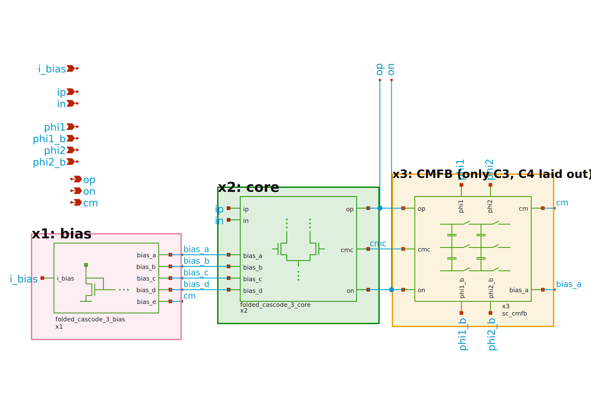

> **How to read it.** The designer's own schematic (xschem), unchanged; the coloured boxes are drawn on a scratch copy.

**x1, the bias** (`folded_cascode_3_bias`), every device boxed with its block number:

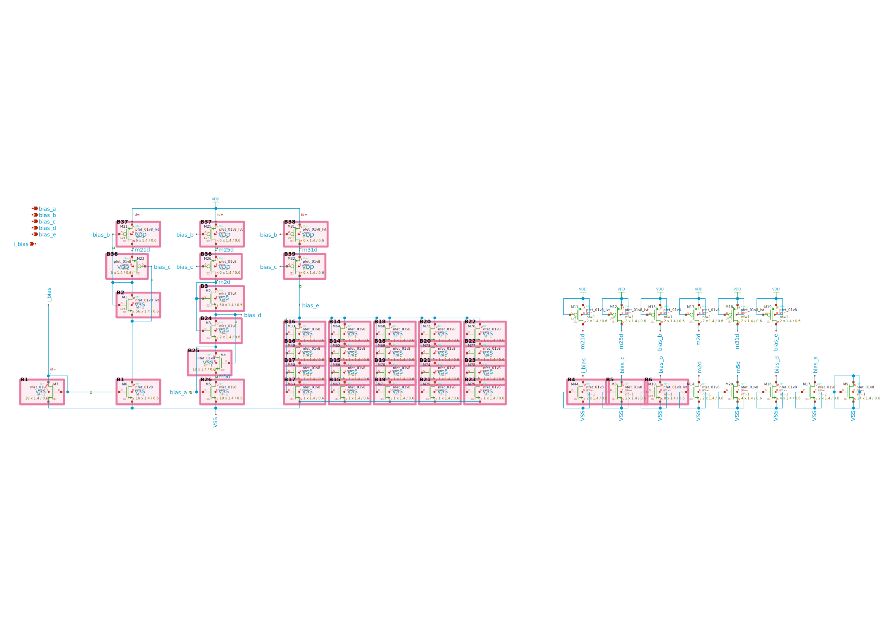

> **How to read it.** The unboxed transistors with all terminals on a supply are the sheet's dummies. The upstream netlist the flow reads gathers them into three top-level dummy devices (XM9, XM43, XM45, m = 23, 8 and 6), which the flow places in `top`.

**x2, the core** (`folded_cascode_3_core`): the input pair, the folded cascodes and the output branches.

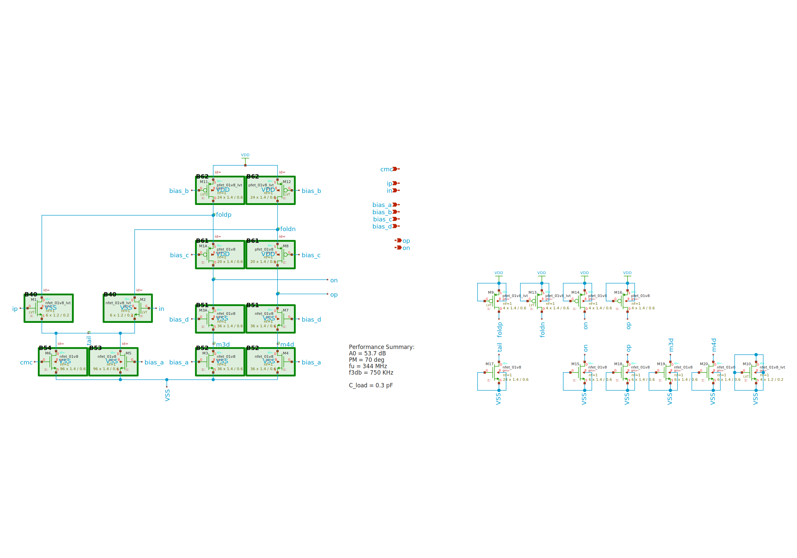

> **How to read it.** The unboxed transistors with all terminals on a supply are the sheet's dummies. The upstream netlist the flow reads gathers them into three top-level dummy devices (XM9, XM43, XM45, m = 23, 8 and 6), which the flow places in `top`.

**x3, the CMFB** (`sc_cmfb`): only C3 and C4 (boxed) are in the flow's circuit.

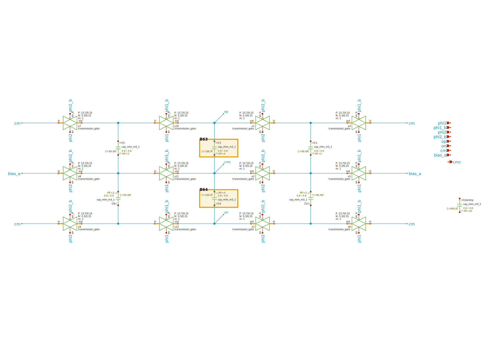

**The specs** (section 12: how they were set):

| Spec | Schematic | Limit | Margin | Allowance for the layout (η × margin) |
|---|---|---|---|---|
| Phase margin (PM) (°) | 77.234 | ≥ 60 | 17.23 | 8.617 |
| DC gain (dB) | 53.47 | ≥ 52.47 | 1 | 0.5 |
| Unity-gain bandwidth (GBW) (MHz) | 209.85 | ≥ 188.87 | 20.99 | 10.49 |

**Imasha's decisions for this design:** lay it out to fit a Tiny Tapeout analog tile (2026-11-04); fold its long devices into one multi-row array (2026-11-05). The other layout choices repeat her ttsky decisions (ASSUMPTION; `inputs/iadc_ota/layout.yaml`).

## 3. What the flow learned before drawing: main nodes, nets and budgets (S1, S2)

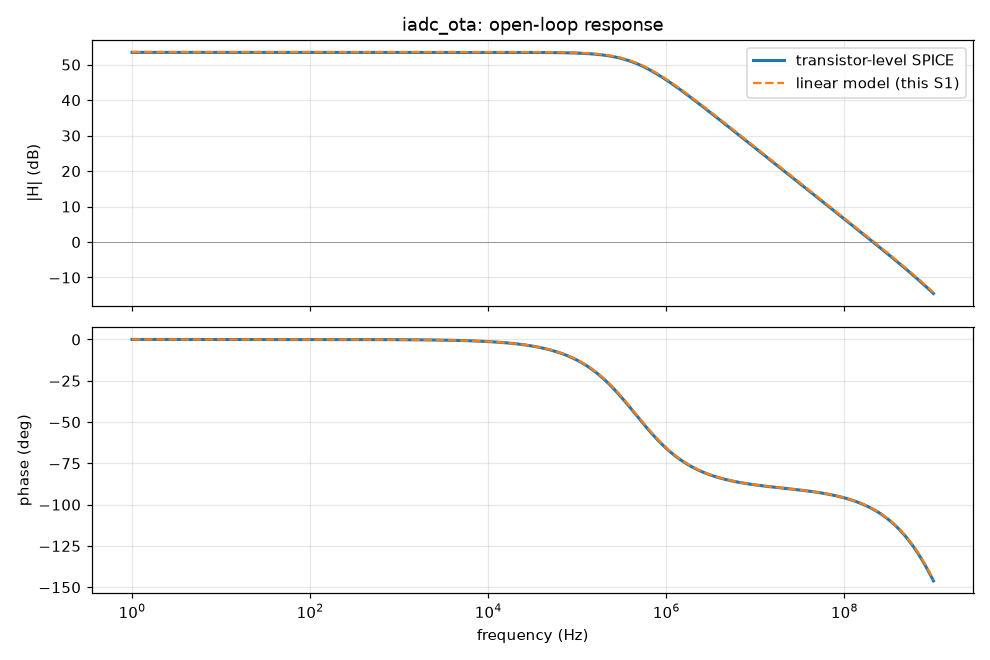

> **How to read it.** Open-loop gain and phase: SPICE on the transistors (solid) against S1's linear model (dashed). Where they agree, every estimate built on the model can be trusted.

**What it shows here:** gate G1.3 (sensitivities against SPICE): PASS.

| Node | Role (S1) | Pole rank | GBW lost per fF (kHz) | PM lost per fF (m°) | Capacitance budget (fF) | Extracted (fF) | Use | Wire length use |
|---|---|---|---|---|---|---|---|---|
| op | signal_output, dominant_pole | 1 | 193 | -11.5 | 0.425 | 50.5 | **119** | 236 |
| on | signal_output, non_dominant_pole | 2 | 193 | -11.5 | 0.425 | 59.4 | **140** | 247 |
| bias_b | mirror_node (diode-connected) | 3 | ≈ 0 | ≈ 0 | 1.78 | 108 | **60.7** | 55.5 |
| bias_c | – | 4 | ≈ 0 | ≈ 0 | 1.2 | 84.5 | **70.5** | 121 |
| bias_d | – | 5 | -1.35e-06 | 1.58e-06 | 1.46 | 80.1 | **55** | 40.7 |
| bias_a | – | 6 | ≈ 0 | ≈ 0 | 2.22 | 139 | **62.5** | 57.9 |
| x1_m2d | mirror_node (diode-connected) | 7 | ≈ 0 | ≈ 0 | 0.935 | 48.3 | **51.7** | 106 |
| x2_m3d | – | 8 | 0.819 | -0.187 | 0.469 | 119 | **254** | 25.5 |
| x2_m4d | – | 9 | 0.824 | -0.185 | 0.453 | 145 | **319** | 24.6 |
| x2_foldn | – | 12 | 19.6 | 34.9 | 0.36 | 43.2 | **120** | 277 |
| x2_foldp | – | 13 | 19.6 | 34.9 | 0.36 | 42.5 | **118** | 316 |
| x1_m25d | – | 15 | ≈ 0 | ≈ 0 | 0.221 | 15.9 | **72.2** | 212 |
| x2_tail | source_coupled (tail) | 18 | ≈ 0 | ≈ 0 | 574 | 122 | 0.213 | 0.0716 |

> **How to read it.** Pole rank 1 is the dominant pole; the sensitivities say how much GBW and phase margin drop per fF of wiring on the node; "use" is extracted / budget (bold: over).

**What it shows here:** the nodes where wiring costs GBW most are op, on and x2_foldp; most main nodes end up over their capacitance budget, which is why G6.2 fails.

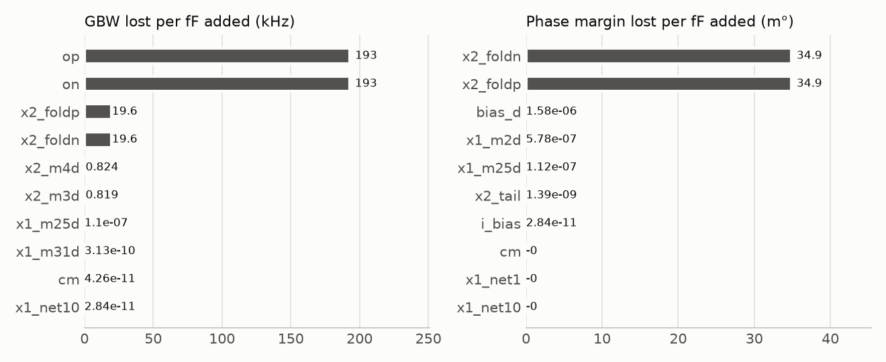

> **How to read it.** The ten nodes where added capacitance costs the most GBW (left) and phase margin (right).

**Matching groups** (S1, rule: *diff pair: identical W, L, nf, m; mirror: same L and model (ratio allowed)*): 2 groups; each becomes one S4 block.

## 4. Who decides what: code, Imasha, and the LLM

- **Code** (the flow): every decision at run time, by fixed rules and by searching for the lowest cost; its settings are fixed in PREREG.
- **Imasha** (the definition): the constraints and policies (the tile, the multi-row array, matching, dummies) and approval of the plans.
- **LLM** (Claude, while building the flow): wrote the code, proposed the algorithms, the rules and the ASSUMPTIONs, drafted PREREG and reviewed the code. **No LLM is called during a run.**

| Decision | What was decided here | Why | Code | Imasha | LLM |
|---|---|---|---|---|---|
| Specs | PM ≥ 60° (config); gain ≥ schematic − 1 dB; GBW ≥ 0.9 × schematic | upstream gives no specs | applies them in every check | accepted the rule (ttsky, LOADBench) | proposed the ASSUMPTION |
| CMFB model | an ideal source with the switched-capacitor CMFB's steady-state law; C3, C4 kept | an AC flow cannot simulate a clocked CMFB directly | simulates it | – | proposed (ASSUMPTION) |
| Share of the margin for layout (η) | 0.5 | half kept for what the flow does not model | applies it | accepted | proposed (ASSUMPTION) |
| Main nodes, budgets, cells | as for every design (sections 3, 5) | from the specs and the small-signal model | computes them (S1–S3) | – | wrote the methods |
| Blocks and matching | matched devices together; common centroid or interdigitated, as needed | gradients cancel; the cheaper one wins | draws both, S5 picks by the cost | decided the policy (ttsky) | implemented |
| Dummies | one at each end of every matched row | edge effects | adds them | decided for ttsky; for iadc an ASSUMPTION | implemented |
| Capacitors | C3, C4 as 4 MIM units of 4.8 × 4.8 µm each | as the netlist gives them | draws the arrays | (the design) | implemented |
| Outline | the Tiny Tapeout 1×2 analog tile, 161 × 225.77 µm | the design must fit a tile | rejects anything outside (G5.6) | decided (2026-11-04) | read the tile from her taped-out GDS |
| Long devices | a multi-row array in one ring for the two m = 96 devices | a 198 µm row is wider than the tile | folds any single-device row over 100 µm | decided (2026-11-05: one multi-row array) | implemented; proposed the 100 µm limit (ASSUMPTION) |
| Sub-circuits as macros | x1 (bias), x2 (core), top | keeps the designer's grouping | places each, then arranges them | decided (use the given hierarchy) | implemented |
| Placement search in a tight outline | start from shelf packing; area-only shapes when nothing else fits | the default search could not reach a fit in the tile (rows 96, 98, 99) | searches | – | designed; opt-in for iadc only so the finished designs keep their results |
| Routing | metal-3/metal-4 grid router | as for ttsky | routes | – | designed |
| Extraction | capacitance only | as ttsky; as the hand layout was measured | extracts | open question | proposed |
| Checks | DRC, LVS, budgets, specs, η, at every stage | nothing passes on trust | runs them | approved PREREG | drafted PREREG |

## 5. The building blocks (S4)

67 blocks, 75 variants, every one DRC-clean and LVS-matched with a negative control rejected. 4 block(s) are multi-row arrays: nmos_diode (XX1_M1: 2 rows), nmos_diode_2 (XX1_M2: 2 rows), nmos_single_4 (XX2_M5: 2 rows), nmos_single_5 (XX2_M6: 2 rows).

**The algorithm, step by step** (as for ttsky25a_fd, with this design's options):

1. **Group:** S1's matching groups first, then S0's blocks; one device type and one body net per block.
2. **Units:** a device with multiplier m is drawn as m copies of the cell S3 chose.
3. **Variants:** common centroid (A B B A …) or interdigitated (A B A B …) for matched devices; a mirror image where neither exists (row 93); one row for a single device.
4. **Dummies** at both ends of every matched row.
5. **Draw the row:** units 0.6 µm apart, a metal-2 stub from each terminal to a metal-3 track per net (0.4 µm wide, 0.9 µm pitch); two stubs too close for facing via patches are staggered (row 94); pins measured from the cell's bounding-box corner (`pin_origin: bbox`, row 95).
6. **Fold** (`fold_row_um: 100`, row 97): a single device's row longer than that becomes identical rows in one ring; metal-2 columns join each net's tracks across the rows.
7. **Ring:** one tap ring 0.8 µm outside the tracks; tap strips where the latch-up distance needs them.
8. **Sign off:** Magic DRC, Netgen LVS (with m and the dummies), a negative control that must fail.

**Every block** (numbered as on the schematics; colour bar: the sub-circuit; picture: the budget-aware layout's variant):

<figure style="display:inline-block;width:31%;margin:4px;vertical-align:top;border-top:5px solid #e87ba4;">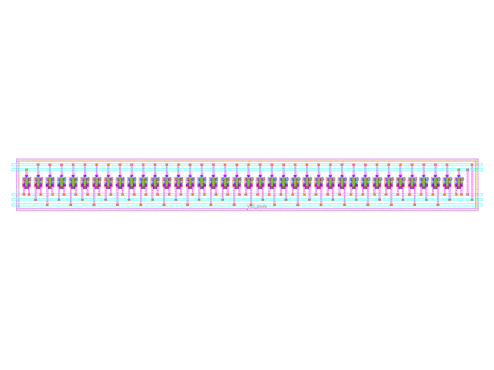<figcaption style="font-size:0.8em"><b>B1 nmos_current_mirror</b> x1 · XX1_M7, XX1_M6 variant ABBA · 81.7 × 9.0 µm</figcaption></figure><figure style="display:inline-block;width:31%;margin:4px;vertical-align:top;border-top:5px solid #e87ba4;">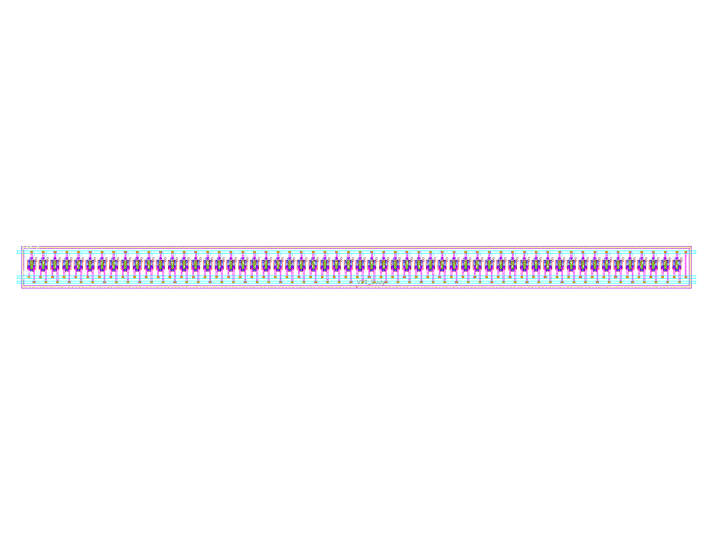<figcaption style="font-size:0.8em"><b>B2 nmos_diode</b> x1 · XX1_M1 variant A · 61.4 × 13.4 µm · 2-row array</figcaption></figure><figure style="display:inline-block;width:31%;margin:4px;vertical-align:top;border-top:5px solid #e87ba4;">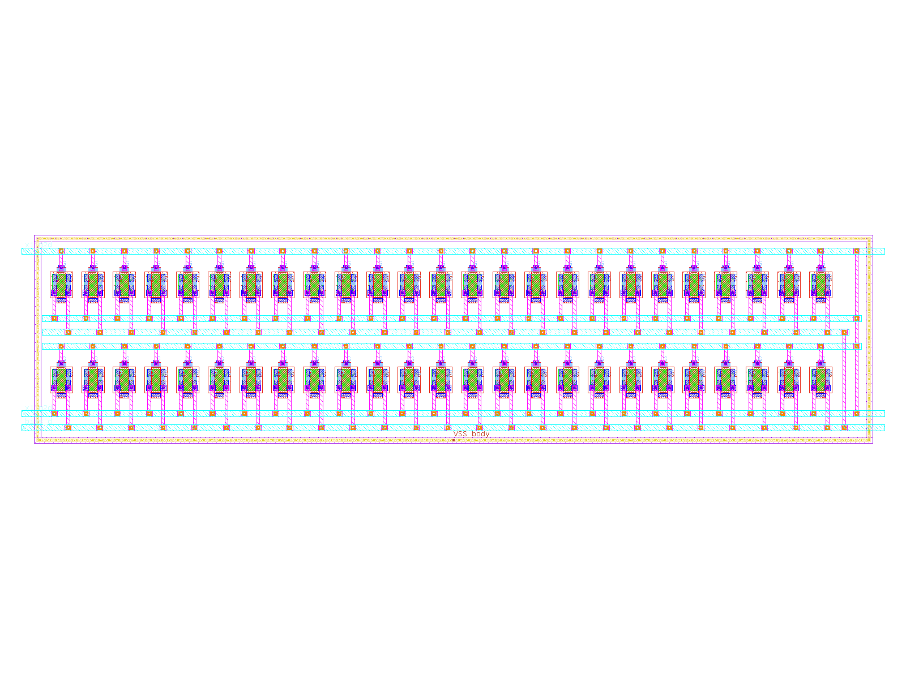<figcaption style="font-size:0.8em"><b>B3 nmos_diode_2</b> x1 · XX1_M2 variant A · 55.3 × 13.4 µm · 2-row array</figcaption></figure><figure style="display:inline-block;width:31%;margin:4px;vertical-align:top;border-top:5px solid #e87ba4;"><figcaption style="font-size:0.8em"><b>B4 nmos_dummy_10</b> x1 · XX1_M44 variant A · 7.9 × 6.3 µm</figcaption></figure><figure style="display:inline-block;width:31%;margin:4px;vertical-align:top;border-top:5px solid #e87ba4;">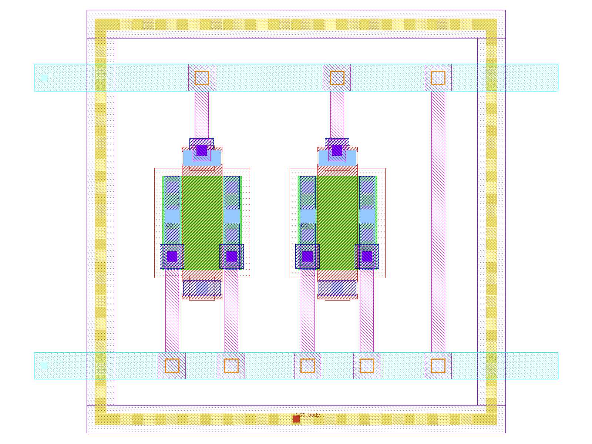<figcaption style="font-size:0.8em"><b>B5 nmos_dummy_11</b> x1 · XX1_M8 variant A · 7.9 × 6.3 µm</figcaption></figure><figure style="display:inline-block;width:31%;margin:4px;vertical-align:top;border-top:5px solid #e87ba4;">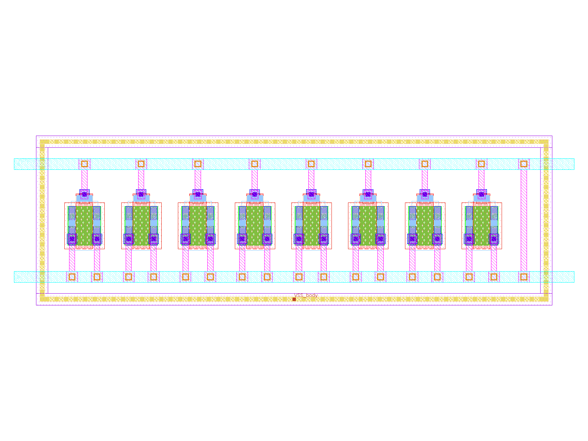<figcaption style="font-size:0.8em"><b>B6 nmos_dummy_2</b> x1 · XX1_M10 variant A · 20.0 × 6.1 µm</figcaption></figure><figure style="display:inline-block;width:31%;margin:4px;vertical-align:top;border-top:5px solid #e87ba4;"><figcaption style="font-size:0.8em"><b>B7 nmos_dummy_3</b> x1 · XX1_M27 variant A · 20.0 × 6.1 µm</figcaption></figure><figure style="display:inline-block;width:31%;margin:4px;vertical-align:top;border-top:5px solid #e87ba4;">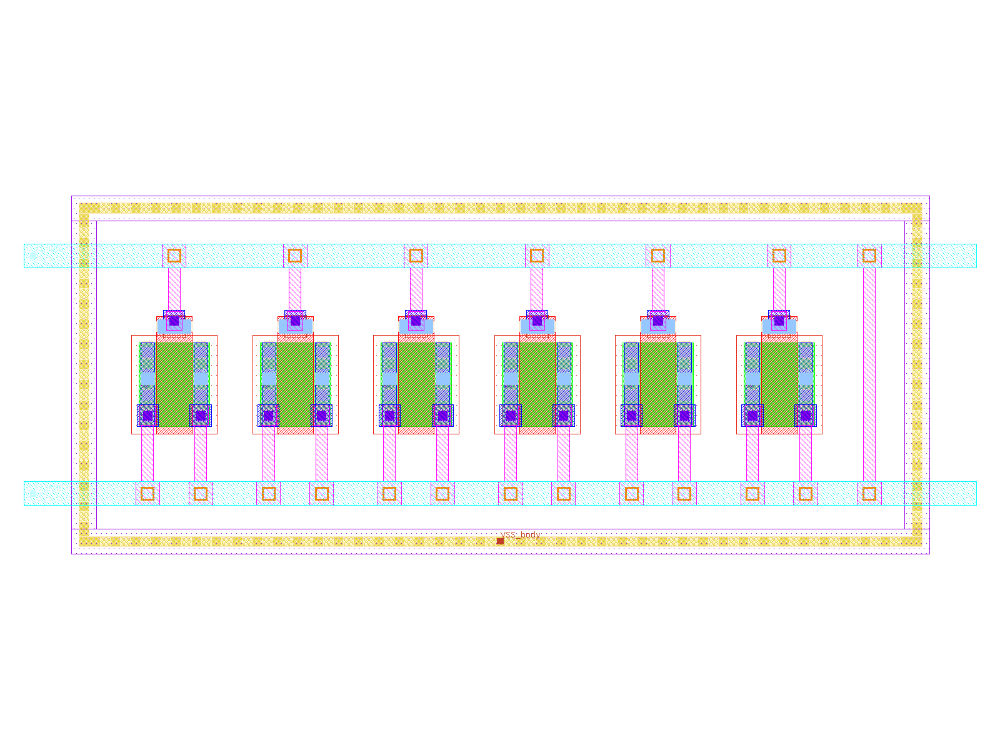<figcaption style="font-size:0.8em"><b>B8 nmos_dummy_4</b> x1 · XX1_M29 variant A · 16.0 × 6.0 µm</figcaption></figure><figure style="display:inline-block;width:31%;margin:4px;vertical-align:top;border-top:5px solid #e87ba4;"><figcaption style="font-size:0.8em"><b>B9 nmos_dummy_5</b> x1 · XX1_M34 variant A · 20.0 × 6.0 µm</figcaption></figure><figure style="display:inline-block;width:31%;margin:4px;vertical-align:top;border-top:5px solid #e87ba4;"><figcaption style="font-size:0.8em"><b>B10 nmos_dummy_6</b> x1 · XX1_M35 variant A · 7.9 × 6.3 µm</figcaption></figure><figure style="display:inline-block;width:31%;margin:4px;vertical-align:top;border-top:5px solid #e87ba4;">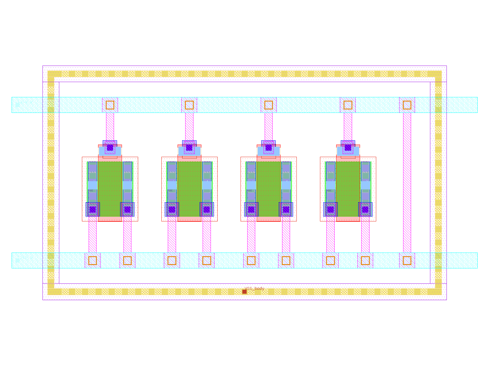<figcaption style="font-size:0.8em"><b>B11 nmos_dummy_7</b> x1 · XX1_M36 variant A · 11.9 × 6.0 µm</figcaption></figure><figure style="display:inline-block;width:31%;margin:4px;vertical-align:top;border-top:5px solid #e87ba4;">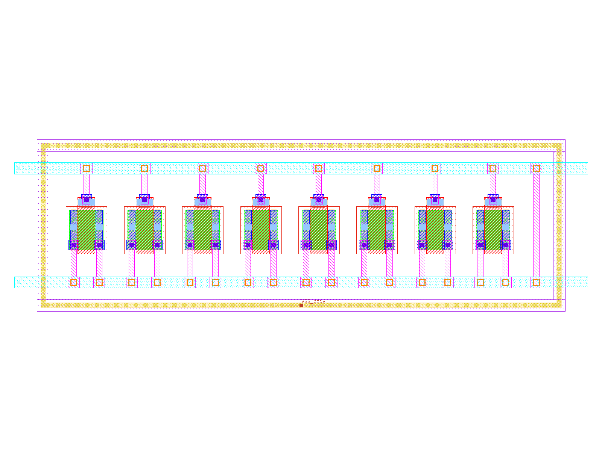<figcaption style="font-size:0.8em"><b>B12 nmos_dummy_8</b> x1 · XX1_M37 variant A · 20.0 × 6.0 µm</figcaption></figure><figure style="display:inline-block;width:31%;margin:4px;vertical-align:top;border-top:5px solid #e87ba4;"><figcaption style="font-size:0.8em"><b>B13 nmos_dummy_9</b> x1 · XX1_M42 variant A · 16.0 × 6.9 µm</figcaption></figure><figure style="display:inline-block;width:31%;margin:4px;vertical-align:top;border-top:5px solid #e87ba4;"><figcaption style="font-size:0.8em"><b>B14 nmos_matched_cascode_pair_10</b> x1 · XX1_M64, XX1_M65 variant AB · 12.7 × 9.9 µm</figcaption></figure><figure style="display:inline-block;width:31%;margin:4px;vertical-align:top;border-top:5px solid #e87ba4;"><figcaption style="font-size:0.8em"><b>B15 nmos_matched_cascode_pair_11</b> x1 · XX1_M66, XX1_M67 variant AB · 11.9 × 9.0 µm</figcaption></figure><figure style="display:inline-block;width:31%;margin:4px;vertical-align:top;border-top:5px solid #e87ba4;"><figcaption style="font-size:0.8em"><b>B16 nmos_matched_cascode_pair_2</b> x1 · XX1_M33, XX1_M49 variant AB · 12.7 × 9.9 µm</figcaption></figure><figure style="display:inline-block;width:31%;margin:4px;vertical-align:top;border-top:5px solid #e87ba4;"><figcaption style="font-size:0.8em"><b>B17 nmos_matched_cascode_pair_3</b> x1 · XX1_M50, XX1_M63 variant AB · 11.9 × 9.0 µm</figcaption></figure><figure style="display:inline-block;width:31%;margin:4px;vertical-align:top;border-top:5px solid #e87ba4;">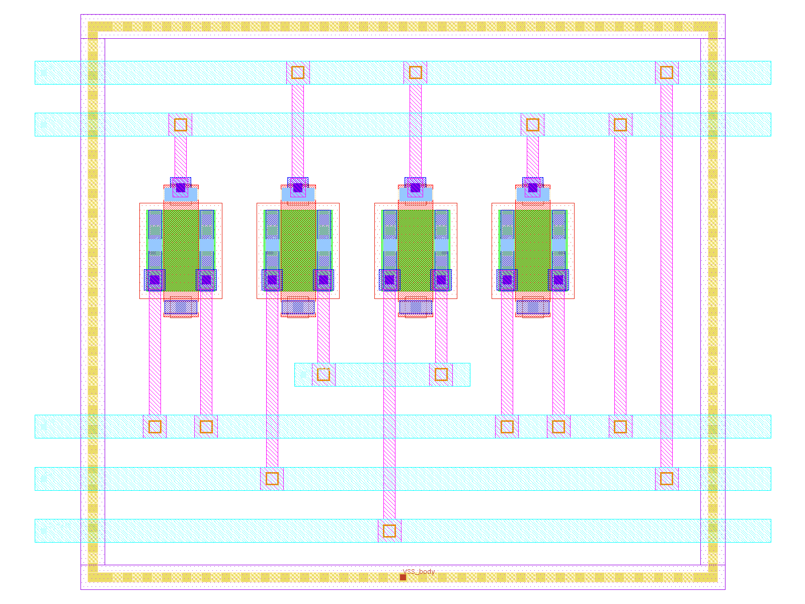<figcaption style="font-size:0.8em"><b>B18 nmos_matched_cascode_pair_4</b> x1 · XX1_M68, XX1_M69 variant AB · 12.7 × 9.9 µm</figcaption></figure><figure style="display:inline-block;width:31%;margin:4px;vertical-align:top;border-top:5px solid #e87ba4;"><figcaption style="font-size:0.8em"><b>B19 nmos_matched_cascode_pair_5</b> x1 · XX1_M70, XX1_M71 variant AB · 11.9 × 9.0 µm</figcaption></figure><figure style="display:inline-block;width:31%;margin:4px;vertical-align:top;border-top:5px solid #e87ba4;"><figcaption style="font-size:0.8em"><b>B20 nmos_matched_cascode_pair_6</b> x1 · XX1_M72, XX1_M73 variant AB · 12.7 × 9.9 µm</figcaption></figure><figure style="display:inline-block;width:31%;margin:4px;vertical-align:top;border-top:5px solid #e87ba4;"><figcaption style="font-size:0.8em"><b>B21 nmos_matched_cascode_pair_7</b> x1 · XX1_M74, XX1_M75 variant AB · 11.9 × 9.0 µm</figcaption></figure><figure style="display:inline-block;width:31%;margin:4px;vertical-align:top;border-top:5px solid #e87ba4;"><figcaption style="font-size:0.8em"><b>B22 nmos_matched_cascode_pair_8</b> x1 · XX1_M76, XX1_M77 variant AB · 12.7 × 9.9 µm</figcaption></figure><figure style="display:inline-block;width:31%;margin:4px;vertical-align:top;border-top:5px solid #e87ba4;">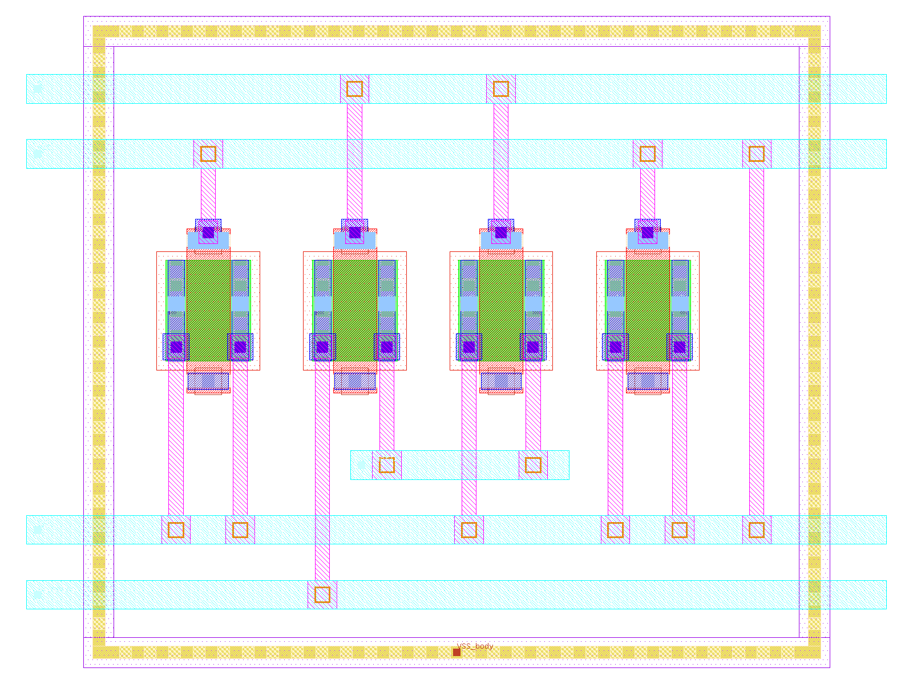<figcaption style="font-size:0.8em"><b>B23 nmos_matched_cascode_pair_9</b> x1 · XX1_M78, XX1_M79 variant AB · 11.9 × 9.0 µm</figcaption></figure><figure style="display:inline-block;width:31%;margin:4px;vertical-align:top;border-top:5px solid #e87ba4;">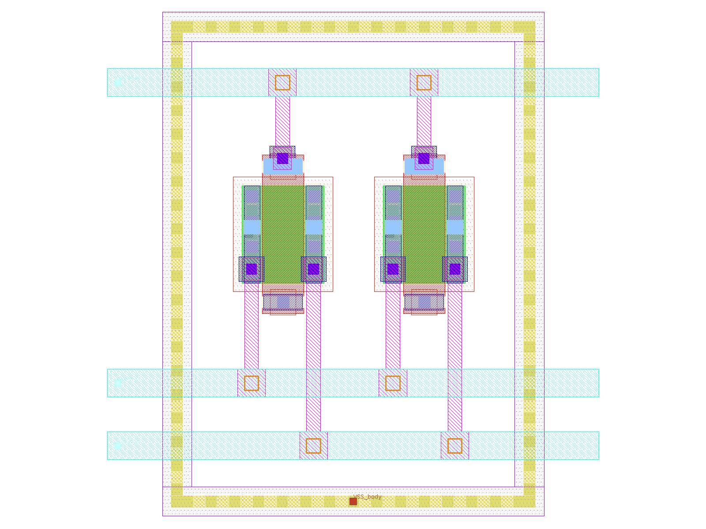<figcaption style="font-size:0.8em"><b>B24 nmos_single</b> x1 · XX1_M3 variant A · 7.1 × 7.2 µm</figcaption></figure><figure style="display:inline-block;width:31%;margin:4px;vertical-align:top;border-top:5px solid #e87ba4;">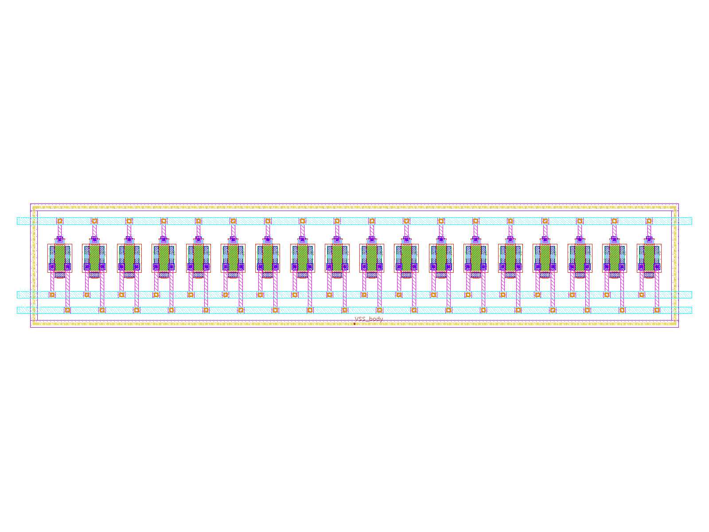<figcaption style="font-size:0.8em"><b>B25 nmos_single_2</b> x1 · XX1_M4 variant A · 39.5 × 7.2 µm</figcaption></figure><figure style="display:inline-block;width:31%;margin:4px;vertical-align:top;border-top:5px solid #e87ba4;">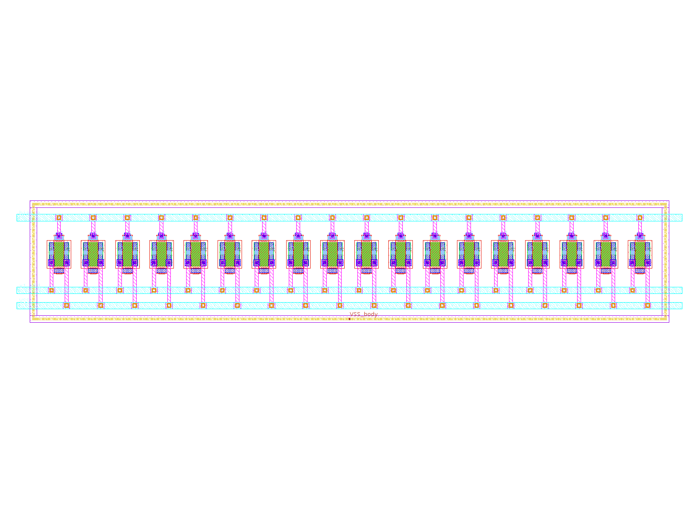<figcaption style="font-size:0.8em"><b>B26 nmos_single_3</b> x1 · XX1_M5 variant A · 39.5 × 7.2 µm</figcaption></figure><figure style="display:inline-block;width:31%;margin:4px;vertical-align:top;border-top:5px solid #e87ba4;"><figcaption style="font-size:0.8em"><b>B27 pmos_dummy_10</b> x1 · XX1_M59 variant A · 8.1 × 7.7 µm</figcaption></figure><figure style="display:inline-block;width:31%;margin:4px;vertical-align:top;border-top:5px solid #e87ba4;"><figcaption style="font-size:0.8em"><b>B28 pmos_dummy_11</b> x1 · XX1_M60 variant A · 8.1 × 7.7 µm</figcaption></figure><figure style="display:inline-block;width:31%;margin:4px;vertical-align:top;border-top:5px solid #e87ba4;"><figcaption style="font-size:0.8em"><b>B29 pmos_dummy_3</b> x1 · XX1_M46 variant A · 8.1 × 6.8 µm</figcaption></figure><figure style="display:inline-block;width:31%;margin:4px;vertical-align:top;border-top:5px solid #e87ba4;">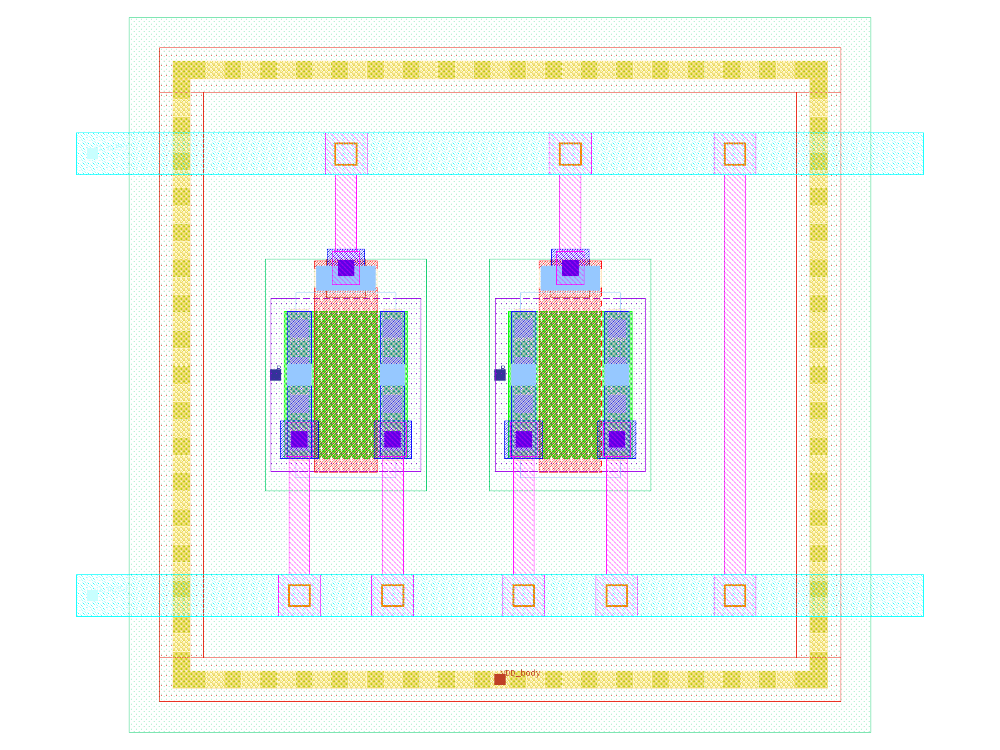<figcaption style="font-size:0.8em"><b>B30 pmos_dummy_4</b> x1 · XX1_M47 variant A · 8.1 × 6.8 µm</figcaption></figure><figure style="display:inline-block;width:31%;margin:4px;vertical-align:top;border-top:5px solid #e87ba4;"><figcaption style="font-size:0.8em"><b>B31 pmos_dummy_5</b> x1 · XX1_M48 variant A · 8.1 × 6.8 µm</figcaption></figure><figure style="display:inline-block;width:31%;margin:4px;vertical-align:top;border-top:5px solid #e87ba4;"><figcaption style="font-size:0.8em"><b>B32 pmos_dummy_6</b> x1 · XX1_M51 variant A · 8.1 × 6.8 µm</figcaption></figure><figure style="display:inline-block;width:31%;margin:4px;vertical-align:top;border-top:5px solid #e87ba4;">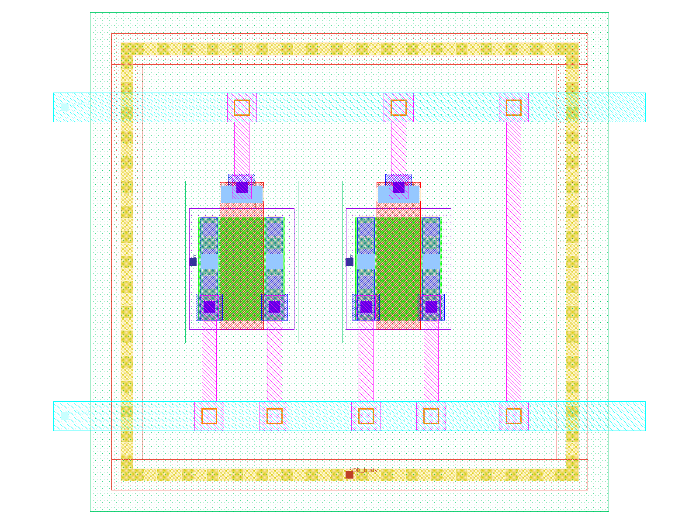<figcaption style="font-size:0.8em"><b>B33 pmos_dummy_7</b> x1 · XX1_M54 variant A · 8.1 × 6.8 µm</figcaption></figure><figure style="display:inline-block;width:31%;margin:4px;vertical-align:top;border-top:5px solid #e87ba4;"><figcaption style="font-size:0.8em"><b>B34 pmos_dummy_8</b> x1 · XX1_M57 variant A · 8.1 × 7.7 µm</figcaption></figure><figure style="display:inline-block;width:31%;margin:4px;vertical-align:top;border-top:5px solid #e87ba4;">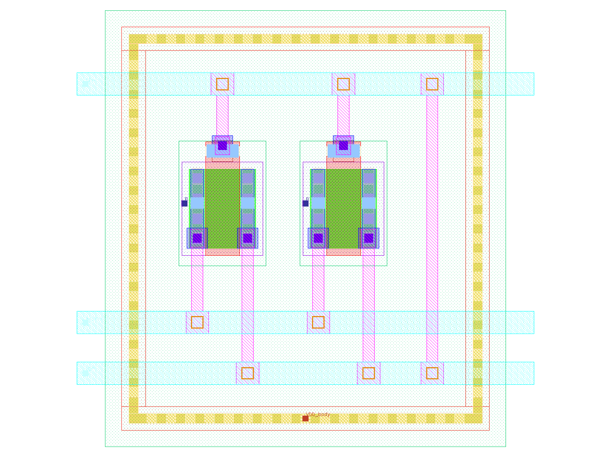<figcaption style="font-size:0.8em"><b>B35 pmos_dummy_9</b> x1 · XX1_M58 variant A · 8.1 × 7.7 µm</figcaption></figure><figure style="display:inline-block;width:31%;margin:4px;vertical-align:top;border-top:5px solid #e87ba4;">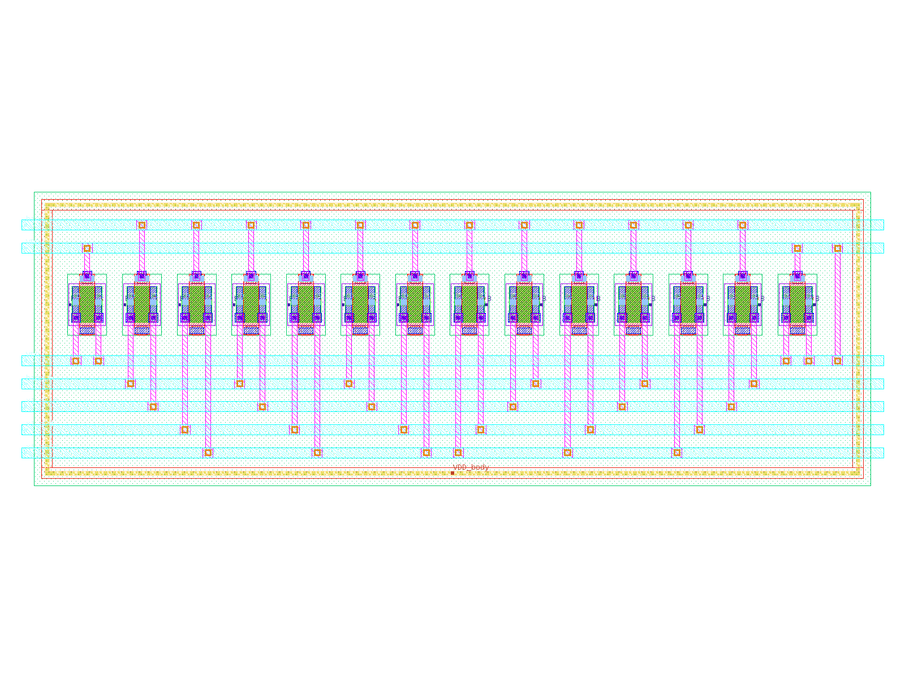<figcaption style="font-size:0.8em"><b>B36 pmos_matched_cascode_pair</b> x1 · XX1_M22, XX1_M26 variant ABBA · 33.8 × 11.5 µm</figcaption></figure><figure style="display:inline-block;width:31%;margin:4px;vertical-align:top;border-top:5px solid #e87ba4;">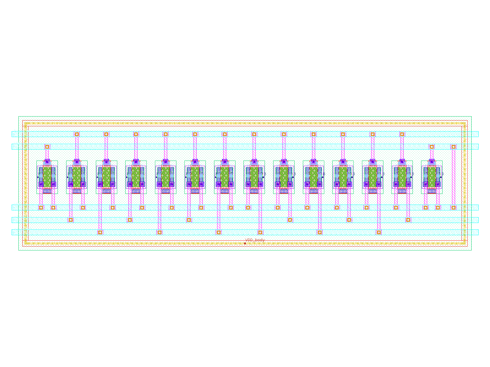<figcaption style="font-size:0.8em"><b>B37 pmos_matched_current_source_pair</b> x1 · XX1_M21, XX1_M25 variant ABBA · 33.8 × 9.7 µm</figcaption></figure><figure style="display:inline-block;width:31%;margin:4px;vertical-align:top;border-top:5px solid #e87ba4;">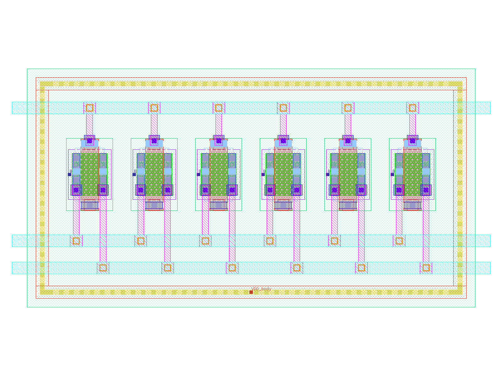<figcaption style="font-size:0.8em"><b>B38 pmos_single</b> x1 · XX1_M31 variant A · 15.8 × 7.9 µm</figcaption></figure><figure style="display:inline-block;width:31%;margin:4px;vertical-align:top;border-top:5px solid #e87ba4;">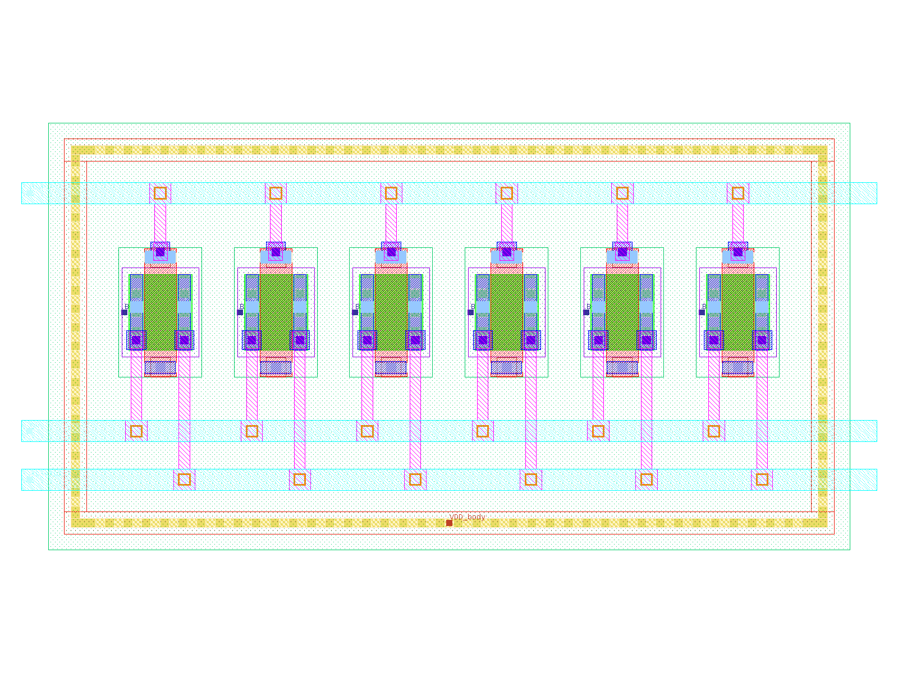<figcaption style="font-size:0.8em"><b>B39 pmos_single_2</b> x1 · XX1_M32 variant A · 15.8 × 7.9 µm</figcaption></figure><figure style="display:inline-block;width:31%;margin:4px;vertical-align:top;border-top:5px solid #008300;">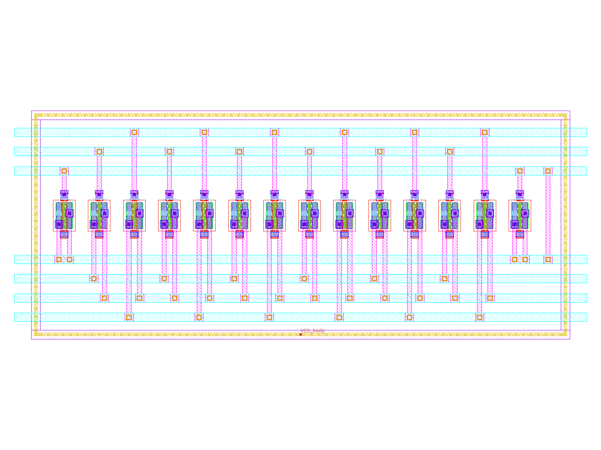<figcaption style="font-size:0.8em"><b>B40 nmos_differential_pair</b> x2 · XX2_M1, XX2_M2 variant ABAB · 26.6 × 10.6 µm</figcaption></figure><figure style="display:inline-block;width:31%;margin:4px;vertical-align:top;border-top:5px solid #008300;">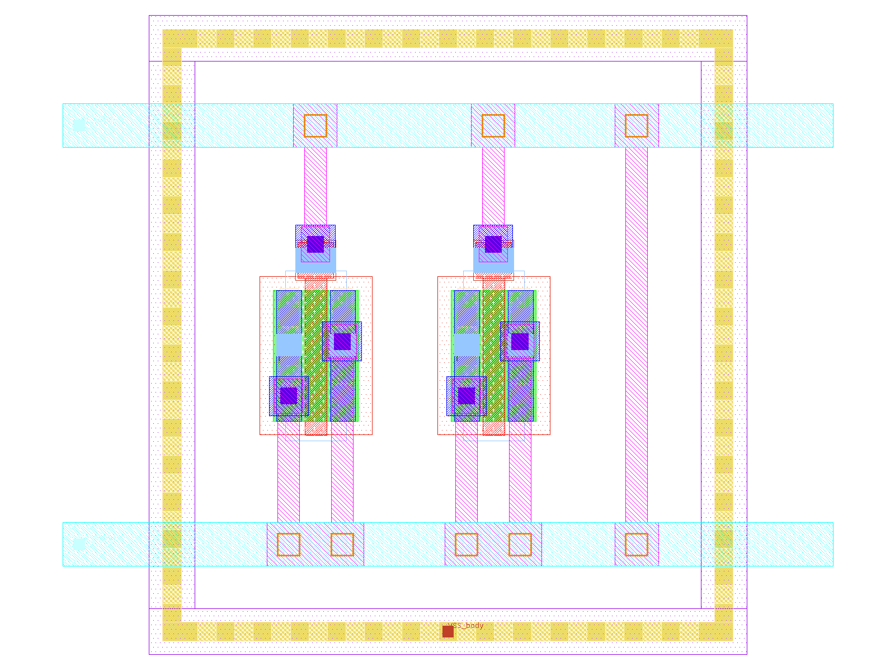<figcaption style="font-size:0.8em"><b>B41 nmos_dummy_12</b> x2 · XX2_M23 variant A · 7.1 × 5.9 µm</figcaption></figure><figure style="display:inline-block;width:31%;margin:4px;vertical-align:top;border-top:5px solid #008300;"><figcaption style="font-size:0.8em"><b>B42 nmos_dummy_13</b> x2 · XX2_M24 variant A · 7.1 × 5.9 µm</figcaption></figure><figure style="display:inline-block;width:31%;margin:4px;vertical-align:top;border-top:5px solid #008300;"><figcaption style="font-size:0.8em"><b>B43 nmos_dummy_14</b> x2 · XX2_M28 variant A · 16.0 × 6.0 µm</figcaption></figure><figure style="display:inline-block;width:31%;margin:4px;vertical-align:top;border-top:5px solid #008300;">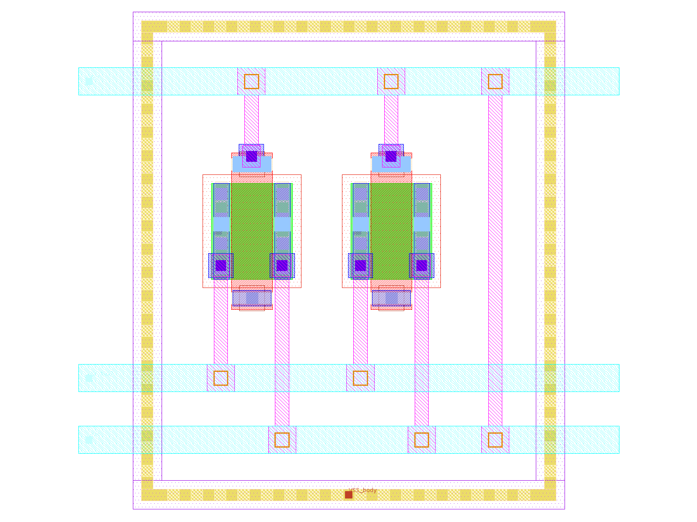<figcaption style="font-size:0.8em"><b>B44 nmos_dummy_15</b> x2 · XX2_M30 variant A · 7.9 × 7.2 µm</figcaption></figure><figure style="display:inline-block;width:31%;margin:4px;vertical-align:top;border-top:5px solid #008300;"><figcaption style="font-size:0.8em"><b>B45 nmos_dummy_16</b> x2 · XX2_M38 variant A · 7.9 × 6.3 µm</figcaption></figure><figure style="display:inline-block;width:31%;margin:4px;vertical-align:top;border-top:5px solid #008300;"><figcaption style="font-size:0.8em"><b>B46 nmos_dummy_17</b> x2 · XX2_M39 variant A · 7.9 × 6.3 µm</figcaption></figure><figure style="display:inline-block;width:31%;margin:4px;vertical-align:top;border-top:5px solid #008300;">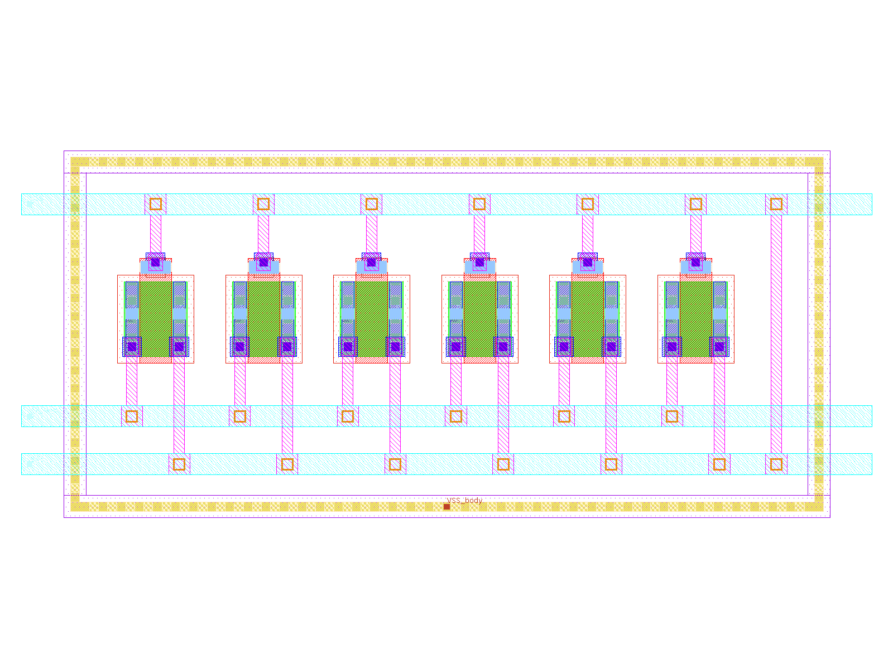<figcaption style="font-size:0.8em"><b>B47 nmos_dummy_18</b> x2 · XX2_M40 variant A · 16.0 × 6.9 µm</figcaption></figure><figure style="display:inline-block;width:31%;margin:4px;vertical-align:top;border-top:5px solid #008300;"><figcaption style="font-size:0.8em"><b>B48 nmos_dummy_19</b> x2 · XX2_M41 variant A · 20.0 × 6.9 µm</figcaption></figure><figure style="display:inline-block;width:31%;margin:4px;vertical-align:top;border-top:5px solid #008300;"><figcaption style="font-size:0.8em"><b>B49 nmos_dummy_20</b> x2 · XX2_M80 variant A · 7.9 × 7.2 µm</figcaption></figure><figure style="display:inline-block;width:31%;margin:4px;vertical-align:top;border-top:5px solid #008300;"><figcaption style="font-size:0.8em"><b>B50 nmos_dummy_21</b> x2 · XX2_M81 variant A · 7.9 × 7.2 µm</figcaption></figure><figure style="display:inline-block;width:31%;margin:4px;vertical-align:top;border-top:5px solid #008300;">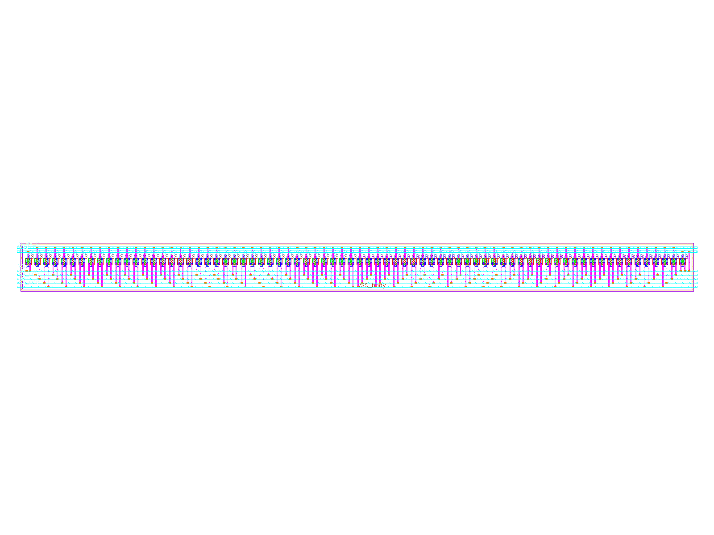<figcaption style="font-size:0.8em"><b>B51 nmos_matched_cascode_pair</b> x2 · XX2_M3A, XX2_M7 variant ABBA · 154.0 × 10.8 µm</figcaption></figure><figure style="display:inline-block;width:31%;margin:4px;vertical-align:top;border-top:5px solid #008300;">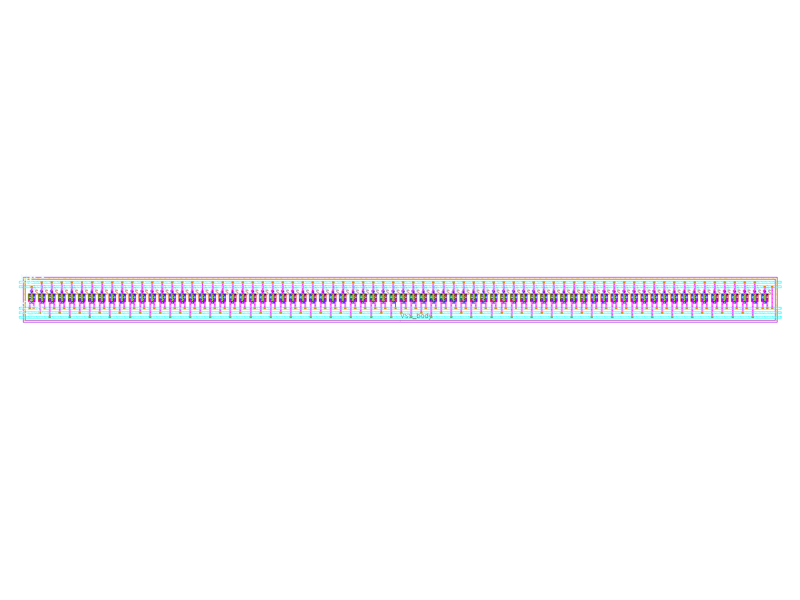<figcaption style="font-size:0.8em"><b>B52 nmos_matched_current_source_pair</b> x2 · XX2_M3, XX2_M4 variant ABAB · 154.0 × 9.0 µm</figcaption></figure><figure style="display:inline-block;width:31%;margin:4px;vertical-align:top;border-top:5px solid #008300;">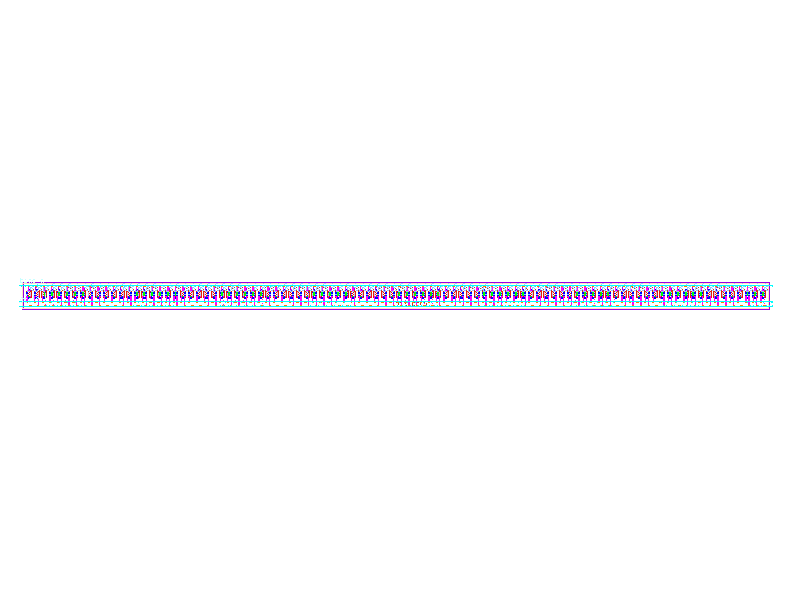<figcaption style="font-size:0.8em"><b>B53 nmos_single_4</b> x2 · XX2_M5 variant A · 102.8 × 13.4 µm · 2-row array</figcaption></figure><figure style="display:inline-block;width:31%;margin:4px;vertical-align:top;border-top:5px solid #008300;"><figcaption style="font-size:0.8em"><b>B54 nmos_single_5</b> x2 · XX2_M6 variant A · 102.8 × 13.4 µm · 2-row array</figcaption></figure><figure style="display:inline-block;width:31%;margin:4px;vertical-align:top;border-top:5px solid #008300;"><figcaption style="font-size:0.8em"><b>B55 pmos_dummy_12</b> x2 · XX2_M55 variant A · 8.1 × 7.7 µm</figcaption></figure><figure style="display:inline-block;width:31%;margin:4px;vertical-align:top;border-top:5px solid #008300;"><figcaption style="font-size:0.8em"><b>B56 pmos_dummy_13</b> x2 · XX2_M56 variant A · 12.4 × 7.7 µm</figcaption></figure><figure style="display:inline-block;width:31%;margin:4px;vertical-align:top;border-top:5px solid #008300;"><figcaption style="font-size:0.8em"><b>B57 pmos_dummy_14</b> x2 · XX2_M61 variant A · 8.1 × 7.7 µm</figcaption></figure><figure style="display:inline-block;width:31%;margin:4px;vertical-align:top;border-top:5px solid #008300;">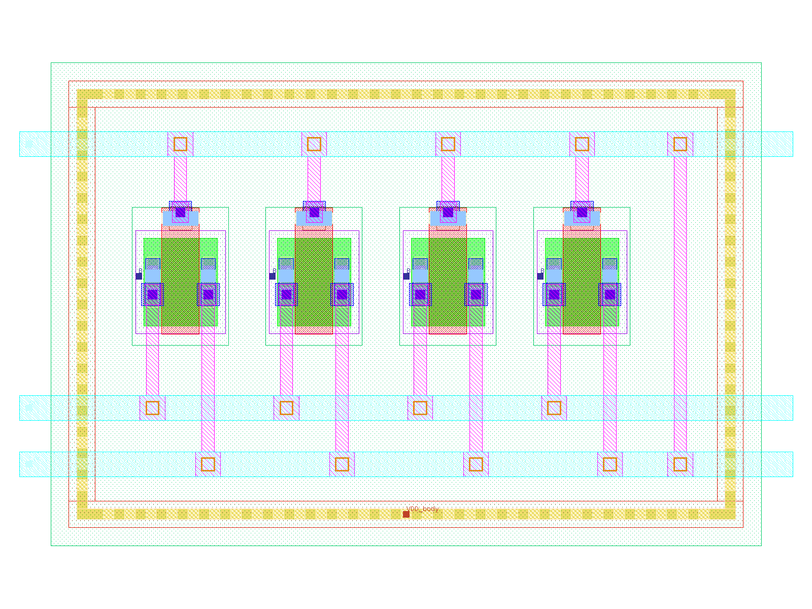<figcaption style="font-size:0.8em"><b>B58 pmos_dummy_15</b> x2 · XX2_M62 variant A · 12.4 × 7.7 µm</figcaption></figure><figure style="display:inline-block;width:31%;margin:4px;vertical-align:top;border-top:5px solid #008300;"><figcaption style="font-size:0.8em"><b>B59 pmos_dummy_16</b> x2 · XX2_M82 variant A · 8.1 × 6.8 µm</figcaption></figure><figure style="display:inline-block;width:31%;margin:4px;vertical-align:top;border-top:5px solid #008300;"><figcaption style="font-size:0.8em"><b>B60 pmos_dummy_17</b> x2 · XX2_M83 variant A · 8.1 × 6.8 µm</figcaption></figure><figure style="display:inline-block;width:31%;margin:4px;vertical-align:top;border-top:5px solid #008300;">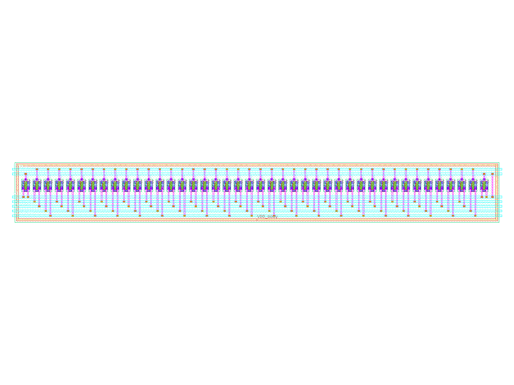<figcaption style="font-size:0.8em"><b>B61 pmos_matched_cascode_pair_2</b> x2 · XX2_M1A, XX2_M8 variant ABAB · 93.7 × 11.5 µm</figcaption></figure><figure style="display:inline-block;width:31%;margin:4px;vertical-align:top;border-top:5px solid #008300;">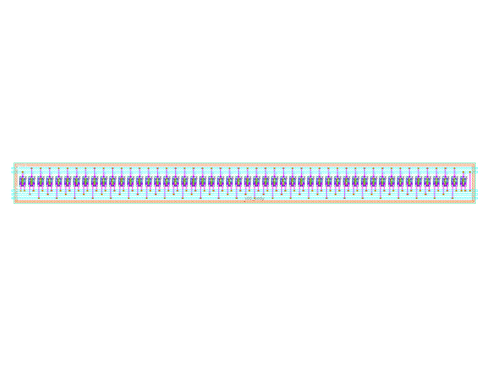<figcaption style="font-size:0.8em"><b>B62 pmos_matched_current_source_pair_2</b> x2 · XX2_M11, XX2_M12 variant ABAB · 110.8 × 9.7 µm</figcaption></figure><figure style="display:inline-block;width:31%;margin:4px;vertical-align:top;border-top:5px solid #eda100;"><figcaption style="font-size:0.8em"><b>B63 XC3</b> top · XC3 variant A · 41.4 × 8.5 µm</figcaption></figure><figure style="display:inline-block;width:31%;margin:4px;vertical-align:top;border-top:5px solid #eda100;">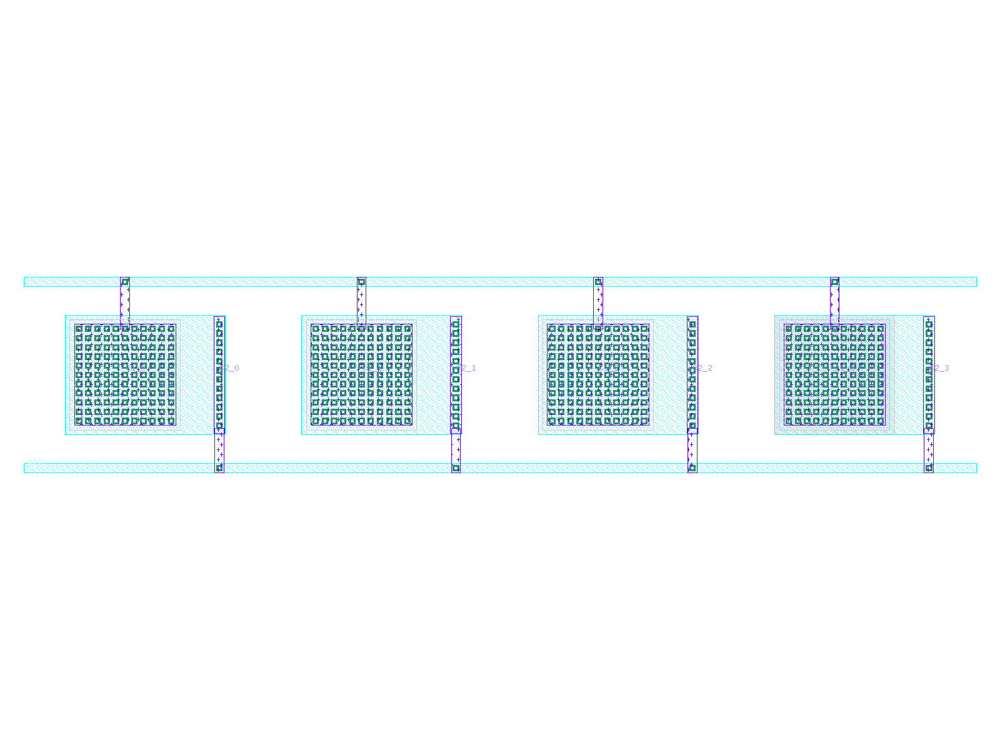<figcaption style="font-size:0.8em"><b>B64 XC4</b> top · XC4 variant A · 41.4 × 8.5 µm</figcaption></figure><figure style="display:inline-block;width:31%;margin:4px;vertical-align:top;border-top:5px solid #eda100;">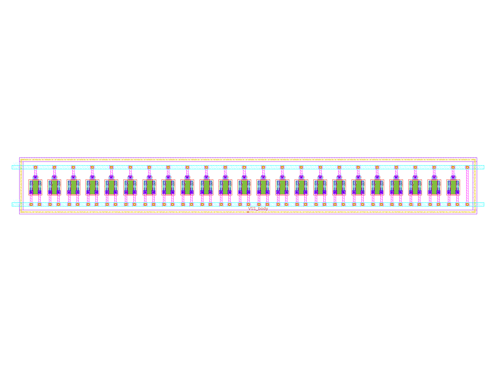<figcaption style="font-size:0.8em"><b>B65 nmos_dummy</b> top · XM9 variant A · 50.5 × 6.0 µm</figcaption></figure><figure style="display:inline-block;width:31%;margin:4px;vertical-align:top;border-top:5px solid #eda100;">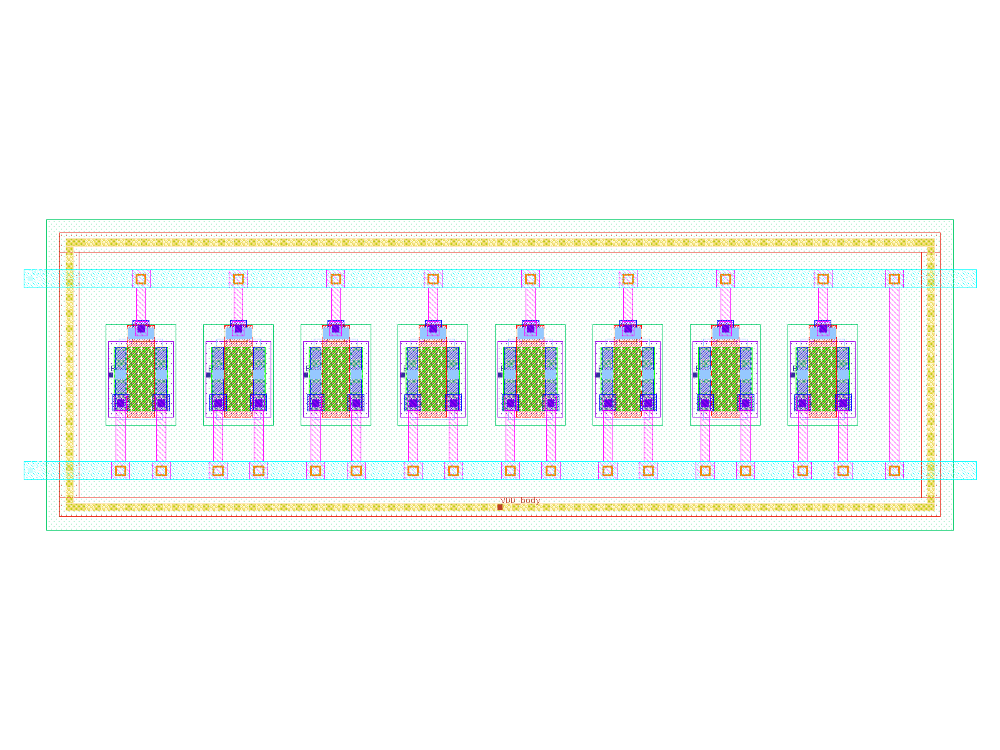<figcaption style="font-size:0.8em"><b>B66 pmos_dummy</b> top · XM43 variant A · 20.9 × 6.8 µm</figcaption></figure><figure style="display:inline-block;width:31%;margin:4px;vertical-align:top;border-top:5px solid #eda100;">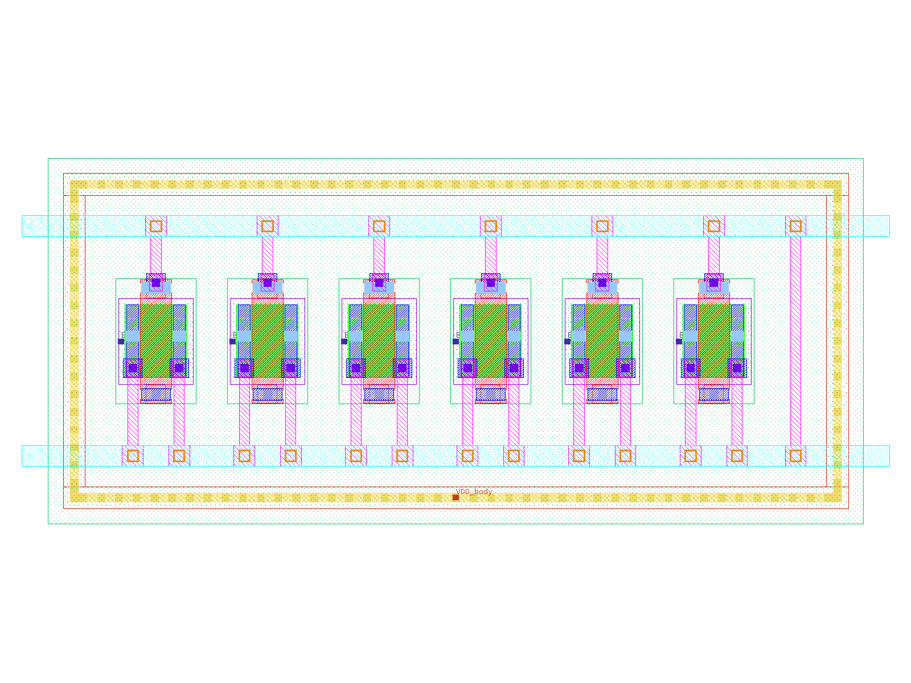<figcaption style="font-size:0.8em"><b>B67 pmos_dummy_2</b> top · XM45 variant A · 16.6 × 7.0 µm</figcaption></figure>

**Matching in the final layouts** (G5.7):

| Matched block | Budget-aware | Area-only |
|---|---|---|
| B1 nmos_current_mirror | ABBA, common centroid | ABBA, common centroid |
| B14 nmos_matched_cascode_pair_10 | AB, centres 1.0 µm off | AB, centres 1.0 µm off |
| B15 nmos_matched_cascode_pair_11 | AB, centres 1.0 µm off | AB, centres 1.0 µm off |
| B16 nmos_matched_cascode_pair_2 | AB, centres 1.0 µm off | AB, centres 1.0 µm off |
| B17 nmos_matched_cascode_pair_3 | AB, centres 1.0 µm off | AB, centres 1.0 µm off |
| B18 nmos_matched_cascode_pair_4 | AB, centres 1.0 µm off | AB, centres 1.0 µm off |
| B19 nmos_matched_cascode_pair_5 | AB, centres 1.0 µm off | AB, centres 1.0 µm off |
| B20 nmos_matched_cascode_pair_6 | AB, centres 1.0 µm off | AB, centres 1.0 µm off |
| B21 nmos_matched_cascode_pair_7 | AB, centres 1.0 µm off | AB, centres 1.0 µm off |
| B22 nmos_matched_cascode_pair_8 | AB, centres 1.0 µm off | AB, centres 1.0 µm off |
| B23 nmos_matched_cascode_pair_9 | AB, centres 1.0 µm off | AB, centres 1.0 µm off |
| B36 pmos_matched_cascode_pair | ABBA, common centroid | ABBA, common centroid |
| B37 pmos_matched_current_source_pair | ABBA, common centroid | ABBA, common centroid |
| B40 nmos_differential_pair | ABAB, centres 0.8 µm off | ABAB, centres 0.8 µm off |
| B51 nmos_matched_cascode_pair | ABBA, common centroid | ABBA, common centroid |
| B52 nmos_matched_current_source_pair | ABAB, centres 1.0 µm off | ABAB, centres 1.0 µm off |
| B61 pmos_matched_cascode_pair_2 | ABAB, centres 1.1 µm off | ABAB, centres 1.1 µm off |
| B62 pmos_matched_current_source_pair_2 | ABAB, centres 1.1 µm off | ABAB, centres 1.1 µm off |

**What it shows here:** 4 of 18 matched blocks are common centroid (budget-aware), 4 of 18 (area-only).

## 6. Placement and routing (S5)

**How the placement is found** (`src/s5/macro.py`, `src/s5/place.py`):

1. **Sub-circuits:** every block belongs to the sub-circuit of its devices (x1, x2, top).
2. **Rows:** inside a sub-circuit, blocks stand in rows, PMOS rows above NMOS rows, 3 µm between rows and 3 µm between blocks; matched blocks may share a row.
3. **Search inside a sub-circuit:** up to 6 blocks, every arrangement is tried; beyond that, simulated annealing: 40,000 random moves (swap two blocks, move a block to another or a new row, change a variant, flip a block); a better placement is always kept, a worse one with probability exp(−Δcost / T), T starting at 0.05 × the start's cost and × 0.9998 after every move; seed 20261104. **For this tile** (`search_from_outside`, rows 96 and 98) the annealing starts from shelf packing (rows filled up to the width limit, tallest blocks first) and may pass through placements outside the outline with a penalty growing with the excess; only placements inside are kept.
4. **Three shapes:** each sub-circuit is placed at widths 1.0, 0.65, 0.5 × the tile's width.
5. **Top level:** every arrangement of the sub-circuits' shapes is tried; anything outside the tile is rejected (never traded). **Area-only fallback** (row 99): where no arrangement of the budget-aware shapes fits, each sub-circuit's area-only shapes join the candidates, and the budget-aware cost still chooses among the arrangements that fit (used here for the budget-aware layout).
6. **Both costs:** the search runs twice with the same seed, budget-aware and area-only; both winners are routed and checked.

**How area and wire length are optimised.** Both enter one number, the cost:

- area term: A / A_ref, the bounding box's area over the sum of the blocks' smallest variants;
- each net's wire use: u = (half-perimeter of its pins' box) / (S2's length budget for the net);
- **budget-aware cost** = A / A_ref + 10 × Σ max(0, u − 1) + 1 × Σ u;
- **area-only cost** = A / A_ref.

Area is kept small one level down too: S3 picks the smallest cell that keeps each node in budget, S4 draws compact blocks and folds the two long devices into arrays. Here the tile, not the area, is the hard limit: iadc's wire budgets are exceeded so far (G2.7, G5.4) that the wire term swamps the area term, which is why the fallback was needed.

**How the wires are routed** (`src/s5/grid.py`):

- a grid of points 0.8 µm apart; metal-3 horizontal, metal-4 vertical, 0.4 µm wide;
- each net a tree: A* from the part already routed to the nearest pin not yet joined, cost = length + 2 µm per via; nets in order of least budget slack;
- obstacles: every block's tracks and keep-outs (an array's inner tracks among them) and the ring contacts;
- a net the router cannot finish is reported, never left open; DRC and LVS then check the result.

**The layouts.**

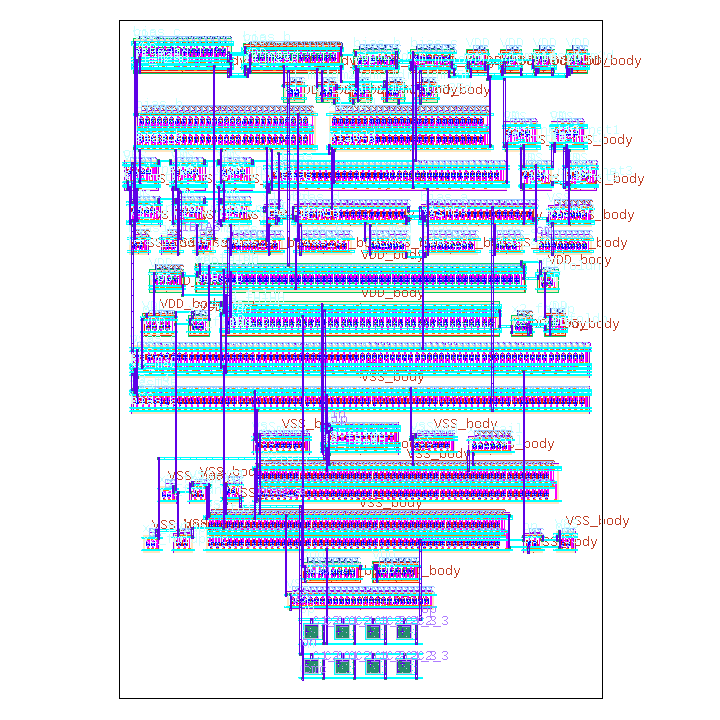 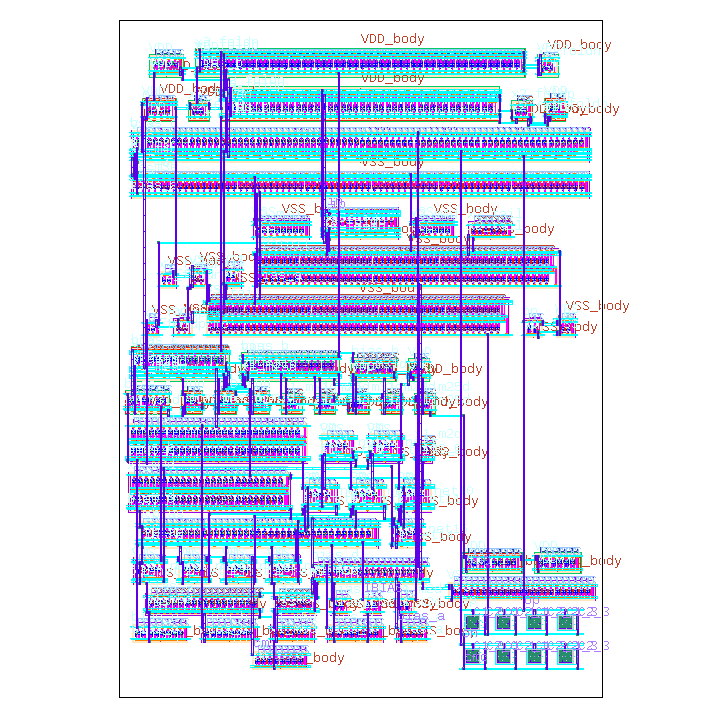 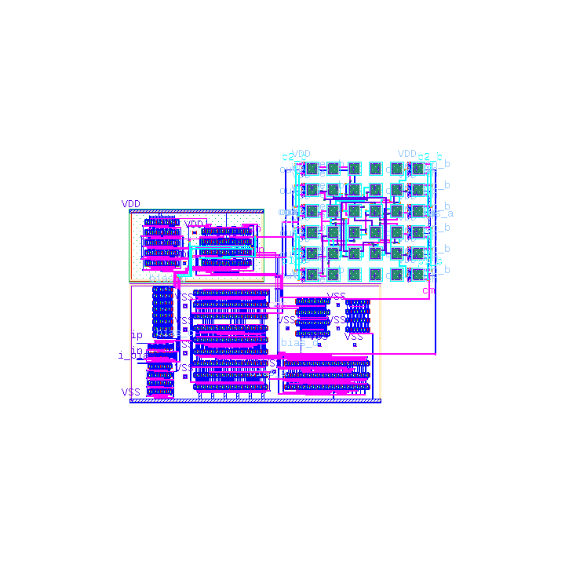

*Left to right, at one scale: Flow, budget-aware, Flow, area-only (thin box: the tile), Hand layout (upstream).*

**Flow, budget-aware, annotated:**

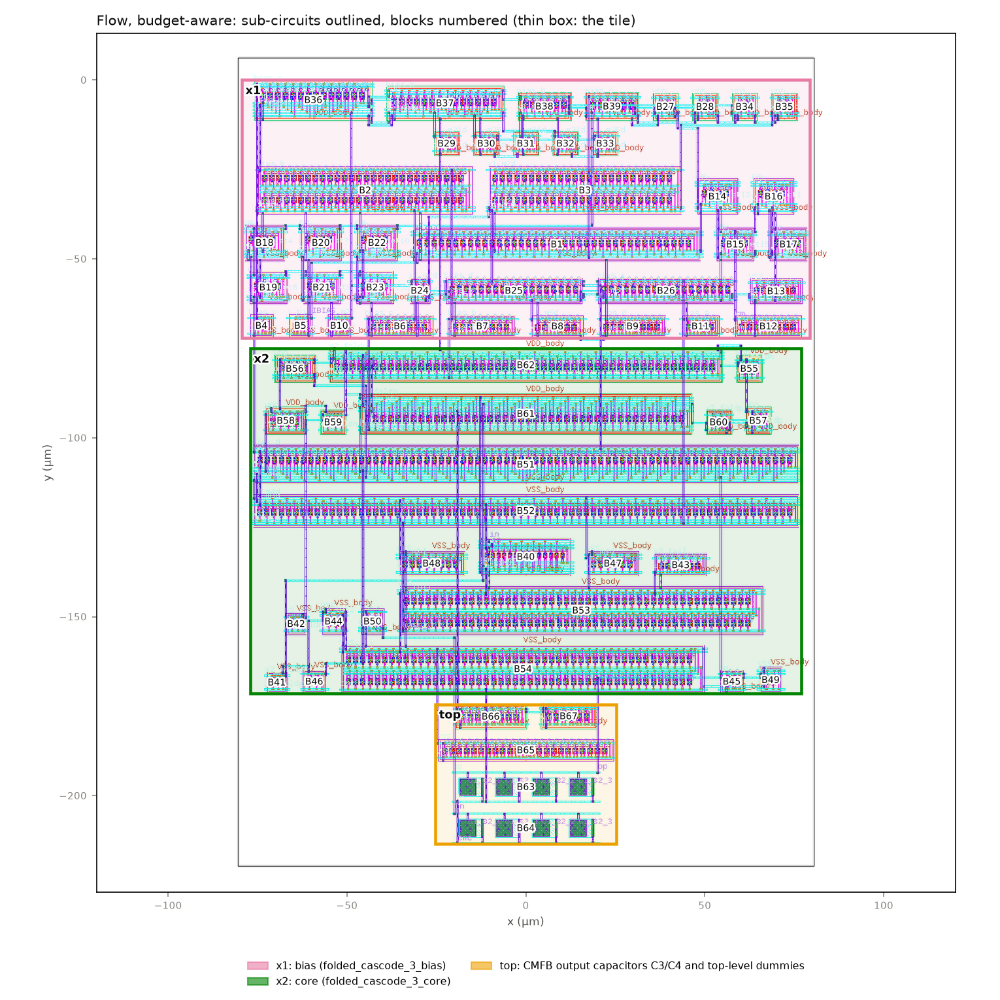

**Flow, area-only, annotated:**

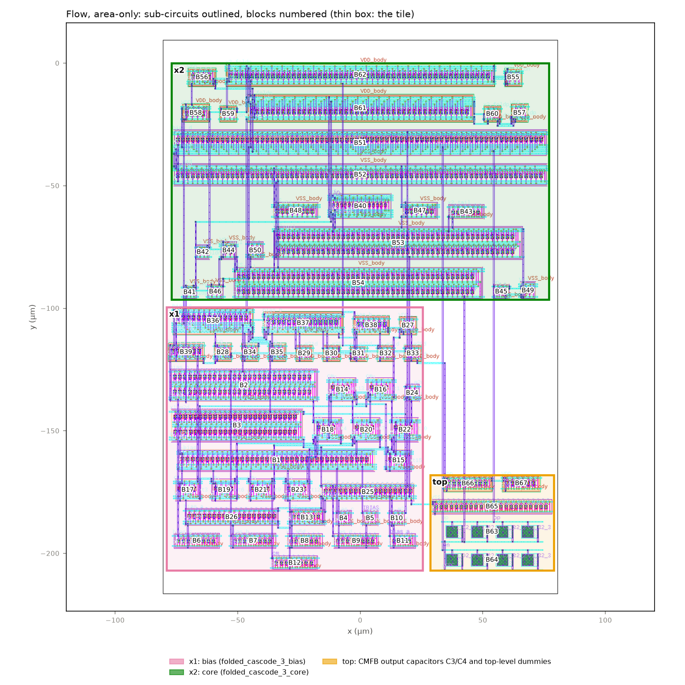

> **How to read it.** Each sub-circuit outlined in its colour, every block's number (as in section 5) at its centre; the thin box is the tile. The two long blocks in x2 are the folded m = 96 arrays.

| | Budget-aware | Area-only |
|---|---|---|
| Sub-circuits, top to bottom | x1 / x2 / top | x2 / x1, top |
| Shape of each sub-circuit | x1 a100 (annealing), x2 a100 (annealing), top w100 (enumeration) | x2 w100 (annealing), x1 w65 (annealing), top w100 (enumeration) |
| Size (µm) | 158.7 × 213.5 | 158.0 × 207.0 |
| Area (µm²) | 33,889 | 32,698 |
| Top-level wire (µm) | 1,894 | 2,494 |
| Sum of wire-budget use | 3140.3 | 4653.4 |
| Nets longer than their budget | 17 of 33 | 20 of 33 |
| DRC errors / LVS | 0 / match | 0 / match |

> **How to read it.** "w100" … is the width limit a sub-circuit was placed under (× the tile's width); "a100" … an area-only shape added by the fallback.

**Sign-off of the final design** (the budget-aware layout), as the tools reported it:

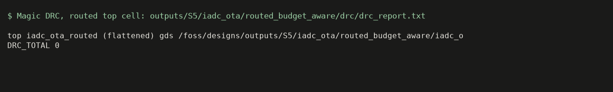

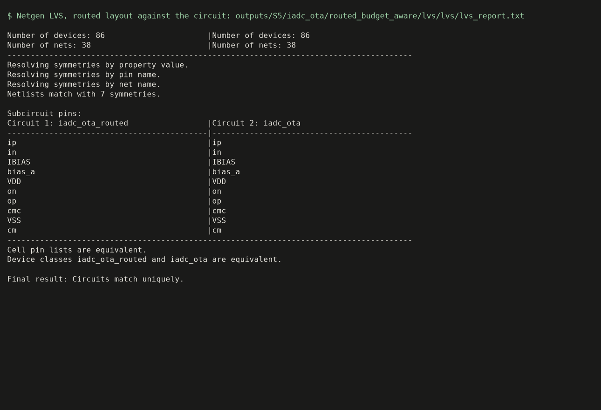

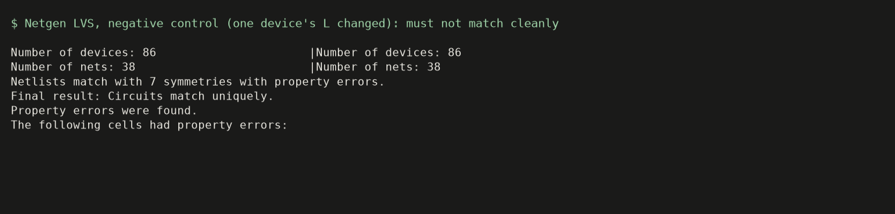

> **How to read it.** The lines of the tools' own report files, verbatim (the file is named above each). Magic's DRC counts 0 errors on the routed top cell. Netgen compares the routed layout with the circuit: the same devices (the many drawn copies merge, e.g. 597 nfet pieces into 49 devices) and nets, "Circuits match uniquely". The negative control, the same check with one device's length changed, reports property errors, so the check can fail.

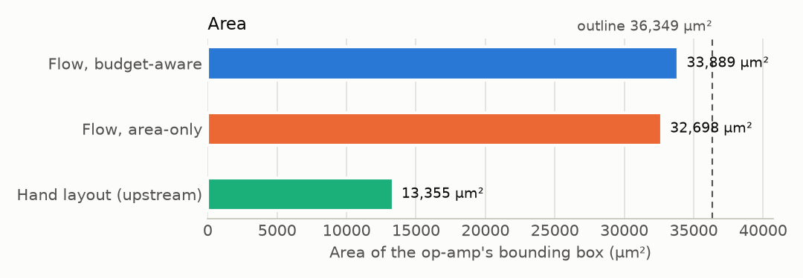

> **How to read it.** The bounding box of each layout; the dashed line is the tile's area. The hand layout holds the whole switched-capacitor CMFB, which the flow's circuit does not.

## 7. After layout: what the wiring costs (S6, S7)

S6 reads each layout back with every wire's capacitance (C-only); S7 simulates it in the original benches with the same ideal CMFB as the schematic (row 100).

| Spec | Limit | Schematic | Drawn devices | After layout, budget-aware | Use of the allowance | After layout, area-only | Use of the allowance |
|---|---|---|---|---|---|---|---|
| Phase margin (PM) (°) | ≥ 60 | 77.234 | 75.503 | 73.023 | 0.489 | 73.047 | 0.486 |
| DC gain (dB) | ≥ 52.47 | 53.47 | 53.602 | 53.602 | -0.264 | 53.602 | -0.264 |
| Unity-gain bandwidth (GBW) (MHz) | ≥ 188.87 | 209.85 | 204.8 | 180.25 | **2.82** | 179.6 | **2.88** |

> **How to read it.** Use of the allowance = (schematic − after layout) / (η × margin); 1.0 is all the layout may take (bold: more). A negative use is a gain.

**What it shows here:** GBW misses its spec: 204.8 MHz with the drawn devices, 180.3 after the wiring. The GBW-sensitive nodes carry far more capacitance than budgeted (op 50.5 fF against 0.425, on 59.4 fF against 0.425, x2_foldp 42.5 fF against 0.36).

**The MIM double count is small here.** With C3's and C4's own plate coupling cancelled (G7.5), GBW is 183.1 MHz (use 2.55): still below the spec, unlike ttsky, where it explained most of the loss.

**The extraction's own check** (S6, gate G6.1):

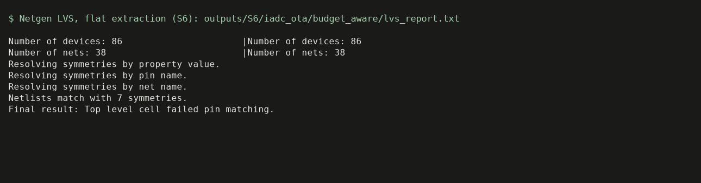

> **How to read it.** Netgen on the flat extraction: the netlists match ("with 7 symmetries": iadc's identical cascode pairs are interchangeable). Its last line reports pin matching failed because flattening turns every inner label into a pin; the flow's G6.1 checks each such row and accepts it only for an inner net or two interchangeable nets (rows 88, 90, 100): G6.1 PASS.

> **How to read it.** The drop from drawn devices to the extracted layout, for each of the three layouts, measured the same way.

## 8. Comparison with the hand layout

**What the hand layout is.** The upstream project's own Magic layout of the OTA (`circuits/iadc_ota/upstream_src/layout/ota/ota.gds`, cell `ota`), measured with the same tool and settings and simulated in the same benches (flow record 7.8). Its CMFB's clocks are held in phase 1 and its output node is driven by the same ideal CMFB law (ASSUMPTION), so the outputs see C3 and C4 as in the flow's model.

> **How to read it.** The hand layout is drawn flat (no sub-cells) except its CMFB, outlined. The flow's layout does not hold the CMFB's switches and sampling capacitors.

**Performance after layout, side by side** (tt, 27 °C, 0.3 pF per output, the same benches and ideal CMFB law; C-only extraction unless marked R+C):

| | Spec | Schematic | Hand: drawn | Hand: C-only | Hand: R+C | Flow BA: drawn | Flow BA: C-only | Flow AO: C-only |
|---|---|---|---|---|---|---|---|---|
| DC gain (dB) | ≥ 52.47 | 53.47 | 53.601 | 53.601 | 57.243 | 53.602 | 53.602 | 53.602 |
| Unity-gain bandwidth (GBW) (MHz) | ≥ 188.87 | 209.85 | 171.85 | 156.2 | 153.7 | 204.8 | 180.25 | 179.6 |
| Phase margin (PM) (°) | ≥ 60 | 77.234 | 82.052 | 81.169 | 78.709 | 75.503 | 73.023 | 73.047 |
| Power (µW) | – | 757.89 | 757.16 | 757.16 | 773.36 | 757.16 | 757.16 | 757.16 |

> **How to read it.** Each column is one circuit simulated in the same bench. The hand layout holds the real switched-capacitor CMFB (its switches and sampling capacitors load the output and bias nodes), so its drawn column already differs from the schematic; the flow's circuit is the schematic's (with the CMFB ideal). The R+C column is the hand layout with its wire resistance as well (flow record 7.8); the flow's layouts were extracted C-only (section 12).

**What it shows here:** after layout the flow's budget-aware layout has the higher GBW (180.3 against 156.2 MHz, C-only), the hand layout the higher phase margin (81.17 against 73.02°); gain is the same. As absolute numbers these mix the layout with the CMFB difference; the wiring's cost (below) separates the layout's own part.

**Why it is not the same circuit.** LVS of the hand layout against the flow's circuit does not match: it holds the switched-capacitor CMFB (switches and four more capacitors on the output and bias nodes). Its drawn devices give GBW 171.8 MHz against the schematic model's 209.9 MHz. What compares fairly is the wiring's cost, and the area with the CMFB caveat:

| | Flow, budget-aware | Flow, area-only | Hand layout |
|---|---|---|---|
| Area (µm²) | 33,889 (2.54 ×) | 32,698 (2.45 ×) | 13,355 (1.00 ×; its CMFB alone 3,265) |
| GBW lost to the wiring | 12.0 % | 12.3 % | 9.1 % |
| Phase margin lost to the wiring | 2.48° | 2.46° | 0.88° |
| Gain lost to the wiring | 0.000 dB | 0.000 dB | 0.000 dB |

**What it shows.**

- **Bandwidth and phase margin:** the hand layout's wiring costs less (GBW 9.1 % against 12.0 %). It is a compact, flat layout: short wires between devices that the flow keeps in separate blocks, each with its own ring.
- **Area:** the flow's layout is 2.5 × the hand layout's, which also holds the CMFB. With 831 unit pieces, a ring per block, 3 µm gaps and dummies cost far more than in ttsky; the tile, not the area, was the target, and it fits.
- **Effort:** the flow's layouts took minutes of computer time, every check automatic; the hand layout's design time is not recorded here.

## 9. What is new in this flow (status on this design)

| Contribution (`docs/05_literature_novelty_remap.md`) | Shown on this design |
|---|---|
| C1. Intent compiled from the circuit's own model | partly: per-node sensitivities and poles (S1) turned into budgets before layout (S2) |
| C2. Device cells chosen from the requirements | yes, with relaxations (G3.3/G3.5; the budgets are tight) |
| C3. Budget-aware variants and placement | 75 signed-off variants; in this tile the budget-aware search fell back to area-only shapes, and the two layouts lose about the same (GBW use 2.82 against 2.88) |
| C4. LLM decisions grounded in the equations, measured | not yet (section 10) |
| C5. Open, reproducible SKY130 flow | yes: every block and both layouts signed off; seeded; golden results |

New for this design: multi-row arrays for long devices, placement search inside a tight outline, and a Tiny Tapeout tile as the outline.

## 10. The next step: LLM integration

As planned for ttsky (its report, section 10): an independent LLM proposes the floorplan and the matching from the netlist, the hierarchy, the specs and section 3's budgets; the same S4–S7 build and check it. On this design it should help where the code's search is weakest:

- **GBW:** keep the GBW-sensitive nets (op, on and x2_foldp) short by placing their blocks side by side across the sub-circuit boundaries the code keeps;
- **density:** propose which blocks may share a ring (one ring per block costs much area with unit transistors), checked by DRC and LVS like everything else;
- **budgets that cannot be met** (G2.7, G5.4): say which to relax, with the equations behind it.

Planned to start with the Claude CLI after Imasha's supervisor agrees; every call journaled.

## 11. What did not pass, and why

None of these is a crash; each stage finished and reported.

| Stage | Result | Time (min) |
|---|---|---|
| S0 | FAIL (G0.7) | 40.3 |
| S1 | FAIL (G1.1) | 1.9 |
| S2 | FAIL (G2.7) | 72.8 |
| S3 | FAIL (G3.3, G3.5) | 45.8 |
| S4 | PASS | 5.8 |
| S5 | FAIL (G5.4) | 15.6 |
| S6 | FAIL (G6.2) | 19.7 |
| S7 | FAIL (G7.1, G7.2) | 1.5 |

- **S0 G0.7:** S0's own reference cell of two devices (XX2_M23, XX2_M24, the PDK's default cell) has 12 DRC errors; that cell is a reference only, and S3 chooses the cells S4 draws (all signed off).
- **S1 G1.1:** some devices sit below saturation by design (unit cascodes); the open G1.1 question (flow record row 41).
- **S2 G2.7:** S2's budgets cannot all be met with the library's smallest cells ("library floors"): the margins left for the layout are small.
- **S3 G3.3:** some transistor types use their "least bad" drawn cell; follows from G2.7.
- **S3 G3.5:** same as G3.3: a relaxation was needed for some cells.
- **S5 G5.4:** S2's wire-length budgets are far exceeded by nets that run between sub-circuits in the tile.
- **S6 G6.2:** follows from G5.4: the long nets and their couplings exceed S2's capacitance budgets.
- **S7 G7.1:** GBW misses its spec after layout (section 7).
- **S7 G7.2:** GBW loses more than η × its margin (section 7).

## 12. Assumptions and limits

- The specs: phase margin ≥ 60° from the design's config; gain ≥ the schematic's gain − 1 dB and GBW ≥ 0.9 × the schematic's GBW, derived from the schematic's own results (ASSUMPTION: the upstream project gives no specs).
- The switched-capacitor CMFB is modelled by an ideal source with its steady-state law (ASSUMPTION); only its output capacitors C3 and C4 are in the laid-out circuit.
- The whole Tiny Tapeout 1×2 tile (161 × 225.77 µm) is the outline; the tile's power straps and analog pins are not routed (ASSUMPTION).
- The matching and dummy choices repeat Imasha's decisions for ttsky25a_fd (centroid or interdigitated, a dummy at each end of every matched row), although the netlist already holds the designer's own dummies (ASSUMPTION).
- The fold limit: a single device's row longer than 100 µm becomes a multi-row array (ASSUMPTION; any value below the tile's width works).
- Capacitance-only extraction, as for ttsky25a_fd and as the hand layout was measured (flow record 7.8).
- One condition only (typical corner, 27 °C, 0.3 pF per output, 30 µA bias); no PVT corners after layout.
- Electromigration limits for SKY130 were not found in the PDK; wire widths are not checked against current.

## 13. Open questions (FEEDBACK NEEDED)

1. GBW misses its spec, which is itself an ASSUMPTION (0.9 × the schematic). Keep it and report the miss, or set iadc's specs another way?
2. Confirm the layout choices repeated from ttsky (matching, dummies on top of the designer's own) and the whole tile as the outline (power straps and pins not routed).
3. The two latent fixes found here (rows 95, 96) are opt-in; make them the default and re-run the finished designs?

## Glossary

- **Schematic:** the circuit as drawn by the designer: which transistors, resistors and capacitors connect to which.
- **Layout:** the drawing of the chip itself: the shapes on each layer that the factory makes. Every wire in it has length, so it adds capacitance and resistance the schematic does not have.
- **Op-amp:** operational amplifier. This one is fully differential: two inputs, two outputs (Vop, Vom).
- **Node / net:** a point of the circuit where terminals connect (a net is its wire in the layout).
- **Pole:** a frequency where a node's resistance and capacitance start to cut the gain; the first (dominant) pole sets the bandwidth, the next ones eat phase margin.
- **GBW:** unity-gain bandwidth: the frequency at which the amplifier's gain has fallen to 1. Higher is faster.
- **Phase margin (PM):** how far the amplifier is from oscillating in feedback. Above about 60° is comfortable.
- **DC gain:** how much the amplifier multiplies a slow input signal, in dB (98 dB is about 80 000 times).
- **Spec:** a required value, e.g. GBW ≥ 1.85 MHz. Here the specs are 0.9 × what the schematic achieves (ASSUMPTION; the design's README gives results, not specs).
- **Margin, η and allowance:** margin = schematic value − spec limit. The flow lets the layout use at most η = 0.5 of it (the allowance); the other half is kept for everything the flow does not model (process corners, temperature). "Use 1.27" means 1.27 × the allowance.
- **Sensitivity:** how much a spec changes per fF of capacitance added on a node (S1).
- **Budget:** the most capacitance, coupling, resistance or wire length a net may get from the layout, so that all of them together stay within the allowance (S2).
- **DRC:** design rule check: are all shapes wide enough and far enough apart for the factory? 0 errors = clean.
- **LVS:** layout versus schematic: is the drawn layout the same circuit as the schematic? "Match" = yes.
- **Negative control:** a deliberately wrong copy (e.g. one transistor's length changed) that a check must reject; it proves the check can fail.
- **Extraction (PEX):** reading the finished layout back into a netlist that includes the wires' capacitance (here capacitance only, "C-only"), so it can be simulated.
- **Drawn devices:** the layout's transistors as drawn, simulated without any wiring: shows what the layout's device shapes alone change. "Drawn → extracted" is then the cost of the wiring.
- **Block:** a group of transistors drawn together as one piece (a matched pair, a mirror, a single device), with its own tap ring; numbered B1 … in this report.
- **Variant:** one way of drawing a block (e.g. A B B A or A B A B); S4 draws several, S5 picks one.
- **Common centroid:** matched transistors split into pieces arranged A B B A, so both have the same centre and a gradient across the chip affects them equally.
- **Interdigitated:** pieces alternating A B A B: both spread over the same area, but their centres differ slightly.
- **Dummy:** an unused transistor or resistor at the end of a row, so the real ones at the ends see the same surroundings as those in the middle.
- **Tap ring:** a ring of substrate (or well) contact around a block, which prevents latch-up.
- **Macro:** one sub-circuit of the design's own hierarchy (x1, x2, top, the resistor packs), placed as a unit.
- **Budget-aware / area-only:** the flow scores every placement two ways and lays out both winners: by area plus how much of each wire's length budget it uses (the flow's own rule), and by area alone (the usual baseline). Comparing them tests whether the budgets help.
- **Simulated annealing:** a search that makes random small changes to a placement, always keeps an improvement, sometimes keeps a worsening early on (to escape poor arrangements), and accepts fewer worsenings as it "cools".
- **A* (A-star):** a shortest-path search on a grid that heads towards the target first; used by the router.
- **Gate (G4.1, G5.4 …):** an automatic pass/fail check at the end of a stage.
- **PREREG:** the pre-registration file: the hypotheses, thresholds and fixed parameters, written down before the runs, changed only by dated amendments.
- **MIM capacitor:** metal–insulator–metal capacitor: here the CMFB's output capacitors C3 and C4, 4 units of 4.8 × 4.8 µm each (196 fF).
- **CMFB:** common-mode feedback: holds the average of the two outputs at a reference voltage. iadc's is a switched-capacitor circuit; the flow's AC model replaces it by an ideal source with its steady-state law (ASSUMPTION), keeping only its output capacitors C3 and C4 in the circuit.
- **Tiny Tapeout analog tile:** the fixed area a design gets on a Tiny Tapeout chip; the 1×2 analog tile is 161 × 225.77 µm (read from Imasha's taped-out tile).
- **Multi-row array:** a device with many copies drawn as several identical rows inside one tap ring, instead of one long row (iadc's two m = 96 devices).

## Where everything is

- Layouts: `outputs/S5/iadc_ota/routed_budget_aware/`, `routed_area_only/`; blocks `outputs/S4/iadc_ota/blocks/`.
- Extraction `outputs/S6/iadc_ota/`; simulations `outputs/S7/iadc_ota/`; hand layout `outputs/reference_layout/iadc_ota/`.
- This report's pictures: `outputs/report/iadc_ota/`; the simple report: `docs/reports/iadc_ota_report.html`.
- The record: `docs/flow_record.md` (7.8, 7.25, rows 93–100); the layout instructions: `inputs/iadc_ota/layout.yaml`.

## Appendix A. Every variant of every block

<figure style="display:inline-block;width:23%;margin:4px;vertical-align:top;border-top:5px solid #e87ba4;"><figcaption style="font-size:0.8em"><b>B1 nmos_current_mirror</b> · ABBA BA ✓ AO ✓</figcaption></figure><figure style="display:inline-block;width:23%;margin:4px;vertical-align:top;border-top:5px solid #e87ba4;"><figcaption style="font-size:0.8em"><b>B1 nmos_current_mirror</b> · ABAB </figcaption></figure><figure style="display:inline-block;width:23%;margin:4px;vertical-align:top;border-top:5px solid #e87ba4;"><figcaption style="font-size:0.8em"><b>B2 nmos_diode</b> · A BA ✓ AO ✓</figcaption></figure><figure style="display:inline-block;width:23%;margin:4px;vertical-align:top;border-top:5px solid #e87ba4;"><figcaption style="font-size:0.8em"><b>B3 nmos_diode_2</b> · A BA ✓ AO ✓</figcaption></figure><figure style="display:inline-block;width:23%;margin:4px;vertical-align:top;border-top:5px solid #e87ba4;"><figcaption style="font-size:0.8em"><b>B4 nmos_dummy_10</b> · A BA ✓ AO ✓</figcaption></figure><figure style="display:inline-block;width:23%;margin:4px;vertical-align:top;border-top:5px solid #e87ba4;"><figcaption style="font-size:0.8em"><b>B5 nmos_dummy_11</b> · A BA ✓ AO ✓</figcaption></figure><figure style="display:inline-block;width:23%;margin:4px;vertical-align:top;border-top:5px solid #e87ba4;"><figcaption style="font-size:0.8em"><b>B6 nmos_dummy_2</b> · A BA ✓ AO ✓</figcaption></figure><figure style="display:inline-block;width:23%;margin:4px;vertical-align:top;border-top:5px solid #e87ba4;"><figcaption style="font-size:0.8em"><b>B7 nmos_dummy_3</b> · A BA ✓ AO ✓</figcaption></figure><figure style="display:inline-block;width:23%;margin:4px;vertical-align:top;border-top:5px solid #e87ba4;"><figcaption style="font-size:0.8em"><b>B8 nmos_dummy_4</b> · A BA ✓ AO ✓</figcaption></figure><figure style="display:inline-block;width:23%;margin:4px;vertical-align:top;border-top:5px solid #e87ba4;"><figcaption style="font-size:0.8em"><b>B9 nmos_dummy_5</b> · A BA ✓ AO ✓</figcaption></figure><figure style="display:inline-block;width:23%;margin:4px;vertical-align:top;border-top:5px solid #e87ba4;"><figcaption style="font-size:0.8em"><b>B10 nmos_dummy_6</b> · A BA ✓ AO ✓</figcaption></figure><figure style="display:inline-block;width:23%;margin:4px;vertical-align:top;border-top:5px solid #e87ba4;"><figcaption style="font-size:0.8em"><b>B11 nmos_dummy_7</b> · A BA ✓ AO ✓</figcaption></figure><figure style="display:inline-block;width:23%;margin:4px;vertical-align:top;border-top:5px solid #e87ba4;"><figcaption style="font-size:0.8em"><b>B12 nmos_dummy_8</b> · A BA ✓ AO ✓</figcaption></figure><figure style="display:inline-block;width:23%;margin:4px;vertical-align:top;border-top:5px solid #e87ba4;"><figcaption style="font-size:0.8em"><b>B13 nmos_dummy_9</b> · A BA ✓ AO ✓</figcaption></figure><figure style="display:inline-block;width:23%;margin:4px;vertical-align:top;border-top:5px solid #e87ba4;"><figcaption style="font-size:0.8em"><b>B14 nmos_matched_cascode_pair_10</b> · AB BA ✓ AO ✓</figcaption></figure><figure style="display:inline-block;width:23%;margin:4px;vertical-align:top;border-top:5px solid #e87ba4;"><figcaption style="font-size:0.8em"><b>B15 nmos_matched_cascode_pair_11</b> · AB BA ✓ AO ✓</figcaption></figure><figure style="display:inline-block;width:23%;margin:4px;vertical-align:top;border-top:5px solid #e87ba4;"><figcaption style="font-size:0.8em"><b>B16 nmos_matched_cascode_pair_2</b> · AB BA ✓ AO ✓</figcaption></figure><figure style="display:inline-block;width:23%;margin:4px;vertical-align:top;border-top:5px solid #e87ba4;"><figcaption style="font-size:0.8em"><b>B17 nmos_matched_cascode_pair_3</b> · AB BA ✓ AO ✓</figcaption></figure><figure style="display:inline-block;width:23%;margin:4px;vertical-align:top;border-top:5px solid #e87ba4;"><figcaption style="font-size:0.8em"><b>B18 nmos_matched_cascode_pair_4</b> · AB BA ✓ AO ✓</figcaption></figure><figure style="display:inline-block;width:23%;margin:4px;vertical-align:top;border-top:5px solid #e87ba4;"><figcaption style="font-size:0.8em"><b>B19 nmos_matched_cascode_pair_5</b> · AB BA ✓ AO ✓</figcaption></figure><figure style="display:inline-block;width:23%;margin:4px;vertical-align:top;border-top:5px solid #e87ba4;"><figcaption style="font-size:0.8em"><b>B20 nmos_matched_cascode_pair_6</b> · AB BA ✓ AO ✓</figcaption></figure><figure style="display:inline-block;width:23%;margin:4px;vertical-align:top;border-top:5px solid #e87ba4;"><figcaption style="font-size:0.8em"><b>B21 nmos_matched_cascode_pair_7</b> · AB BA ✓ AO ✓</figcaption></figure><figure style="display:inline-block;width:23%;margin:4px;vertical-align:top;border-top:5px solid #e87ba4;"><figcaption style="font-size:0.8em"><b>B22 nmos_matched_cascode_pair_8</b> · AB BA ✓ AO ✓</figcaption></figure><figure style="display:inline-block;width:23%;margin:4px;vertical-align:top;border-top:5px solid #e87ba4;"><figcaption style="font-size:0.8em"><b>B23 nmos_matched_cascode_pair_9</b> · AB BA ✓ AO ✓</figcaption></figure><figure style="display:inline-block;width:23%;margin:4px;vertical-align:top;border-top:5px solid #e87ba4;"><figcaption style="font-size:0.8em"><b>B24 nmos_single</b> · A BA ✓ AO ✓</figcaption></figure><figure style="display:inline-block;width:23%;margin:4px;vertical-align:top;border-top:5px solid #e87ba4;"><figcaption style="font-size:0.8em"><b>B25 nmos_single_2</b> · A BA ✓ AO ✓</figcaption></figure><figure style="display:inline-block;width:23%;margin:4px;vertical-align:top;border-top:5px solid #e87ba4;"><figcaption style="font-size:0.8em"><b>B26 nmos_single_3</b> · A BA ✓ AO ✓</figcaption></figure><figure style="display:inline-block;width:23%;margin:4px;vertical-align:top;border-top:5px solid #e87ba4;"><figcaption style="font-size:0.8em"><b>B27 pmos_dummy_10</b> · A BA ✓ AO ✓</figcaption></figure><figure style="display:inline-block;width:23%;margin:4px;vertical-align:top;border-top:5px solid #e87ba4;"><figcaption style="font-size:0.8em"><b>B28 pmos_dummy_11</b> · A BA ✓ AO ✓</figcaption></figure><figure style="display:inline-block;width:23%;margin:4px;vertical-align:top;border-top:5px solid #e87ba4;"><figcaption style="font-size:0.8em"><b>B29 pmos_dummy_3</b> · A BA ✓ AO ✓</figcaption></figure><figure style="display:inline-block;width:23%;margin:4px;vertical-align:top;border-top:5px solid #e87ba4;"><figcaption style="font-size:0.8em"><b>B30 pmos_dummy_4</b> · A BA ✓ AO ✓</figcaption></figure><figure style="display:inline-block;width:23%;margin:4px;vertical-align:top;border-top:5px solid #e87ba4;"><figcaption style="font-size:0.8em"><b>B31 pmos_dummy_5</b> · A BA ✓ AO ✓</figcaption></figure><figure style="display:inline-block;width:23%;margin:4px;vertical-align:top;border-top:5px solid #e87ba4;"><figcaption style="font-size:0.8em"><b>B32 pmos_dummy_6</b> · A BA ✓ AO ✓</figcaption></figure><figure style="display:inline-block;width:23%;margin:4px;vertical-align:top;border-top:5px solid #e87ba4;"><figcaption style="font-size:0.8em"><b>B33 pmos_dummy_7</b> · A BA ✓ AO ✓</figcaption></figure><figure style="display:inline-block;width:23%;margin:4px;vertical-align:top;border-top:5px solid #e87ba4;"><figcaption style="font-size:0.8em"><b>B34 pmos_dummy_8</b> · A BA ✓ AO ✓</figcaption></figure><figure style="display:inline-block;width:23%;margin:4px;vertical-align:top;border-top:5px solid #e87ba4;"><figcaption style="font-size:0.8em"><b>B35 pmos_dummy_9</b> · A BA ✓ AO ✓</figcaption></figure><figure style="display:inline-block;width:23%;margin:4px;vertical-align:top;border-top:5px solid #e87ba4;"><figcaption style="font-size:0.8em"><b>B36 pmos_matched_cascode_pair</b> · ABBA BA ✓ AO ✓</figcaption></figure><figure style="display:inline-block;width:23%;margin:4px;vertical-align:top;border-top:5px solid #e87ba4;"><figcaption style="font-size:0.8em"><b>B36 pmos_matched_cascode_pair</b> · ABAB </figcaption></figure><figure style="display:inline-block;width:23%;margin:4px;vertical-align:top;border-top:5px solid #e87ba4;"><figcaption style="font-size:0.8em"><b>B37 pmos_matched_current_source_pair</b> · ABBA BA ✓ AO ✓</figcaption></figure><figure style="display:inline-block;width:23%;margin:4px;vertical-align:top;border-top:5px solid #e87ba4;"><figcaption style="font-size:0.8em"><b>B37 pmos_matched_current_source_pair</b> · ABAB </figcaption></figure><figure style="display:inline-block;width:23%;margin:4px;vertical-align:top;border-top:5px solid #e87ba4;"><figcaption style="font-size:0.8em"><b>B38 pmos_single</b> · A BA ✓ AO ✓</figcaption></figure><figure style="display:inline-block;width:23%;margin:4px;vertical-align:top;border-top:5px solid #e87ba4;"><figcaption style="font-size:0.8em"><b>B39 pmos_single_2</b> · A BA ✓ AO ✓</figcaption></figure><figure style="display:inline-block;width:23%;margin:4px;vertical-align:top;border-top:5px solid #008300;"><figcaption style="font-size:0.8em"><b>B40 nmos_differential_pair</b> · ABBA </figcaption></figure><figure style="display:inline-block;width:23%;margin:4px;vertical-align:top;border-top:5px solid #008300;"><figcaption style="font-size:0.8em"><b>B40 nmos_differential_pair</b> · ABAB BA ✓ AO ✓</figcaption></figure><figure style="display:inline-block;width:23%;margin:4px;vertical-align:top;border-top:5px solid #008300;"><figcaption style="font-size:0.8em"><b>B41 nmos_dummy_12</b> · A BA ✓ AO ✓</figcaption></figure><figure style="display:inline-block;width:23%;margin:4px;vertical-align:top;border-top:5px solid #008300;"><figcaption style="font-size:0.8em"><b>B42 nmos_dummy_13</b> · A BA ✓ AO ✓</figcaption></figure><figure style="display:inline-block;width:23%;margin:4px;vertical-align:top;border-top:5px solid #008300;"><figcaption style="font-size:0.8em"><b>B43 nmos_dummy_14</b> · A BA ✓ AO ✓</figcaption></figure><figure style="display:inline-block;width:23%;margin:4px;vertical-align:top;border-top:5px solid #008300;"><figcaption style="font-size:0.8em"><b>B44 nmos_dummy_15</b> · A BA ✓ AO ✓</figcaption></figure><figure style="display:inline-block;width:23%;margin:4px;vertical-align:top;border-top:5px solid #008300;"><figcaption style="font-size:0.8em"><b>B45 nmos_dummy_16</b> · A BA ✓ AO ✓</figcaption></figure><figure style="display:inline-block;width:23%;margin:4px;vertical-align:top;border-top:5px solid #008300;"><figcaption style="font-size:0.8em"><b>B46 nmos_dummy_17</b> · A BA ✓ AO ✓</figcaption></figure><figure style="display:inline-block;width:23%;margin:4px;vertical-align:top;border-top:5px solid #008300;"><figcaption style="font-size:0.8em"><b>B47 nmos_dummy_18</b> · A BA ✓ AO ✓</figcaption></figure><figure style="display:inline-block;width:23%;margin:4px;vertical-align:top;border-top:5px solid #008300;"><figcaption style="font-size:0.8em"><b>B48 nmos_dummy_19</b> · A BA ✓ AO ✓</figcaption></figure><figure style="display:inline-block;width:23%;margin:4px;vertical-align:top;border-top:5px solid #008300;"><figcaption style="font-size:0.8em"><b>B49 nmos_dummy_20</b> · A BA ✓ AO ✓</figcaption></figure><figure style="display:inline-block;width:23%;margin:4px;vertical-align:top;border-top:5px solid #008300;"><figcaption style="font-size:0.8em"><b>B50 nmos_dummy_21</b> · A BA ✓ AO ✓</figcaption></figure><figure style="display:inline-block;width:23%;margin:4px;vertical-align:top;border-top:5px solid #008300;"><figcaption style="font-size:0.8em"><b>B51 nmos_matched_cascode_pair</b> · ABBA BA ✓ AO ✓</figcaption></figure><figure style="display:inline-block;width:23%;margin:4px;vertical-align:top;border-top:5px solid #008300;"><figcaption style="font-size:0.8em"><b>B51 nmos_matched_cascode_pair</b> · ABAB </figcaption></figure><figure style="display:inline-block;width:23%;margin:4px;vertical-align:top;border-top:5px solid #008300;"><figcaption style="font-size:0.8em"><b>B52 nmos_matched_current_source_pair</b> · ABBA </figcaption></figure><figure style="display:inline-block;width:23%;margin:4px;vertical-align:top;border-top:5px solid #008300;"><figcaption style="font-size:0.8em"><b>B52 nmos_matched_current_source_pair</b> · ABAB BA ✓ AO ✓</figcaption></figure><figure style="display:inline-block;width:23%;margin:4px;vertical-align:top;border-top:5px solid #008300;"><figcaption style="font-size:0.8em"><b>B53 nmos_single_4</b> · A BA ✓ AO ✓</figcaption></figure><figure style="display:inline-block;width:23%;margin:4px;vertical-align:top;border-top:5px solid #008300;"><figcaption style="font-size:0.8em"><b>B54 nmos_single_5</b> · A BA ✓ AO ✓</figcaption></figure><figure style="display:inline-block;width:23%;margin:4px;vertical-align:top;border-top:5px solid #008300;"><figcaption style="font-size:0.8em"><b>B55 pmos_dummy_12</b> · A BA ✓ AO ✓</figcaption></figure><figure style="display:inline-block;width:23%;margin:4px;vertical-align:top;border-top:5px solid #008300;"><figcaption style="font-size:0.8em"><b>B56 pmos_dummy_13</b> · A BA ✓ AO ✓</figcaption></figure><figure style="display:inline-block;width:23%;margin:4px;vertical-align:top;border-top:5px solid #008300;"><figcaption style="font-size:0.8em"><b>B57 pmos_dummy_14</b> · A BA ✓ AO ✓</figcaption></figure><figure style="display:inline-block;width:23%;margin:4px;vertical-align:top;border-top:5px solid #008300;"><figcaption style="font-size:0.8em"><b>B58 pmos_dummy_15</b> · A BA ✓ AO ✓</figcaption></figure><figure style="display:inline-block;width:23%;margin:4px;vertical-align:top;border-top:5px solid #008300;"><figcaption style="font-size:0.8em"><b>B59 pmos_dummy_16</b> · A BA ✓ AO ✓</figcaption></figure><figure style="display:inline-block;width:23%;margin:4px;vertical-align:top;border-top:5px solid #008300;"><figcaption style="font-size:0.8em"><b>B60 pmos_dummy_17</b> · A BA ✓ AO ✓</figcaption></figure><figure style="display:inline-block;width:23%;margin:4px;vertical-align:top;border-top:5px solid #008300;"><figcaption style="font-size:0.8em"><b>B61 pmos_matched_cascode_pair_2</b> · ABBA </figcaption></figure><figure style="display:inline-block;width:23%;margin:4px;vertical-align:top;border-top:5px solid #008300;"><figcaption style="font-size:0.8em"><b>B61 pmos_matched_cascode_pair_2</b> · ABAB BA ✓ AO ✓</figcaption></figure><figure style="display:inline-block;width:23%;margin:4px;vertical-align:top;border-top:5px solid #008300;"><figcaption style="font-size:0.8em"><b>B62 pmos_matched_current_source_pair_2</b> · ABBA </figcaption></figure><figure style="display:inline-block;width:23%;margin:4px;vertical-align:top;border-top:5px solid #008300;"><figcaption style="font-size:0.8em"><b>B62 pmos_matched_current_source_pair_2</b> · ABAB BA ✓ AO ✓</figcaption></figure><figure style="display:inline-block;width:23%;margin:4px;vertical-align:top;border-top:5px solid #eda100;"><figcaption style="font-size:0.8em"><b>B63 XC3</b> · A BA ✓ AO ✓</figcaption></figure><figure style="display:inline-block;width:23%;margin:4px;vertical-align:top;border-top:5px solid #eda100;"><figcaption style="font-size:0.8em"><b>B64 XC4</b> · A BA ✓ AO ✓</figcaption></figure><figure style="display:inline-block;width:23%;margin:4px;vertical-align:top;border-top:5px solid #eda100;"><figcaption style="font-size:0.8em"><b>B65 nmos_dummy</b> · A BA ✓ AO ✓</figcaption></figure><figure style="display:inline-block;width:23%;margin:4px;vertical-align:top;border-top:5px solid #eda100;"><figcaption style="font-size:0.8em"><b>B66 pmos_dummy</b> · A BA ✓ AO ✓</figcaption></figure><figure style="display:inline-block;width:23%;margin:4px;vertical-align:top;border-top:5px solid #eda100;"><figcaption style="font-size:0.8em"><b>B67 pmos_dummy_2</b> · A BA ✓ AO ✓</figcaption></figure>

