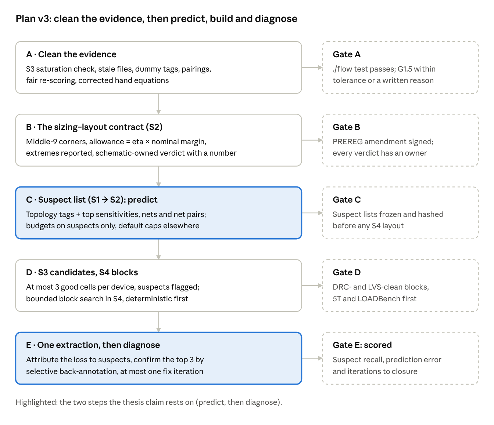
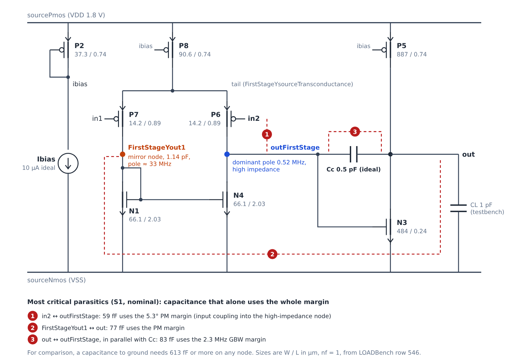
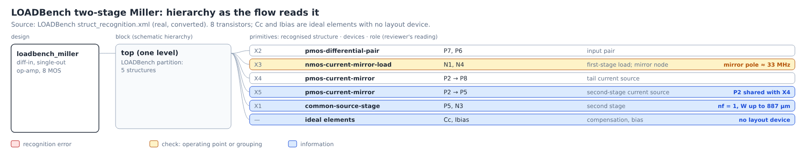
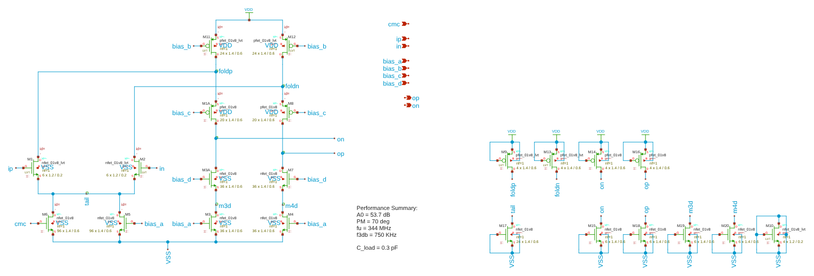
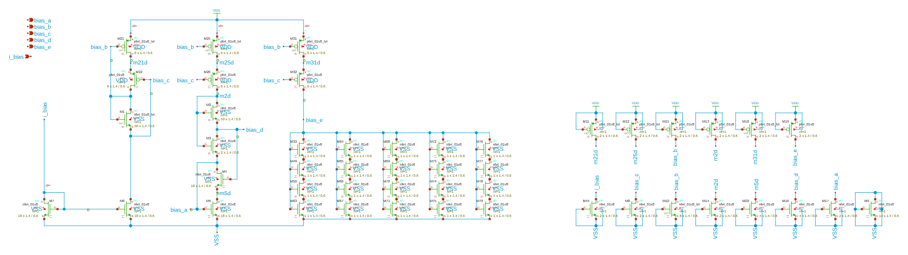
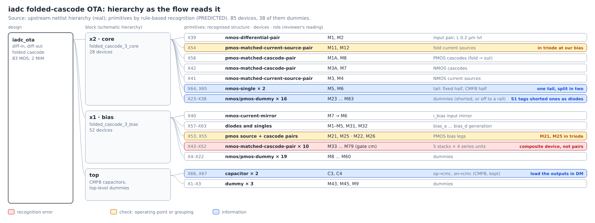
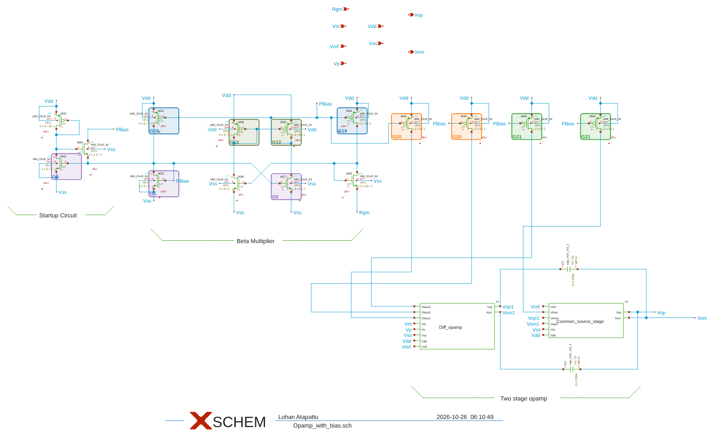
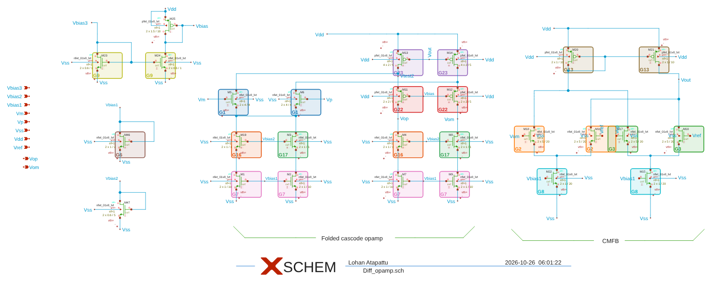
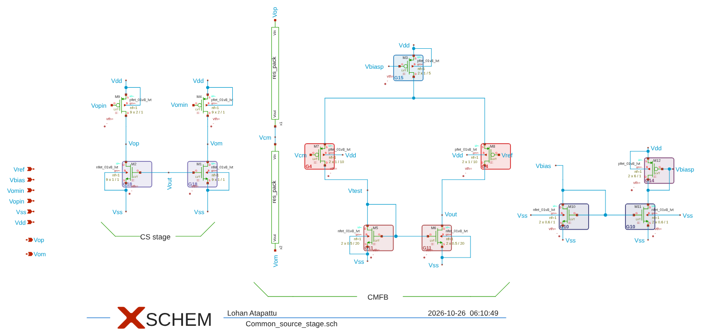
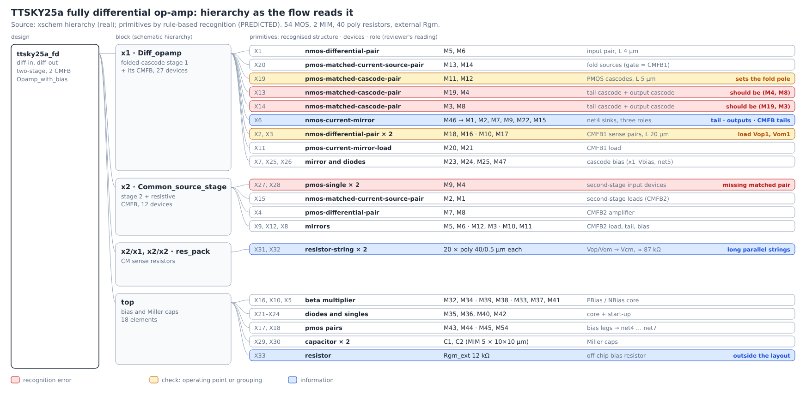

<!-- Mirror of the Claude Doc "Plan v3: circuit review pack and implementation plan" (https://claude.ai/artifact/R15Aj6FzDVKxcYwLT1WAr5), exported 2026-10-27 by Cowork. The doc is the live copy; this file is for Claude Code and the repo history. Images: docs/plan_v3/img/ (drawn by docs/plan_v3/src/*.py or rendered from the upstream xschem sources). -->

# Plan v3: circuit review pack and implementation plan

Oct 27, 2026 · @Imasha Nethmal

## How to use this doc

This doc has two jobs. First, it gives a supervisor-level reading of your six proposals from 27 October and turns them into one implementation plan (Plan v3). Second, it lays out, for each of the three new circuits, exactly what the flow is fed and what it assumes, so you can check the assumptions on your side before any code changes.

Nothing here has been run. No code was changed and the flow was not re-run. Every number quoted comes from the Plan v2 outputs already in the repo.

**Labels used throughout**

- **PREDICTED**: derived before simulation from hand equations or S1 sensitivities. It may be wrong; SPICE is the judge.
- **ASSUMPTION**: a value or modelling choice not found in the design sources. Check it.
- **post hoc**: decided after seeing Plan v2 results. It cannot count as evidence for Plan v2's pre-registered hypotheses.
- **FEEDBACK NEEDED**: a decision only you can make.

**How to review a circuit section**

1. Look at the schematic and the hierarchy image. Does the grouping match how you would draw the layout?
2. Read the node list. For each node, does the equation match your intuition, and is the stated role (pole, zero, mirror, bias) right?
3. Check the critical-node shortlist. These are the nodes the plan proposes to protect; everything else gets the default treatment.
4. Answer the questions at the end of the section, in a comment on this doc or in chat.

## Supervisor assessment of your proposals

Short version: your six proposals are sound and fit together. Two of them (the released allowance and predict-then-diagnose) matter far more than the others. Together they change what the project can claim.

| # | Your proposal | Verdict | Condition |
| --- | --- | --- | --- |
| 1 | Budget at middle corners only; report the extremes | Adopt | Keep ff, ss, sf and fs at nominal V and T in the set (the "middle 9"); pre-register it |
| 2 | Release the schematic-to-layout allowance to a realistic level | Adopt: this is the main lever | One allowance table for all designs, fixed before any re-run |
| 3 | Predict, then diagnose after one PEX (the suspect list) | Adopt as the main claim | Freeze the suspect list before layout and score it |
| 4 | Critical nets and nodes only, from topology and nodal analysis | Adopt | A fixed selection rule; every other net gets a default cap; include net pairs |
| 5 | S3 finds a good candidate; the combination search moves to S4 | Adopt | Bound S4's search; keep S3's floors so "infeasible" stays testable |
| 6 | LLM for decisions, with guardrails | Defer; design the interface now | Closed candidate lists, deterministic checks, fixed budgets |

### 1. Middle corners for budgets; extremes reported

**Why it is right.** It separates responsibilities. If a schematic fails at ss, −40 °C and low supply with no layout at all, layout cannot repair it. Today such corners veto the budget: Plan v2's binding margins were 0.014 dB, 0.093 dB and 0.26° at single corners. Miliozzi et al. (DAC 1996) also generate layout constraints with process and temperature held within preset tolerances; corner sign-off after extraction is common practice (to confirm against the paper).

**What to watch.**

- Dropping the extremes alone does not rescue TTSKY25a. It binds at ff with nominal supply and temperature, which is a middle corner. The real fix is item 2.
- A parasitic's effect can differ by corner. In TTSKY25a, ff is where the schematic's gain margin binds (0.093 dB); its PM barely moves (78.05° against 78.23° at tt). Your paper's 52° post-layout figure comes from a bench at ff and 20 °C (ASSUMPTION: the repository's bench is the one the paper used) (`paper_post_layout.json`), so ff belongs in the budget set, even though our own capacitance-only extraction of the tile gives about 78° there and the 52° is still unexplained. Use one factor at a time (the middle 9), not tt alone.
- Your "not much worse than the worst" rule becomes a reported check at each extreme corner: layout use ≤ eta × the nominal margin, measured with that corner's own sensitivities. A failure there is diagnostic information, not a veto.

**A finding from the circuit review that matters here.** With specs derived from the schematic's own nominal performance (the package rule), the schematic already misses a spec at some middle corners before any layout: 2 of 9 for LOADBench and iadc, 6 of 9 for TTSKY25a (gain at low supply and cold, power at ff and high supply). So the middle-9 set alone is not enough. It works together with item 2, which judges layout only on how much it degrades each corner.

### 2. Release the allowance realistically

**Why it is right.** Option B (each corner's allowance = eta × the nominal margin, applied with that corner's own rates) removes the near-zero-corner veto. The 27 October analysis showed it clears TTSKY25a and the 5T stress design even with all 45 corners. It also matches practice: a designer reserves a share of the nominal margin for layout, not a share of whatever is left at the worst corner.

**What to watch.**

- LOADBench and iadc are tight even at nominal, because their specs come from the package rule (gain −1 dB, GBW × 0.9). Their "margin" is that rule. For these two designs the release has to happen in the spec rule, not in the corner rule.
- A released allowance can become a tuning knob. Write one table for all designs into PREREG (per metric: ΔPM in degrees, ΔGBW in %, Δgain in dB) before any re-run, and report results at those values only. The numbers are yours to choose (FEEDBACK NEEDED); none of our sources gives them.
- When a schematic sits on the edge of a spec, S2 should say so before layout, as a **schematic-owned** verdict with a number for sizing, for example "needs 3° more PM at ff to leave layout its allowance". That is the feedback channel to sizing you described.

### 3. Predict, then diagnose

**Why it is right, and why it is the thesis.** Plan v2 showed our budget rule performs about the same as an equal split on the held-out designs, so "better allocation" is not a claim we can defend. This claim is testable: "before layout, we name the few nets that will cause most of the degradation and by how much; after one extraction we attribute the loss to them and count the iterations closure takes (the target is one)". The constraint-generation papers (Choudhury and Sangiovanni-Vincentelli: UCB/ERL M92/38, 1992, and IEEE TCAD, 1993; Charbon, Malavasi et al. 1994–96) and layout-aware sizing (Lourenço et al., DATE 2015) do not evaluate a frozen, scored pre-layout prediction of this kind. ALIGN and MAGICAL generate layouts but make no such prediction. This needs a proper literature check before we write it as a claim, including Malavasi et al. (IEEE TCAD 1996) on constraint budgeting, machine-learned pre-layout parasitic prediction (for example ParaGraph, DAC 2020) and the parasitic-contribution reports of commercial extraction tools.

**How it works.** After PEX, the predicted loss per net is S1's sensitivity × that net's extracted parasitic. Compare the sum with SPICE on the full extracted netlist. Then confirm the top suspects by putting only their parasitics back into the schematic netlist (selective back-annotation): a few SPICE runs, no new layout. That is the "trial" in your suspect analogy.

**What to watch.**

- The linear model holds for small changes. Large parasitics move poles, so the confirmation step is needed.
- Score the list: recall at k (is the real top contributor in the list?) and prediction error per spec.
- If the hand equations are used to explain why a net is a suspect, they must be right. Today they are not: in each circuit the textbook model misses an element that S1's SPICE-based sensitivities expose (a mirror doublet, a fold-node current split, a fold-node pole). In TTSKY25a it is the top-ranked node.

The circuit review also found a pattern that supports this approach. In all three circuits the most damaging parasitic is a **coupling between two nets**, not a capacitance to ground:

| Circuit | Most critical item (S1) | Capacitance that uses up the margin | Smallest ground cap that does the same |
| --- | --- | --- | --- |
| LOADBench | input `in2` ↔ first-stage output | 59 fF (PM) | 613 fF |
| iadc | output `op` ↔ output `on` | 27 fF (GBW) | 109 fF |
| TTSKY25a | fold node ↔ fold node | 108 fF (PM) | 430 fF |

### 4. Critical nets only

**Why it is right.** A few nodes dominate. S1's table for TTSKY25a has 2,553 net and net-pair entries; 49 of them would use a margin below 300 fF. The few dozen at the top deserve a budget; the rest need only a default cap. Budgeting all of them hides the story. Charbon's harmful/helpful split prunes in a similar way.

**What to watch.**

- Fix the selection rule in advance: the union of (a) topology tags (high-impedance nodes, pole nodes, fold nodes, signal-path mirror nodes, the compensation path, inputs and outputs) and (b) the top S1 entries that together cover a set share of the predicted degradation per spec.
- Every other net still gets a generous default cap, or a long wire on an "innocent" net goes unseen.
- Include **pairs**, not only nodes, and have S4 turn them into spacing or shielding rules.
- Fix the S1 tagger first: it labels dummy devices with drain, gate and source on one net as diode-connected, so iadc's outputs `op` and `on` are tagged "mirror node".
- The linear program is cheap; Plan v2's slowness came from S3's SPICE search. The main gain here is clarity, not speed.

### 5. S3 gives a good candidate; combinations move to S4

**Why it is right.** The best layout of a device depends on its neighbours: shared diffusion, stacking, common centroid. Only S4 knows them. Example: iadc's fold node joins M11 (PMOS source), M1A (PMOS cascode) and M1 (input). Merging M11 and M1A into one stacked cell cuts the capacitance of that design's most sensitive internal node, and it is a block-level decision. ALIGN works this way (primitive variants first, the choice during placement); whether MAGICAL does is to check.

**Your suspect analogy fits here.** When no cell meets a device's floor, S3 takes the least-bad one and records `suspect: true`, why, and which spec is at risk. After PEX it is checked first; it is not assumed guilty.

**What to watch.**

- The explosion moves to S4 unless it is bounded: at most 3 candidates per device, a fixed number of variants per block, and a wall-clock cap that logs "search truncated".
- Keep S3's floor computation, so G2.7 ("infeasible before layout") stays a real test.
- Define "good": meets its floor with a set margin, DRC-clean alone, least area, ranked deterministically.
- Fix the saturation check first. It must compare against the schematic (do no harm), because some devices sit below vdsat by design (stacked composite devices) or by the schematic (iadc's M11/M12 at our assumed bias).

### 6. LLM in decisions

**Risks.** Invented numbers, runs that cannot be reproduced, and EDA reviewers' scepticism.

**Guardrails, if used.**

- The LLM chooses only from a closed candidate list that deterministic code generated.
- Deterministic checks (DRC, LVS, SPICE floor) validate every choice.
- Fixed budget: at most K proposals and M rounds, temperature 0, prompt, output and model ID logged.
- A deterministic fallback when it fails.
- An ablation with and without it.
- No LLM number ever enters a budget.

**Advice.** Build S4 deterministic first. Add the LLM later as an optional advisor behind the same interface, and claim only what the ablation shows.

### Novelty: how I would position the project

The claim I would defend: **a pre-layout contract between sizing and layout.**

1. Before layout, S2 states whether the schematic leaves layout a realistic allowance. If it does not, S2 returns a quantified request to sizing.
2. S1 and S2 name, in advance, the few nets and net pairs that will use that allowance (a frozen, scored suspect list).
3. After one extraction, the flow attributes the loss to those nets, confirms the main suspects, and counts the iterations to closure (target: one), as a scored outcome rather than a promise.

The budget-allocation rule becomes an implementation detail; an equal split is acceptable if it performs as well.

One nuance on "layout cannot improve a schematic": it is mostly true, but some parasitics help (Charbon's helpful split, such as a capacitance that adds a left-half-plane zero), and layout sets matching. Say "layout should not degrade beyond its allowance", not "layout only harms".

## Implementation plan v3

Five phases, each ending at a gate. The order matters: Phase A fixes defects that bias the evidence, and nothing else is worth measuring until it is done. All of it needs your go-ahead; nothing below has started.

### What stays as it is

- S0 ingest, binding and the hash-frozen sources.
- S1's SPICE-linearised model and sensitivities. They are the backbone of everything below (G1.2 agrees with SPICE within 3 % on all three circuits).
- All 45 PVT corners are still simulated; the extremes move from the budget to the report.
- The five budget rules stay as baselines. Plan v2's results stay as recorded.
- The least-bad fallback, the outcome definitions, the journey record and the independent reviews.

### Phase A: clean the evidence (prerequisite)

| Item | Change | Why | Size |
| --- | --- | --- | --- |
| A1 | S3 saturation check relative to the schematic (do no harm) | Devices already below vdsat make every option fail; iadc's S3 result is an artefact | small |
| A2 | Stale-file and crash detection; re-run TTSKY25a at eta 0.9 | Two snapshots picked up old files | small |
| A3 | S1 tagger skips dummies. Recognition: TTSKY25a's cascode pairs become (x1\_M4, x1\_M8) and (x1\_M19, x1\_M3); add the second-stage pair (x2\_M9, x2\_M4); iadc's series-stacked `cm` devices become one composite device | Tags and pairs drive the suspect list (C) and S4's matching (D) | small to medium |
| A4 | One upper bound for the LP baselines, one tolerance everywhere | A fair comparison | small |
| A5 | Correct the PREDICTED hand equations with the elements this review found missing (post hoc: fitted on these circuits, so judge Gate A on the held-out designs too) | They are the "why" behind every suspect | medium |

**Gate A:** `./flow test` passes; G1.5 is within a pre-registered tolerance on all five designs, or there is a written reason.

### Phase B: the sizing–layout contract (S2)

- **B1** PREREG amendment v3, before any re-run: the middle-9 set, extremes as report only, the allowance table, eta, the schematic-owned verdict, and how suspects are scored.
- **B2** Allowance per corner = eta × the nominal margin, applied with each corner's own sensitivities (Option B).
- **B3** Extremes: a reported do-no-harm check.
- **B4** Every verdict has an owner: "fits"; "layout-owned misfit" (which nets); or "schematic-owned" (which spec, which corner, and how much more margin sizing must give).

**Gate B:** S2 runs on all five designs and every verdict has an owner.

### Phase C: the suspect list (predict)

- **C1** S1 writes `suspects.json`: the union of topology tags and the top nets and net pairs by margin use, covering a pre-registered share of the predicted loss per spec over the middle-9 corners. Each entry gives the net or pair, the spec, the predicted share, the reason (tag and equation term) and the corner where it bites.
- **C2** S2 budgets only the suspects; every other net gets a default cap per route class.
- **C3** A first calibration without new layouts: attribute the loss in the two hand layouts already extracted (iadc and the TTSKY25a tile) to S1's suspects. The layouts existed before the list, so this is calibration (post hoc), not evidence.

**Gate C:** suspect lists frozen and hashed in the repo before any S4 layout.

### Phase D: S3 candidates, S4 blocks

- **D1** S3 gives at most 3 good cells per device that meet their floors. When none does, it gives the least-bad with `suspect: true` and a note. No combination search.
- **D2** S4 assembles blocks with a bounded search over stacking, shared-diffusion and common-centroid variants of the recognised pairs. Suspect pairs get spacing or shielding rules; other nets get default caps. Deterministic first.
- **D3** Later and optional: an LLM advisor behind the same interface, with the guardrails above and an ablation.

**Gate D:** DRC- and LVS-clean blocks. Start with the 5T example and LOADBench (fewest devices), then iadc (it has a hand layout to compare with), TTSKY25a last.

### Phase E: one extraction, then diagnose

- **E1** Extract (C, then R+C) and simulate the middle-9 corners, with the extremes as a report.
- **E2** Attribute: predicted loss per suspect against the extracted parasitics; confirm the top 3 by selective back-annotation; per spec, a verdict of met, layout-owned (named net) or schematic-owned.
- **E3** At most one fix iteration, recorded.

**Gate E (pre-registered scores):** suspect recall at k, prediction error per spec, iterations to closure, run time.

Ground truth for recall at k is registered with the scores (B1): the loss each net or net pair causes, found by removing its extracted parasitics one at a time and re-simulating.

**A6** (added after the independent review): the bench measures PM as 180° + phase at the unity-gain frequency − phase at 1 Hz. When the dominant pole is near 1 Hz this reads high: TTSKY25a's pole is at about 25 Hz, so its PM reads 2.3° high. Fix: round the 1 Hz phase to the nearest 180°. Size: small. It belongs in Phase A.

### Order and size

A, then B, then C; then D and E. C3 can run while D1 is built, but only after the selection rule and the scoring (D5) are frozen in PREREG; otherwise C3 is post hoc. Sizes are relative (small: a focused change with tests; medium: a new module; large: a new stage). A is small to medium, B small, C medium, D large, E medium.

## Circuit 1: LOADBench two-stage Miller op-amp (`loadbench_miller`)

### What the flow is fed

| Input | Source | Status |
| --- | --- | --- |
| Netlist | LOADBench `SimpleTwoStageOpAmp_SimpleOpAmp1_1`, row 546: 8 MOS, ideal Cc = 0.5 pF, ideal 10 µA bias sink | copied |
| Testbench | `diso_amp_AC/OP/NOISE`: DC unity feedback through a 1 GH choke, CL = 1 pF, VDD 1.8 V, VCM 0.9 V, tt, 27 °C | new |
| Specs | PM ≥ 60°, power ≤ 614 µW; gain ≥ 57.0 dB and GBW ≥ 21.05 MHz from the package rule (−1 dB, × 0.9) | **ASSUMPTION** |
| Hierarchy, primitives | LOADBench's own structure recognition | real, converted |
| Hand equations | textbook two-stage Miller model (Allen & Holberg, sec. 6.2) | **PREDICTED** |
| Schematic result (this flow, tt) | 58.0 dB, 23.39 MHz, 65.3°, 558 µW; LOADBench's own run gives 58.0 dB, 23.41 MHz, 65.33°, 558.4 µW | matches |

### Nodal analysis the flow assumes (PREDICTED)

Differential input, single-ended output. Values are S1's operating point at tt, 27 °C.

1. **outFirstStage, first-stage output (high impedance).** R1 = ro(P6) ∥ ro(N4) = 495 kΩ ∥ 461 kΩ = 239 kΩ. A1 = gm1 · R1 = 117.7 µS × 239 kΩ = 28.1.
2. **out, second-stage output.** R2 = ro(N3) ∥ ro(P5) = 8.19 kΩ ∥ 10.2 kΩ = 4.54 kΩ. A2 = gm2 · R2 = 6.26 mS × 4.54 kΩ = 28.4. A0 = A1 · A2 = 799, which is 58.05 dB. SPICE gives 58.0 dB. ✔
3. **Unity-gain frequency.** GBW = gm1 / (2π Cc'), with Cc' = Cc + Cgd(N3) = 0.5 + 0.123 = 0.623 pF. This gives **30.1 MHz**; SPICE gives 23.4 MHz. ✘
4. **Second pole and zero.** p2 = gm2 Cc' / (C1 C2 + Cc'(C1 + C2)), with C1 = 0.66 pF at outFirstStage and C2 = CL + Cdb(N3) + Cdb(P5) + Cgd(P5) = 1.55 pF. This gives p2 = 258 MHz and a right-half-plane zero gm2/Cc' = 1.6 GHz. Both are far away, so the model predicts **PM = 82°**; SPICE gives 65.3°. ✘
5. **FirstStageYout1, the mirror node: missing from the hand model** ("mirror doublet neglected"). At high frequency R ≈ 1/(gm + gds) of N1 = 4.2 kΩ (S1's 3.3 kΩ is the DC value, which includes a loop that Cc shorts at MHz), and C = 1.14 pF, mostly the gate capacitance of N1 and N4. That puts a pole at about 33 MHz and a zero at about 66 MHz. At 23 MHz the doublet costs about 16° of phase. In the independent review's re-built model, removing the mirror-node capacitance moves PM from 65.3° to 82.5° and GBW from 23.5 to 27.5 MHz: the doublet explains the whole PM gap and about 60 % of the GBW gap. About 9 % of GBW stays unexplained.
6. **tail (FirstStageYsourceTransconductance).** C = 126 fF, pole about 316 MHz. It matters a little here because the mirror load makes the output single-ended, so the tail is not an AC ground.
7. **ibias, a bias node.** S1 tags it "non-dominant pole" (11 MHz by time constant). Its sensitivity is about zero: it takes 170 pF to use the GBW margin. A time-constant pole on a bias node is not a signal pole; the tag misleads.

Why the mirror node is so heavy: N1 and N4 are 66 µm × 2.03 µm, long and wide. That means a large gate capacitance and a small gm. It is a sizing choice, so the doublet is schematic-owned. Layout only adds to it.

### Critical items from S1 (nominal; the capacitance that alone uses a whole margin)

| # | Net or pair | fF | Spec | Reading |
| --- | --- | --- | --- | --- |
| 1 | in2 ↔ outFirstStage | 59 | PM (5.3°) | Input feeds forward into the high-impedance node: a right-half-plane zero at gm1/C, about 320 MHz at 59 fF |
| 2 | FirstStageYout1 ↔ out | 77 | PM | Closes a positive-feedback loop: out → mirror → N4 → outFirstStage → N3 → out |
| 3 | out ↔ outFirstStage | 83 | GBW (2.3 MHz) | Adds directly to Cc |
| 4 | tail ↔ outFirstStage | 154 | PM |  |
| 5 | tail ↔ out | 218 | GBW |  |
| 6 | FirstStageYout1 ↔ outFirstStage | 256 | PM |  |
| – | any capacitance to ground | ≥ 613 | GBW | tail 613 fF and mirror node 639 fF (GBW); outFirstStage 1.58 pF and out 2.1 pF (PM) |

### Feedback

- **This schematic leaves layout almost nothing by construction.** PM has 5.3° of margin, and gain and GBW have exactly the package rule's 1 dB and 10 %. Plan v2's G2.0 at nominal predicts PM use at 3.7× its margin and gain use at 6.6×. The gain figure is suspicious: capacitance cannot change DC gain, so it comes from the resistance estimate, which uses route lengths from the as-sized single-finger devices (row 44). Treat it as unverified.
- **It is a sizing-tool output, not a layout-ready schematic.** Every device has nf = 1, with widths up to 887 µm. Layout must fold them, and folding changes the junction capacitances that LOADBench's ad/as formulas assumed. That change is a layout gain, not a loss.
- **Proposed suspect list (PREDICTED):** items 1, 2 and 3 above, plus the mirror node. The layout rules they imply: keep in2 away from outFirstStage, keep the mirror node short and away from out, and place Cc so that its parallel parasitic is small.
- **Fix in A5:** add the mirror doublet to the hand model. Without it, the hand model is 17° optimistic on the one spec that binds.

### Questions for you

1. With only 65.3° in the schematic, do you keep PM ≥ 60° for this design, or release it in the allowance table (B1)?
2. How would you lay out N1 and N4 (66 µm × 2 µm each): common-centroid with how many fingers? That decides the mirror-node capacitance.
3. Does the positive-feedback reading of item 2 match your intuition?

## Circuit 2: iadc fully differential folded-cascode OTA (`iadc_ota`)

### What the flow is fed

| Input | Source | Status |
| --- | --- | --- |
| Netlist | r09g/iadc (commit b8c2c40, MIT), `ota.spice`: `folded_cascode_3_core` + `_3_bias` + top-level dummies, flattened. 85 devices: 83 MOS (38 of them dummies) and 2 MIM | copied, flattened |
| CMFB | Switched-capacitor CMFB reduced to its output capacitors C3 and C4; an ideal CMFB in the testbench drives `cmc` | **ASSUMPTION** (AC model) |
| Bias | 30 µA ideal source (`Ibias_ext`), from the upstream transient testbench | adapted |
| Testbench | `dido_amp_AC/OP/NOISE`, CL = 0.3 pF per output, VDD 1.8 V, VCM 0.9 V, tt, 27 °C | new; VCM not stated upstream |
| Specs | PM ≥ 60°; gain ≥ 52.47 dB and GBW ≥ 188.9 MHz from the package rule | **ASSUMPTION** |
| Hierarchy | upstream netlist hierarchy | real |
| Primitives | rule-based recognition | **PREDICTED** |
| Hand equations | textbook folded cascode (Johns & Martin 6.4; Razavi 9.4) | **PREDICTED** |
| Schematic result (this flow, tt) | 53.5 dB, 209.9 MHz, 77.2° |  |
| **New finding:** text in `folded_cascode_3_core.sch` | "Performance Summary: A0 = 53.7 dB, PM = 70 deg, fu = 344 MHz, f3db = 750 KHz, C\_load = 0.3 pF" (the designer's figures, conditions not stated) | `SOURCE.md` says upstream gives no figures: to correct |

### Nodal analysis the flow assumes (PREDICTED)

Purely differential drive; output v(op) − v(on). Signal path: ip/in → M1/M2 → fold nodes foldp/foldn → PMOS cascodes M1A/M8 → outputs on/op, with NMOS cascoded sinks M3A/M3 and M7/M4.

1. **op and on, the outputs (high impedance).** R\_up = gm(M8) · ro(M8) · (ro(M12) ∥ ro(M2)) = 146 × 2.03 kΩ = 297 kΩ. R\_down = gm(M7) · ro(M7) · ro(M4) = 6.1 MΩ. Ro = 283 kΩ. A0 = gm1 · Ro = 1.42 mS × 283 kΩ = 403, which is 52.1 dB. SPICE gives 53.5 dB. ✔ (within 1.4 dB)
2. **Output capacitance.** Cout = CL + C3 + the cascode drain capacitances = 0.30 + 0.196 + 0.05 = 0.546 pF. S1's time-constant estimate gives 0.555 pF. ✔ The CMFB capacitor C3 is 36 % of it: in differential mode `cmc` is an AC ground, so C3 loads the output.
3. **Unity-gain frequency.** GBW = gm1 / (2π Cout) = **415 MHz**; SPICE gives 210 MHz. ✘ A factor of 2.
4. **Fold node, the non-dominant pole.** p2 = gm(M8) / Cf with Cf = 116 fF gives 629 MHz, so the model predicts **PM = 56.7°**; SPICE gives 77.2°. ✘
5. **The missing element: the fold current source's output resistance.** In our operating point M11 and M12 are **in triode** (vds − vdsat = −0.157 V), so ro(M12) = 2.19 kΩ, about equal to 1/gm(M8) = 2.18 kΩ. The signal current from M2 splits at the fold node, and only k = Rf / (Rf + 1/gm8) = 0.48 of it reaches the cascode. With that one term:
   - GBW = k · gm1 / (2π Cout) = **200 MHz** (SPICE 210, −5 %); with the body effect of M8, k = 0.53 and GBW ≈ 221 MHz (+5 %) ✔
   - fold pole = (gm8 + 1/Rf) / (2π Cf) = **1.3 GHz**, so a single-pole estimate gives PM ≈ 81°; the independent review's full model puts the fold pole at 1.16 GHz and reproduces SPICE's 77.2° ✔

   One missing term explains both the factor of 2 in GBW and the 20° in PM.
6. **The designer's own figures match our operating point without C3 and C4.** Without the CMFB capacitors the load is 0.35 pF instead of 0.55 pF, and our operating point then gives about 53.6 dB, 330–343 MHz and 70°, against the summary's 53.7 dB, 344 MHz and 70°. Saturated fold sources would instead give about 70 dB of gain. So M11 and M12 in triode is probably the design's intent (VCM does not set it: foldp = bias\_c + |Vgs(M1A)|), and the difference is the load. My first reading, that our bias pushed them into triode, was wrong; the independent review caught it. **Our bench keeps C3 and C4, which are in the real circuit.**
7. **Tail and bias nodes.** Their differential-mode sensitivity is zero (they are common-mode nodes). That is correct, not a defect. They matter for CMRR and the CMFB loop, which have no spec here.
8. **Dummies.** 38 devices: 24 with drain, gate and source on one net, and 14 with gate and source on a rail and the drain on a circuit net (M56 and M80 on op, M55 and M61 on the fold nodes). Recognition finds them, but S1's node tagger reads the 24 shorted ones as diodes and tags op, on, foldp, foldn, VDD and VSS (and some tail and bias nodes) as "mirror node (diode-connected)". The tags are wrong; the capacitance the dummies add is real (M38, M56 and M80 sit on op).
9. **Bias block.** The `cm` devices are 5 parallel stacks of 4 series units: one composite device, not 10 cascode pairs. M21, M25, M26 and M31 sit below vdsat by design (low-voltage cascode bias). S3's saturation check must not count these as failures (A1).

### Critical items from S1 (nominal)

| # | Net or pair | fF | Spec | Reading |
| --- | --- | --- | --- | --- |
| 1 | op ↔ on | 27 | GBW (21 MHz) | A capacitance between the outputs counts about 4× a one-side capacitance to ground in differential mode |
| 2 | op ↔ x2\_m3d, on ↔ x2\_m4d | 57 | GBW | Output to the opposite side's NMOS cascode source |
| 3 | op ↔ foldp, on ↔ foldn | 72 | GBW (PM at 213 fF) | Output to the opposite side's fold node |
| 4 | op ↔ ip, on ↔ in | 89 | GBW | Input to output |
| 5 | op or on to ground | 109 | GBW | 0.19 MHz lost per fF per side: the load is only 0.3 pF |
| 6 | foldp or foldn to ground | 494 | PM | The fold pole |

The intuition: this is a single-stage OTA with a small load, so every femtofarad on the outputs comes straight out of GBW. The fold nodes matter for PM: about half a picofarad each to ground, but only 124 fF between them (foldp ↔ foldn, which also uses the GBW margin at 268 fF).

### Feedback

- **The operating point is probably the designer's.** M11 and M12 in triode look intended, so S3's saturation check must accept devices that sit below vdsat in the schematic (A1); that is the S3 artefact review C found. The remaining difference from the designer's figures is the CMFB capacitors in our load.
- **Proposed suspect list (PREDICTED):** items 1–5, the fold nodes and the fold-to-fold pair. The layout rules they imply: symmetric, short outputs that do not run in parallel; outputs kept away from the other side's fold and cascode nodes (a folded-cascode floorplan puts them close); M11 and M1A, and M12 and M8, merged into stacks to cut the fold-node capacitance.
- **Recognition fixes (A3):** dummy-aware tagging, and the `cm` stacks read as composite devices.
- **This circuit has the best calibration target we own.** The upstream hand layout and its PEX netlist are the same circuit. C3 (attributing its loss to suspects) should start here.

### Questions for you

1. The schematic's Performance Summary (344 MHz, 70°) matches our operating point without C3 and C4. Should the iadc reference include the CMFB capacitors (our bench) or not (the designer's summary)?
2. For a single-stage OTA with a 0.3 pF load, is 10 % of GBW a fair layout allowance, or should GBW's allowance be larger here?
3. Should S4 keep the 38 upstream dummies as drawn, or place its own?

## Circuit 3: TTSKY25a fully differential two-stage op-amp (`ttsky25a_fd`)

This is your design, so your reading outranks mine wherever they differ.

### What the flow is fed

| Input | Source | Status |
| --- | --- | --- |
| Netlist | NethmalWDI/Fully\_differential\_opamp (commit bdb5ef1, Apache-2.0): `Opamp_with_bias.sch` netlisted by xschem and flattened. 54 MOS, 2 MIM Miller caps (5 × 10×10 µm, 1.03 pF each), 40 poly resistors in two `res_pack` strings | copied, flattened |
| Bias sources | Off-chip Rgm = 12 kΩ and Vref = 0.9 V, kept inside the DUT | adapted |
| Load | 529 fF ideal per output (the tt value of your 200 × 1×1 µm MIM loads) | adapted |
| Testbench | `dido_amp_AC/OP/NOISE`, DC unity feedback through chokes, VDD 1.8 V, VCM 0.9 V, tt, 27 °C | new |
| Specs | PM ≥ 60°; gain ≥ 97.4 dB, GBW ≥ 1.85 MHz, power ≤ 497 µW from the package rule (your decision of 26 October) | **ASSUMPTION** |
| Hierarchy | xschem hierarchy | real |
| Primitives | rule-based recognition | **PREDICTED** |
| Hand equations | textbook two-stage fully differential model (Johns & Martin, ch. 6–7) | **PREDICTED** |
| Schematic result (this flow, tt) | 98.4 dB, 2.05 MHz, 78.2°, 452 µW; your own testbench re-run gives the same | matches |
| Paper, post-layout | about 100 dB, 2.3 MHz, **52°**, CMRR 91 dB at 1 kHz; simulated at **ff, 20 °C** (ASSUMPTION: that is the repository's bench; the paper's own run conditions and extraction options are not in the repo) | reported |

### Nodal analysis the flow assumes (PREDICTED)

Purely differential drive; output v(Vop) − v(Vom). Signal path: Vp/Vm → M6/M5 (NMOS, L 4 µm) → fold nodes x1\_net1/x1\_Vtest2 → PMOS cascodes M12/M11 (L 5 µm) → first-stage outputs Vom1/Vop1 → PMOS CS devices M9/M4 (9 × 2/1 µm) → Vop/Vom. The Miller capacitors are C2 (Vom1 → Vop) and C1 (Vop1 → Vom).

1. **Vop1 and Vom1, first-stage outputs (high impedance).** R\_down = gm(M8) · ro(M8) · ro(M9) = 442 MΩ. R\_up = gm(M12) · ro(M12) · (ro(M6) ∥ ro(M14)) = 890 MΩ. R1 = 295 MΩ. A1 = gm1 · R1 = 15.1 µS × 295 MΩ = 4,460 (73 dB).
2. **Vop and Vom, outputs.** R2 = ro(M9) ∥ ro(M2) ∥ R\_pack = 115 kΩ ∥ 104 kΩ ∥ 87 kΩ = 33.5 kΩ. A2 = gm2 · R2 = 481 µS × 33.5 kΩ = 16.1 (24 dB). A0 = 97.1 dB; SPICE gives 98.4 dB. ✔ The resistive CM sense costs about 4 dB of second-stage gain.
3. **Unity-gain frequency.** GBW = gm1 / (2π Cc') with Cc' = 1.03 pF gives **2.33 MHz**; SPICE gives 2.05 MHz (−12 %). The fold node passes 97 % of the signal current here, so this is not iadc's problem; about 9 % is unexplained.
4. **Second pole and zero (as modelled).** p2 = 108 MHz and a right-half-plane zero at gm2/Cc' = 74 MHz, so the model predicts **PM = 87.0°**; SPICE gives 78.2°. ✘
5. **Missing (a): the fold-node pole** ("folding-node pole neglected"). The PMOS cascode M12 is L = 5 µm at low current, so gm(M12) = 6.9 µS. At high frequency the fold node sees about 1/gm = 146 kΩ, and its capacitance is dominated by M12's own Cgs (67 fF of an estimated 60–90 fF). The pole is about **12–19 MHz**, roughly the fT of the cascode device (16 MHz). At 2.05 MHz it costs about 10° (10.3° in the independent review's full model).
6. **Missing (b): the CMFB 1 sense devices load the first-stage outputs.** M17 and M18 (5/20 µm, ×2) put about 0.8 pF of Cgs on Vop1 and Vom1. Above about 1.4 MHz the CMFB tail nodes x1\_net7/x1\_net8 (1.07 pF each) are held by their own capacitance, so the full Cgs counts. My two-pole estimate moved p2 to about 37 MHz (3°); the full model puts the cost at about 1.2°, so this is a minor item.

   With (a) and (b), PM ≈ 180 − 90 − 10 − 1.2 − 1.6 ≈ **77°**. SPICE reports 78.2°, but measured from the true DC phase it is about 75.9° (item 9). ✔
7. **Two CMFB loops** (stage 1: M10/M16/M17/M18 → x1\_Vout → M13/M14; stage 2: res\_pack → x2\_Vcm → M7/M8 → x2\_Vout → M1/M2). The differential analysis does not see them, and no spec covers their stability. That post-layout risk is not checked by the flow today.
8. **res\_pack.** Two strings of 20 × 4.34 kΩ (about 87 kΩ each) from the outputs to x2\_Vcm. Besides the gain cost, they are long poly runs: S1 already lists couplings between Vop1/Vom1 and the string nodes next to the outputs (226 fF to use the GBW margin, because they act like extra Miller capacitance).

9) **PM measurement (found by the independent review).** The bench measures PM as 180° + phase at the unity-gain frequency − phase at 1 Hz. Your amplifier's dominant pole is at about 25 Hz, so the phase at 1 Hz is already −2.3° and PM reads 2.3° high: about 75.9° rather than 78.2°, and the margin is about 16° rather than 18°. LOADBench and iadc are not affected (under 0.01°). Fix A6: round the 1 Hz phase to the nearest 180°.

### Critical items from S1 (nominal)

| # | Net or pair | fF | Spec | Reading |
| --- | --- | --- | --- | --- |
| 1 | x1\_Vtest2 ↔ x1\_net1 (fold ↔ fold) | 108 | PM (18.2°; about 16° once A6 is fixed) | Differential coupling across the two lowest-frequency internal nodes |
| 2 | Vop1 ↔ x1\_net1, Vom1 ↔ x1\_Vtest2 | 206 | PM | First-stage output to the opposite fold node |
| 3 | x1\_net1 ↔ x1\_net5, x1\_Vtest2 ↔ x1\_net6 | 209 | PM | Fold node to the opposite NMOS cascode source |
| 4 | Vom1 ↔ Vop, Vop1 ↔ Vom | 215 | GBW (0.205 MHz) | In parallel with the Miller capacitors |
| 5 | Vop1/Vom1 ↔ res\_pack nodes near the outputs | 226 | GBW | Extra Miller capacitance |
| 6 | either fold node to ground | 430 | PM | The fold pole |
| – | Vop1/Vom1 to ground; Vop/Vom to ground | 3,600; 16,000 |  | Robust |

### Corners: what the schematic itself does

With specs set by the package rule, your schematic misses a spec at 6 of the 9 middle corners before any layout: gain at tt 0.9 V (−5.5 dB), tt −40 °C (−2.6 dB) and fs (−0.5 dB); power at ff, fs, tt 1.1 V and tt 85 °C. Supply power in our bench is 190, 452 and 927 µW at 0.9, 1.0 and 1.1 × VDD (tt, 27 °C). PM is steady at 74–80° across all nine. Under Option B these become schematic-owned reports, and layout is judged only on how much it degrades each corner.

### Feedback

- **The tile's own extraction loses about 3° of PM, not 26°.** Plan v2 extracted your taped-out tile (capacitance only, no wire resistance). Its PEX gives 77.6–78.0° against 80.6–80.9° for its drawn devices, at three condition sets including your paper's bench (flow record 7.8). The paper's 52° is not reproduced at any condition, so it stays an open question: wire resistance, another extractor or another netlist. **The prediction to test is which nets carry that 3°.** S1 says the fold nodes come first: about 430 fF on each fold node, or 110 fF between them, uses the whole margin, and in your floorplan the fold nets run from the NMOS input pair up to the PMOS sources and cascodes. Attributing the tile's 3° to nets (C3) tests this before any new layout. The tile is a later circuit (bias switch block, extra dummies), so this is calibration, not evidence.
- **The fold pole is a sizing choice.** An L = 5 µm cascode at 6.9 µS puts the pole near 16 MHz, only 8× GBW, so layout has little room. A shorter cascode would move it up. That is a sizing decision (schematic-owned), not a layout one.
- **Recognition errors to fix (A3):** the NMOS cascode pairs should be (x1\_M4, x1\_M8) and (x1\_M19, x1\_M3), not (x1\_M19, x1\_M4) and (x1\_M3, x1\_M8); the second-stage devices x2\_M9 and x2\_M4 are not grouped as a matched pair at all. S4's matching depends on both.
- **Proposed suspect list (PREDICTED):** items 1–5 and the fold nodes; the CMFB tail nodes x1\_net7/x1\_net8 as a watch item for the CMFB loop.

### Questions for you

1. How was the paper's post-layout run set up (extractor, wire resistance, netlist)? Our extraction of the tile does not reproduce 52°. And which nets did you watch when you laid out the tile?
2. Is the 4.9× change of supply power between 0.9 and 1.1 × VDD expected (start-up branch, Rgm, the fixed Vref), or a bench artefact?
3. Should the flow check CMFB loop stability (both loops) as a spec?
4. Do the corrected pairings, (x1\_M4, x1\_M8), (x1\_M19, x1\_M3) and (x2\_M9, x2\_M4), match your intent?

## Decisions needed from you

### What the three circuits teach together

|  | LOADBench | iadc | TTSKY25a |
| --- | --- | --- | --- |
| What the hand model misses | mirror pole-zero doublet | fold current split (M11/M12 in triode, probably by design) | fold-node pole; CMFB sense load on the first-stage outputs |
| Hand model against SPICE (GBW, PM) | +29 %, +17° | +98 %, −20° | +14 %, +9° |
| Most critical parasitic | in2 ↔ outFirstStage, 59 fF | op ↔ on, 27 fF | fold ↔ fold, 108 fF |
| Middle corners the schematic already misses (package rule) | 2 of 9 | 2 of 9 | 6 of 9 |
| Recognition issues | none | dummy tags; `cm` stacks | cascode pairs swapped; CS pair missing |

Three lessons:

1. Each hand model leaves out an element that S1's SPICE-based sensitivities expose; in TTSKY25a it is the top-ranked node. Suspects must come from S1; the hand model explains them once corrected.
2. Couplings beat ground capacitance by 4–10×. Suspects must include net pairs.
3. With specs derived from the schematic's own nominal performance, the schematic fails some middle corners before any layout. Option B (judge layout on degradation at each corner) is necessary, not optional.

### Decisions (FEEDBACK NEEDED)

| # | Decision | My recommendation |
| --- | --- | --- |
| D1 | Corner set for budgets | The middle 9 for budgets; the other 36 reported, with a do-no-harm check |
| D2 | Allowance rule | Option B: eta × nominal margin per corner, applied with each corner's own sensitivities |
| D3 | Allowance values: ΔPM, ΔGBW %, Δgain dB, Δpower, and eta | Your numbers; one table for every design, written into PREREG before any re-run |
| D4 | Specs for designs with no upstream specs (LOADBench, iadc, TTSKY25a) | Judge layout on degradation only; report the derived absolute specs, do not gate on them |
| D5 | Suspect selection rule | Topology tags plus the top S1 entries (nets and pairs) that cover a fixed share of the predicted loss per spec, with a cap of k items; your share and k |
| D6 | iadc reference | Decide whether the iadc reference includes the CMFB capacitors (our bench) or not (the designer's summary, which our operating point reproduces without them) |
| D7 | TTSKY25a calibration | Attribute the tile's extracted loss to S1's suspects now (C3), labelled post hoc |
| D8 | CMFB loop stability | Add it as a reported check for fully differential designs |
| D9 | Phase A fixes A1–A6 | Approve them as the first technical work, before any re-run |
| D10 | LLM | Defer until a deterministic S4 works; keep the interface ready |

### What happens after your answers

1. I draft PREREG amendment v3 (B1) from your answers to D1–D5, for your sign-off.
2. The Phase A fixes go to Claude Code as code changes, with tests, once you approve D9.
3. C3 (the calibration on the two existing hand layouts) runs as soon as A3 is done.

Nothing in this doc changed code or re-ran the flow. The numbers come from Plan v2's outputs and the S1 files in the repo; new hand calculations are marked PREDICTED.
