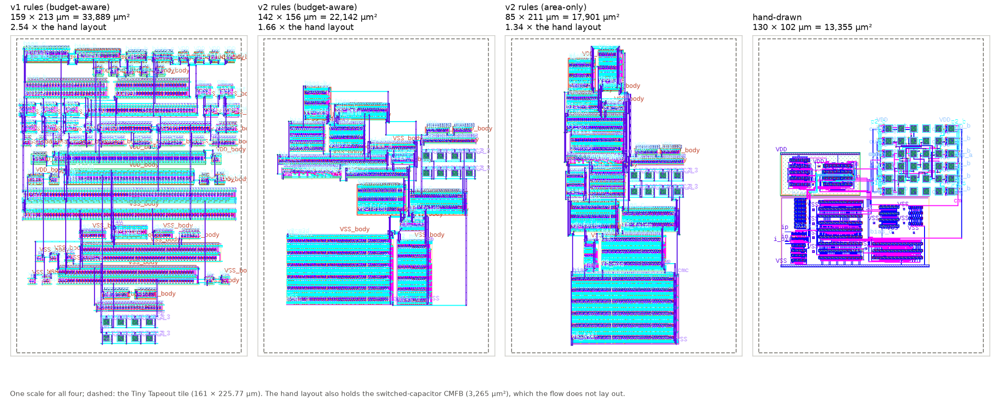
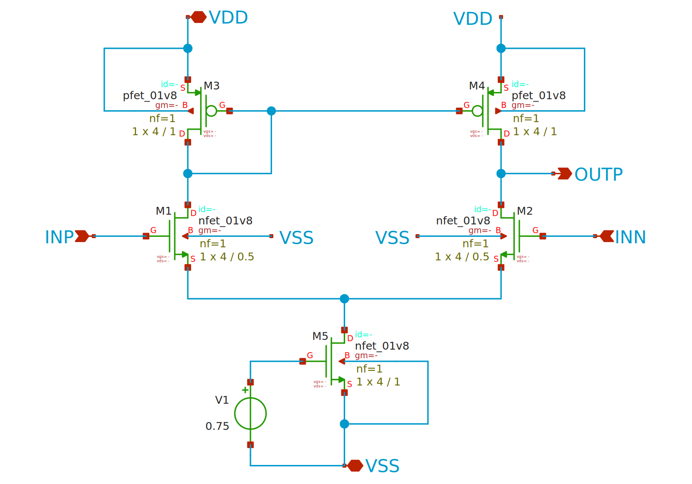
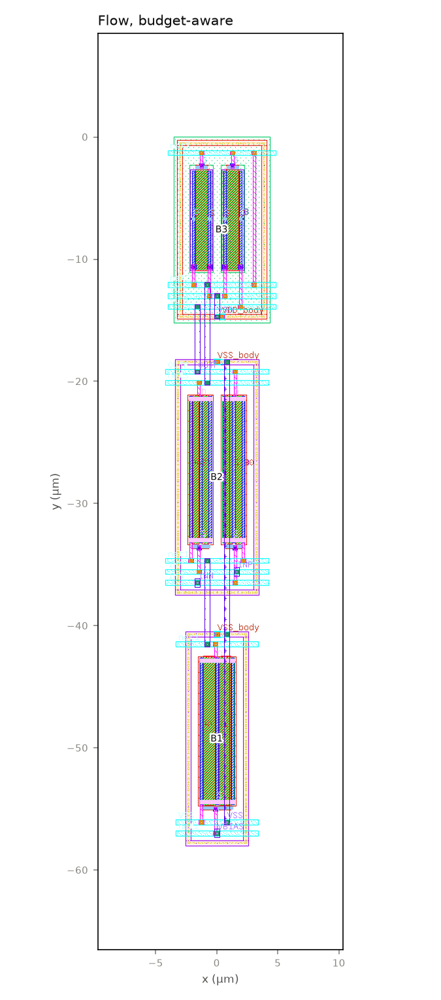
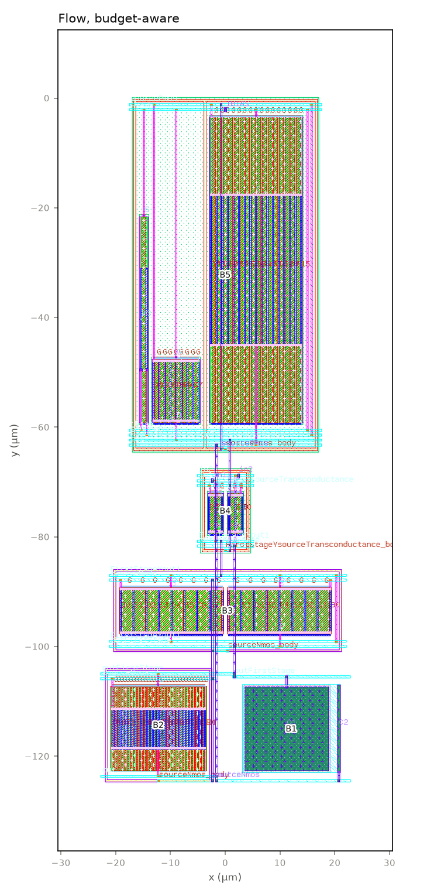
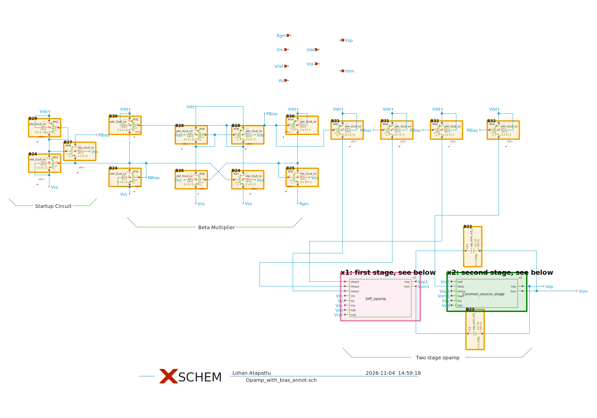
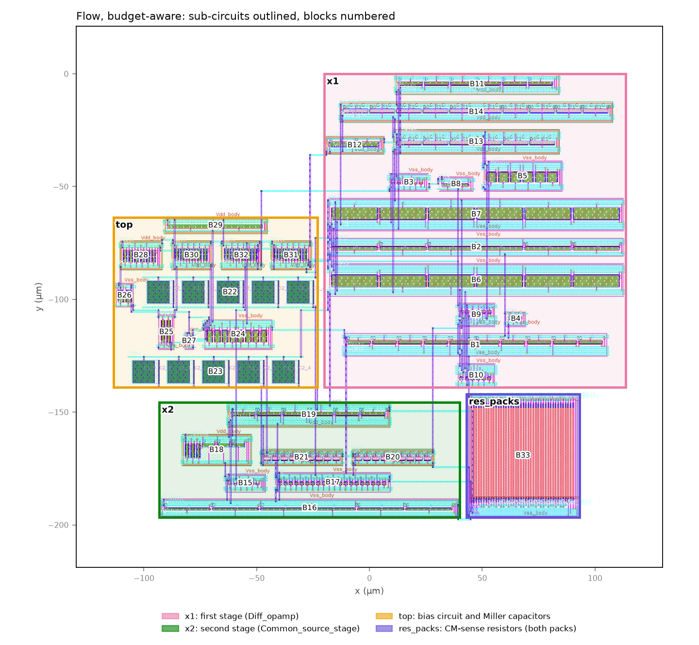
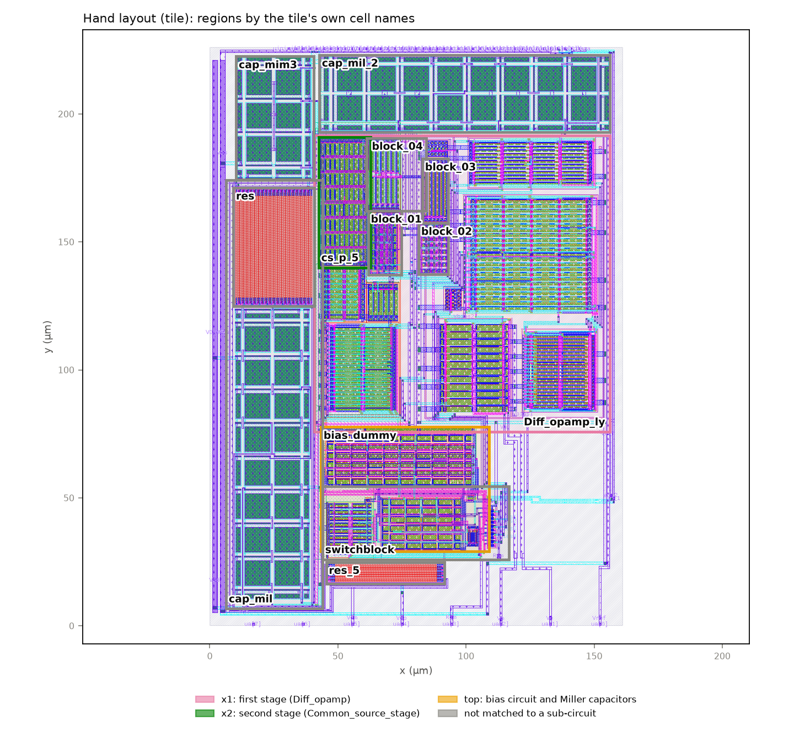
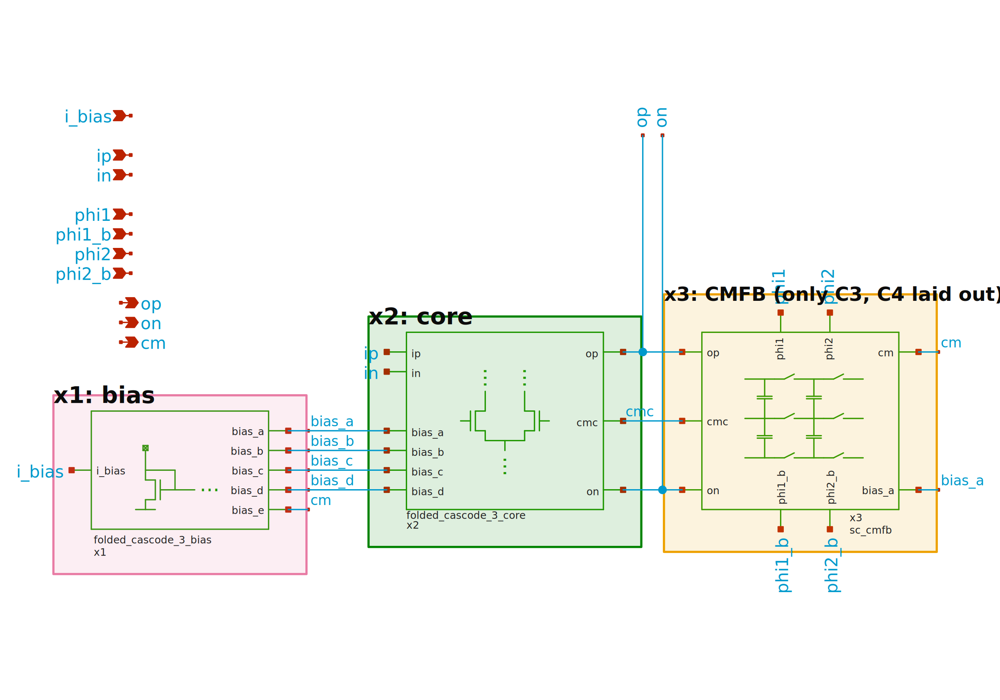
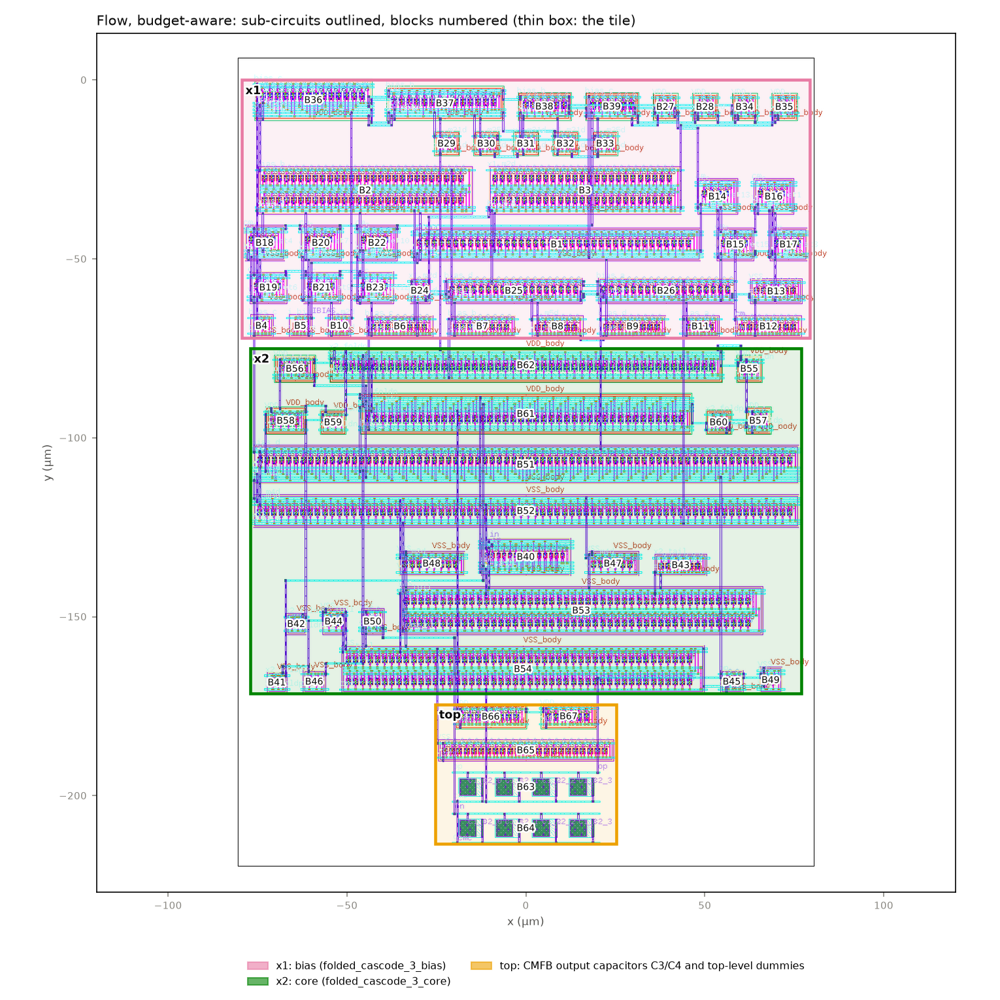
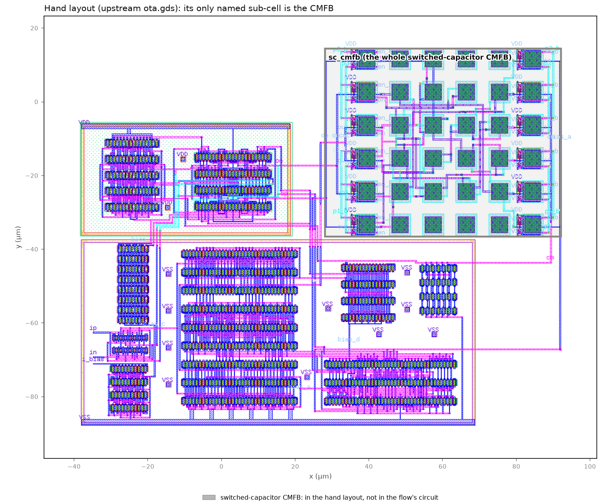

# Analog layout automation on SKY130: progress report

*Generated by `python3 scripts/make_progress_report.py` from the flow's outputs (repo at d6958ca61 2026-11-05). For reviewers: what the flow does, what it produced on four designs, what is new, what is planned, and the risks. Every number is read from the outputs; the detailed reports and the record are linked at the end.*

## 1. In short

- **What it is:** an open, reproducible flow that takes a sized SKY130 analog circuit and its specs, works out *before any layout* which nodes matter and how much parasitics each may take (budgets), then draws, places, routes, extracts and re-simulates the layout, checking every step (DRC, LVS, specs).
- **Status:** stages S0–S7 of a planned S0–S9 are built and run end to end on four designs, with a small local GUI and per-design reports. S8 (diagnosis and repair) and S9 (selection) are planned.
- **Every layout produced is DRC-clean and LVS-matched.** After layout, every spec is met on three designs; on the fourth (iadc, in a Tiny Tapeout tile) GBW misses its assumed spec.
- **New rule set (v2, Nov 5):** layout rules from layout books and papers, reviewed by Imasha, cut iadc's area by 35–45 % (19 blocks instead of 67; DRC-clean, LVS-matched); it is 1.34–1.66 × the hand layout against a target of 1.3 ×, with phase 3 to come (section 5).
- **No LLM takes any decision in the flow.** It runs with no LLM at all (section 7). An LLM (Claude) helped write and review the code; an LLM *taking* layout decisions is the next, measured step (section 8).
- **Quality controls:** 211 automated tests pass; 36 golden results re-checked on every change; 106 problems found and fixed, each recorded with how it was found (`docs/flow_record.md`).

| Design | S0 | S1 | S2 | S3 | S4 | S5 | S6 | S7 |
|---|---|---|---|---|---|---|---|---|
| `example_ota_5t` | PASS | PASS | PASS | PASS | PASS | PASS | PASS | PASS |
| `loadbench_miller` | FAIL | FAIL | PASS | FAIL | PASS | FAIL | FAIL | FAIL |
| `ttsky25a_fd` | PASS | FAIL | PASS | FAIL | PASS | FAIL | FAIL | FAIL |
| `iadc_ota` | FAIL | FAIL | FAIL | FAIL | PASS | FAIL | FAIL | FAIL |
| `iadc_ota_v2` | FAIL | FAIL | FAIL | FAIL | PASS | FAIL | FAIL | FAIL |

> **How to read it.** PASS: every check (gate) of the stage passed; FAIL: at least one gate failed although the stage finished (each failure is explained in the design's report; most are budgets the layout exceeds, or known properties of the circuit). No stage of the final runs crashed. `iadc_ota_v2` is iadc under layout rule set v2 (section 5).

**Time taken** (minutes per stage, the committed run of each design, on one Windows PC in Docker):

| Design | S0 | S1 | S2 | S3 | S4 | S5 | S6 | S7 | Total |
|---|---|---|---|---|---|---|---|---|---|
| `example_ota_5t` | 20 | 0.3 | 8 | 21 | 0.5 | 1 | 0.4 | 2 | **53** (0.9 h) |
| `loadbench_miller` | 11 | 0.3 | 8 | 57 | 1 | 2 | 2 | 34 | **115** (1.9 h) |
| `ttsky25a_fd` | 23 | 4 | 77 | 53 | 4 | 6 | 4 | 1 | **172** (2.9 h) |
| `iadc_ota` | 40 | 2 | 73 | 46 | 6 | 16 | 20 | 2 | **203** (3.4 h) |
| `iadc_ota_v2` | 26 | 64 | 38 | 16 | 4 | 20 | 41 | 1 | **212** (3.5 h) |

> **How to read it.** S0's time is mostly its 45 PVT points and the 200-run Monte Carlo; S2's, the SPICE checks of the budgets; S3's, building and signing off every cell option. S4–S7 (layout, routing, extraction, post-layout SPICE) take minutes on the small designs and under an hour on the large ones. Two v2 times are inflated: its S1 ran while blocks were being built for tests on the same PC, and 30 of its S6's 41 minutes were the kpex cross-check (an information-only gate) reaching its time limit.

## 2. The stages: what each does and which algorithm it runs

| Stage | Does | Algorithm / method |
|---|---|---|
| **S0 Ingest** | reads and freezes the design (netlist, specs, benches); checks every node and device; binds devices to SKY130 cells | netlist parsing and validation; SHA-256 freeze; round-trip LVS (Netgen); bench re-run; 45 PVT points; 200-run mismatch Monte Carlo |
| **S1 Electrical intent** | finds which nodes matter and how much | operating point (ngspice); exact linear small-signal model; pole per node; sensitivity of every spec to capacitance on every node and node pair, checked against SPICE; matching groups by rule |
| **S2 Requirement compiler** | turns the specs into layout budgets before any layout exists | shares each spec's allowance (η × margin) among nets by max-min fair progressive filling; capacitance, coupling, resistance and wire-length budgets; verified in SPICE with the harmful budgets inserted |
| **S3 Device design** | chooses how each transistor is drawn | enumerates PDK cell options (fingers, contacts, diffusion sharing), builds and signs off each in Magic, keeps the smallest within budget |
| **S4 Blocks** | draws matched blocks from the unit cells | rule-based grouping; common-centroid / interdigitated / mirror sequences; dummies; tracks packed by the left-edge rule; multi-row arrays; one tap ring; DRC, LVS and a negative control for every variant |
| **S5 Placement and routing** | places the blocks (inside an outline) and wires them | enumeration or seeded simulated annealing per sub-circuit, every arrangement of the sub-circuits; cost = area + wire-budget use; metal-4 spine router (small designs) or a metal-3/metal-4 grid A* router; top-level DRC and LVS |
| **S6 Extraction** | reads the layout back with its parasitics | Magic extraction (C-only, and R+C where it fits in memory); flat LVS; every budget against what was extracted; kpex cross-check |
| **S7 Post-layout evaluation** | simulates the layout in the original benches | ngspice on four views: schematic, drawn devices, C-only, R+C; each spec's loss against η × margin; S2's prediction against the result |
| **S8 Diagnosis and repair** | *planned, not built* | attribute a failure to nodes with the sensitivities, fix locally in S3–S5 |
| **S9 Selection** | *planned, not built* | the smallest layout meeting every verified spec |

Every stage ends with automatic checks (gates); every drawn block and layout is checked by Magic DRC and Netgen LVS, each LVS with a deliberately broken copy that must fail. The search settings (seeds, schedules, gaps, thresholds) and the hypotheses are fixed in advance in `PREREG.md`.

## 3. What happened

- **Oct 23–27:** S0–S3 built and run on five designs (plan v1–v2): the 5T, a stress variant, LOADBench, ttsky, iadc; before/after comparison; the hand layouts of ttsky and iadc measured the flow's way.
- **Nov 1–2:** Plan v3 Phase A and a supervisor review of S0–S3 on the 5T and LOADBench: fixes, golden results, the S0–S3 walkthrough.
- **Nov 3–4:** Plan v4: S4–S7 built (blocks, placement, routing, extraction, post-layout SPICE); the 5T and LOADBench through all eight stages; an independent code review; golden results for S4–S7.
- **Nov 4:** Phase 8: ttsky through S4–S7 with its own hierarchy, common-centroid matching, dummies, interleaved resistors and a 250 × 200 µm outline; a second independent review; the detailed ttsky report.
- **Nov 4–5:** A local web GUI (edit a design or make a new one, run the flow, get a report; no LLM); iadc through S0–S7 in a Tiny Tapeout tile, which needed multi-row arrays and a placement search for tight outlines; its detailed report.
- **Nov 5:** Layout rule set v2 (section 5): drafted from layout books and papers, reviewed and answered by Imasha, fixed in a PREREG amendment, coded (phases 1–2) and run on iadc with Imasha's hand-drawn hierarchy: 35–45 % less area than v1, DRC-clean and LVS-matched. The README was rewritten around the flow and its results.

## 4. The expected novelty

From the project's literature review (`docs/05_literature_novelty_remap.md`). Already published, so **not** claimed: per-net parasitic budgets in general, spec-to-parasitic mapping, common-centroid pattern selection, symmetry extraction, LLM-generated constraints.

| Contribution | In one line | Status |
|---|---|---|
| C1. Intent compiled from the circuit's own model | per-node sensitivities from a small-signal model turn the specs into budgets and routing rules **before any layout**, each traceable to a node and its pole | built (S1, S2), checked against SPICE; the symbolic, hierarchical, variation-range form is partial |
| C2. Device cells chosen from the requirements | each SKY130 transistor cell (fingers, contacts) chosen to keep its node within budget | built (S3); relaxations needed where budgets are tight |
| C3. Budget-aware variants and placement | several signed-off variants per block, chosen and placed to minimise area **subject to the budgets** | built (S4, S5); on ttsky the budget-aware layout uses 40 % less of the wire budgets and loses less GBW and phase margin than the area-only baseline (hypothesis H5); on the small designs both choose the same placement |
| C4. LLM decisions grounded in the equations, measured | an LLM proposes and explains decisions over the explicit budgets; what it adds is measured against the rule-only flow | planned (section 8) |
| C5. Open, reproducible SKY130 flow | open tools, every block signed off, seeded, golden results | built |

## 5. Layout rule set v2

**Why.** The first rule set (v1) made layouts 1.06–2.54 × the hand layouts' area. Most of that came from values fixed by hand in plan v4: 3 µm between blocks and rows, 0.6 µm between units, a tap ring on every block, 8 µm of routing margin, and every designer dummy transistor as a block with its own ring.

**How the rules were set.** The rules (`docs/rules_v2/ruleset_v2.md`) were drafted from Imasha's references:
- Saint & Saint, *IC Mask Design*, its Case Study 1 (a CMOS differential amplifier) read in full;
- the ASP-DAC 2022 common-centroid review and its case studies;
- Long et al. (ISCAS 2005) on 2-D common centroid;
- university layout lectures and a Cadence note.

Imasha reviewed them and answered ten questions; a PREREG amendment fixed them before any v2 code.

**The rules:**
- every spacing the generator chooses is the SKY130 DRC minimum × 1.10, rounded up to 0.05 µm (read from the Magic deck, checked by a test);
- no wire over any device;
- routing channels only as wide as routing needs;
- blocks as the designer draws them (one coloured box = one block), with the designer's dummies at the row ends;
- 2-D arrangements: cross-quad, 2-D common centroid with paired A B / B A rows, folded rows, series strings one per row;
- every candidate estimated on paper, and only the best 2–3 per block signed off.

v2 is opt-in per design; the finished designs run v1 unchanged.

**First result: iadc in its Tiny Tapeout tile**, with Imasha's drawn hierarchy:



| | v1, budget-aware | v1, area-only | v2, budget-aware | v2, area-only | Hand layout |
|---|---|---|---|---|---|
| Size | 158.7 × 213.5 µm | 158.0 × 207.0 µm | 141.7 × 156.2 µm | 84.7 × 211.2 µm | 130.4 × 102.4 µm |
| Area | 33,889 µm² | 32,698 µm² | 22,142 µm² | 17,901 µm² | 13,355 µm² (10,090 without its CMFB) |
| Against the hand layout (whole / without its CMFB) | 2.54 × / 3.36 × | 2.45 × / 3.24 × | 1.66 × / 2.19 × | 1.34 × / 1.77 × | – |
| Blocks | 67 | 67 | 19 | 19 | – |
| Gap between neighbouring blocks | 3 µm (fixed) | 3 µm (fixed) | DRC gap + 2.4 µm channel | DRC gap + 1.6 µm channel | – |
| Total route length | 2,830 µm | 3,499 µm | 1,597 µm | 1,986 µm | – |
| Top-level DRC errors / LVS | 0 / match | 0 / match | 0 / match | 0 / match | – |
| GBW drawn → after layout (C-only) | 204.8 → 180.3 MHz | 204.8 → 179.6 MHz | 204.8 → 176.8 MHz | 204.8 → 175.9 MHz | 171.8 → 156.2 MHz |
| GBW lost to the wiring | 12.0 % | 12.3 % | 13.7 % | 14.1 % | 9.1 % |

> **How to read it.** One scale for all four pictures; the dashed box is the Tiny Tapeout tile. The hand layout also holds the switched-capacitor CMFB, which the flow does not lay out (its bench keeps an ideal CMFB), so like for like is the hand layout without its CMFB.

- **Achieved:**
  - 35–45 % less area than v1;
  - 19 blocks instead of 67;
  - a 44 % shorter route;
  - every block and both layouts DRC-clean and LVS-matched;
  - gain and phase margin met.
- **Not yet** (PREREG 2026-11-05):
  - the target of 1.3 × the hand layout (area-only is 1.34 × the whole hand layout, 1.77 × it without its CMFB);
  - no extra wiring loss: v2 loses 13.7 % of GBW against v1's 12.0 %, so the denser blocks likely couple more.
- **Where the rest of the area goes** (area-only):
  - the blocks themselves are 10,658 µm²;
  - channels and arrangement inside the macros add 31 %;
  - stacking the three macros in a column adds 28 %.
- **Next (phase 3):**
  - pack the macros side by side;
  - put channels only where routing needs them;
  - one ring per stack, plus an outer ring.
  - ttsky under v2 (`ttsky25a_fd_v2`) is the second design to compare with a hand layout.
- **Bugs found on the way:** flow record rows 101–106.

**Second design: `ttsky25a_fd` under v2** (the v1 block plan; no drawn hierarchy yet):

Still running when this report was made (S0 PASS); `scripts/finish_ttsky_v2.sh` regenerates this report, the README pictures and `docs/reports/ttsky25a_fd_v2_report.html` when it ends.

## 6. Results on the designs tried (rule set v1)

### 5T OTA (`example_ota_5t`)

Sized 5T OTA (NMOS pair 24/0.5, PMOS mirror 8/1, NMOS tail 24/1 with internal 0.75 V gate bias). Specs and schematic-simulated results from the upstream repository.

Stages: S0 **PASS** · S1 **PASS** · S2 **PASS** · S3 **PASS** · S4 **PASS** · S5 **PASS** · S6 **PASS** · S7 **PASS**.

- **Layout (budget-aware):** 9.1 × 58.0 µm; top-level DRC 0 errors; LVS match.
- **Full detail:** `docs/reports/example_ota_5t_report.html`.

 


> **How to read it.** The upstream xschem schematic as drawn (frozen source, printed from a scratch copy) and the flow's routed layout, blocks numbered. The drawing is the topology template: its W labels are the template's, while the flow lays out the sized netlist (`best_sizes.json`, the sizes given above).

| Spec | Limit | Schematic | After layout (R+C) | Met | Use of the allowance |
|---|---|---|---|---|---|
| Gain (dB) | ≥ 30 | 31.7 | 31.69 | yes | 0.0054 |
| GBW (MHz) | ≥ 20 | 104.5 | 101.3 | yes | 0.0742 |
| Phase margin (°) | ≥ 60 | 80.93 | 79.42 | yes | 0.144 |
| Power (µW) | ≤ 1000 | 152.6 | 150.5 | yes | -0.0049 |
| Input noise (nV/√Hz) | ≤ 400 | 339.1 | 339.5 | yes | 0.0155 |

### Two-stage Miller op-amp (`loadbench_miller`)

Two-stage Miller op-amp, LOADBench SimpleTwoStageOpAmp_SimpleOpAmp1_1, Pareto row chosen by a fixed rule (circuits/loadbench_miller/SOURCE.md). PMOS input pair, NMOS mirror, NMOS common-source second stage, ideal Miller capacitor, ideal 10 uA bias sink. Specs are an ASSUMPTION (config.yaml spec_notes).

Stages: S0 **FAIL** · S1 **FAIL** · S2 **PASS** · S3 **FAIL** · S4 **PASS** · S5 **FAIL** · S6 **FAIL** · S7 **FAIL**.

- **Layout (budget-aware):** 45.5 × 124.8 µm; top-level DRC 0 errors; LVS match.
- **Full detail:** `docs/reports/loadbench_miller_report.html`.




> **How to read it.** The flow's routed layout, blocks numbered (this design's package is a netlist; no schematic drawing).

| Spec | Limit | Schematic | After layout (R+C) | Met | Use of the allowance |
|---|---|---|---|---|---|
| Phase margin (°) | ≥ 60 | 65.32 | 65.26 | yes | 0.0243 |
| Power (µW) | ≤ 614.2 | 558.4 | 553.3 | yes | -0.185 |
| Gain (dB) | ≥ 57 | 58 | 57.98 | yes | 0.0336 |
| GBW (MHz) | ≥ 21.05 | 23.39 | 22.12 | yes | **1.08** |

With the MIM capacitors' likely double-counted plate coupling removed (G7.5), GBW uses 0.575 of the allowance.

### Imasha's fully differential op-amp, taped out (`ttsky25a_fd`)

Two-stage fully differential op-amp, TTSKY25a tile tt_um_diff (NethmalWDI/Fully_differential_opamp): folded-cascode first stage, common-source second stage, a CMFB loop per stage, Miller MIM capacitors, beta-multiplier bias with start-up. Specs are an ASSUMPTION (config.yaml spec_notes).

Stages: S0 **PASS** · S1 **FAIL** · S2 **PASS** · S3 **FAIL** · S4 **PASS** · S5 **FAIL** · S6 **FAIL** · S7 **FAIL**.

- **Layout (budget-aware):** 227.0 × 196.7 µm; top-level DRC 0 errors; LVS match.
- **Full detail:** `docs/ttsky25a_fd_report.html`.

 


> **How to read it.** The designer's schematic (sub-circuits boxed in colour, each device with its block number) and the flow's routed layout (sub-circuits outlined, blocks numbered)

| Spec | Limit | Schematic | After layout (C-only) | Met | Use of the allowance |
|---|---|---|---|---|---|
| Phase margin (°) | ≥ 60 | 78.23 | 73.68 | yes | 0.499 |
| Gain (dB) | ≥ 97.4 | 98.39 | 98.25 | yes | 0.28 |
| GBW (MHz) | ≥ 1.847 | 2.052 | 1.922 | yes | **1.27** |
| Power (µW) | ≤ 497.2 | 452 | 456.3 | yes | 0.19 |

With the MIM capacitors' likely double-counted plate coupling removed (G7.5), GBW uses 0.455 of the allowance.

**Against the hand layout:**



| | Flow, budget-aware | Flow, area-only | Hand layout |
|---|---|---|---|
| Area (µm²) | 44,652 (1.31 ×) | 36,152 (1.06 ×) | 34,182 |
| GBW lost to the wiring (drawn → extracted) | 6.0 % | 6.1 % | 6.8 % |
| Phase margin lost to the wiring | 4.4° | 4.8° | 3.0° |
| GBW after layout, C-only (MHz) | 1.922 | 1.918 | 1.426 (its drawn devices: 1.53) |


> **How to read it.** The hand layout is of a slightly different circuit (the taped-out tile adds enable switches; its op-amp cell is measured), so the wiring's cost (one layout simulated with and without its wiring) and the area are what compare fairly.

### Folded-cascode OTA of an incremental ADC, in a Tiny Tapeout tile (`iadc_ota`)

Fully differential folded-cascode OTA of the iadc incremental delta-sigma modulator, with a hand-drawn Magic layout and its PEX netlist upstream. The switched-capacitor CMFB is modelled by an ideal source with its steady-state law (ASSUMPTION). Specs are an ASSUMPTION.

Stages: S0 **FAIL** · S1 **FAIL** · S2 **FAIL** · S3 **FAIL** · S4 **PASS** · S5 **FAIL** · S6 **FAIL** · S7 **FAIL**.

- **Layout (budget-aware):** 158.7 × 213.5 µm; top-level DRC 0 errors; LVS match.
- **Full detail:** `docs/iadc_ota_report.html`.

 


> **How to read it.** The designer's schematic (sub-circuits boxed in colour, each device with its block number) and the flow's routed layout (sub-circuits outlined, blocks numbered)

| Spec | Limit | Schematic | After layout (C-only) | Met | Use of the allowance |
|---|---|---|---|---|---|
| Phase margin (°) | ≥ 60 | 77.23 | 73.02 | yes | 0.489 |
| Gain (dB) | ≥ 52.47 | 53.47 | 53.6 | yes | -0.264 |
| GBW (MHz) | ≥ 188.9 | 209.9 | 180.3 | **no** | **2.82** |

With the MIM capacitors' likely double-counted plate coupling removed (G7.5), GBW uses 2.55 of the allowance.

**Against the hand layout:**



| | Flow, budget-aware | Flow, area-only | Hand layout |
|---|---|---|---|
| Area (µm²) | 33,889 (2.54 ×) | 32,698 (2.45 ×) | 13,355 |
| GBW lost to the wiring (drawn → extracted) | 12.0 % | 12.3 % | 9.1 % |
| Phase margin lost to the wiring | 2.5° | 2.5° | 0.9° |
| GBW after layout, C-only (MHz) | 180.3 | 179.6 | 156.2 (its drawn devices: 171.8) |


> **How to read it.** The hand layout is of a slightly different circuit (it holds the real switched-capacitor CMFB, outlined), so the wiring's cost (one layout simulated with and without its wiring) and the area are what compare fairly.


> **How to read it.** "use of the allowance" is the loss from schematic to layout divided by η × margin (η = 0.5): 1.0 is all the flow lets the layout take; bold is more.

## 7. Does it run without Claude?

**Yes.** The flow calls no LLM. Everything runs in the pinned open-source EDA container (`hpretl/iic-osic-tools:2026.10`: Magic, Netgen, ngspice, xschem, KLayout, SKY130) with Python from `requirements.txt`:

```powershell
$env:FLOW_CONTAINER="layout-s0s3"; .\flow.ps1 run example_ota_5t       # S0–S7 of one design
.\flow.ps1 test                                                     # tests + golden results
.\gui\gui.ps1                     # local web GUI: http://localhost:8765/ (no LLM, no tokens)
```

Claude was used to write and review the code and the documents; no run depends on it. The GUI edits a design (or makes a new one from files), runs the flow and writes the reports, all locally.

## 8. The LLM integration plan

**What:** an independent LLM (the Claude CLI, once the supervisor agrees) gets only the netlist, the hierarchy, the specs and S2's budgets, and proposes the floorplan, the matching style per block and the constraint trade-offs, with reasons. The same S4–S7 build and check its proposal exactly as they check the code's. It never places coordinates or signs anything off.

**How it is measured:** the same designs and extraction with and without the LLM (an ablation): spec retention after layout, area, the number of extraction and SPICE runs, and how well the budgets predicted the loss. Every call is journaled (inputs, prompt version, output, validation).

| Pros | Cons |
|---|---|
| Can use designer knowledge the cost function lacks (e.g. ttsky: Miller capacitors next to the first-stage outputs; iadc: which blocks may share a ring) | Can be confidently wrong; every output must be checked (it is: the same DRC, LVS and SPICE) |
| Explains its choices in words a designer can review | Results can change with the model version; runs must be journaled and pinned to be reproducible |
| Can resolve budget conflicts (which budget to relax) with the equations behind them | Costs tokens and needs a network connection and permission; the flow must keep working without it |
| Literature: LLM tuning loops need few post-layout simulations (ICPI) | LLM coordinates are known to fail (ACDC): it must stay at the decision level |

## 9. Risks of the method

- **Budgets can be infeasible:** S2's budgets come from linearised sensitivities and assume a compact layout. On ttsky and iadc most nets exceed them (G5.4, G6.2 fail) while the specs are still largely met: the budgets are conservative and do not yet steer the layout as intended. iadc's budgets cannot even be met by the smallest cells (G2.7).
- **Specs are often ASSUMPTIONs:** three of the four designs have no upstream specs; the flow uses 0.9 × the schematic's own results. A missed spec (iadc's GBW) may be a missed assumption, not a bad layout.
- **Extraction is partial on large layouts:** R+C extraction ran out of memory on ttsky's supply rings; ttsky and iadc are judged on capacitance only. Wire resistance is missing there.
- **One condition only after layout:** no PVT corners or mismatch Monte Carlo after layout yet.
- **A likely double count:** Magic counts a MIM capacitor's own plate coupling on top of its model; the flow reports both numbers (G6.5, G7.5) but the gates keep Magic's.
- **Density:** v1's layouts are 1.06–2.54 × the hand layouts' area (a tap ring per block, 3 µm gaps, the designer's dummies as separate blocks). Rule set v2 brings iadc to 1.34–1.66 × (1.77–2.19 × against the hand layout without its CMFB); the target of 1.3 × is not met yet (phase 3: macro packing, channels only where needed, rings per stack).
- **Denser layouts couple more:** under v2 iadc's route is 44 % shorter, yet the wiring takes 13.7 % of GBW against v1's 12.0 % (the hand layout: 9.1 %); the denser blocks are the likely cause, not yet measured net by net.
- **Hand comparisons are not like-for-like:** both hand layouts are of slightly different circuits (enable switches, a real switched-capacitor CMFB); only the wiring's cost and the area compare fairly.
- **Unrouted chip-level parts:** the tile's power straps and pins are not routed; no symmetric routing of matched pairs; electromigration widths not checked (no SKY130 limits found).
- **Opt-in fixes:** latent flaws found on iadc (stubs off-centre by up to 0.125 µm; a placement search that dropped shapes) and under v2 (a tap strip's contacts 0.13 µm from the ring's, below 0.17; the router keeping 0.30 µm, not 0.40, from wide metal4) are fixed only where switched on, so the finished designs keep their committed, DRC-clean results until a decision is made.
- **Small sample:** four designs; every hypothesis result (H4, H5, G2.0's prediction) rests on one or two circuits.
- **LLM risks (planned step):** an LLM can be confidently wrong, non-reproducible across versions, and costs tokens; the plan keeps every LLM output behind the same deterministic checks and journals each call.

## 10. Where to look next

- `docs/ttsky25a_fd_report.html`, `docs/iadc_ota_report.html`: the two detailed reports (schematics, every block, algorithms, who decides what, comparisons with the hand layouts, DRC/LVS evidence).
- `docs/reports/<design>_report.html`: a short report for every design (also for designs made with the GUI; `iadc_ota_v2_report.html` is iadc under rule set v2).
- `docs/rules_v2/ruleset_v2.md`: rule set v2, its sources, the rules and Imasha's answers.
- `docs/s0_s3_walkthrough.html`, `docs/s4_s7_walkthrough.html`: every gate and number, stage by stage.
- `docs/flow_record.md`: the journey, every problem found and how; `PREREG.md`: hypotheses and fixed settings;
  `README.md`: how to run everything.

