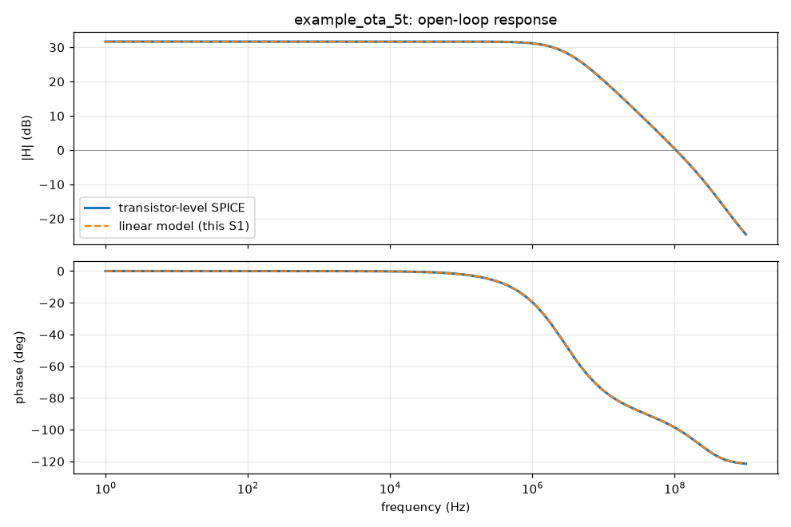
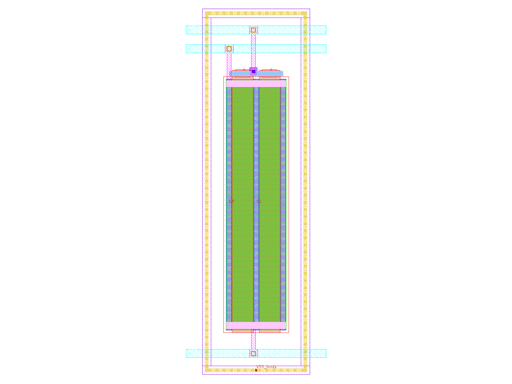
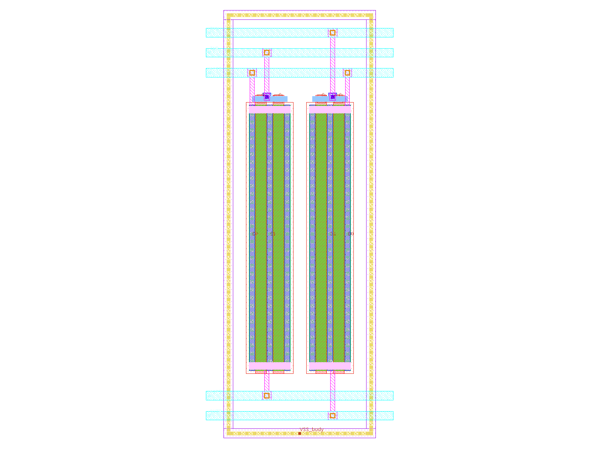
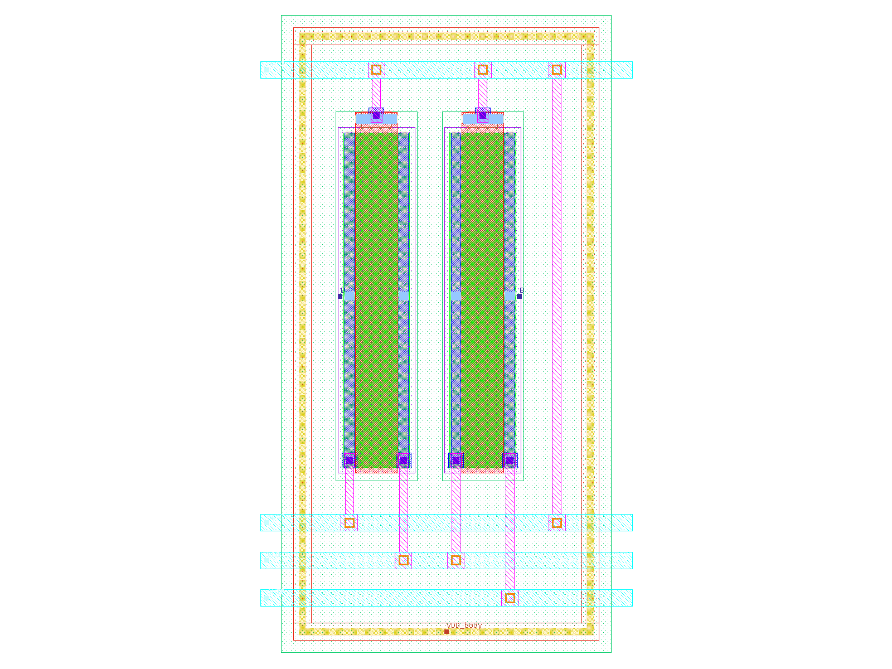
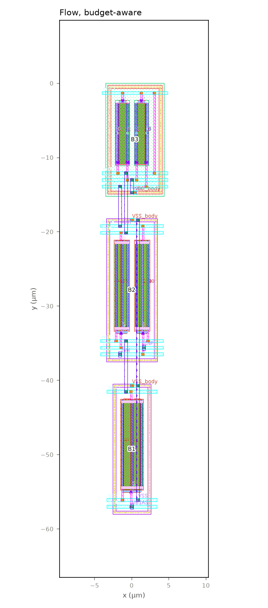
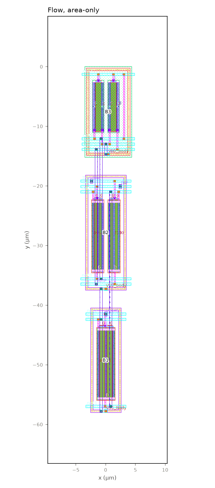
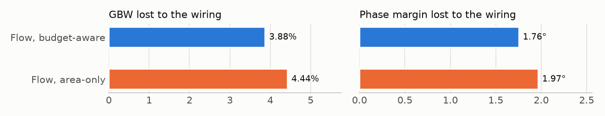

# Layout report: `example_ota_5t`

*Generated by `python3 scripts/make_design_report.py example_ota_5t` from the flow's own output files (repo at ef21cda3f 2026-11-04); no number is typed by hand and no LLM is used. Assumptions are marked ASSUMPTION in the inputs.*

## 1. The design

Sized 5T OTA (NMOS pair 24/0.5, PMOS mirror 8/1, NMOS tail 24/1 with internal 0.75 V gate bias). Specs and schematic-simulated results from the upstream repository.

- **Devices:** 5 transistors (5 pieces once each multiplier m is drawn), 0 passives.
- **Netlist:** `circuits/example_ota_5t/source/example_ota_5t_sized.spice`; specs: `circuits/example_ota_5t/source/config.yaml`.
- **Layout instructions:** none (the flow's defaults).

## 2. The stages and their checks

| Stage | What it does | Result | Failed checks | Time (min) |
|---|---|---|---|---|
| S0 | reads the netlist, specs and test benches; checks they agree (and that the sources are unchanged) | **PASS** | – | 20.3 |
| S1 | builds a linear model of the circuit; finds its main nodes and matching groups | **PASS** | – | 0.3 |
| S2 | turns the specs into budgets: how much capacitance, resistance and wire length each net may have | **PASS** | – | 8.2 |
| S3 | chooses how each transistor is drawn (fingers, cell shape), checked in simulation | **PASS** | – | 21.1 |
| S4 | draws the matched blocks (with dummies and tap rings where asked) and checks each | **PASS** | – | 0.5 |
| S5 | places the blocks (inside the outline, if one is given) and routes them; DRC and LVS | **PASS** | – | 0.8 |
| S6 | reads the layout back with its wiring capacitance; compares with the budgets | **PASS** | – | 0.4 |
| S7 | simulates the read-back layout in the original benches; compares with the specs | **PASS** | – | 1.6 |

*Who decides what:* Specs, budgets, cells, blocks, placement, routing, checks: code (fixed rules and searches; settings in PREREG); Design, specs' basis, layout instructions (outline, matching, dummies, hierarchy): the designer (the GUI's inputs); The flow's code, its rules and defaults: written with an LLM (Claude); no LLM is called during a run.

## 3. Specs

| Spec | Schematic | Limit | Margin | Allowance for the layout |
|---|---|---|---|---|
| DC gain (dB) | 31.697 | ≥ 30 | 1.697 | 0.8485 |
| Unity-gain bandwidth (GBW) (MHz) | 104.45 | ≥ 20 | 84.45 | 42.23 |
| Phase margin (°) | 80.935 | ≥ 60 | 20.93 | 10.47 |
| Power (µW) | 152.6 | ≤ 1000 | 847.4 | 423.7 |
| vnoise_nv_rthz () | 339.06 | ≤ 400 | 60.94 | 30.47 |

## 4. The main nodes (S1) and their budgets (S2)

| Node | Role | Pole rank | GBW lost per fF (kHz) | PM lost per fF (m°) | Budget (fF) | Extracted (fF) | Use |
|---|---|---|---|---|---|---|---|
| OUTP | signal_output, dominant_pole | 1 | 94.7 | -8.81 | 37.6 | 4.95 | 0.132 |
| net3 | mirror_node (diode-connected), non_dominant_pole | 2 | 57.9 | 63.7 | 44.3 | 6.41 | 0.145 |
| net1 | source_coupled (tail) | 3 | 0.255 | -0.0574 | 77.8 | 11.2 | 0.144 |

> **How to read it.** Pole rank 1 is the dominant pole; the two sensitivity columns say how much GBW and phase margin drop per fF of wiring on the node; "use" is extracted / budget in the budget-aware layout (bold: over).




> **How to read it.** Open-loop gain and phase: SPICE on the transistors (solid) against S1's linear model (dashed); where they agree, every estimate built on the model can be trusted.

## 5. The blocks (S4)

3 blocks, 5 variants, all signed off (DRC 0, LVS match, negative control rejected). Colour bar: <span style="color:#e87ba4">■</span> nmos, <span style="color:#008300">■</span> pmos. The picture is the variant the budget-aware layout chose.

<div><figure style="display:inline-block;width:31%;margin:4px;vertical-align:top;border-top:5px solid #e87ba4;"><figcaption style="font-size:0.8em"><b>B1 nmos_current_mirror_bias</b><br>XM5<br>variant A</figcaption></figure><figure style="display:inline-block;width:31%;margin:4px;vertical-align:top;border-top:5px solid #e87ba4;"><figcaption style="font-size:0.8em"><b>B2 nmos_differential_pair</b><br>XM1, XM2<br>variant AB</figcaption></figure><figure style="display:inline-block;width:31%;margin:4px;vertical-align:top;border-top:5px solid #008300;"><figcaption style="font-size:0.8em"><b>B3 pmos_current_mirror_load</b><br>XM3, XM4<br>variant AB</figcaption></figure></div>

## 6. The layouts (S5)

**Flow, budget-aware**



**Flow, area-only**



| | Budget-aware | Area-only |
|---|---|---|
| Size (µm) | 9.1 × 58.0 | 9.1 × 58.0 |
| Area (µm²) | 526 | 526 |
| DRC errors / LVS | 0 / match | 0 / match |
| Sum of wire-budget use (lower is better) | 0.3 | 1.3 |

> **How to read it.** Blocks are numbered as in section 5. The budget-aware cost is A / A_ref + 10 × Σ max(0, u − 1) + 1 × Σ u (u: a net's length over its budget); the area-only cost is A / A_ref. Every row arrangement, variant and flip is enumerated.

## 7. After layout (S6, S7)

The layout read back with its wiring (capacitance and resistance) and simulated in the original benches.

| Spec | Limit | Schematic | Drawn devices | After layout, budget-aware | Use of allowance | After layout, area-only | Use of allowance |
|---|---|---|---|---|---|---|---|
| DC gain (dB) | ≥ 30 | 31.697 | 31.814 | 31.692 | 0.0054 | 31.682 | 0.0172 |
| Unity-gain bandwidth (GBW) (MHz) | ≥ 20 | 104.45 | 105.42 | 101.32 | 0.0742 | 100.74 | 0.088 |
| Phase margin (°) | ≥ 60 | 80.935 | 81.182 | 79.424 | 0.144 | 79.211 | 0.165 |
| Power (µW) | ≤ 1000 | 152.6 | 152.4 | 150.51 | -0.0049 | 150.49 | -0.005 |
| vnoise_nv_rthz () | ≤ 400 | 339.06 | 339.63 | 339.54 | 0.0155 | 339.53 | 0.0152 |

> **How to read it.** Use of allowance = (schematic − after layout) / (η × margin); 1.0 is all the layout may take (bold: more).

**What it shows here:** every spec is met after layout; every spec within the allowance.




> **How to read it.** Each layout simulated with its drawn devices only and again with its wiring, by the same extraction and bench; the drop is what the wiring and placement cost. Shorter is better.

## 9. What did not pass

- nothing: every gate that ran passed.

Explanations of each gate: `docs/s4_s7_walkthrough.html` (S4–S7) and `docs/s0_s3_walkthrough.html` (S0–S3).

## 10. The inputs used

```yaml
# Design package for S0: the sized 5T OTA from llm-analog-sizing (hierarchical-optimization branch).
# Every path is relative to the repository root. Items marked null are not available yet
# and are reported as pending by S0, never invented.
design: example_ota_5t
description: >
  Sized 5T OTA (NMOS pair 24/0.5, PMOS mirror 8/1, NMOS tail 24/1 with internal 0.75 V gate bias).
  Specs and schematic-simulated results from the upstream repository.

netlist: circuits/example_ota_5t/source/example_ota_5t_sized.spice
config: circuits/example_ota_5t/source/config.yaml          # specs + conditions + interface
achieved: circuits/example_ota_5t/source/measurements.json  # schematic-simulated specs
testbenches:
  - circuits/example_ota_5t/testbenches/diso_amp_AC.spice
  - circuits/example_ota_5t/testbenches/diso_amp_OP.spice
  - circuits/example_ota_5t/testbenches/diso_amp_NOISE.spice
dut_subckt_in_testbench: example_ota_5t_sized

# Upstream stage-1 hierarchy and symbolic analysis (made for the 6-transistor '5t-ota'),
# reused through an explicit name map (docs/02_analysis.md, Addendum A1).
upstream:
  netlist: circuits/5t-ota/source/circuit.spice
  hierarchy: circuits/5t-ota/source/hierarchy.json
  primitives: circuits/5t-ota/source/primitives.json
  equations: circuits/5t-ota/source/5t-ota_differential_equations.json
  name_map: inputs/example_ota_5t/name_map.yaml

# Ideal bias sources inside the DUT: kept for simulation, removed in the layout view,
# their positive node exposed as this port.
bias_sources:
  V1: VBIAS

operating_point: null    # S1 generates it (ngspice .op)
variation_ranges: null   # awaiting the PSO range format
conditions_override: {}
s1_extras: [symbolic_patch]   # the pole drop-out study (patched copies of the upstream equations)
budget_corners: nominal       # Plan v3 Phase A (D-b, PREREG 2026-11-01): S2 budgets at the nominal corner only; the PVT points are reported in G2.9, not gated
```

## Glossary

- **GBW:** unity-gain bandwidth: where the gain falls to 1. Higher is faster.
- **Phase margin:** how far the amplifier is from oscillating in feedback; above about 60° is comfortable.
- **Margin, η, allowance:** margin = schematic value − spec limit; the layout may use η of it (the allowance).
- **DRC / LVS:** design-rule check (0 errors = manufacturable) / layout versus schematic ("match" = same circuit).
- **Extraction:** reading the layout back with its wires' capacitance (C-only) or also resistance (R+C).
- **Drawn devices:** the layout's transistors without any wiring; "drawn → extracted" is the wiring's cost.
- **Block / variant:** transistors drawn together as one piece (B1 …) / one way of drawing it (A B B A, A B A B …).
- **Budget-aware / area-only:** placement scored by area plus wire budgets (the flow's rule) / by area alone.
- **Gate:** an automatic pass/fail check at the end of a stage (G4.1, G5.4 …).

