# Layout report: `iadc_ota_v2`

*Generated by `python3 scripts/make_design_report.py iadc_ota_v2` from the flow's own output files (repo at d6958ca61 2026-11-05); no number is typed by hand and no LLM is used. Assumptions are marked ASSUMPTION in the inputs.*

## 1. The design

Fully differential folded-cascode OTA of the iadc incremental delta-sigma modulator, with a hand-drawn Magic layout and its PEX netlist upstream. The switched-capacitor CMFB is modelled by an ideal source with its steady-state law (ASSUMPTION). Specs are an ASSUMPTION.

- **Devices:** 83 transistors (831 pieces once each multiplier m is drawn), 2 passives.
- **Netlist:** `circuits/iadc_ota_v2/source/iadc_ota.spice`; specs: `circuits/iadc_ota_v2/source/config.yaml`.
- **Layout instructions:** `inputs/iadc_ota_v2/layout.yaml`: matching = centroid, dummies = True, pack_internal = True, outline_um = [161.0, 225.77], hierarchy = upstream, pin_origin = bbox, fold_row_um = 100, search_from_outside = True, rc_extraction = False, ruleset = v2.

## 2. The stages and their checks

| Stage | What it does | Result | Failed checks | Time (min) |
|---|---|---|---|---|
| S0 | reads the netlist, specs and test benches; checks they agree (and that the sources are unchanged) | **FAIL** | G0.7 pcell binding drc lvs | 25.9 |
| S1 | builds a linear model of the circuit; finds its main nodes and matching groups | **FAIL** | G1.1 operating point | 64.4 |
| S2 | turns the specs into budgets: how much capacitance, resistance and wire length each net may have | **FAIL** | G2.7 library floors feasible | 38.3 |
| S3 | chooses how each transistor is drawn (fingers, cell shape), checked in simulation | **FAIL** | G3.3 all chosen devices in circuit, G3.5 no relaxation | 16.2 |
| S4 | draws the matched blocks (with dummies and tap rings where asked) and checks each | **PASS** | – | 4.2 |
| S5 | places the blocks (inside the outline, if one is given) and routes them; DRC and LVS | **FAIL** | G5.4 route rules | 19.8 |
| S6 | reads the layout back with its wiring capacitance; compares with the budgets | **FAIL** | G6.2 parasitics within budgets | 41.2 |
| S7 | simulates the read-back layout in the original benches; compares with the specs | **FAIL** | G7.1 specs met post layout, G7.2 loss within eta margin | 1.4 |

*Who decides what:* Specs, budgets, cells, blocks, placement, routing, checks: code (fixed rules and searches; settings in PREREG); Design, specs' basis, layout instructions (outline, matching, dummies, hierarchy): the designer (the GUI's inputs); The flow's code, its rules and defaults: written with an LLM (Claude); no LLM is called during a run.

## 3. Specs

| Spec | Schematic | Limit | Margin | Allowance for the layout |
|---|---|---|---|---|
| Phase margin (°) | 77.234 | ≥ 60 | 17.23 | 8.617 |
| DC gain (dB) | 53.47 | ≥ 52.47 | 1 | 0.5 |
| Unity-gain bandwidth (GBW) (MHz) | 209.85 | ≥ 188.87 | 20.99 | 10.49 |

## 4. The main nodes (S1) and their budgets (S2)

| Node | Role | Pole rank | GBW lost per fF (kHz) | PM lost per fF (m°) | Budget (fF) | Extracted (fF) | Use |
|---|---|---|---|---|---|---|---|
| op | signal_output, dominant_pole | 1 | 193 | -11.5 | 0.425 | 38.8 | **91.3** |
| on | signal_output, non_dominant_pole | 2 | 193 | -11.5 | 0.425 | 42.3 | **99.4** |
| bias_b | mirror_node (diode-connected) | 3 | ≈ 0 | ≈ 0 | 1.78 | 90.2 | **50.6** |
| bias_c | – | 4 | ≈ 0 | ≈ 0 | 1.2 | 67 | **55.9** |
| bias_d | – | 5 | -1.35e-06 | 1.58e-06 | 1.46 | 65.7 | **45.2** |
| bias_a | – | 6 | ≈ 0 | ≈ 0 | 2.22 | 167 | **75.1** |
| x1_m2d | mirror_node (diode-connected) | 7 | ≈ 0 | ≈ 0 | 0.935 | 31.5 | **33.7** |
| x2_foldn | – | 12 | 19.6 | 34.9 | 0.36 | 31.7 | **88.1** |
| x2_foldp | – | 13 | 19.6 | 34.9 | 0.36 | 29.5 | **82** |

> **How to read it.** Pole rank 1 is the dominant pole; the two sensitivity columns say how much GBW and phase margin drop per fF of wiring on the node; "use" is extracted / budget in the budget-aware layout (bold: over).

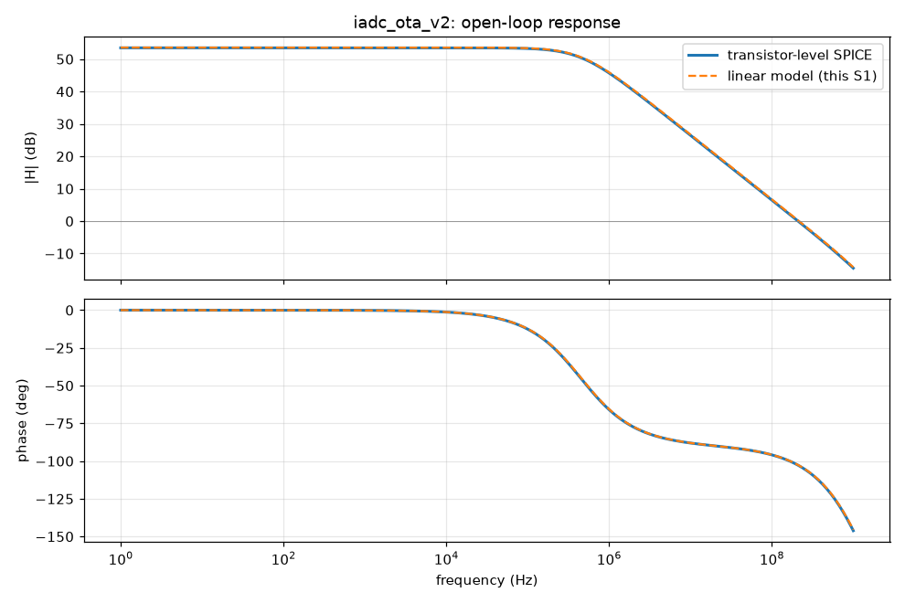


> **How to read it.** Open-loop gain and phase: SPICE on the transistors (solid) against S1's linear model (dashed); where they agree, every estimate built on the model can be trusted.

## 5. The blocks (S4)

19 blocks, 48 variants, all signed off (DRC 0, LVS match, negative control rejected). Colour bar: <span style="color:#e87ba4">■</span> top, <span style="color:#008300">■</span> x1, <span style="color:#eda100">■</span> x2. The picture is the variant the budget-aware layout chose.

<div><figure style="display:inline-block;width:31%;margin:4px;vertical-align:top;border-top:5px solid #e87ba4;"><figcaption style="font-size:0.8em"><b>B1 XC3</b><br>XC3<br>variant A</figcaption></figure><figure style="display:inline-block;width:31%;margin:4px;vertical-align:top;border-top:5px solid #e87ba4;">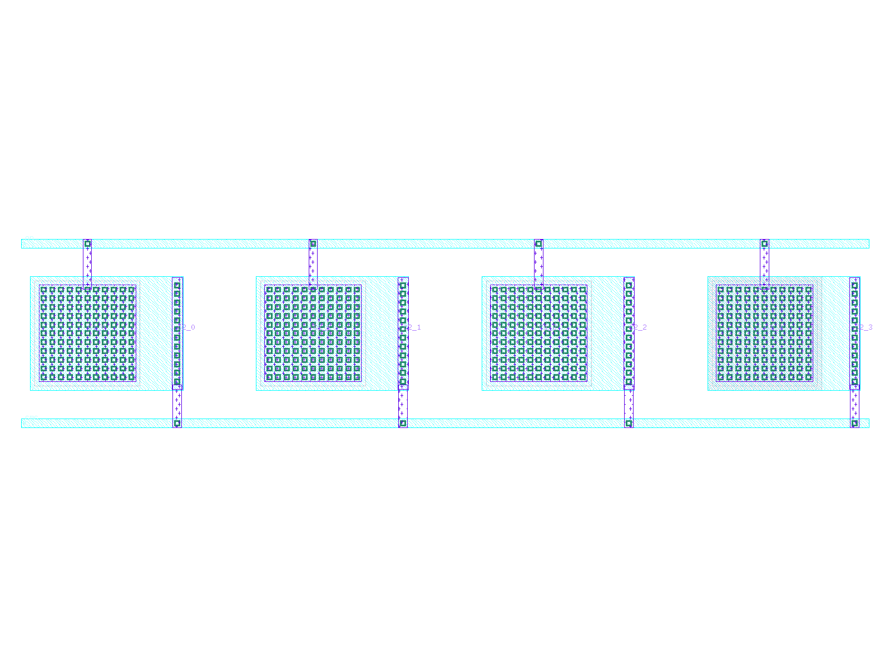<figcaption style="font-size:0.8em"><b>B2 XC4</b><br>XC4<br>variant A</figcaption></figure><figure style="display:inline-block;width:31%;margin:4px;vertical-align:top;border-top:5px solid #e87ba4;">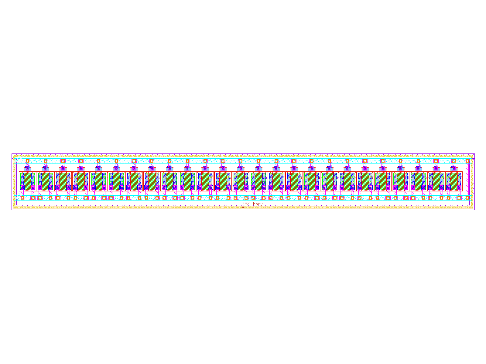<figcaption style="font-size:0.8em"><b>B3 nmos_dummy</b><br>XM9<br>variant f1</figcaption></figure><figure style="display:inline-block;width:31%;margin:4px;vertical-align:top;border-top:5px solid #e87ba4;">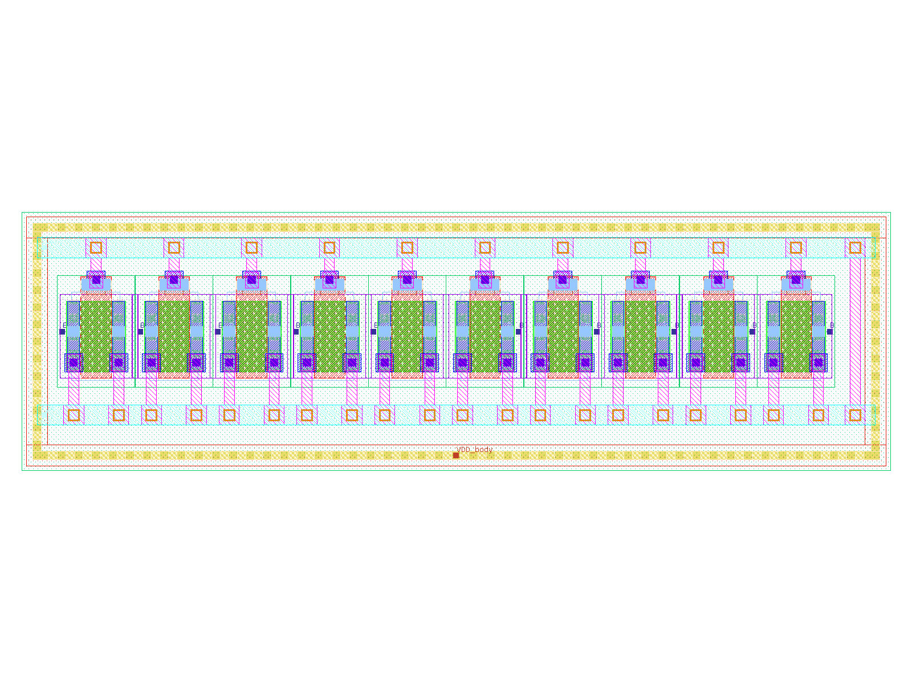<figcaption style="font-size:0.8em"><b>B4 pmos_dummy</b><br>XM43<br>variant f1</figcaption></figure><figure style="display:inline-block;width:31%;margin:4px;vertical-align:top;border-top:5px solid #e87ba4;">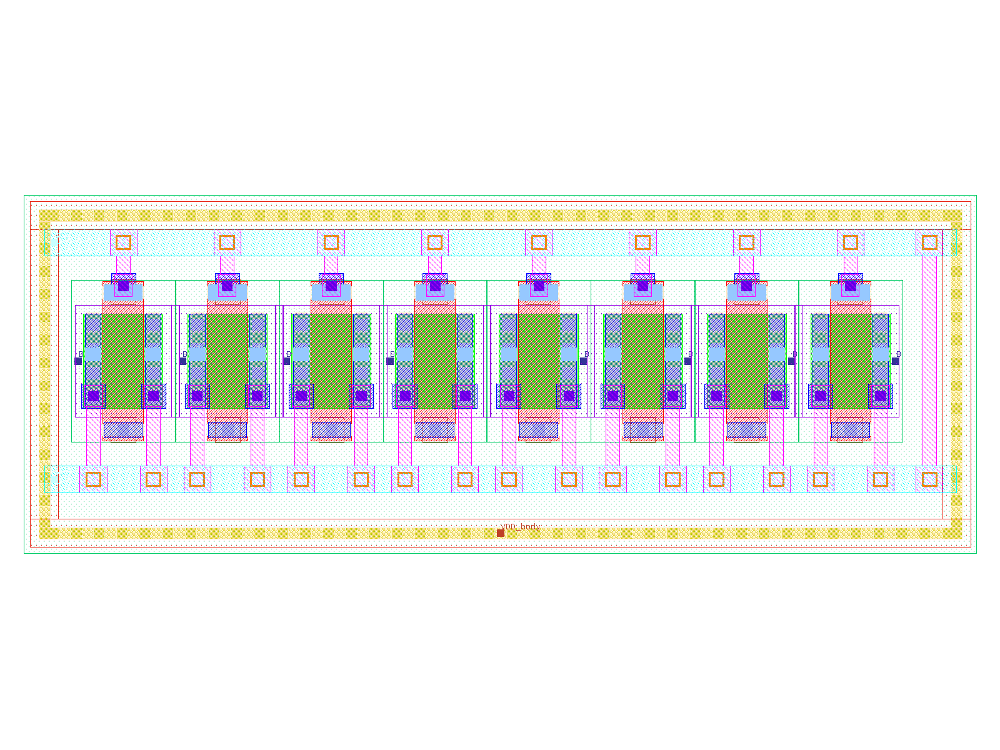<figcaption style="font-size:0.8em"><b>B5 pmos_dummy_2</b><br>XM45<br>variant f1</figcaption></figure><figure style="display:inline-block;width:31%;margin:4px;vertical-align:top;border-top:5px solid #008300;">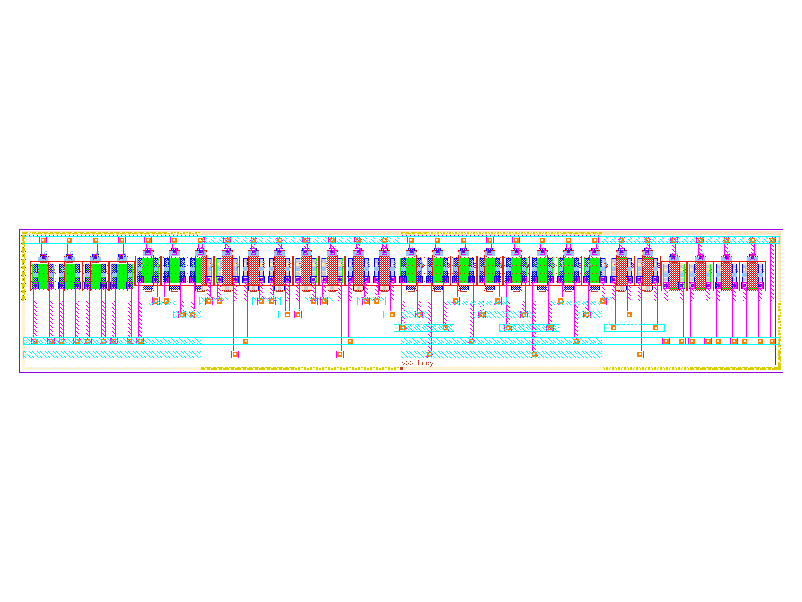<figcaption style="font-size:0.8em"><b>B6 x1_cc_cm</b><br>XX1_M33, XX1_M49, XX1_M50, … (21)<br>variant strings1</figcaption></figure><figure style="display:inline-block;width:31%;margin:4px;vertical-align:top;border-top:5px solid #008300;">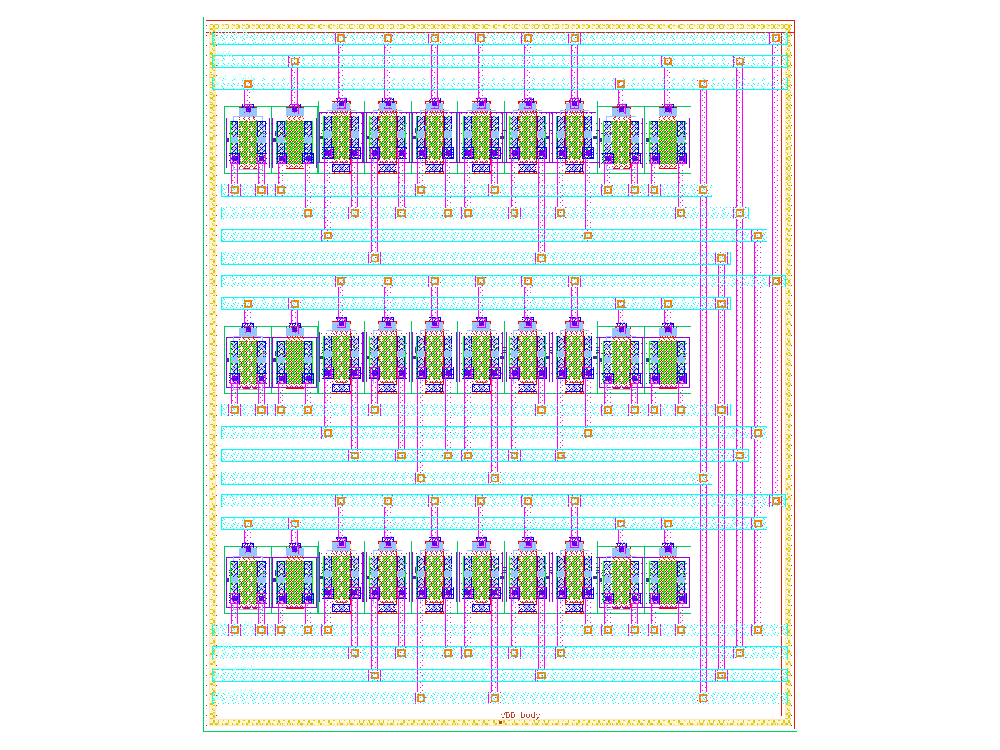<figcaption style="font-size:0.8em"><b>B7 x1_cm_bias_b</b><br>XX1_M21, XX1_M25, XX1_M31, … (9)<br>variant cc3</figcaption></figure><figure style="display:inline-block;width:31%;margin:4px;vertical-align:top;border-top:5px solid #008300;">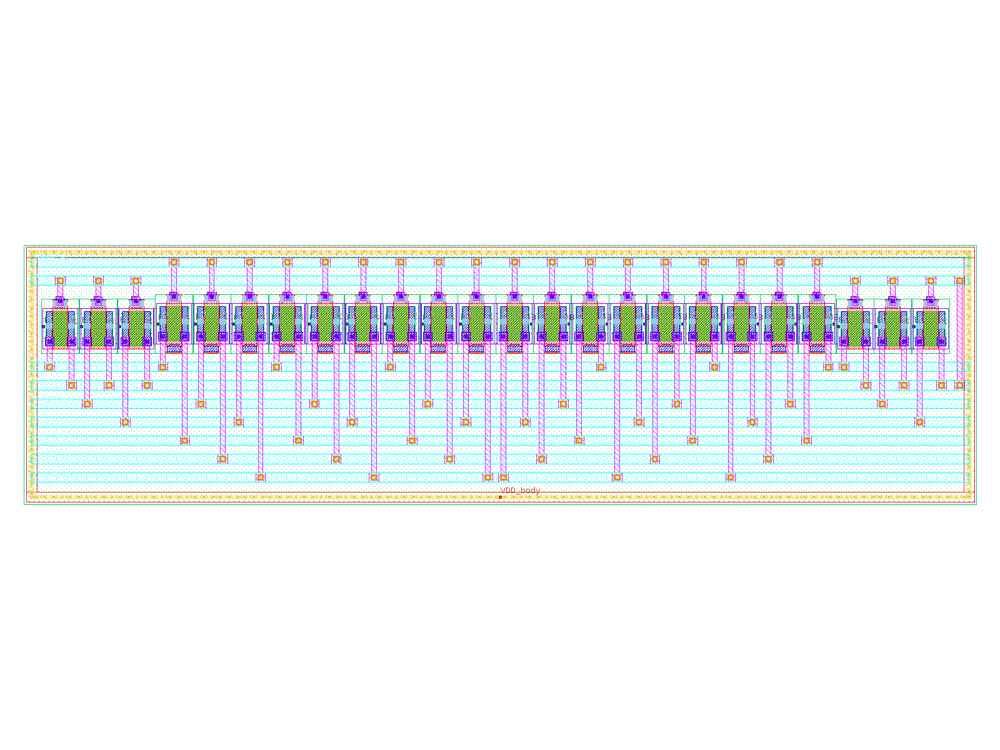<figcaption style="font-size:0.8em"><b>B8 x1_cm_bias_c</b><br>XX1_M22, XX1_M26, XX1_M32, … (6)<br>variant cc1 (area-only: cc3)</figcaption></figure><figure style="display:inline-block;width:31%;margin:4px;vertical-align:top;border-top:5px solid #008300;">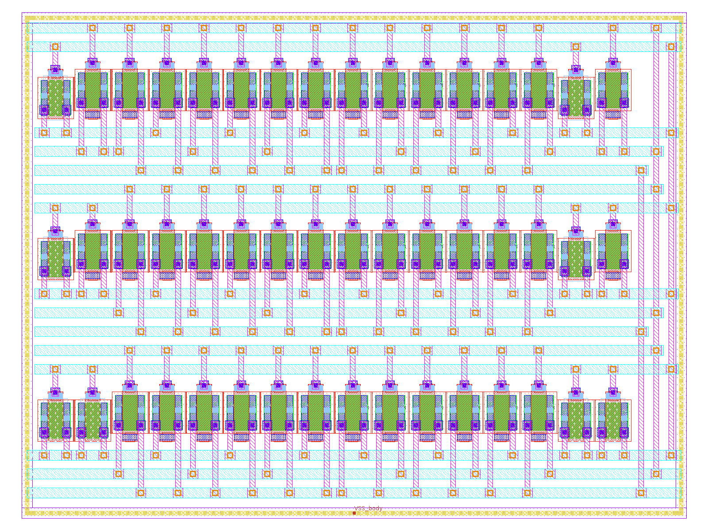<figcaption style="font-size:0.8em"><b>B9 x1_cm_iref</b><br>XX1_M7, XX1_M6, XX1_M10, … (5)<br>variant cc3 (area-only: cc2)</figcaption></figure><figure style="display:inline-block;width:31%;margin:4px;vertical-align:top;border-top:5px solid #008300;">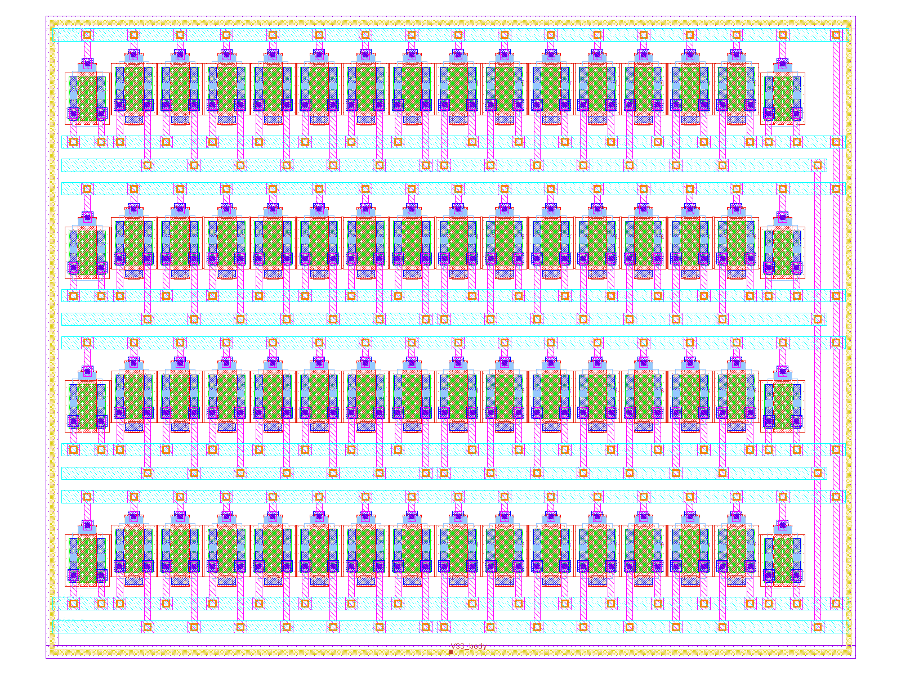<figcaption style="font-size:0.8em"><b>B10 x1_diode_bias_b</b><br>XX1_M1, XX1_M27<br>variant f4</figcaption></figure><figure style="display:inline-block;width:31%;margin:4px;vertical-align:top;border-top:5px solid #008300;">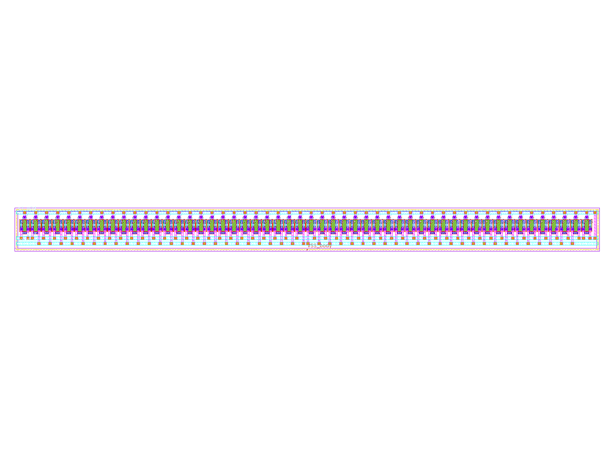<figcaption style="font-size:0.8em"><b>B11 x1_diode_m2d</b><br>XX1_M2, XX1_M35<br>variant f1 (area-only: f2)</figcaption></figure><figure style="display:inline-block;width:31%;margin:4px;vertical-align:top;border-top:5px solid #008300;">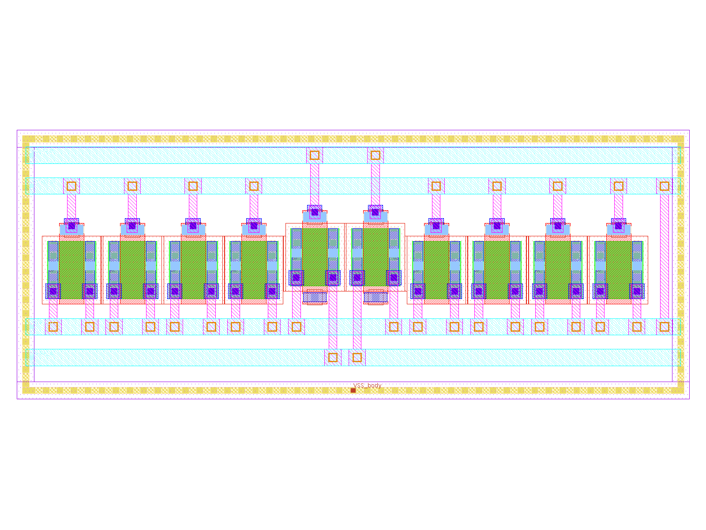<figcaption style="font-size:0.8em"><b>B12 x1_single_m3</b><br>XX1_M3, XX1_M34<br>variant f1</figcaption></figure><figure style="display:inline-block;width:31%;margin:4px;vertical-align:top;border-top:5px solid #008300;">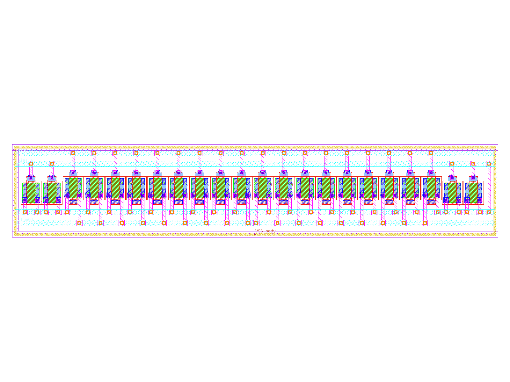<figcaption style="font-size:0.8em"><b>B13 x1_single_m4</b><br>XX1_M4, XX1_M36<br>variant f1 (area-only: f3)</figcaption></figure><figure style="display:inline-block;width:31%;margin:4px;vertical-align:top;border-top:5px solid #008300;">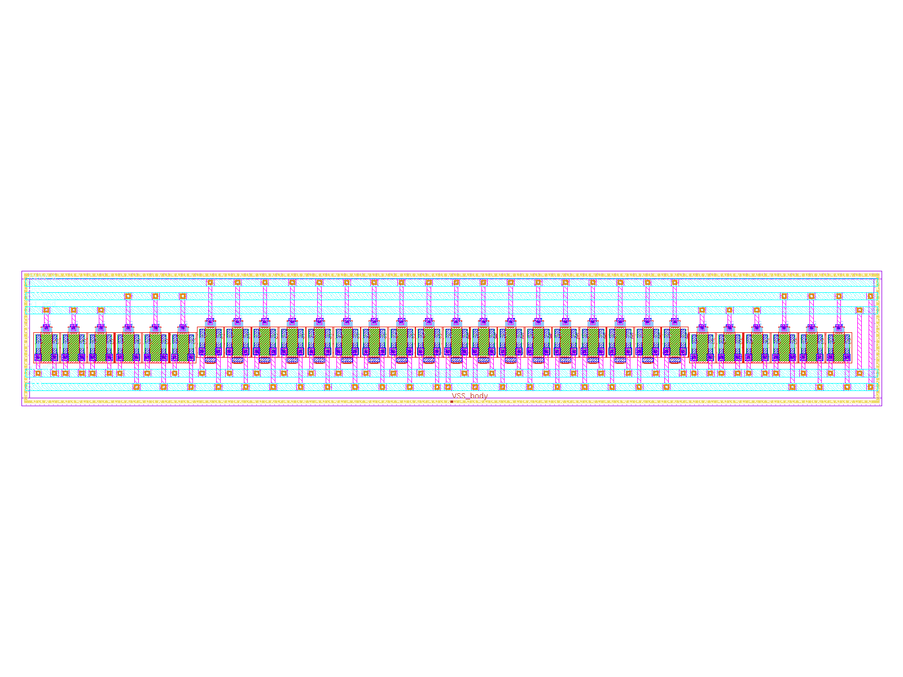<figcaption style="font-size:0.8em"><b>B14 x1_single_m5</b><br>XX1_M5, XX1_M29, XX1_M42<br>variant f1 (area-only: f2)</figcaption></figure><figure style="display:inline-block;width:31%;margin:4px;vertical-align:top;border-top:5px solid #eda100;">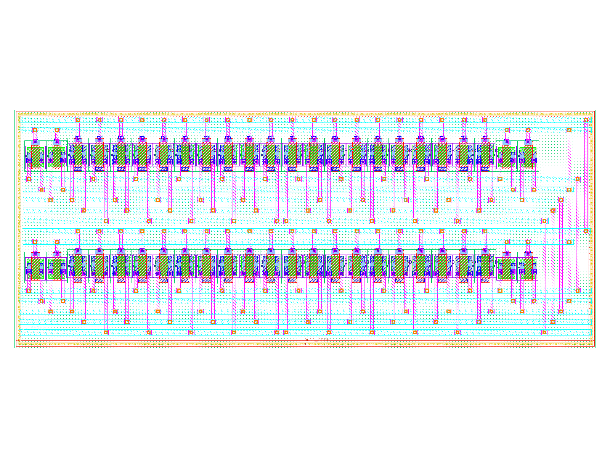<figcaption style="font-size:0.8em"><b>B15 x2_cl_casc</b><br>XX2_M1A, XX2_M8, XX2_M56, XX2_M62<br>variant cc2</figcaption></figure><figure style="display:inline-block;width:31%;margin:4px;vertical-align:top;border-top:5px solid #eda100;">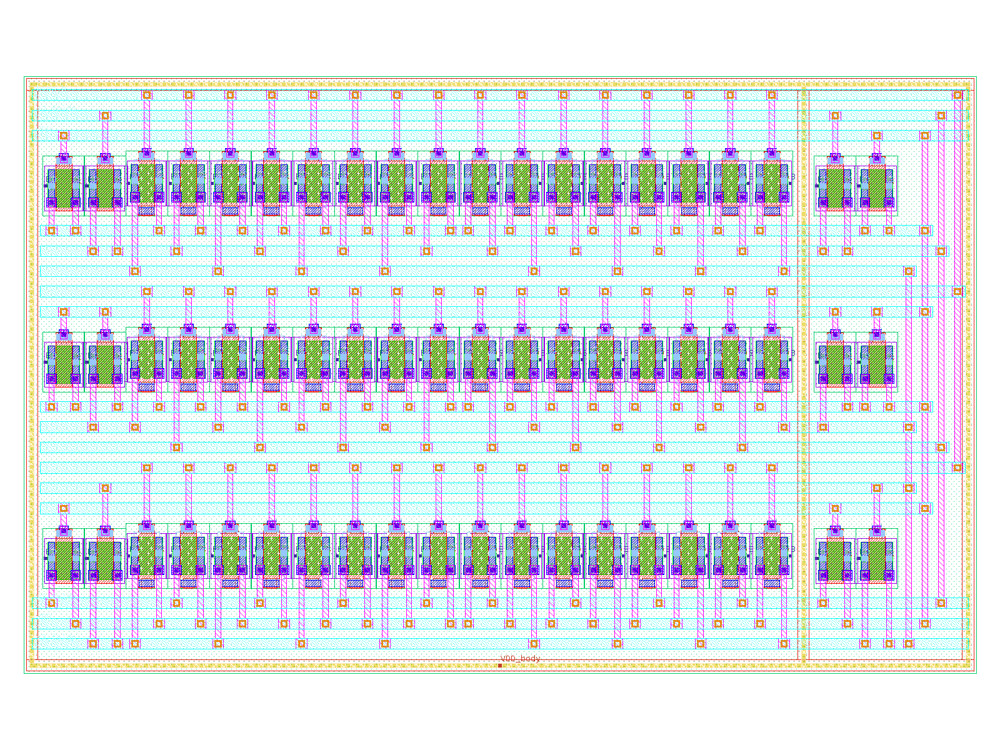<figcaption style="font-size:0.8em"><b>B16 x2_cl_src</b><br>XX2_M11, XX2_M12, XX2_M55, … (6)<br>variant cc3</figcaption></figure><figure style="display:inline-block;width:31%;margin:4px;vertical-align:top;border-top:5px solid #eda100;">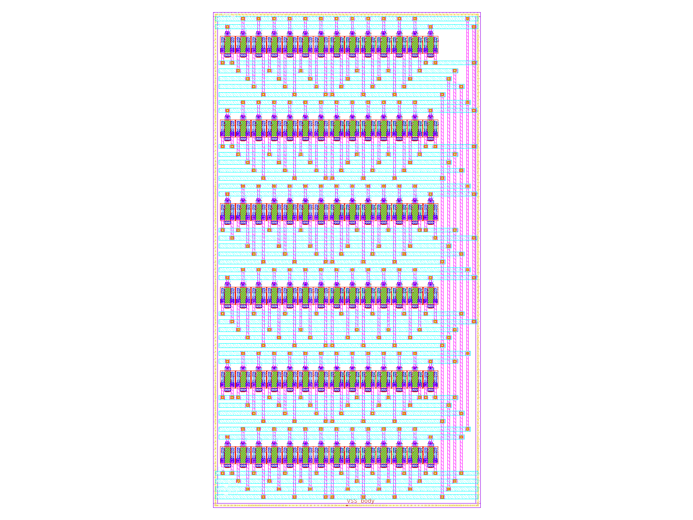<figcaption style="font-size:0.8em"><b>B17 x2_cm_casc</b><br>XX2_M3A, XX2_M7, XX2_M38, … (6)<br>variant cc6 (area-only: cc3)</figcaption></figure><figure style="display:inline-block;width:31%;margin:4px;vertical-align:top;border-top:5px solid #eda100;">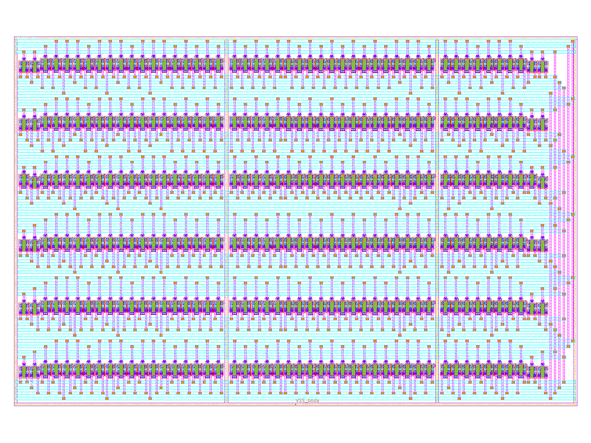<figcaption style="font-size:0.8em"><b>B18 x2_cm_tail</b><br>XX2_M6, XX2_M5, XX2_M3, … (8)<br>variant cc6 (area-only: id6)</figcaption></figure><figure style="display:inline-block;width:31%;margin:4px;vertical-align:top;border-top:5px solid #eda100;">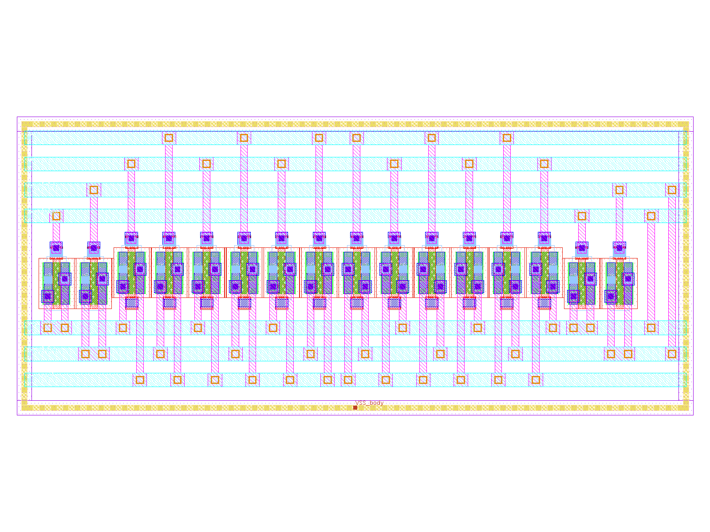<figcaption style="font-size:0.8em"><b>B19 x2_diff</b><br>XX2_M1, XX2_M2, XX2_M23, XX2_M24<br>variant cc1 (area-only: cc3)</figcaption></figure></div>

## 6. The layouts (S5)

**Flow, budget-aware**

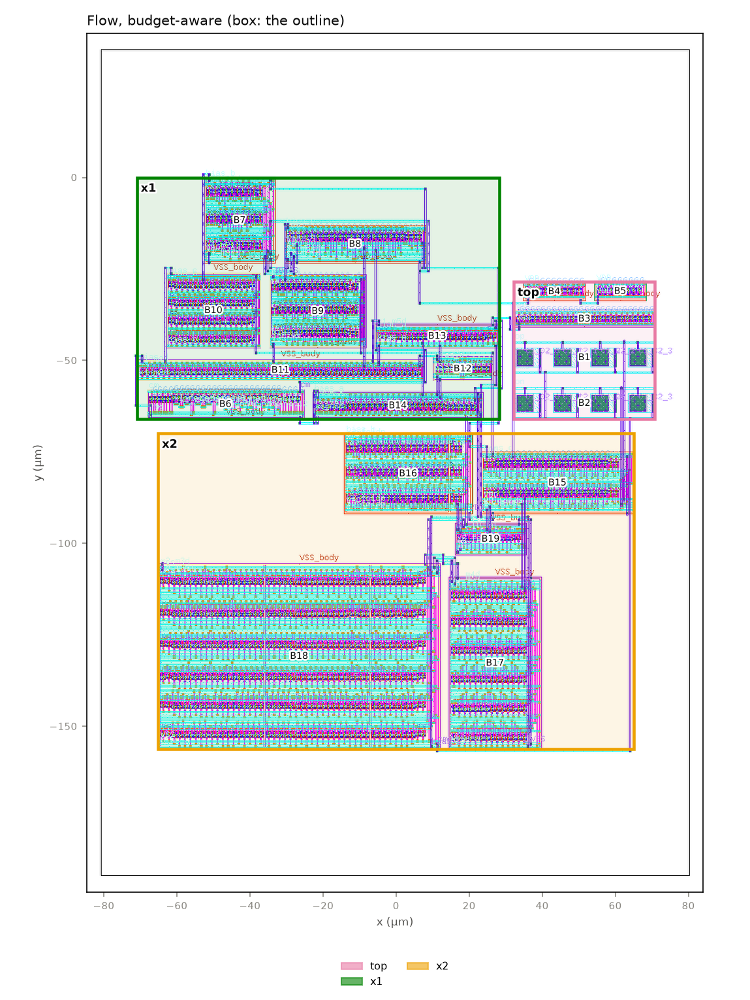

**Flow, area-only**

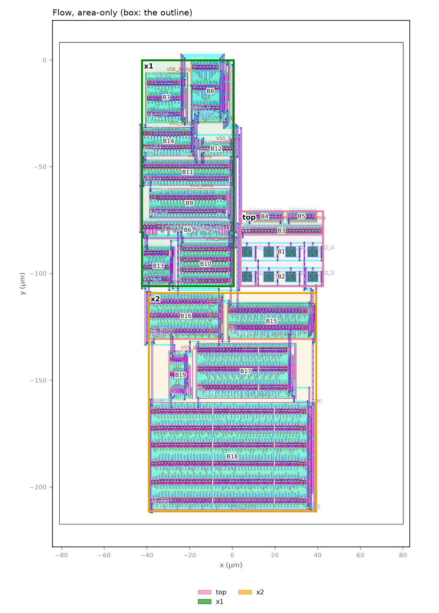

| | Budget-aware | Area-only |
|---|---|---|
| Size (µm) | 141.7 × 156.2 | 84.7 × 211.2 |
| Area (µm²) | 22,142 | 17,901 |
| DRC errors / LVS | 0 / match | 0 / match |
| Sum of wire-budget use (lower is better) | 540.6 | 860.0 |

> **How to read it.** Blocks are numbered as in section 5; coloured boxes are the sub-circuits. The budget-aware cost is A / A_ref + 10 × Σ max(0, u − 1) + 1 × Σ u (u: a net's length over its budget); the area-only cost is A / A_ref. Sub-circuits are placed by seeded annealing (40,000 moves, seed 20261104) or enumeration.

## 7. After layout (S6, S7)

The layout read back with its wiring (capacitance only) and simulated in the original benches.

| Spec | Limit | Schematic | Drawn devices | After layout, budget-aware | Use of allowance | After layout, area-only | Use of allowance |
|---|---|---|---|---|---|---|---|
| Phase margin (°) | ≥ 60 | 77.234 | 75.503 | 72.72 | 0.524 | 72.888 | 0.504 |
| DC gain (dB) | ≥ 52.47 | 53.47 | 53.602 | 53.602 | -0.264 | 53.602 | -0.264 |
| Unity-gain bandwidth (GBW) (MHz) | ≥ 188.87 | 209.85 | 204.8 | 176.76 | **3.15** | 175.87 | **3.24** |

> **How to read it.** Use of allowance = (schematic − after layout) / (η × margin); 1.0 is all the layout may take (bold: more).

**What it shows here:** a spec is missed after layout; gbw_mhz lose more than the allowance.

**What it shows here:** with the MIM capacitors' own plate coupling cancelled (very likely counted twice by the extraction): gain_db uses -0.264, gbw_mhz uses 2.9, pm_deg uses 0.554.

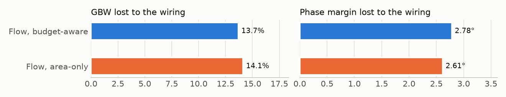


> **How to read it.** Each layout simulated with its drawn devices only and again with its wiring, by the same extraction and bench; the drop is what the wiring and placement cost. Shorter is better.

## 9. What did not pass

- **S0 G0.7** (each device, drawn by the SKY130 PCell at its exact size, passes Magic DRC and Netgen LVS (both with negative controls))
- **S1 G1.1** (operating point: functional devices saturated, supply current reproduced, charge conservation)
- **S2 G2.7** (the S3 library's cheapest cells fit inside the budgets (library floors))
- **S3 G3.3** (the circuit with every chosen cell meets every spec in SPICE, saturated, within its allowance)
- **S3 G3.5** (no device type had to be relaxed (every type has an option within its allowance))
- **S5 G5.4** (G5.4 route rules)
- **S6 G6.2** (G6.2 parasitics within budgets)
- **S7 G7.1** (G7.1 specs met post layout)
- **S7 G7.2** (G7.2 loss within eta margin)

Explanations of each gate: `docs/s4_s7_walkthrough.html` (S4–S7) and `docs/s0_s3_walkthrough.html` (S0–S3).

## 10. The inputs used

```yaml
# Copy of iadc_ota, made with the local GUI on 2026-11-05 (edited: layout instructions).
# Design package: iadc fully differential folded-cascode OTA (r09g/iadc, MIT), AC model with an ideal CMFB.
# Generated inputs: circuits/iadc_ota_v2/ (scripts/make_iadc_package.py, see its SOURCE.md).
design: iadc_ota_v2
description: >
  Fully differential folded-cascode OTA of the iadc incremental delta-sigma modulator, with a hand-drawn
  Magic layout and its PEX netlist upstream. The switched-capacitor CMFB is modelled by an ideal source with
  its steady-state law (ASSUMPTION). Specs are an ASSUMPTION.

netlist: circuits/iadc_ota_v2/source/iadc_ota.spice
config: circuits/iadc_ota_v2/source/config.yaml
achieved: null
reference: null                 # upstream has no OTA performance figures
testbenches:
  - circuits/iadc_ota_v2/testbenches/dido_amp_AC.spice
  - circuits/iadc_ota_v2/testbenches/dido_amp_OP.spice
  - circuits/iadc_ota_v2/testbenches/dido_amp_NOISE.spice
dut_subckt_in_testbench: iadc_ota

upstream:
  netlist: circuits/iadc_ota_v2/source/iadc_ota.spice
  hierarchy: circuits/iadc_ota_v2/upstream/hierarchy.json
  primitives: circuits/iadc_ota_v2/upstream/primitives.json            # PREDICTED (rule-based)
  equations: circuits/iadc_ota_v2/upstream/equations.predicted.json    # PREDICTED (textbook)
  name_map: circuits/iadc_ota_v2/upstream/name_map.yaml

bias_sources:
  Ibias_ext: IBIAS              # 30 uA ideal bias current (testbench), removed in the layout view

port_roles:                     # DUT ports outside the six standard ones
  cmc: bias_ac_ground           # CMFB control, driven by the ideal CMFB in the wrapper: AC ground in DM
  cm: bias_monitor              # CM reference made by the bias block, read by the ideal CMFB
  bias_a: bias_monitor          # bias node read by the ideal CMFB (SC CMFB steady-state law)

ac_drive: {INP: 0.5, INN: -0.5}
s3_build_mode: A-bin            # many device types: build only the options the main mode can choose

operating_point: null
variation_ranges: null
conditions_override: {}
specs_from_achieved:
  gain_db: {min_delta: -1.0}
  gbw_mhz: {min_factor: 0.9}
```

```yaml
# Layout options for S4-S7 of iadc_ota (Imasha, 2026-11-04: lay it out to fit a Tiny Tapeout analog tile).
# Read only by S4-S7 (the last two options by S6/S7): S0-S3 never read this file.
# The matching and dummy choices repeat Imasha's decisions for ttsky25a_fd (2026-11-04); for this design they are an
# ASSUMPTION until she confirms them (the netlist already holds the designer's own top-level dummies).
matching: centroid        # matched transistors only as common centroid or interdigitated rows, chosen by the cost
dummies: true             # one dummy unit at each end of every matched row (ASSUMPTION for this design, see above)
pack_internal: true       # a net only one block uses gets a short track, packed in rows (left-edge)
outline_um: [161.0, 225.77]   # the Tiny Tapeout 1x2 analog tile, width x height, as read from the taped-out tile
                          # tt_um_diff (circuits/ttsky25a_fd/upstream_src/gds/tt_um_diff.gds: 161.0 x 225.77 um).
                          # ASSUMPTION: the whole tile is available to the OTA; the tile's power straps (VDPWR,
                          # VGND, left edge) and its analog pins ua[0..7] (bottom edge, metal4) are not routed
hierarchy: upstream       # S5 places x1 (bias), x2 (core) and top (CMFB capacitors, dummies) as macros
pin_origin: bbox          # unit pins measured from the cell's bounding-box corner, where Magic places it (flow record
                          # row 95); iadc's single-finger W 1.2 / L 0.2 cell needs it. The finished designs keep the old
                          # way until Imasha decides (their stubs sit up to 0.125 um off their strips' centres)
fold_row_um: 100          # a single device's row of copies longer than this becomes a multi-row array in one ring
                          # (Imasha, 2026-11-05; flow record row 97): XX2_M5/M6 (m = 96) would be 198 um, wider than the
                          # tile. 100 um: two rows of 48 (ASSUMPTION: the limit; any value below the tile's width works)
search_from_outside: true # S5's annealing may start outside the outline and walk back in (flow record row 96); x1's
                          # start (a row per matched block) is far taller than the tile. Opt-in, like pin_origin
rc_extraction: false      # C-only, as for ttsky25a_fd (flow record row 87) and as the hand layout was measured (7.8)
ruleset: v2               # layout rule set v2 (docs/rules_v2/ruleset_v2.md, Imasha 2026-11-05): DRC minimum + 10 %
                          # spacing, no routing over device areas, channels opened as routing needs; opt-in
blocks:                   # Imasha's hand-drawn hierarchy of 2026-11-05: one coloured box = one block; the designer's
                          # dummies join the block whose device drains onto the dummy's net (same type), at its
                          # row ends (docs/rules_v2/ruleset_v2.md, rules P1, Y2). Matching level: centroid (the
                          # common-centroid or interdigitated arrangements; 2-D first)
  - name: x1_cm_iref
    kind: current_mirror
    drawn: "x1 purple box CM (B1)"
    devices: [XX1_M7, XX1_M6]
    dummies: [XX1_M10, XX1_M44, XX1_M8]
    level: centroid
  - name: x1_cm_bias_c
    kind: current_mirror
    drawn: "x1 green box CM (B36 + B39)"
    devices: [XX1_M22, XX1_M26, XX1_M32]
    dummies: [XX1_M57, XX1_M58, XX1_M59]
    level: centroid
  - name: x1_cm_bias_b
    kind: current_mirror
    drawn: "x1 blue box CM (B37 + B38)"
    devices: [XX1_M21, XX1_M25, XX1_M31]
    dummies: [XX1_M46, XX1_M47, XX1_M48, XX1_M51, XX1_M54, XX1_M60]
    level: centroid
  - name: x1_cc_cm
    kind: common_centroid
    drawn: "x1 red box CC (B14-B23): five series strings of four"
    devices: [XX1_M33, XX1_M49, XX1_M50, XX1_M63, XX1_M64, XX1_M65, XX1_M66, XX1_M67, XX1_M68, XX1_M69, XX1_M70, XX1_M71, XX1_M72, XX1_M73, XX1_M74, XX1_M75, XX1_M76, XX1_M77, XX1_M78, XX1_M79]
    dummies: [XX1_M37]
    level: centroid
  - name: x1_diode_bias_b
    kind: single
    drawn: "x1, not boxed (B2)"
    devices: [XX1_M1]
    dummies: [XX1_M27]
    level: centroid
  - name: x1_diode_m2d
    kind: single
    drawn: "x1, not boxed (B3)"
    devices: [XX1_M2]
    dummies: [XX1_M35]
    level: centroid
  - name: x1_single_m3
    kind: single
    drawn: "x1, not boxed (B24)"
    devices: [XX1_M3]
    dummies: [XX1_M34]
    level: centroid
  - name: x1_single_m4
    kind: single
    drawn: "x1, not boxed (B25)"
    devices: [XX1_M4]
    dummies: [XX1_M36]
    level: centroid
  - name: x1_single_m5
    kind: single
    drawn: "x1, not boxed (B26)"
    devices: [XX1_M5]
    dummies: [XX1_M29, XX1_M42]
    level: centroid
  - name: x2_cm_tail
    kind: current_mirror
    drawn: "x2 black box CM (B52 + B53 + B54)"
    devices: [XX2_M6, XX2_M5, XX2_M3, XX2_M4]
    dummies: [XX2_M28, XX2_M30, XX2_M40, XX2_M41]
    level: centroid
  - name: x2_diff
    kind: diff_pair
    drawn: "x2 green box diff (B40)"
    devices: [XX2_M1, XX2_M2]
    dummies: [XX2_M23, XX2_M24]
    level: centroid
  - name: x2_cm_casc
    kind: current_mirror
    drawn: "x2 red box CM (B51)"
    devices: [XX2_M3A, XX2_M7]
    dummies: [XX2_M38, XX2_M39, XX2_M80, XX2_M81]
    level: centroid
  - name: x2_cl_casc
    kind: cascode_load
    drawn: "x2 purple box CL (B61)"
    devices: [XX2_M1A, XX2_M8]
    dummies: [XX2_M56, XX2_M62]
    level: centroid
  - name: x2_cl_src
    kind: current_load
    drawn: "x2 yellow box CL (B62)"
    devices: [XX2_M11, XX2_M12]
    dummies: [XX2_M55, XX2_M61, XX2_M82, XX2_M83]
    level: centroid
```

## Glossary

- **GBW:** unity-gain bandwidth: where the gain falls to 1. Higher is faster.
- **Phase margin:** how far the amplifier is from oscillating in feedback; above about 60° is comfortable.
- **Margin, η, allowance:** margin = schematic value − spec limit; the layout may use η of it (the allowance).
- **DRC / LVS:** design-rule check (0 errors = manufacturable) / layout versus schematic ("match" = same circuit).
- **Extraction:** reading the layout back with its wires' capacitance (C-only) or also resistance (R+C).
- **Drawn devices:** the layout's transistors without any wiring; "drawn → extracted" is the wiring's cost.
- **Block / variant:** transistors drawn together as one piece (B1 …) / one way of drawing it (A B B A, A B A B …).
- **Budget-aware / area-only:** placement scored by area plus wire budgets (the flow's rule) / by area alone.
- **Gate:** an automatic pass/fail check at the end of a stage (G4.1, G5.4 …).

