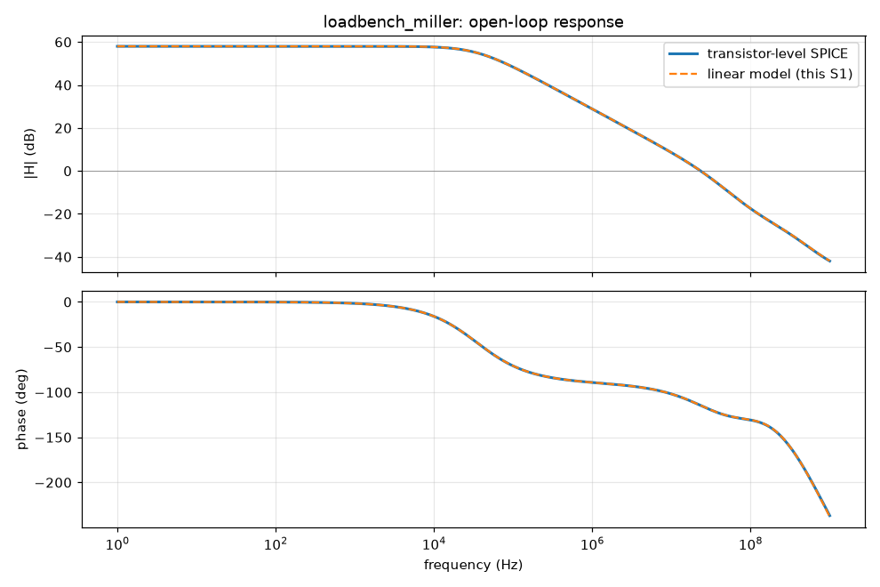
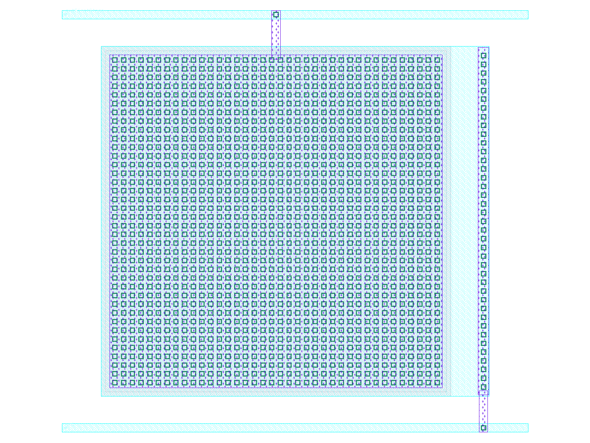
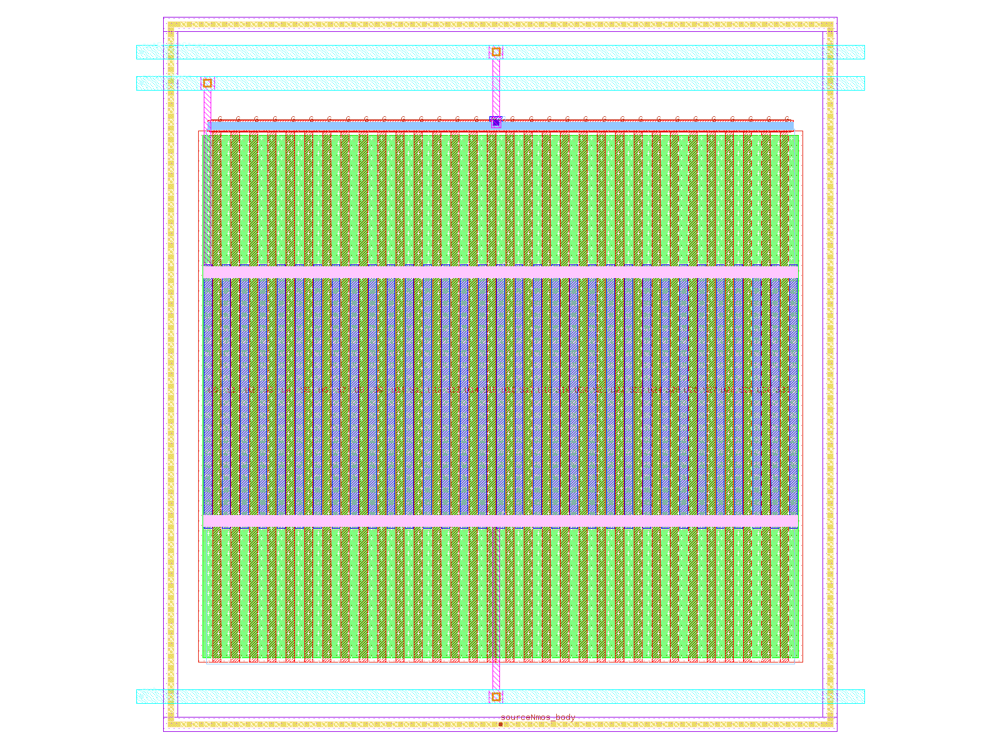
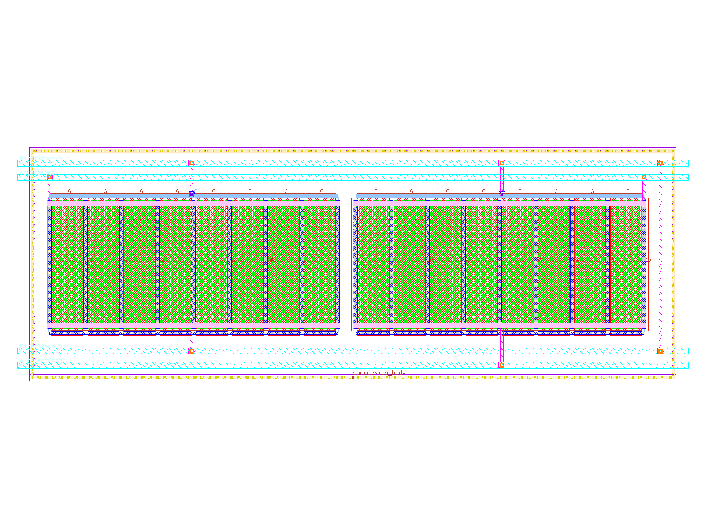
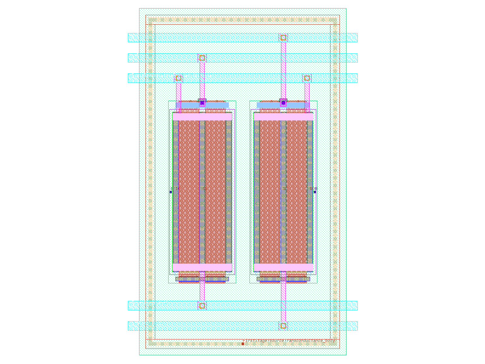
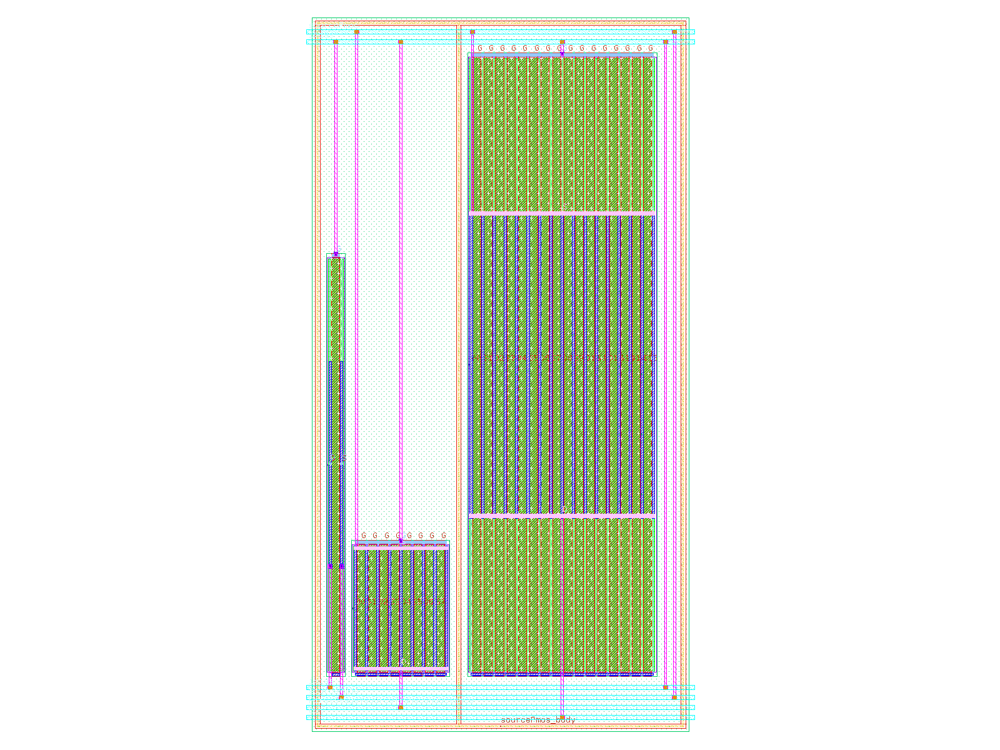
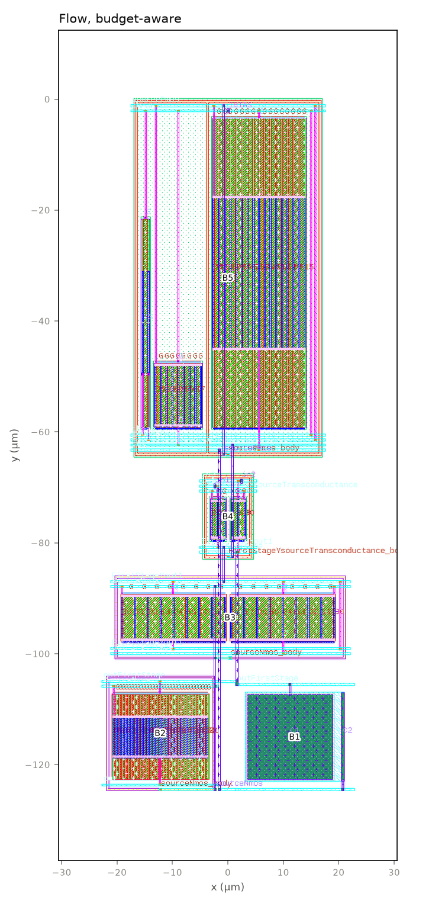
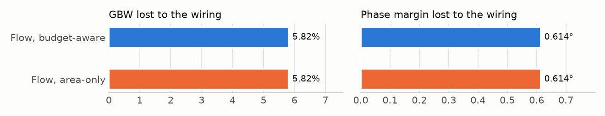

# Layout report: `loadbench_miller`

*Generated by `python3 scripts/make_design_report.py loadbench_miller` from the flow's own output files (repo at a1a4448de 2026-11-05); no number is typed by hand and no LLM is used. Assumptions are marked ASSUMPTION in the inputs.*

## 1. The design

Two-stage Miller op-amp, LOADBench SimpleTwoStageOpAmp_SimpleOpAmp1_1, Pareto row chosen by a fixed rule (circuits/loadbench_miller/SOURCE.md). PMOS input pair, NMOS mirror, NMOS common-source second stage, ideal Miller capacitor, ideal 10 uA bias sink. Specs are an ASSUMPTION (config.yaml spec_notes).

- **Devices:** 8 transistors (8 pieces once each multiplier m is drawn), 1 passives.
- **Netlist:** `circuits/loadbench_miller/source/loadbench_miller.spice`; specs: `circuits/loadbench_miller/source/config.yaml`.
- **Layout instructions:** none (the flow's defaults).

## 2. The stages and their checks

| Stage | What it does | Result | Failed checks | Time (min) |
|---|---|---|---|---|
| S0 | reads the netlist, specs and test benches; checks they agree (and that the sources are unchanged) | **FAIL** | G0.7 pcell binding drc lvs | 10.8 |
| S1 | builds a linear model of the circuit; finds its main nodes and matching groups | **FAIL** | G1.6 resistance sensitivity vs spice | 0.3 |
| S2 | turns the specs into budgets: how much capacitance, resistance and wire length each net may have | **PASS** | – | 7.9 |
| S3 | chooses how each transistor is drawn (fingers, cell shape), checked in simulation | **FAIL** | G3.5 no relaxation | 57.5 |
| S4 | draws the matched blocks (with dummies and tap rings where asked) and checks each | **PASS** | – | 1.1 |
| S5 | places the blocks (inside the outline, if one is given) and routes them; DRC and LVS | **FAIL** | G5.4 route rules | 1.5 |
| S6 | reads the layout back with its wiring capacitance; compares with the budgets | **FAIL** | G6.2 parasitics within budgets | 1.8 |
| S7 | simulates the read-back layout in the original benches; compares with the specs | **FAIL** | G7.2 loss within eta margin | 34.1 |

*Who decides what:* Specs, budgets, cells, blocks, placement, routing, checks: code (fixed rules and searches; settings in PREREG); Design, specs' basis, layout instructions (outline, matching, dummies, hierarchy): the designer (the GUI's inputs); The flow's code, its rules and defaults: written with an LLM (Claude); no LLM is called during a run.

## 3. Specs

| Spec | Schematic | Limit | Margin | Allowance for the layout |
|---|---|---|---|---|
| Phase margin (°) | 65.323 | ≥ 60 | 5.323 | 2.662 |
| Power (µW) | 558.45 | ≤ 614.2 | 55.75 | 27.88 |
| DC gain (dB) | 58 | ≥ 57 | 1 | 0.5 |
| Unity-gain bandwidth (GBW) (MHz) | 23.387 | ≥ 21.048 | 2.339 | 1.169 |

## 4. The main nodes (S1) and their budgets (S2)

| Node | Role | Pole rank | GBW lost per fF (kHz) | PM lost per fF (m°) | Budget (fF) | Extracted (fF) | Use |
|---|---|---|---|---|---|---|---|
| outFirstStage | dominant_pole | 1 | 1.18 | 3.37 | 7.54 | 20.7 | **2.74** |
| ibias | bias current input (ideal current source: open in AC), mirror_node (diode-connected), non_dominant_pole | 2 | 0.0138 | -0.144 | 452 | 58 | 0.129 |
| out | signal_output | 3 | 0.0938 | 2.5 | 40.3 | 67.1 | **1.66** |
| FirstStageYout1 | mirror_node (diode-connected) | 4 | 3.66 | 3.77 | 12.4 | 37.1 | **3** |
| FirstStageYsourceTransconductance | source_coupled (tail) | 5 | 3.81 | -7.93 | 55.8 | 27.8 | 0.498 |

> **How to read it.** Pole rank 1 is the dominant pole; the two sensitivity columns say how much GBW and phase margin drop per fF of wiring on the node; "use" is extracted / budget in the budget-aware layout (bold: over).




> **How to read it.** Open-loop gain and phase: SPICE on the transistors (solid) against S1's linear model (dashed); where they agree, every estimate built on the model can be trusted.

## 5. The blocks (S4)

5 blocks, 9 variants, all signed off (DRC 0, LVS match, negative control rejected). Colour bar: <span style="color:#e87ba4">■</span> cap, <span style="color:#008300">■</span> nmos, <span style="color:#eda100">■</span> pmos. The picture is the variant the budget-aware layout chose.

<div><figure style="display:inline-block;width:31%;margin:4px;vertical-align:top;border-top:5px solid #e87ba4;"><figcaption style="font-size:0.8em"><b>B1 Capacitor2</b><br>Capacitor2<br>variant A</figcaption></figure><figure style="display:inline-block;width:31%;margin:4px;vertical-align:top;border-top:5px solid #008300;"><figcaption style="font-size:0.8em"><b>B2 cs_stage</b><br>XNormalTransistorNmos3<br>variant A</figcaption></figure><figure style="display:inline-block;width:31%;margin:4px;vertical-align:top;border-top:5px solid #008300;"><figcaption style="font-size:0.8em"><b>B3 nmos_mirror_load</b><br>XDiodeTransistorNmos1, XNormalTransistorNmos4<br>variant AB</figcaption></figure><figure style="display:inline-block;width:31%;margin:4px;vertical-align:top;border-top:5px solid #eda100;"><figcaption style="font-size:0.8em"><b>B4 input_pair</b><br>XNormalTransistorPmos7, XNormalTransistorPmos6<br>variant AB</figcaption></figure><figure style="display:inline-block;width:31%;margin:4px;vertical-align:top;border-top:5px solid #eda100;"><figcaption style="font-size:0.8em"><b>B5 pmos_bias_bank</b><br>XDiodeTransistorPmos2, XNormalTransistorPmos8, XNormalTransistorPmos5<br>variant row</figcaption></figure></div>

## 6. The layouts (S5)

**Flow, budget-aware**



**Flow, area-only**


| | Budget-aware | Area-only |
|---|---|---|
| Size (µm) | 45.5 × 124.8 | 45.5 × 124.8 |
| Area (µm²) | 5,680 | 5,680 |
| DRC errors / LVS | 0 / match | 0 / match |
| Sum of wire-budget use (lower is better) | 3.2 | 3.2 |

**What it shows here:** both costs chose the same placement, so this design cannot tell them apart.

> **How to read it.** Blocks are numbered as in section 5. The budget-aware cost is A / A_ref + 10 × Σ max(0, u − 1) + 1 × Σ u (u: a net's length over its budget); the area-only cost is A / A_ref. Every row arrangement, variant and flip is enumerated.

## 7. After layout (S6, S7)

The layout read back with its wiring (capacitance and resistance) and simulated in the original benches.

| Spec | Limit | Schematic | Drawn devices | After layout, budget-aware | Use of allowance | After layout, area-only | Use of allowance |
|---|---|---|---|---|---|---|---|
| Phase margin (°) | ≥ 60 | 65.323 | 65.873 | 65.259 | 0.0243 | 65.259 | 0.0243 |
| Power (µW) | ≤ 614.2 | 558.45 | 557.43 | 553.28 | -0.185 | 553.28 | -0.185 |
| DC gain (dB) | ≥ 57 | 58 | 58.014 | 57.983 | 0.0336 | 57.983 | 0.0336 |
| Unity-gain bandwidth (GBW) (MHz) | ≥ 21.048 | 23.387 | 23.491 | 22.125 | **1.08** | 22.125 | **1.08** |

> **How to read it.** Use of allowance = (schematic − after layout) / (η × margin); 1.0 is all the layout may take (bold: more).

**What it shows here:** every spec is met after layout; gbw_mhz lose more than the allowance.

**What it shows here:** with the MIM capacitors' own plate coupling cancelled (very likely counted twice by the extraction): gain_db uses 0.0336, gbw_mhz uses 0.575, pm_deg uses 0.209.




> **How to read it.** Each layout simulated with its drawn devices only and again with its wiring, by the same extraction and bench; the drop is what the wiring and placement cost. Shorter is better.

## 9. What did not pass

- **S0 G0.7** (each device, drawn by the SKY130 PCell at its exact size, passes Magic DRC and Netgen LVS (both with negative controls))
- **S1 G1.6** (resistance sensitivities agree with SPICE (small-signal, or a confirmed bias shift))
- **S3 G3.5** (no device type had to be relaxed (every type has an option within its allowance))
- **S5 G5.4** (G5.4 route rules)
- **S6 G6.2** (G6.2 parasitics within budgets)
- **S7 G7.2** (G7.2 loss within eta margin)

Explanations of each gate: `docs/s4_s7_walkthrough.html` (S4–S7) and `docs/s0_s3_walkthrough.html` (S0–S3).

## 10. The inputs used

```yaml
# Design package: two-stage Miller op-amp from LOADBench (MLCAD'26), one Pareto point.
# Generated inputs: circuits/loadbench_miller/ (scripts/make_loadbench_package.py, see its SOURCE.md).
design: loadbench_miller
description: >
  Two-stage Miller op-amp, LOADBench SimpleTwoStageOpAmp_SimpleOpAmp1_1, Pareto row chosen by a fixed rule
  (circuits/loadbench_miller/SOURCE.md). PMOS input pair, NMOS mirror, NMOS common-source second stage,
  ideal Miller capacitor, ideal 10 uA bias sink. Specs are an ASSUMPTION (config.yaml spec_notes).

netlist: circuits/loadbench_miller/source/loadbench_miller.spice
config: circuits/loadbench_miller/source/config.yaml
achieved: null                  # LOADBench's metrics come from another library and testbench: kept as a
                                # reference (G0.8), and the achieved values are this flow's own S0 simulation
reference: circuits/loadbench_miller/source/loadbench_reference.json
testbenches:
  - circuits/loadbench_miller/testbenches/diso_amp_AC.spice
  - circuits/loadbench_miller/testbenches/diso_amp_OP.spice
  - circuits/loadbench_miller/testbenches/diso_amp_NOISE.spice
dut_subckt_in_testbench: loadbench_miller

upstream:
  netlist: circuits/loadbench_miller/source/loadbench_miller.spice
  hierarchy: circuits/loadbench_miller/upstream/hierarchy.json
  primitives: circuits/loadbench_miller/upstream/primitives.json
  equations: circuits/loadbench_miller/upstream/equations.predicted.json   # PREDICTED (textbook)
  name_map: circuits/loadbench_miller/upstream/name_map.yaml

bias_sources:
  Ibias: IBIAS          # ideal 10 uA sink: kept for simulation, removed in the layout view

# AC drive of each DUT input in the AC testbench (INN is held at AC ground by the DC-feedback network)
ac_drive: {INP: 1.0, INN: 0.0}

operating_point: null
variation_ranges: null
conditions_override: {}
specs_from_achieved:            # ASSUMPTION (no specs in LOADBench), see config.yaml spec_notes
  gain_db: {min_delta: -1.0}
  gbw_mhz: {min_factor: 0.9}
budget_corners: nominal         # Plan v3 Phase A (D-b, PREREG 2026-11-01): S2 budgets at the nominal corner only; the PVT points are reported in G2.9, not gated
designer_groups: inputs/loadbench_miller/designer_groups.yaml   # Plan v3 Phase A (D-e): the designer's groups and floorplan rows
s1_extras: [symbolic_patch_miller]   # Plan v3 Phase A step 10: the hand model with the NMOS-mirror doublet, PREDICTED (patched, post hoc)
```

## Glossary

- **GBW:** unity-gain bandwidth: where the gain falls to 1. Higher is faster.
- **Phase margin:** how far the amplifier is from oscillating in feedback; above about 60° is comfortable.
- **Margin, η, allowance:** margin = schematic value − spec limit; the layout may use η of it (the allowance).
- **DRC / LVS:** design-rule check (0 errors = manufacturable) / layout versus schematic ("match" = same circuit).
- **Extraction:** reading the layout back with its wires' capacitance (C-only) or also resistance (R+C).
- **Drawn devices:** the layout's transistors without any wiring; "drawn → extracted" is the wiring's cost.
- **Block / variant:** transistors drawn together as one piece (B1 …) / one way of drawing it (A B B A, A B A B …).
- **Budget-aware / area-only:** placement scored by area plus wire budgets (the flow's rule) / by area alone.
- **Gate:** an automatic pass/fail check at the end of a stage (G4.1, G5.4 …).

