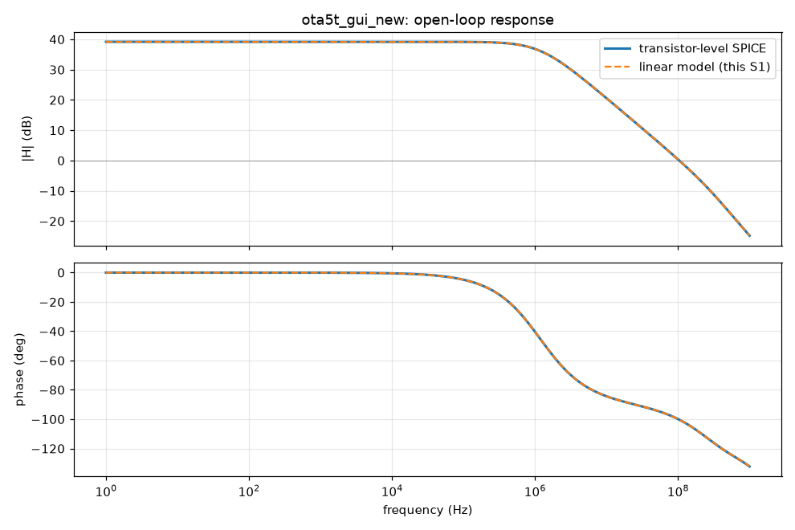
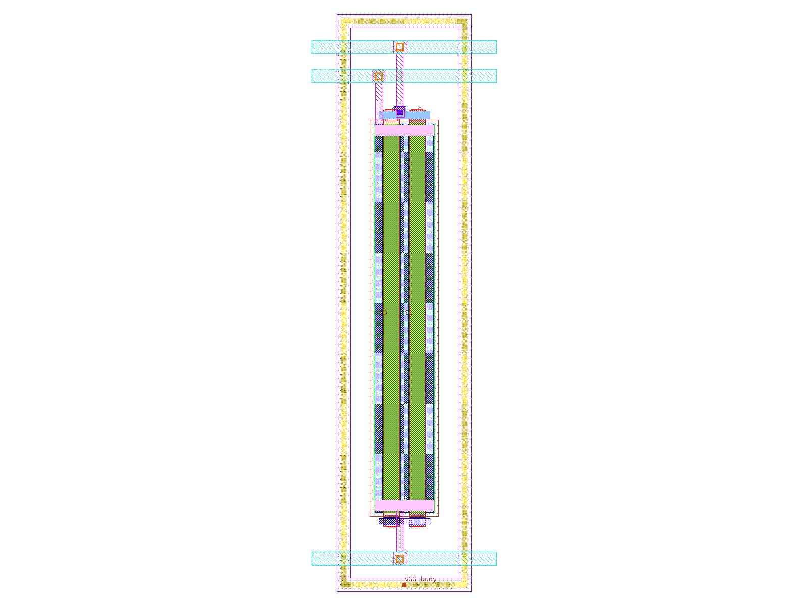
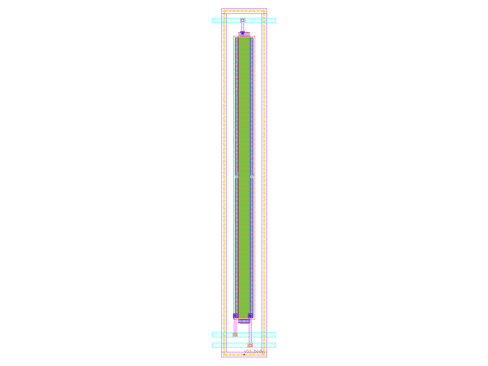
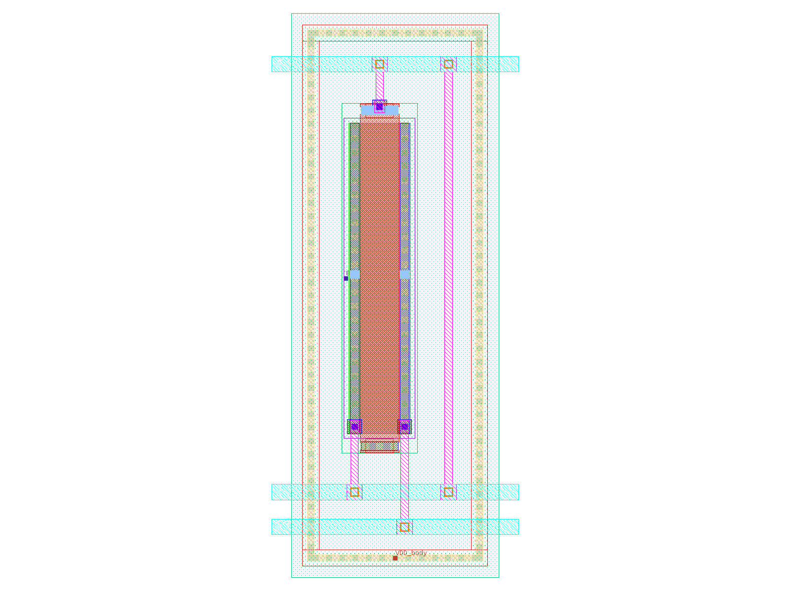
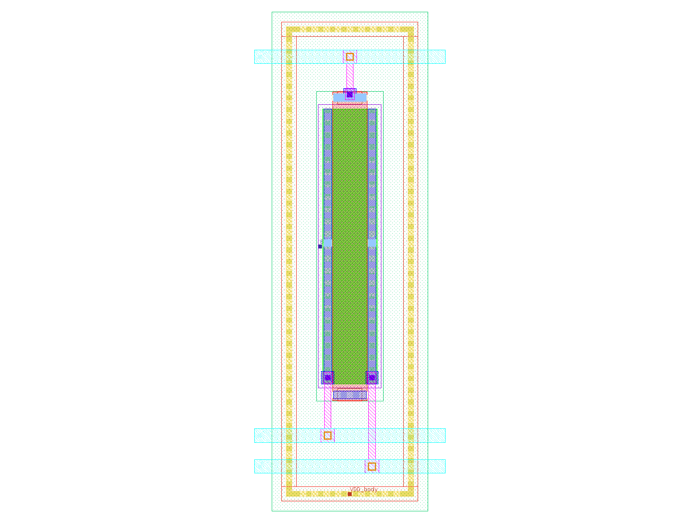
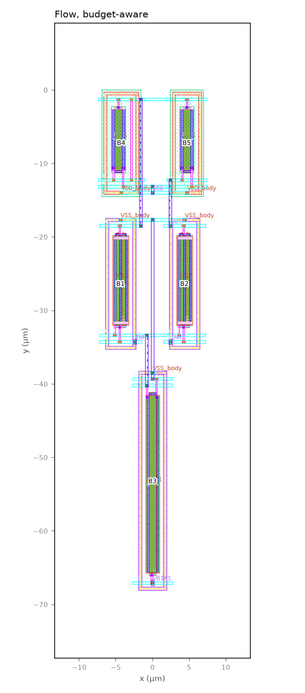
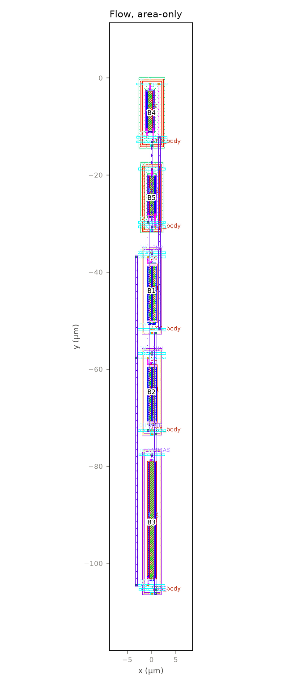
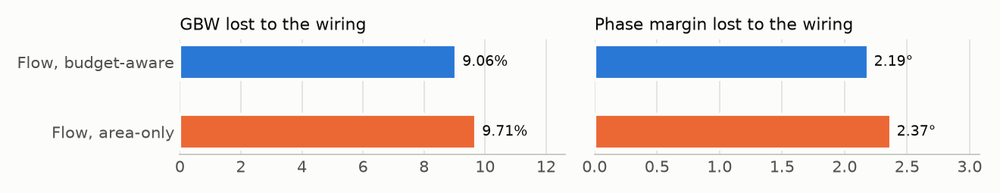

# Layout report: `ota5t_gui_new`

*Generated by `python3 scripts/make_design_report.py ota5t_gui_new` from the flow's own output files (repo at ef21cda3f 2026-11-04); no number is typed by hand and no LLM is used. Assumptions are marked ASSUMPTION in the inputs.*

## 1. The design

GUI test: the 5T OTA entered as a brand-new design (netlist and config only; benches generated; specs from its own results)

- **Devices:** 5 transistors (5 pieces once each multiplier m is drawn), 0 passives.
- **Netlist:** `circuits/ota5t_gui_new/source/ota5t_gui_new.spice`; specs: `circuits/ota5t_gui_new/source/config.yaml`.
- **Layout instructions:** none (the flow's defaults).

## 2. The stages and their checks

| Stage | What it does | Result | Failed checks | Time (min) |
|---|---|---|---|---|
| S0 | reads the netlist, specs and test benches; checks they agree (and that the sources are unchanged) | **PASS** | – | 25.9 |
| S1 | builds a linear model of the circuit; finds its main nodes and matching groups | **FAIL** | G1.4 matching groups | 8.8 |
| S2 | turns the specs into budgets: how much capacitance, resistance and wire length each net may have | **FAIL** | G2.7 library floors feasible | 32.4 |
| S3 | chooses how each transistor is drawn (fingers, cell shape), checked in simulation | **FAIL** | G3.5 no relaxation | 23.5 |
| S4 | draws the matched blocks (with dummies and tap rings where asked) and checks each | **PASS** | – | 0.5 |
| S5 | places the blocks (inside the outline, if one is given) and routes them; DRC and LVS | **FAIL** | G5.4 route rules | 0.9 |
| S6 | reads the layout back with its wiring capacitance; compares with the budgets | **FAIL** | G6.2 parasitics within budgets | 1.0 |
| S7 | simulates the read-back layout in the original benches; compares with the specs | **FAIL** | G7.2 loss within eta margin | 3.2 |

*Who decides what:* Specs, budgets, cells, blocks, placement, routing, checks: code (fixed rules and searches; settings in PREREG); Design, specs' basis, layout instructions (outline, matching, dummies, hierarchy): the designer (the GUI's inputs); The flow's code, its rules and defaults: written with an LLM (Claude); no LLM is called during a run.

## 3. Specs

| Spec | Schematic | Limit | Margin | Allowance for the layout |
|---|---|---|---|---|
| DC gain (dB) | 39.196 | ≥ 38.196 | 1 | 0.5 |
| Unity-gain bandwidth (GBW) (MHz) | 104.03 | ≥ 93.631 | 10.4 | 5.202 |
| Phase margin (°) | 79.662 | ≥ 60 | 19.66 | 9.831 |
| Power (µW) | 152.55 | ≤ 167.8 | 15.25 | 7.627 |
| Input noise (nV/√Hz) | 348.1 | ≤ 400 | 51.9 | 25.95 |

## 4. The main nodes (S1) and their budgets (S2)

| Node | Role | Pole rank | GBW lost per fF (kHz) | PM lost per fF (m°) | Budget (fF) | Extracted (fF) | Use |
|---|---|---|---|---|---|---|---|
| OUTP | signal_output, dominant_pole | 1 | 95.2 | -9.27 | 0.129 | 5.53 | **42.8** |
| net3 | mirror_node (diode-connected), non_dominant_pole | 2 | 58.5 | 66.4 | 0.239 | 8.21 | **34.3** |
| net1 | source_coupled (tail) | 3 | -5.21 | 2.07 | 77.8 | 11.9 | 0.153 |

> **How to read it.** Pole rank 1 is the dominant pole; the two sensitivity columns say how much GBW and phase margin drop per fF of wiring on the node; "use" is extracted / budget in the budget-aware layout (bold: over).




> **How to read it.** Open-loop gain and phase: SPICE on the transistors (solid) against S1's linear model (dashed); where they agree, every estimate built on the model can be trusted.

## 5. The blocks (S4)

5 blocks, 5 variants, all signed off (DRC 0, LVS match, negative control rejected). Colour bar: <span style="color:#e87ba4">■</span> nmos, <span style="color:#008300">■</span> pmos. The picture is the variant the budget-aware layout chose.

<div><figure style="display:inline-block;width:31%;margin:4px;vertical-align:top;border-top:5px solid #e87ba4;"><figcaption style="font-size:0.8em"><b>B1 XM1</b><br>XM1<br>variant A</figcaption></figure><figure style="display:inline-block;width:31%;margin:4px;vertical-align:top;border-top:5px solid #e87ba4;"><figcaption style="font-size:0.8em"><b>B2 XM2</b><br>XM2<br>variant A</figcaption></figure><figure style="display:inline-block;width:31%;margin:4px;vertical-align:top;border-top:5px solid #e87ba4;"><figcaption style="font-size:0.8em"><b>B3 XM5</b><br>XM5<br>variant A</figcaption></figure><figure style="display:inline-block;width:31%;margin:4px;vertical-align:top;border-top:5px solid #008300;"><figcaption style="font-size:0.8em"><b>B4 XM3</b><br>XM3<br>variant A</figcaption></figure><figure style="display:inline-block;width:31%;margin:4px;vertical-align:top;border-top:5px solid #008300;"><figcaption style="font-size:0.8em"><b>B5 XM4</b><br>XM4<br>variant A</figcaption></figure></div>

## 6. The layouts (S5)

**Flow, budget-aware**



**Flow, area-only**



| | Budget-aware | Area-only |
|---|---|---|
| Size (µm) | 14.9 × 68.2 | 6.3 × 106.5 |
| Area (µm²) | 1,015 | 675 |
| DRC errors / LVS | 0 / match | 0 / match |
| Sum of wire-budget use (lower is better) | 26.6 | 98.8 |

> **How to read it.** Blocks are numbered as in section 5. The budget-aware cost is A / A_ref + 10 × Σ max(0, u − 1) + 1 × Σ u (u: a net's length over its budget); the area-only cost is A / A_ref. Every row arrangement, variant and flip is enumerated.

## 7. After layout (S6, S7)

The layout read back with its wiring (capacitance and resistance) and simulated in the original benches.

| Spec | Limit | Schematic | Drawn devices | After layout, budget-aware | Use of allowance | After layout, area-only | Use of allowance |
|---|---|---|---|---|---|---|---|
| DC gain (dB) | ≥ 38.196 | 39.196 | 39.194 | 39.301 | -0.21 | 39.3 | -0.209 |
| Unity-gain bandwidth (GBW) (MHz) | ≥ 93.631 | 104.03 | 105.25 | 95.71 | **1.6** | 95.031 | **1.73** |
| Phase margin (°) | ≥ 60 | 79.662 | 79.941 | 77.753 | 0.194 | 77.571 | 0.213 |
| Power (µW) | ≤ 167.8 | 152.55 | 153.03 | 138.3 | -1.87 | 138.28 | -1.87 |
| Input noise (nV/√Hz) | ≤ 400 | 348.1 | 348.5 | 349.14 | 0.04 | 349.14 | 0.0402 |

> **How to read it.** Use of allowance = (schematic − after layout) / (η × margin); 1.0 is all the layout may take (bold: more).

**What it shows here:** every spec is met after layout; gbw_mhz lose more than the allowance.




> **How to read it.** Each layout simulated with its drawn devices only and again with its wiring, by the same extraction and bench; the drop is what the wiring and placement cost. Shorter is better.

## 9. What did not pass

- **S1 G1.4** (matching groups (differential pair, mirrors) are present and consistent)
- **S2 G2.7** (the S3 library's cheapest cells fit inside the budgets (library floors))
- **S3 G3.5** (no device type had to be relaxed (every type has an option within its allowance))
- **S5 G5.4** (G5.4 route rules)
- **S6 G6.2** (G6.2 parasitics within budgets)
- **S7 G7.2** (G7.2 loss within eta margin)

Explanations of each gate: `docs/s4_s7_walkthrough.html` (S4–S7) and `docs/s0_s3_walkthrough.html` (S0–S3).

## 10. The inputs used

```yaml
# New design made with the local GUI on 2026-11-04 (gui/gui.ps1). Field reference: docs/INPUTS.md.
design: ota5t_gui_new
description: 'GUI test: the 5T OTA entered as a brand-new design (netlist and config
  only; benches generated; specs from its own results)'
netlist: circuits/ota5t_gui_new/source/ota5t_gui_new.spice
config: circuits/ota5t_gui_new/source/config.yaml
achieved: null
testbenches:
- circuits/ota5t_gui_new/testbenches/diso_amp_AC.spice
- circuits/ota5t_gui_new/testbenches/diso_amp_OP.spice
- circuits/ota5t_gui_new/testbenches/diso_amp_NOISE.spice
dut_subckt_in_testbench: example_ota_5t_sized
upstream:
  netlist: null
  hierarchy: null
  primitives: null
  equations: null
  name_map: null
predicted: []
bias_sources:
  V1: VBIAS
operating_point: null
variation_ranges: null
conditions_override: {}
ac_drive:
  INP: 1.0
  INN: 0.0
specs_from_achieved:
  gain_db:
    min_delta: -1.0
  gbw_mhz:
    min_factor: 0.9
  power_uw:
    max_factor: 1.1
```

## Glossary

- **GBW:** unity-gain bandwidth: where the gain falls to 1. Higher is faster.
- **Phase margin:** how far the amplifier is from oscillating in feedback; above about 60° is comfortable.
- **Margin, η, allowance:** margin = schematic value − spec limit; the layout may use η of it (the allowance).
- **DRC / LVS:** design-rule check (0 errors = manufacturable) / layout versus schematic ("match" = same circuit).
- **Extraction:** reading the layout back with its wires' capacitance (C-only) or also resistance (R+C).
- **Drawn devices:** the layout's transistors without any wiring; "drawn → extracted" is the wiring's cost.
- **Block / variant:** transistors drawn together as one piece (B1 …) / one way of drawing it (A B B A, A B A B …).
- **Budget-aware / area-only:** placement scored by area plus wire budgets (the flow's rule) / by area alone.
- **Gate:** an automatic pass/fail check at the end of a stage (G4.1, G5.4 …).

