# Layout report: `ttsky25a_fd`

*Generated by `python3 scripts/make_design_report.py ttsky25a_fd` from the flow's own output files (repo at ef21cda3f 2026-11-04); no number is typed by hand and no LLM is used. Assumptions are marked ASSUMPTION in the inputs.*

## 1. The design

Two-stage fully differential op-amp, TTSKY25a tile tt_um_diff (NethmalWDI/Fully_differential_opamp): folded-cascode first stage, common-source second stage, a CMFB loop per stage, Miller MIM capacitors, beta-multiplier bias with start-up. Specs are an ASSUMPTION (config.yaml spec_notes).

- **Devices:** 54 transistors (139 pieces once each multiplier m is drawn), 43 passives.
- **Netlist:** `circuits/ttsky25a_fd/source/ttsky25a_fd.spice`; specs: `circuits/ttsky25a_fd/source/config.yaml`.
- **Layout instructions:** `inputs/ttsky25a_fd/layout.yaml`: matching = centroid, dummies = True, pack_internal = True, outline_um = [250, 200], hierarchy = upstream, rc_extraction = False.

## 2. The stages and their checks

| Stage | What it does | Result | Failed checks | Time (min) |
|---|---|---|---|---|
| S0 | reads the netlist, specs and test benches; checks they agree (and that the sources are unchanged) | **PASS** | – | 22.7 |
| S1 | builds a linear model of the circuit; finds its main nodes and matching groups | **FAIL** | G1.2 linear model vs spice | 3.8 |
| S2 | turns the specs into budgets: how much capacitance, resistance and wire length each net may have | **PASS** | – | 77.0 |
| S3 | chooses how each transistor is drawn (fingers, cell shape), checked in simulation | **FAIL** | G3.3 all chosen devices in circuit, G3.5 no relaxation | 53.0 |
| S4 | draws the matched blocks (with dummies and tap rings where asked) and checks each | **PASS** | – | 4.2 |
| S5 | places the blocks (inside the outline, if one is given) and routes them; DRC and LVS | **FAIL** | G5.4 route rules | 6.4 |
| S6 | reads the layout back with its wiring capacitance; compares with the budgets | **FAIL** | G6.2 parasitics within budgets | 3.6 |
| S7 | simulates the read-back layout in the original benches; compares with the specs | **FAIL** | G7.2 loss within eta margin | 1.0 |

*Who decides what:* Specs, budgets, cells, blocks, placement, routing, checks: code (fixed rules and searches; settings in PREREG); Design, specs' basis, layout instructions (outline, matching, dummies, hierarchy): the designer (the GUI's inputs); The flow's code, its rules and defaults: written with an LLM (Claude); no LLM is called during a run.

## 3. Specs

| Spec | Schematic | Limit | Margin | Allowance for the layout |
|---|---|---|---|---|
| Phase margin (°) | 78.234 | ≥ 60 | 18.23 | 9.117 |
| DC gain (dB) | 98.401 | ≥ 97.401 | 1 | 0.5 |
| Unity-gain bandwidth (GBW) (MHz) | 2.0517 | ≥ 1.8465 | 0.2052 | 0.1026 |
| Power (µW) | 451.98 | ≤ 497.18 | 45.2 | 22.6 |

## 4. The main nodes (S1) and their budgets (S2)

| Node | Role | Pole rank | GBW lost per fF (kHz) | PM lost per fF (m°) | Budget (fF) | Extracted (fF) | Use |
|---|---|---|---|---|---|---|---|
| Vop1 | dominant_pole | 1 | 0.0572 | 0.615 | 17.4 | 72.5 | **4.17** |
| Vom1 | non_dominant_pole | 2 | 0.0572 | 0.615 | 17.4 | 73.1 | **4.2** |
| x1_net7 | source_coupled (tail) | 3 | 0.00735 | 0.402 | 3.68 | 13.4 | **3.65** |
| x1_net8 | source_coupled (tail) | 4 | 0.00735 | 0.402 | 3.68 | 58.6 | **15.9** |
| x2_Vtest | mirror_node (diode-connected) | 5 | ≈ 0 | ≈ 0 | 239 | 61.1 | 0.255 |
| x1_net6 | – | 6 | 0.000709 | 0.0068 | 0.787 | 8.7 | **11.1** |
| x1_Vtest2 | – | 8 | 0.137 | 42.4 | 1.86 | 44.6 | **24** |
| x1_net1 | – | 9 | 0.137 | 42.4 | 1.86 | 24.7 | **13.3** |
| Vop | signal_output | 12 | 0.00149 | 1.14 | 5.08 | 65 | **12.8** |
| Vom | signal_output | 13 | 0.00149 | 1.14 | 5.08 | 132 | **25.9** |

> **How to read it.** Pole rank 1 is the dominant pole; the two sensitivity columns say how much GBW and phase margin drop per fF of wiring on the node; "use" is extracted / budget in the budget-aware layout (bold: over).

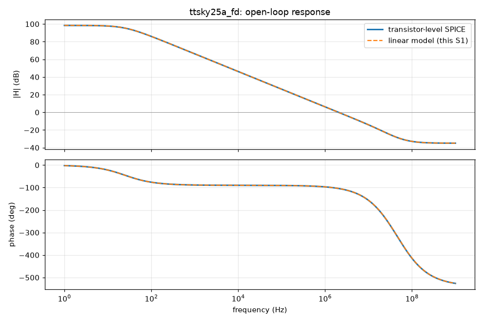


> **How to read it.** Open-loop gain and phase: SPICE on the transistors (solid) against S1's linear model (dashed); where they agree, every estimate built on the model can be trusted.

## 5. The blocks (S4)

33 blocks, 53 variants, all signed off (DRC 0, LVS match, negative control rejected). Colour bar: <span style="color:#e87ba4">■</span> res_packs, <span style="color:#008300">■</span> top, <span style="color:#eda100">■</span> x1, <span style="color:#6250d6">■</span> x2. The picture is the variant the budget-aware layout chose.

<div><figure style="display:inline-block;width:31%;margin:4px;vertical-align:top;border-top:5px solid #e87ba4;">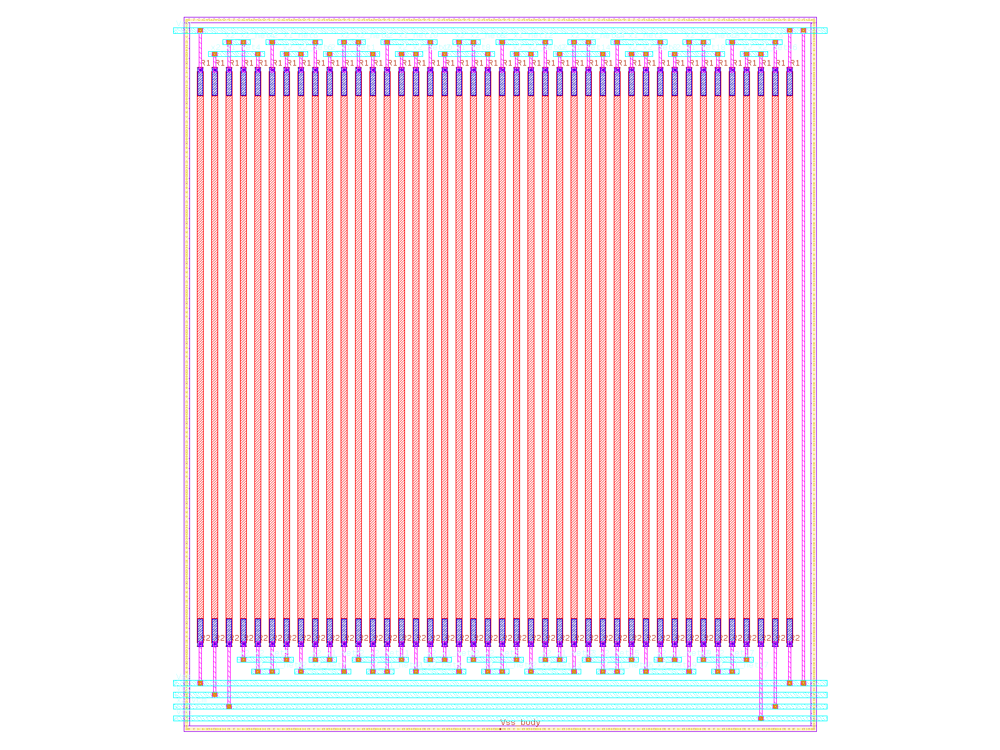<figcaption style="font-size:0.8em"><b>B1 res_packs</b><br>XX2_X1_R1, XX2_X1_R2, XX2_X1_R3, … (40)<br>variant interleaved</figcaption></figure><figure style="display:inline-block;width:31%;margin:4px;vertical-align:top;border-top:5px solid #008300;">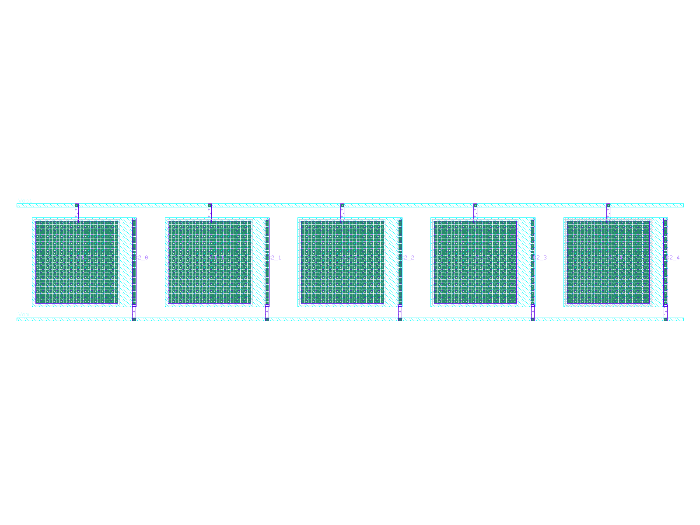<figcaption style="font-size:0.8em"><b>B2 XC1</b><br>XC1<br>variant A</figcaption></figure><figure style="display:inline-block;width:31%;margin:4px;vertical-align:top;border-top:5px solid #008300;"><figcaption style="font-size:0.8em"><b>B3 XC2</b><br>XC2<br>variant A</figcaption></figure><figure style="display:inline-block;width:31%;margin:4px;vertical-align:top;border-top:5px solid #008300;">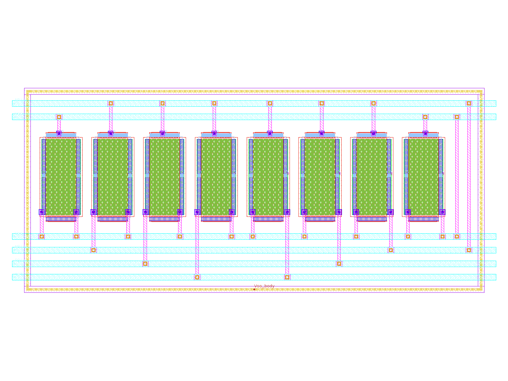<figcaption style="font-size:0.8em"><b>B4 nmos_current_mirror</b><br>XM33, XM37, XM41<br>variant centroid (area-only: interdigitated)</figcaption></figure><figure style="display:inline-block;width:31%;margin:4px;vertical-align:top;border-top:5px solid #008300;">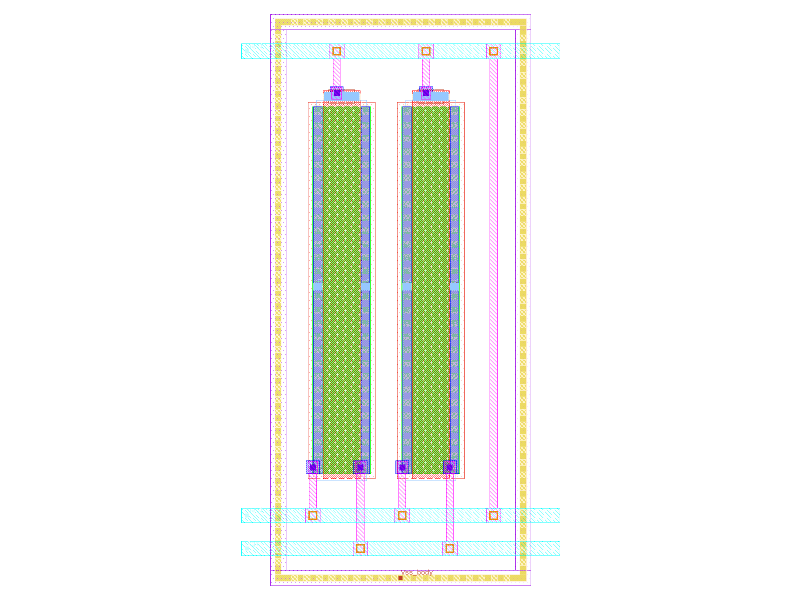<figcaption style="font-size:0.8em"><b>B5 nmos_diode</b><br>XM35<br>variant A</figcaption></figure><figure style="display:inline-block;width:31%;margin:4px;vertical-align:top;border-top:5px solid #008300;">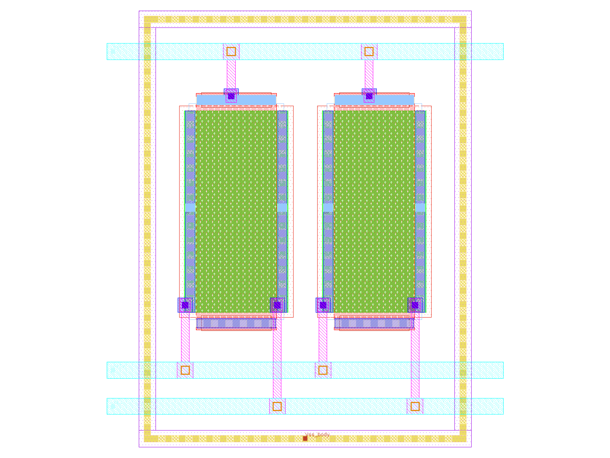<figcaption style="font-size:0.8em"><b>B6 nmos_single</b><br>XM36<br>variant A</figcaption></figure><figure style="display:inline-block;width:31%;margin:4px;vertical-align:top;border-top:5px solid #008300;">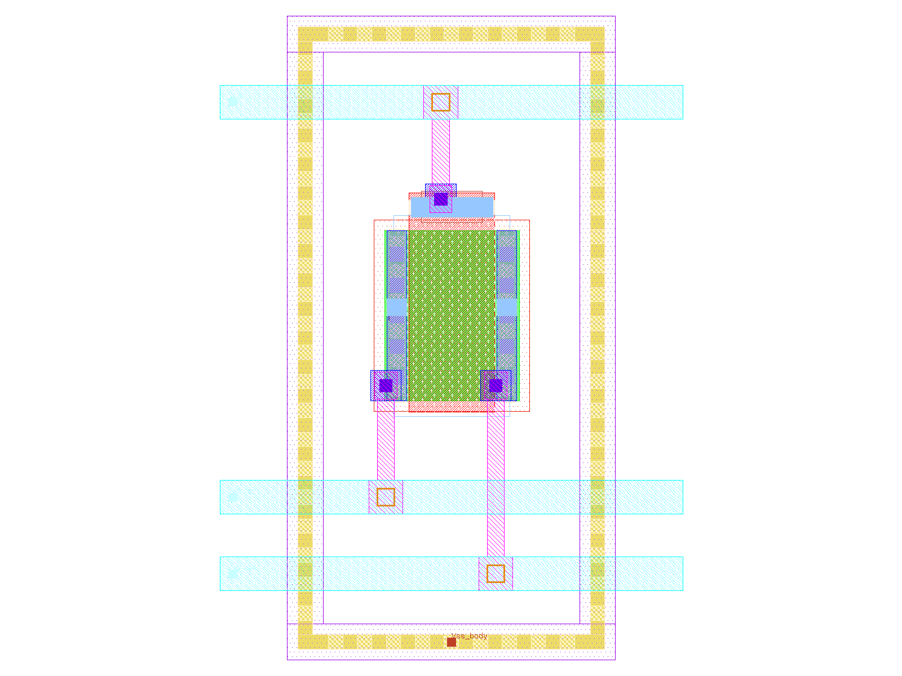<figcaption style="font-size:0.8em"><b>B7 nmos_single_2</b><br>XM40<br>variant A</figcaption></figure><figure style="display:inline-block;width:31%;margin:4px;vertical-align:top;border-top:5px solid #008300;">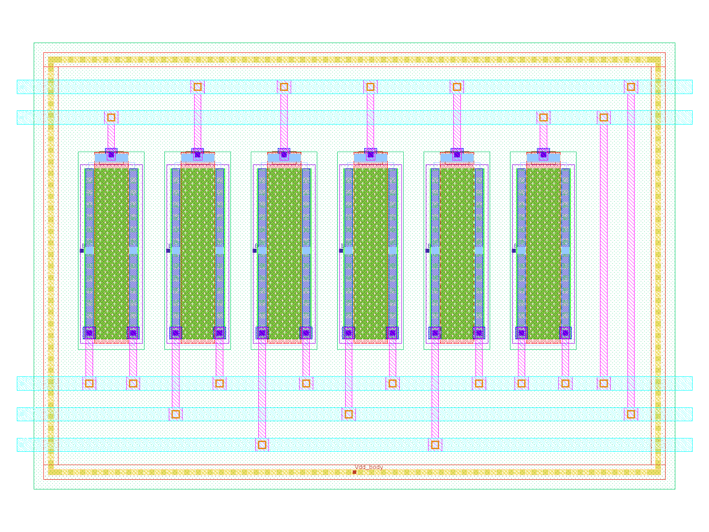<figcaption style="font-size:0.8em"><b>B8 pmos_current_mirror</b><br>XM39, XM38<br>variant ABAB</figcaption></figure><figure style="display:inline-block;width:31%;margin:4px;vertical-align:top;border-top:5px solid #008300;">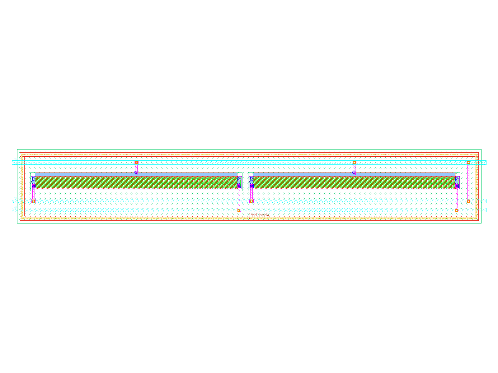<figcaption style="font-size:0.8em"><b>B9 pmos_diode</b><br>XM42<br>variant A</figcaption></figure><figure style="display:inline-block;width:31%;margin:4px;vertical-align:top;border-top:5px solid #008300;">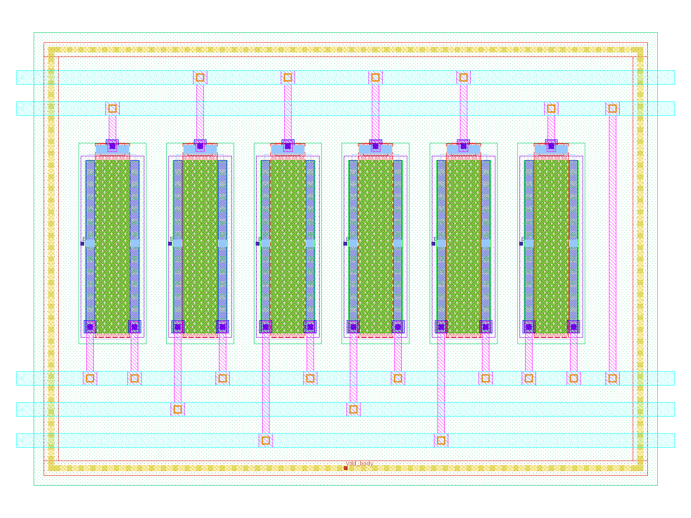<figcaption style="font-size:0.8em"><b>B10 pmos_matched_current_source_pair</b><br>XM32, XM34<br>variant ABAB (area-only: ABBA)</figcaption></figure><figure style="display:inline-block;width:31%;margin:4px;vertical-align:top;border-top:5px solid #008300;"><figcaption style="font-size:0.8em"><b>B11 pmos_matched_current_source_pair_2</b><br>XM43, XM44<br>variant ABAB</figcaption></figure><figure style="display:inline-block;width:31%;margin:4px;vertical-align:top;border-top:5px solid #008300;"><figcaption style="font-size:0.8em"><b>B12 pmos_matched_current_source_pair_3</b><br>XM45, XM54<br>variant ABBA (area-only: ABAB)</figcaption></figure><figure style="display:inline-block;width:31%;margin:4px;vertical-align:top;border-top:5px solid #eda100;">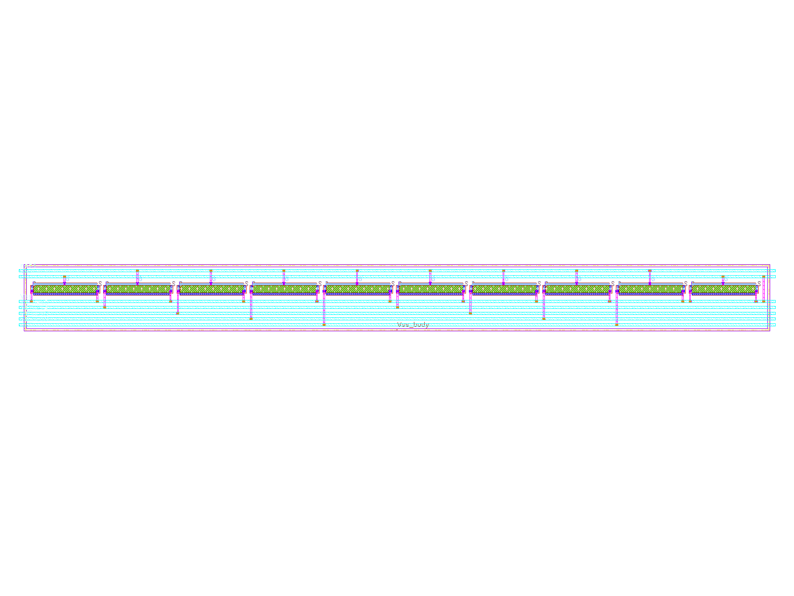<figcaption style="font-size:0.8em"><b>B13 mirror_XX1_M1_XX1_M2_XX1_M7_XX1_M9</b><br>XX1_M1, XX1_M2, XX1_M7, XX1_M9<br>variant interdigitated (area-only: centroid)</figcaption></figure><figure style="display:inline-block;width:31%;margin:4px;vertical-align:top;border-top:5px solid #eda100;">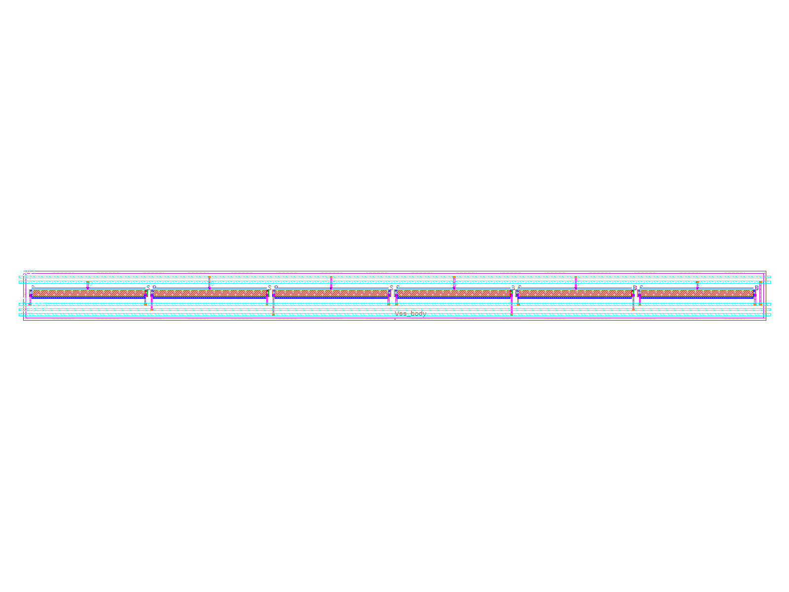<figcaption style="font-size:0.8em"><b>B14 mirror_XX1_M22_XX1_M15</b><br>XX1_M22, XX1_M15<br>variant ABBA (area-only: ABAB)</figcaption></figure><figure style="display:inline-block;width:31%;margin:4px;vertical-align:top;border-top:5px solid #eda100;">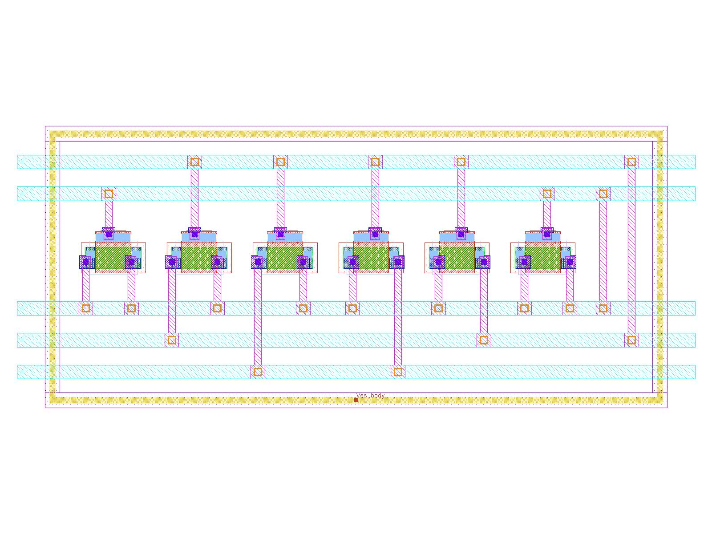<figcaption style="font-size:0.8em"><b>B15 nmos_current_mirror_2</b><br>XX1_M23, XX1_M24<br>variant ABBA</figcaption></figure><figure style="display:inline-block;width:31%;margin:4px;vertical-align:top;border-top:5px solid #eda100;">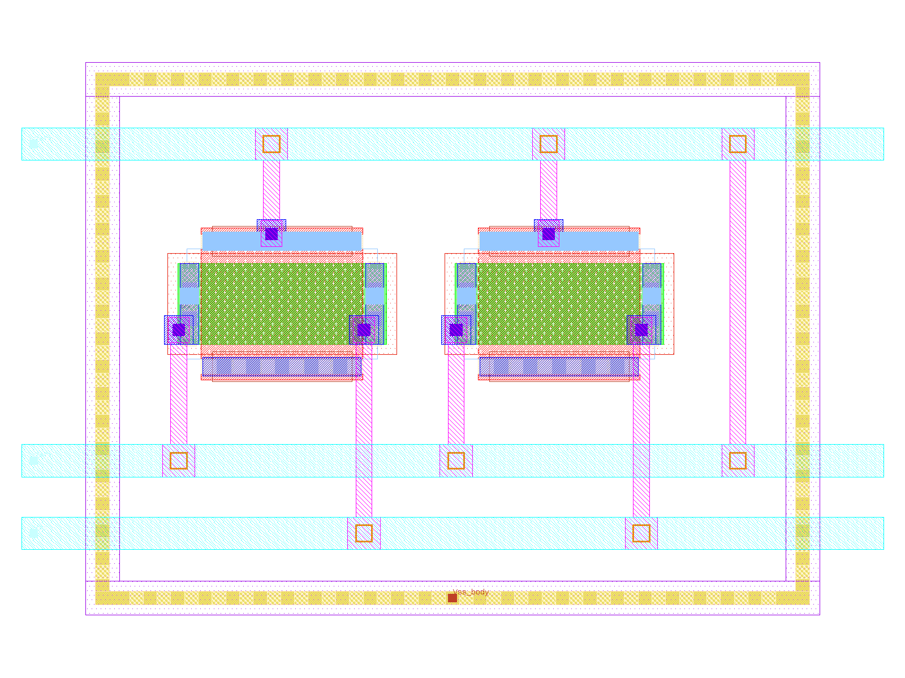<figcaption style="font-size:0.8em"><b>B16 nmos_current_mirror_4</b><br>XX1_M46<br>variant A</figcaption></figure><figure style="display:inline-block;width:31%;margin:4px;vertical-align:top;border-top:5px solid #eda100;">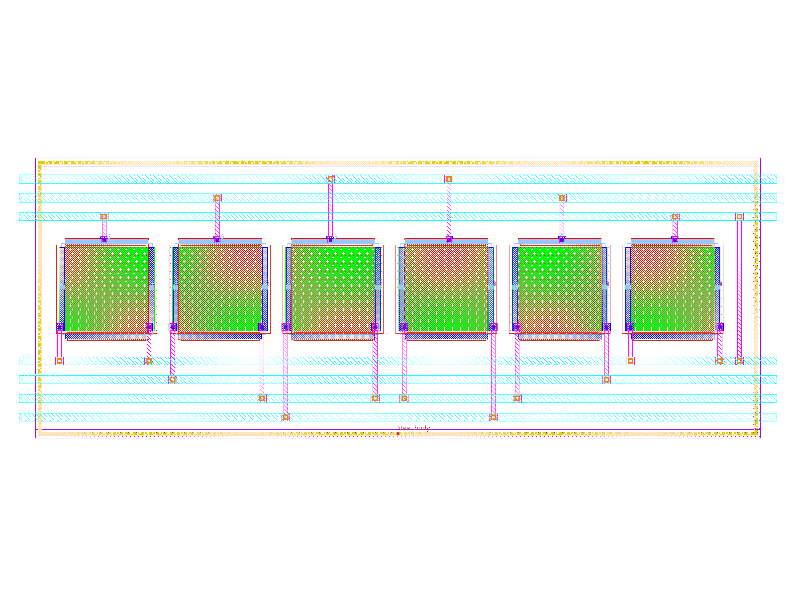<figcaption style="font-size:0.8em"><b>B17 nmos_differential_pair</b><br>XX1_M5, XX1_M6<br>variant ABBA (area-only: ABAB)</figcaption></figure><figure style="display:inline-block;width:31%;margin:4px;vertical-align:top;border-top:5px solid #eda100;">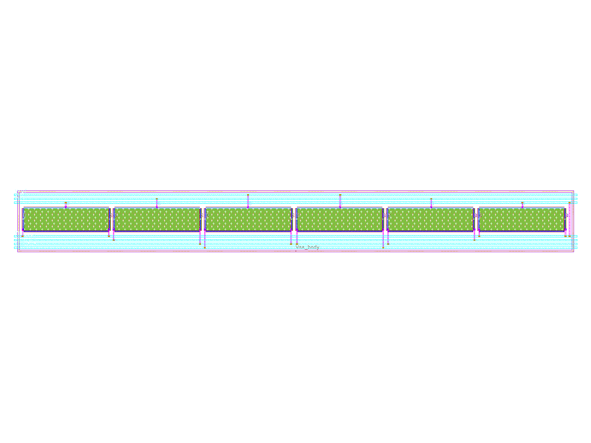<figcaption style="font-size:0.8em"><b>B18 nmos_differential_pair_2</b><br>XX1_M18, XX1_M16<br>variant ABBA (area-only: ABAB)</figcaption></figure><figure style="display:inline-block;width:31%;margin:4px;vertical-align:top;border-top:5px solid #eda100;"><figcaption style="font-size:0.8em"><b>B19 nmos_differential_pair_3</b><br>XX1_M10, XX1_M17<br>variant ABBA (area-only: ABAB)</figcaption></figure><figure style="display:inline-block;width:31%;margin:4px;vertical-align:top;border-top:5px solid #eda100;">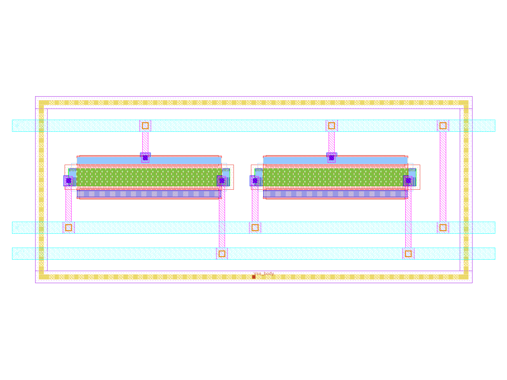<figcaption style="font-size:0.8em"><b>B20 nmos_diode_2</b><br>XX1_M47<br>variant A</figcaption></figure><figure style="display:inline-block;width:31%;margin:4px;vertical-align:top;border-top:5px solid #eda100;">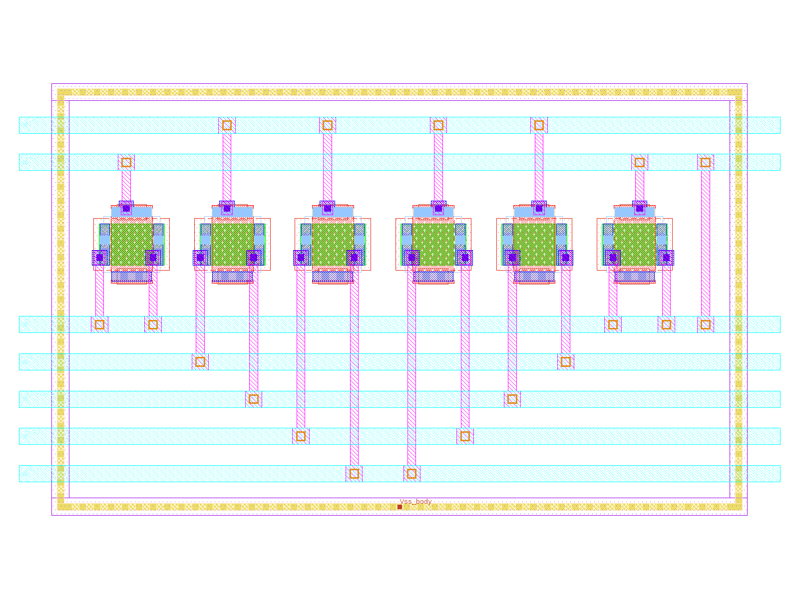<figcaption style="font-size:0.8em"><b>B21 nmos_matched_cascode_pair</b><br>XX1_M19, XX1_M4<br>variant ABBA</figcaption></figure><figure style="display:inline-block;width:31%;margin:4px;vertical-align:top;border-top:5px solid #eda100;"><figcaption style="font-size:0.8em"><b>B22 nmos_matched_cascode_pair_2</b><br>XX1_M3, XX1_M8<br>variant ABBA (area-only: ABAB)</figcaption></figure><figure style="display:inline-block;width:31%;margin:4px;vertical-align:top;border-top:5px solid #eda100;">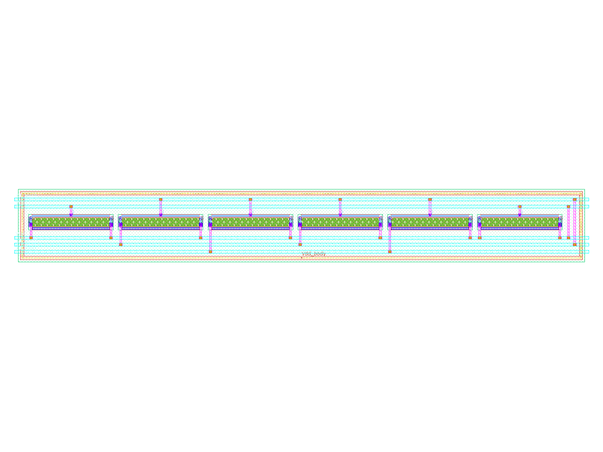<figcaption style="font-size:0.8em"><b>B23 pmos_current_mirror_load</b><br>XX1_M20, XX1_M21<br>variant ABAB</figcaption></figure><figure style="display:inline-block;width:31%;margin:4px;vertical-align:top;border-top:5px solid #eda100;">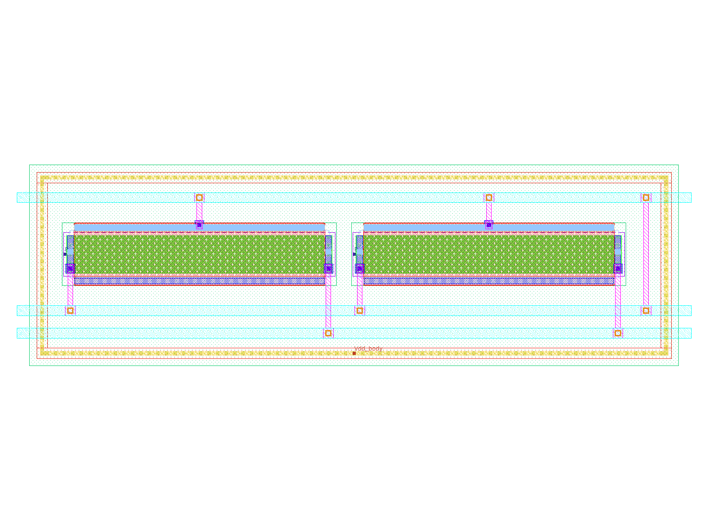<figcaption style="font-size:0.8em"><b>B24 pmos_diode_2</b><br>XX1_M25<br>variant A</figcaption></figure><figure style="display:inline-block;width:31%;margin:4px;vertical-align:top;border-top:5px solid #eda100;">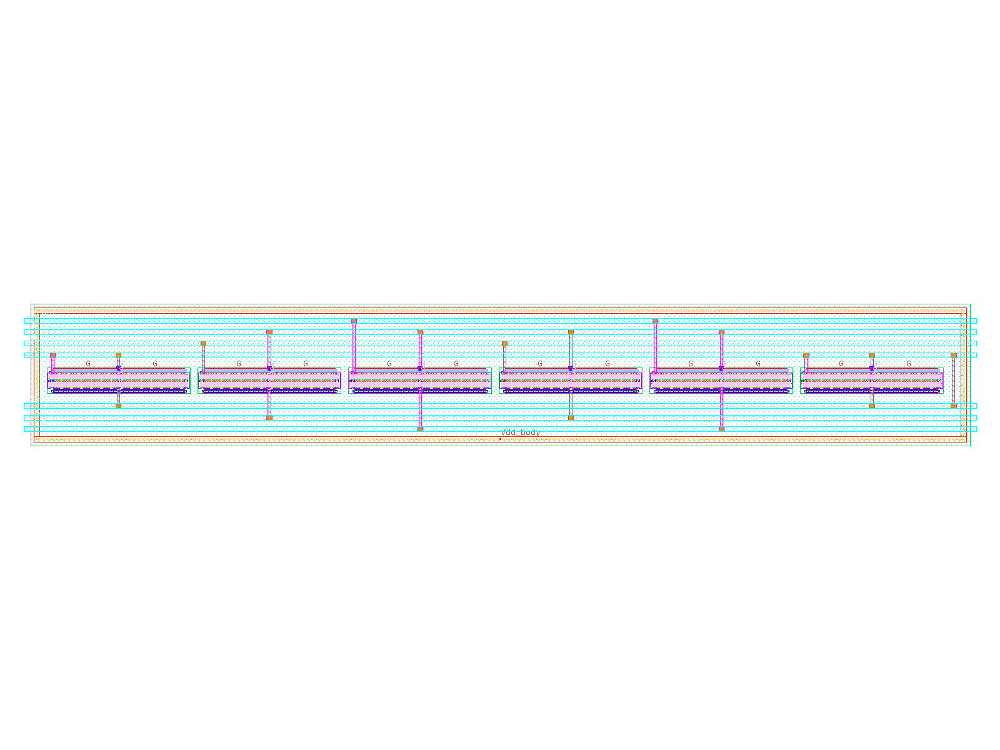<figcaption style="font-size:0.8em"><b>B25 pmos_matched_cascode_pair</b><br>XX1_M11, XX1_M12<br>variant ABAB</figcaption></figure><figure style="display:inline-block;width:31%;margin:4px;vertical-align:top;border-top:5px solid #eda100;">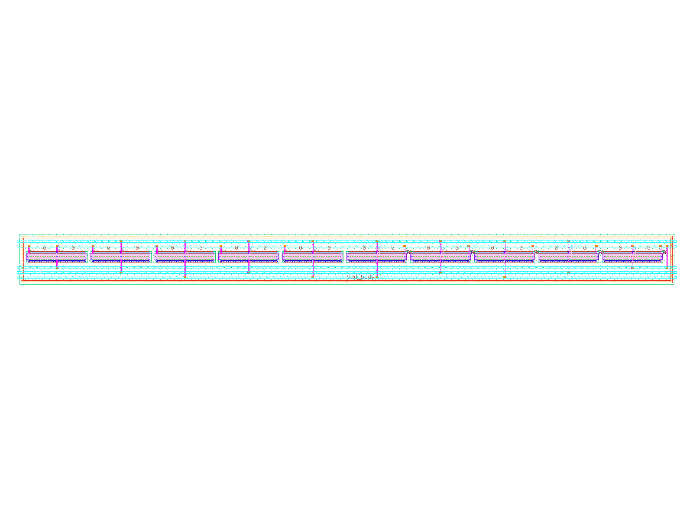<figcaption style="font-size:0.8em"><b>B26 pmos_matched_current_source_pair_4</b><br>XX1_M13, XX1_M14<br>variant ABBA (area-only: ABAB)</figcaption></figure><figure style="display:inline-block;width:31%;margin:4px;vertical-align:top;border-top:5px solid #6250d6;"><figcaption style="font-size:0.8em"><b>B27 nmos_current_mirror_3</b><br>XX2_M10, XX2_M11<br>variant ABBA (area-only: ABAB)</figcaption></figure><figure style="display:inline-block;width:31%;margin:4px;vertical-align:top;border-top:5px solid #6250d6;">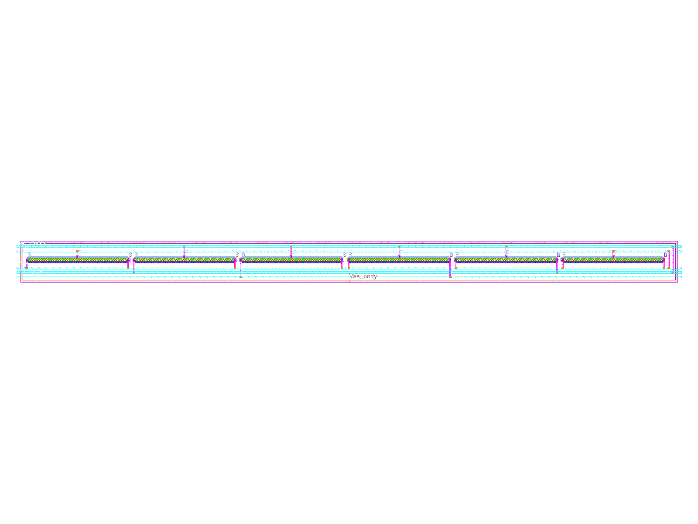<figcaption style="font-size:0.8em"><b>B28 nmos_current_mirror_load</b><br>XX2_M5, XX2_M6<br>variant ABBA</figcaption></figure><figure style="display:inline-block;width:31%;margin:4px;vertical-align:top;border-top:5px solid #6250d6;">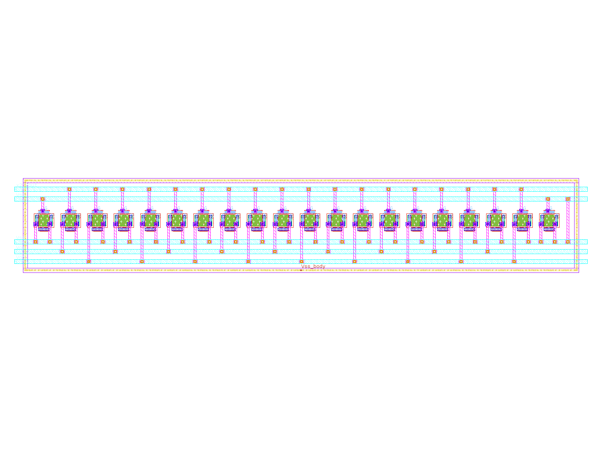<figcaption style="font-size:0.8em"><b>B29 nmos_matched_current_source_pair</b><br>XX2_M2, XX2_M1<br>variant ABAB</figcaption></figure><figure style="display:inline-block;width:31%;margin:4px;vertical-align:top;border-top:5px solid #6250d6;">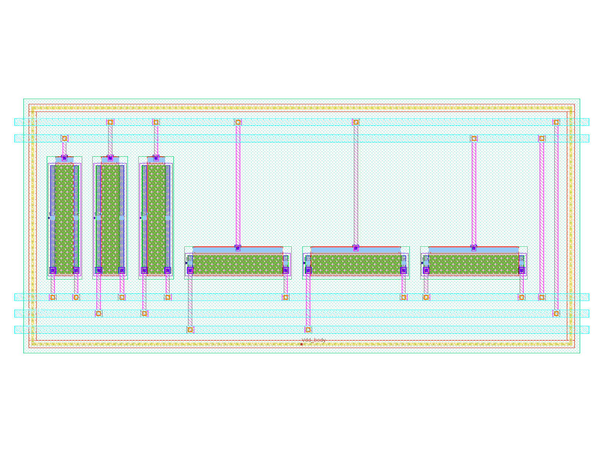<figcaption style="font-size:0.8em"><b>B30 pmos_current_mirror_2</b><br>XX2_M12, XX2_M3<br>variant row</figcaption></figure><figure style="display:inline-block;width:31%;margin:4px;vertical-align:top;border-top:5px solid #6250d6;">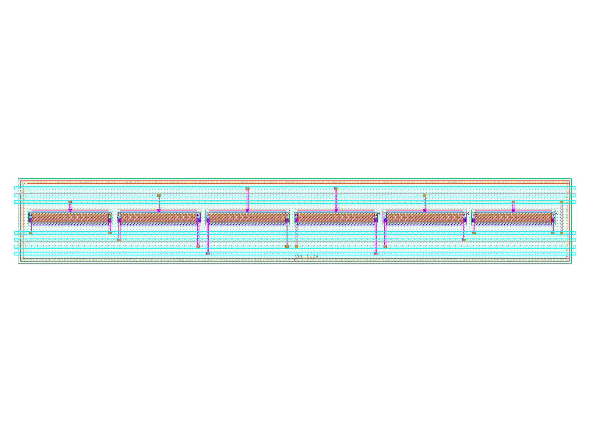<figcaption style="font-size:0.8em"><b>B31 pmos_differential_pair</b><br>XX2_M7, XX2_M8<br>variant ABBA</figcaption></figure><figure style="display:inline-block;width:31%;margin:4px;vertical-align:top;border-top:5px solid #6250d6;">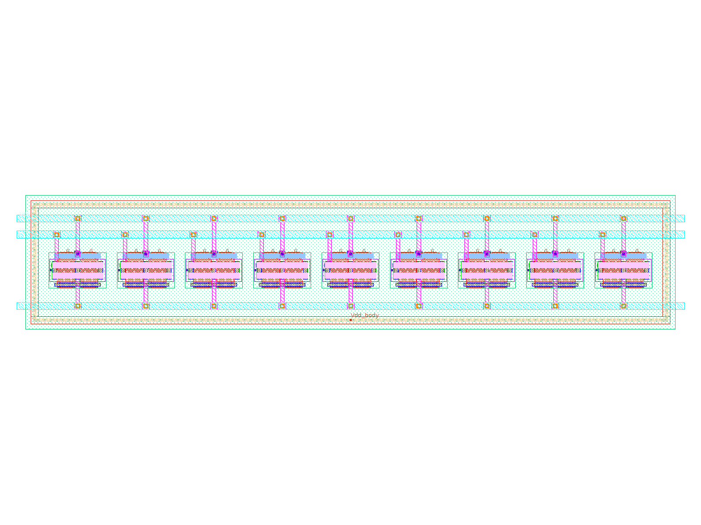<figcaption style="font-size:0.8em"><b>B32 pmos_single</b><br>XX2_M4<br>variant A</figcaption></figure><figure style="display:inline-block;width:31%;margin:4px;vertical-align:top;border-top:5px solid #6250d6;"><figcaption style="font-size:0.8em"><b>B33 pmos_single_2</b><br>XX2_M9<br>variant A</figcaption></figure></div>

## 6. The layouts (S5)

**Flow, budget-aware**

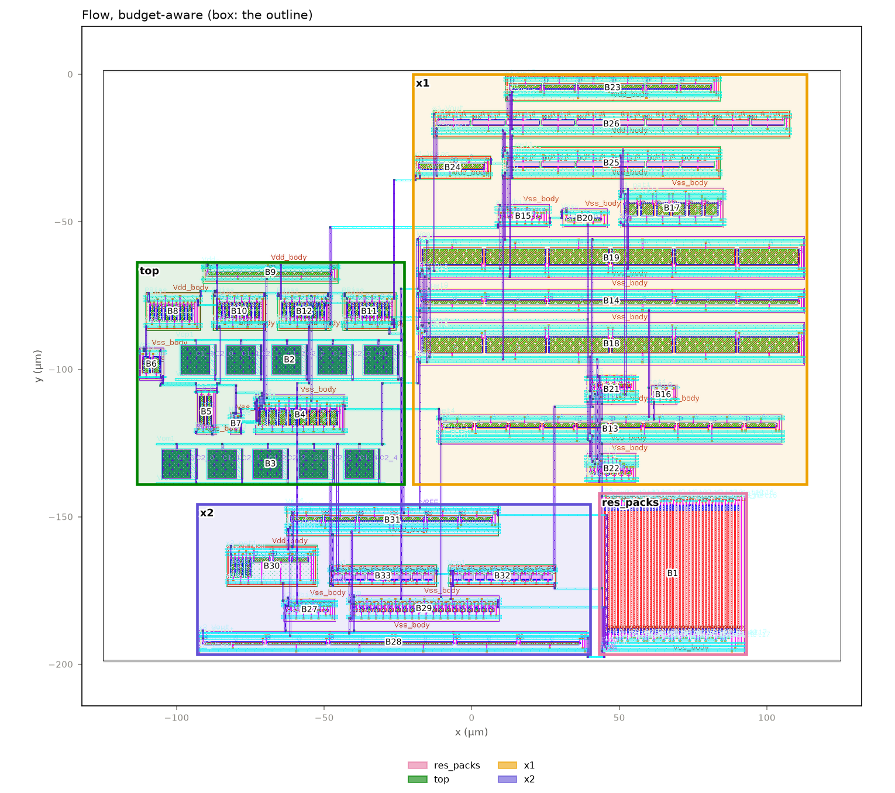

**Flow, area-only**

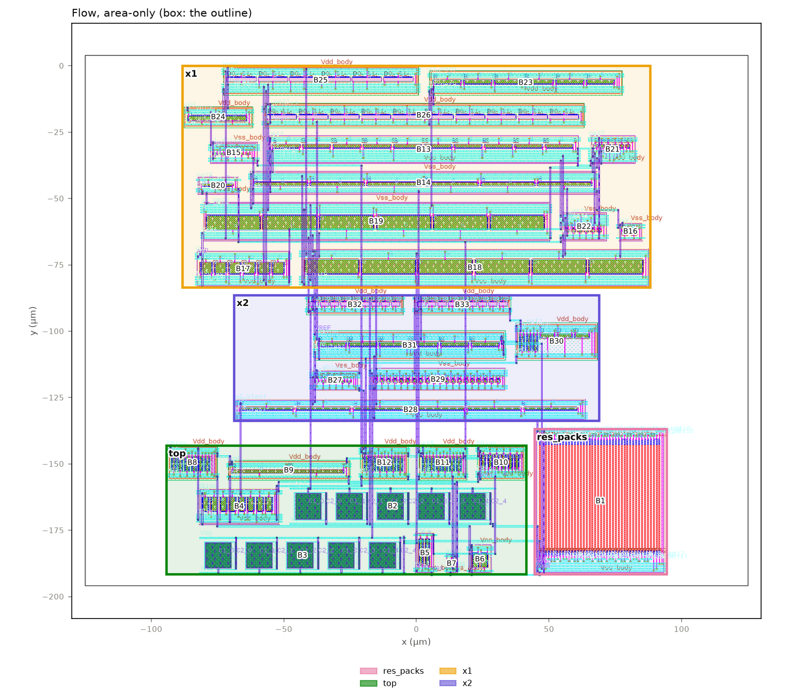

| | Budget-aware | Area-only |
|---|---|---|
| Size (µm) | 227.0 × 196.7 | 188.8 × 191.4 |
| Area (µm²) | 44,652 | 36,152 |
| DRC errors / LVS | 0 / match | 0 / match |
| Sum of wire-budget use (lower is better) | 119.3 | 199.0 |

> **How to read it.** Blocks are numbered as in section 5; coloured boxes are the sub-circuits. The budget-aware cost is A / A_ref + 10 × Σ max(0, u − 1) + 1 × Σ u (u: a net's length over its budget); the area-only cost is A / A_ref. Sub-circuits are placed by seeded annealing (40,000 moves, seed 20261104) or enumeration.

## 7. After layout (S6, S7)

The layout read back with its wiring (capacitance only) and simulated in the original benches.

| Spec | Limit | Schematic | Drawn devices | After layout, budget-aware | Use of allowance | After layout, area-only | Use of allowance |
|---|---|---|---|---|---|---|---|
| Phase margin (°) | ≥ 60 | 78.231 | 78.128 | 73.678 | 0.499 | 73.343 | 0.536 |
| DC gain (dB) | ≥ 97.401 | 98.392 | 98.252 | 98.252 | 0.28 | 98.252 | 0.28 |
| Unity-gain bandwidth (GBW) (MHz) | ≥ 1.8465 | 2.0517 | 2.0432 | 1.9216 | **1.27** | 1.9179 | **1.3** |
| Power (µW) | ≤ 497.18 | 451.98 | 456.27 | 456.27 | 0.19 | 456.27 | 0.19 |

> **How to read it.** Use of allowance = (schematic − after layout) / (η × margin); 1.0 is all the layout may take (bold: more).

**What it shows here:** every spec is met after layout; gbw_mhz lose more than the allowance.

**What it shows here:** with the MIM capacitors' own plate coupling cancelled (very likely counted twice by the extraction): gain_db uses 0.278, gbw_mhz uses 0.455, pm_deg uses 0.593.

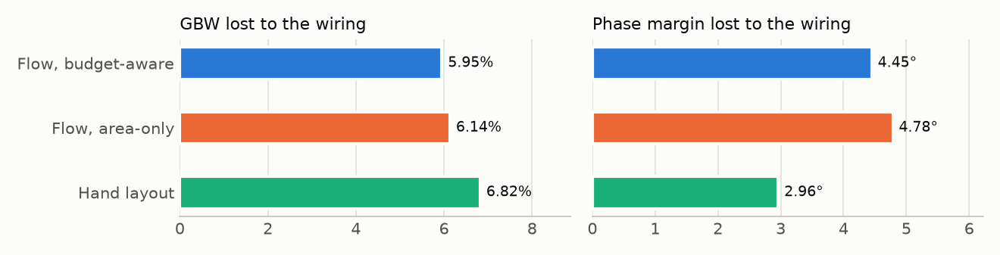


> **How to read it.** Each layout simulated with its drawn devices only and again with its wiring, by the same extraction and bench; the drop is what the wiring and placement cost. Shorter is better.

## 8. The hand-drawn reference layout

`circuits/ttsky25a_fd/upstream_src/gds/tt_um_diff.gds` (cell `tt_um_diff`), extracted and simulated the same way (C-only). LVS against this flow's schematic: no match (it is not exactly the same circuit; compare the wiring cost and area, not absolute numbers).

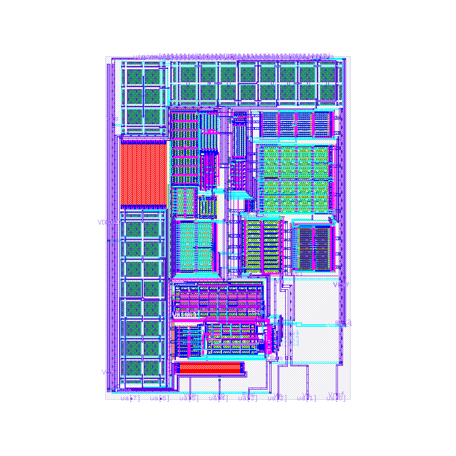

Its top cell measures 161.0 × 225.8 µm (36,349 µm², the whole cell, including anything beside the circuit itself).

## 9. What did not pass

- **S1 G1.2** (the exact linear model reproduces SPICE's gain, GBW and PM)
- **S3 G3.3** (the circuit with every chosen cell meets every spec in SPICE, saturated, within its allowance)
- **S3 G3.5** (no device type had to be relaxed (every type has an option within its allowance))
- **S5 G5.4** (G5.4 route rules)
- **S6 G6.2** (G6.2 parasitics within budgets)
- **S7 G7.2** (G7.2 loss within eta margin)

Explanations of each gate: `docs/s4_s7_walkthrough.html` (S4–S7) and `docs/s0_s3_walkthrough.html` (S0–S3).

## 10. The inputs used

```yaml
# Design package: TTSKY25a two-stage fully differential op-amp (the user's taped-out design).
# Generated inputs: circuits/ttsky25a_fd/ (scripts/make_ttsky25a_package.py, see its SOURCE.md).
design: ttsky25a_fd
description: >
  Two-stage fully differential op-amp, TTSKY25a tile tt_um_diff (NethmalWDI/Fully_differential_opamp):
  folded-cascode first stage, common-source second stage, a CMFB loop per stage, Miller MIM capacitors,
  beta-multiplier bias with start-up. Specs are an ASSUMPTION (config.yaml spec_notes).

netlist: circuits/ttsky25a_fd/source/ttsky25a_fd.spice
config: circuits/ttsky25a_fd/source/config.yaml
achieved: null                  # the designers' bench is re-run as a reference (G0.8); achieved = this flow's S0 run
reference: circuits/ttsky25a_fd/source/reference.json
testbenches:
  - circuits/ttsky25a_fd/testbenches/dido_amp_AC.spice
  - circuits/ttsky25a_fd/testbenches/dido_amp_OP.spice
  - circuits/ttsky25a_fd/testbenches/dido_amp_NOISE.spice
dut_subckt_in_testbench: ttsky25a_fd

upstream:
  netlist: circuits/ttsky25a_fd/source/ttsky25a_fd.spice
  hierarchy: circuits/ttsky25a_fd/upstream/hierarchy.json
  primitives: circuits/ttsky25a_fd/upstream/primitives.json          # PREDICTED (rule-based)
  equations: circuits/ttsky25a_fd/upstream/equations.predicted.json  # PREDICTED (textbook)
  name_map: circuits/ttsky25a_fd/upstream/name_map.yaml

bias_sources:                   # off-chip test elements kept for simulation, removed in the layout view
  Rgm_ext: RGM                  # 12 kohm bias resistor of the beta multiplier (off-chip in the tile)
  Vref_ext: VREF                # 0.9 V CM reference of both CMFB loops

ac_drive: {INP: 0.5, INN: -0.5}

operating_point: null
variation_ranges: null
conditions_override: {}
specs_from_achieved:            # ASSUMPTION (no specs upstream), see config.yaml spec_notes
  gain_db: {min_delta: -1.0}
  gbw_mhz: {min_factor: 0.9}
  power_uw: {max_factor: 1.1}
```

```yaml
# Layout options for S4-S7 (plan v4 Phase 8, docs/plan_v5_ttsky25a.md; Imasha's decisions of 2026-11-04).
# Read only by S4-S7 (the last two options by S6/S7): S0-S3 never read this file. A design without one keeps the plan v4 defaults (the 5T,
# LOADBench).
matching: centroid        # matched transistors only as common centroid (ABBA) or interdigitated rows; no plain AB
dummies: true             # one dummy unit at each end of every matched row (transistors and resistors)
pack_internal: true       # a net only one block uses gets a short track, packed in rows (left-edge)
resistor_blocks:          # matched resistor strings, interleaved A B B A ... in one block
  - name: res_packs
    members: [XX2_X1_R, XX2_X2_R]   # the two res_packs of x2 (CM sense, OUTP and OUTN sides)
    body: Vss                       # the block's tap ring and the resistor dummies' ends (ASSUMPTION)
outline_um: [250, 200]    # the hard outline, width x height (Imasha: 250 x 200 um; orientation ASSUMPTION)
hierarchy: upstream        # S5 places each sub-circuit of circuits/<d>/upstream/hierarchy.json as a macro, then the macros
rc_extraction: false      # S6 does no R+C extraction, S7 takes the C-only view as post-layout (flow record
                          # row 87: Magic's extresist ran past 2 GB on the supplies, and restricted to the signal
                          # nets left the ports unconnected); the hand layout was also measured C-only (7.7)
lvs_no_series: [sky130_fd_pr__res_generic_po]   # S6's flat LVS compares the res_pack resistors one by one (a flat
                          # extraction makes their labelled nodes ports, so Netgen cannot merge them in the layout)
```

## Glossary

- **GBW:** unity-gain bandwidth: where the gain falls to 1. Higher is faster.
- **Phase margin:** how far the amplifier is from oscillating in feedback; above about 60° is comfortable.
- **Margin, η, allowance:** margin = schematic value − spec limit; the layout may use η of it (the allowance).
- **DRC / LVS:** design-rule check (0 errors = manufacturable) / layout versus schematic ("match" = same circuit).
- **Extraction:** reading the layout back with its wires' capacitance (C-only) or also resistance (R+C).
- **Drawn devices:** the layout's transistors without any wiring; "drawn → extracted" is the wiring's cost.
- **Block / variant:** transistors drawn together as one piece (B1 …) / one way of drawing it (A B B A, A B A B …).
- **Budget-aware / area-only:** placement scored by area plus wire budgets (the flow's rule) / by area alone.
- **Gate:** an automatic pass/fail check at the end of a stage (G4.1, G5.4 …).

