# S0–S3 walkthrough: what each stage does and what it produced

Generated by `python3 scripts/make_s0s3_walkthrough.py` from the run's own output files (repo at 973661c5 2026-11-03). Every number below is read from `outputs/`. Typed by hand: the meaning of each gate, the explanation of each known finding, and the *How to read it* notes. The *What it shows here* lines and each design's summary are built from the numbers. The flow and its rules are described in `README.md` and `docs/flow_record.md` (section 7.13 for the current version, 7.14 for this review).

**The four stages:**

- **S0**: Ingest: reads the sized netlist and the package, freezes the sources by hash, builds the circuit IR (devices, nets, blocks), draws every device with the SKY130 PCell and signs it off (DRC, LVS), reproduces the testbenches, and simulates 45 PVT points and a mismatch Monte Carlo.
- **S1**: Electrical intent: extracts the operating point, builds the exact small-signal (linear) model and checks it against SPICE, computes how every net capacitance, coupling and terminal resistance moves gain, GBW, PM and noise (checked against SPICE finite differences), and finds the matching groups.
- **S2**: Budgets: shares a fraction eta of each spec margin between all layout parasitics (fF, Ω) by a joint max-min fair allocation, floors every budget at what the cheapest library cell already adds, verifies the budgets in SPICE, and scores five other budget rules on the same data.
- **S3**: Devices: builds a library of layout cells per device type (fingers, gate and diffusion options; each DRC/LVS-signed and extracted), picks for every type the smallest cell that stays within its S2 allowance, and simulates the whole circuit with all chosen cells.

**Status per design** (PASS: every gate passes; FAIL: a gate reports a finding, explained under the design; ERROR would be a crash):

| Design | S0 | S1 | S2 | S3 |
|---|---|---|---|---|
| example_ota_5t | PASS | PASS | PASS | PASS |
| loadbench_miller | FAIL | FAIL | PASS | FAIL |

## How to read this page

The tables and plots below carry two kinds of note. **How to read it** explains what a table or plot shows; it is the same for every design. **What it shows here** says what it shows for that design, built from its own numbers. The ideas they use:

- **Margin.** How far the schematic is from a spec: schematic − limit for a minimum spec (gain ≥ 30 dB), limit − schematic for a maximum spec (power ≤ 1000 µW). The layout's parasitic capacitance and resistance use up part of each margin.
- **eta and the allowance.** eta is the share of each margin the layout may use (each design's S2 section gives its value). eta × margin is the *allowance*, or *allowed use*; the rest is kept in reserve.
- **Expected need.** What a compact layout puts on each net or terminal anyway: the S3 library's cell for the device plus one short wire per pin. A budget below its expected need is one a real layout could not meet.
- **First order and SPICE.** *First order* is a prediction from S1's linear model (sensitivity × parasitic). It is fast, and S2 uses it to set the budgets. *SPICE* is the transistor-level simulation with the parasitics inserted, which is the check.
- **PASS, FAIL, ERROR.** PASS: every gate passed. FAIL: a gate reports a finding, but the stage finished and wrote its report; each one is explained under its design. ERROR means the stage crashed.
- **Negative control.** A deliberately broken copy, checked by the same tool, which must fail. It shows that the tool really ran.
- **PREDICTED and ASSUMPTION.** Labels on inputs the upstream stages did not give. Where a design's specs come from is listed under its S0 margins.

## example_ota_5t

Run: `./flow run example_ota_5t` (all four stages). Status, run time and the files of each stage:

| Stage | Status | Started | Run time | Steps |
|---|---|---|---|---|
| S0 | **PASS** | 2026-11-02T19:15:37 | 20.3 min | ingest, pcell_binding, pvt |
| S1 | **PASS** | 2026-11-02T19:35:54 | 0.3 min | run, symbolic_patch |
| S2 | **PASS** | 2026-11-02T19:36:13 | 8.2 min | cells, run |
| S3 | **PASS** | 2026-11-02T19:44:26 | 0.3 min | run |

**In short** (built from the reports):

- **Run:** all four stages ran without an ERROR; every gate passes.
- **Budgets (S2):** 21 parasitics at eta = 0.5; every budget is at least 3.73 × what a compact layout needs; in SPICE, with all of them in place at once, every check stays within its allowance (G2.5).
- **Devices (S3):** 3 device types; each has a cell within its allowance; device area 200.8 µm²; with every chosen cell the circuit meets every spec in SPICE (G3.3).

**Known findings** (failed gates and why; none is a crash):

- none: every gate passes.

### S0

Ingest: reads the sized netlist and the package, freezes the sources by hash, builds the circuit IR (devices, nets, blocks), draws every device with the SKY130 PCell and signs it off (DRC, LVS), reproduces the testbenches, and simulates 45 PVT points and a mismatch Monte Carlo.

Outputs: `outputs/S0/example_ota_5t/` (report: `s0_report.json`).

| Gate | Result | What it checks |
|---|---|---|
| G0.1 inventory | PASS | every element of the netlist is recognised (MOSFETs, sources, passives counted) |
| G0.2 validation | PASS | netlist and package are consistent (no undefined nodes, models or ports) |
| G0.3 hash freeze | PASS | the design sources match their frozen SHA-256 hashes |
| G0.4 name map | PASS | the upstream names map onto this netlist |
| G0.5 round trip lvs | PASS | the IR written back as SPICE is LVS-identical to the source netlist (Netgen) |
| G0.6 testbench reproduction | PASS | the testbenches run and reproduce the performance; the specs are fixed from it |
| G0.7 pcell binding drc lvs | PASS | each device, drawn by the SKY130 PCell at its exact size, passes Magic DRC and Netgen LVS (both with negative controls) |
| G0.9 pvt (info) | info | 45 PVT points (5 corners × 3 supplies × 3 temperatures) simulated |
| G0.10 mismatch mc (info) | info | mismatch Monte Carlo (200 runs) |

- **Netlist:** 5 MOSFETs, 1 source(s), 0 passive(s); 8 nets; 3 blocks.

| Block | Kind | Devices | Source |
|---|---|---|---|
| pmos_current_mirror_load | pmos-current-mirror-load | XM3, XM4 | name_map |
| nmos_differential_pair | nmos-differential-pair | XM1, XM2 | name_map |
| nmos_current_mirror_bias | nmos-current-mirror-bias | XM5 | name_map+manual |

**Testbench reproduction (G0.6):** the upstream testbenches re-run here, nominal corner (tolerance 0.1 %).

| Quantity | Upstream | This run | Within tolerance |
|---|---|---|---|
| gain_db | 31.697 | 31.697 | yes |
| gbw_mhz | 104.455 | 104.455 | yes |
| pm_deg | 80.9348 | 80.9348 | yes |
| isup_ua | 84.7774 | 84.7774 | yes |
| power_uw | 152.599 | 152.599 | yes |
| vout_v | 0.400774 | 0.400774 | yes |
| vnoise_nv_rthz | 339.064 | 339.064 | yes |
| vnoise_rms_uv_rms | 398.929 | 398.929 | yes |

**Specs and margins** (margin = how far the schematic is from the spec):

| Spec | Kind | Limit | Schematic | Margin |
|---|---|---|---|---|
| gain_db | min | 30 | 31.697 | 1.697 dB |
| gbw_mhz | min | 20 | 104.455 | 84.45 MHz |
| pm_deg | min | 60 | 80.9348 | 20.93 deg |
| power_uw | max | 1000 | 152.599 | 847.4 uW |
| vnoise_nv_rthz | max | 400 | 339.064 | 60.94 nV/sqrt(Hz) |

> **How to read it.** The margin is how far the schematic is from each spec. The layout's parasitics use up part of it; the smaller a margin, the less room the layout has on that spec.

**PCell binding (G0.7):** every device drawn by the SKY130 PCell at its exact size, then Magic DRC and Netgen LVS, each with a negative control that must fail.

| Device | DRC errors | DRC control caught | LVS | LVS control caught | Pass |
|---|---|---|---|---|---|
| XM3 | 0 | yes | match | yes | PASS |
| XM4 | 0 | yes | match | yes | PASS |
| XM1 | 0 | yes | match | yes | PASS |
| XM2 | 0 | yes | match | yes | PASS |
| XM5 | 0 | yes | match | yes | PASS |

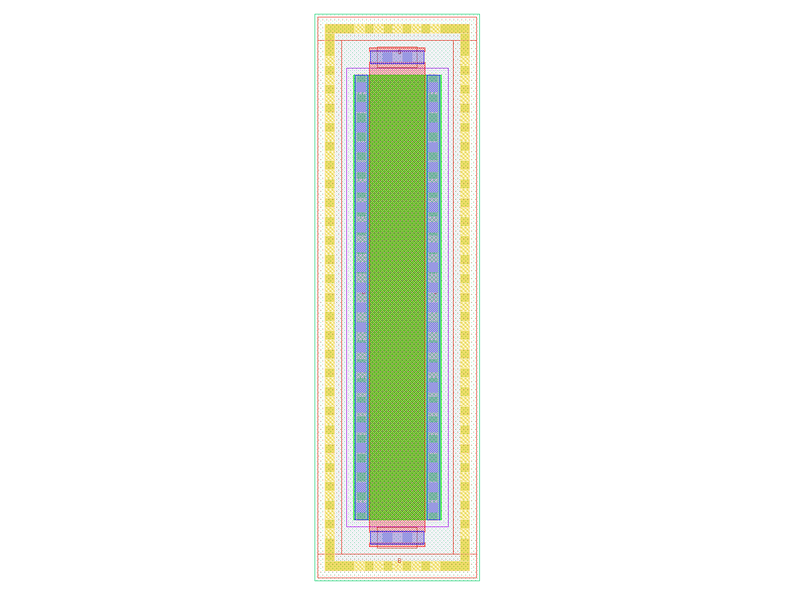  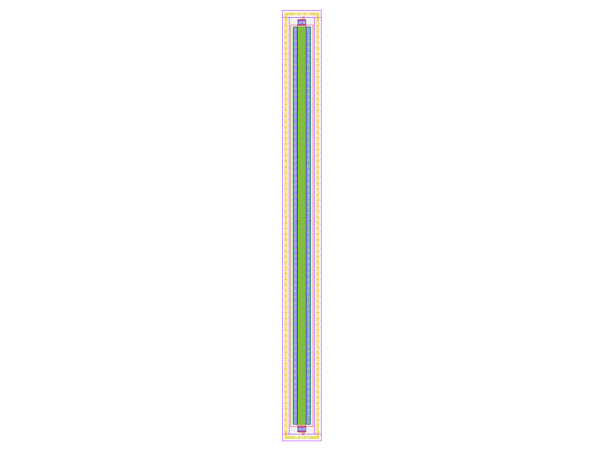

*PCells as drawn: XM3, XM4, XM1.*

> **How to read it.** Each transistor is drawn by the SKY130 PCell at exactly its netlist size (W, L, fingers) and checked on its own with Magic DRC and Netgen LVS. 'Control caught' means a deliberately broken copy was also checked and correctly failed, which shows the check really ran. In the pictures (KLayout, in the PDK's own colours): red is the polysilicon gate, blue the metal-1 on the source and drain contacts, the green outline the active (diffusion) area, and the yellow dotted frame the substrate or well tap.

**What it shows here:** 5 of 5 devices pass DRC and LVS, each with both controls caught.

**PVT (G0.9):** 45 points; the schematic meets every spec at 25 of them.

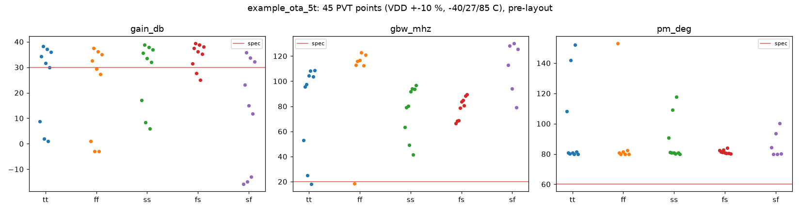

*Specs at the 45 PVT points.*

> **How to read it.** 45 simulations of the schematic before layout: 5 process corners on the x-axis (tt typical, ff and ss fast and slow, fs and sf fast NMOS with slow PMOS and the reverse) × supply 0.9, 1.0 and 1.1 × VDD × −40, 27 and 85 °C, so 9 dots per corner. The red line is the spec. Where the circuit collapses, the other specs can show meaningless values (e.g. a large PM where the gain barely reaches 0 dB). This is reported, not gated: S2 sets the budgets at the nominal corner and reports in G2.9 what they would use at these points.

**What it shows here:** gain_db misses at 20 of 45 points, at 0.9 and 1 × VDD (worst sf_v0.9_t-40, margin -45.9); gbw_mhz misses at 2 of 45 points, at 0.9 × VDD (worst tt_v0.9_t85, margin -2.07); pm_deg is met at every point (smallest margin 19.8, at ff_v1.1_t27); power_uw is met at every point (smallest margin 751, at sf_v1.1_t85); vnoise_nv_rthz misses at 8 of 45 points, at 0.9 × VDD (worst sf_v0.9_t-40, margin -1.16e+03).

**Mismatch Monte Carlo (G0.10):** gain_db 31.18 ± 3.5 (n = 200); gbw_mhz 104.3 ± 0.92 (n = 200); pm_deg 81.16 ± 0.76 (n = 200); offset_v -0.007044 ± 0.0017 (n = 200).

> **How to read it.** The same circuit simulated many times with random transistor mismatch (SKY130's mismatch models): the mean ± one standard deviation of each result. offset_v is the circuit's offset voltage.

### S1

Electrical intent: extracts the operating point, builds the exact small-signal (linear) model and checks it against SPICE, computes how every net capacitance, coupling and terminal resistance moves gain, GBW, PM and noise (checked against SPICE finite differences), and finds the matching groups.

Outputs: `outputs/S1/example_ota_5t/` (report: `s1_report.json`).

| Gate | Result | What it checks |
|---|---|---|
| G1.1 operating point | PASS | operating point: functional devices saturated, supply current reproduced, charge conservation |
| G1.2 linear model vs spice | PASS | the exact linear model reproduces SPICE's gain, GBW and PM |
| G1.3 sensitivity vs spice | PASS | capacitance sensitivities of the linear model agree with SPICE finite differences |
| G1.4 matching groups | PASS | matching groups (differential pair, mirrors) are present and consistent |
| G1.5 symbolic vs spice (reported, not gated) | info | hand (symbolic) model against SPICE: reported, not gated |
| G1.6 resistance sensitivity vs spice | PASS | resistance sensitivities agree with SPICE (small-signal, or a confirmed bias shift) |

- **Operating point (G1.1):** supply current 84.78 µA (testbench 84.78 µA); devices not saturated: none; smallest vds − vdsat: XM5 0.0196 V.

> **How to read it.** Vds − vdsat is each transistor's distance from the edge of saturation. The smallest one belongs to the transistor that leaves saturation first when layout resistance shifts its voltages; S2 budgets that headroom as a check of its own (sat_<device>).

**Linear model against SPICE (G1.2):**

| | gain (dB) | GBW (MHz) | PM (deg) |
|---|---|---|---|
| linear model | 31.6929 | 105.007 | 80.9457 |
| SPICE | 31.697 | 104.455 | 80.9348 |
| difference | -0.0041 dB | 0.53 % | 0.011 deg |

> **How to read it.** S1 builds an exact small-signal model of the circuit at its operating point and checks it against transistor-level SPICE. When the two agree, S1 can compute every sensitivity from the model, quickly, instead of running SPICE once per parasitic.

- **Sensitivities checked against SPICE:** capacitance (G1.3) 18 of 18 checks pass; resistance (G1.6) 27 of 27.

**The most critical capacitances** (fF that alone would use the whole margin; smallest first):

| Net or coupling | Spec | fF to use the margin | Change per fF |
|---|---|---|---|
| `OUTP~net3` | pm_deg | 178 | -0.118 |
| `net3~INP` | pm_deg | 240 | -0.0873 |
| `net1~net3` | pm_deg | 281 | -0.0744 |
| `net3` | pm_deg | 329 | -0.0637 |
| `OUTP~net3` | gbw_mhz | 340 | -0.248 |
| `net3~INN` | pm_deg | 521 | -0.0402 |
| `OUTP~INP` | gbw_mhz | 817 | -0.103 |
| `OUTP` | gbw_mhz | 892 | -0.0947 |

> **How to read it.** Capacitance on one net, or between two nets ('A~B', a coupling), changes a spec by 'change per fF'. 'fF to use the margin' is margin ÷ change: the capacitance that would use up the whole margin on its own. The smallest numbers mark the nets the layout must keep short and apart.

**What it shows here:** `OUTP~net3` leaves the least room: 178 fF there alone would use the whole pm_deg margin.

**Matching groups (G1.4):** mirror: XM3, XM4; diff pair: XM1, XM2.

**Hand model against SPICE (G1.5, report only):**

| Model | gain (dB) | GBW (MHz) | PM (deg) |
|---|---|---|---|
| original | 31.36 | 108.4 | 91.34 |
| P1 | 31.36 | 104.4 | 82.84 |
| P2 | 31.36 | 104 | 80.23 |
| SPICE | 31.7 | 104.5 | 80.93 |

> **How to read it.** Textbook hand equations for the circuit (the 'original' row; PREDICTED when the upstream stage did not give them) against SPICE. Each further row adds one effect the hand model missed. Reported, not gated: the flow itself uses the exact model, and this table shows why.

**What it shows here:** the original hand model is +10.4 deg off SPICE in PM; with P2 it is -0.7 deg.

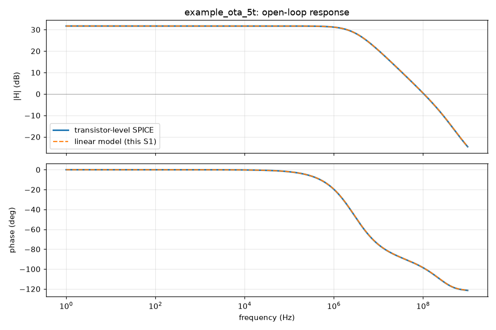

*Open-loop response: linear model against SPICE.*

> **How to read it.** Open-loop gain (top) and phase (bottom) against frequency. Solid: transistor-level SPICE; dashed: S1's linear model. Lines lying on top of each other mean the model can stand in for SPICE (G1.2).

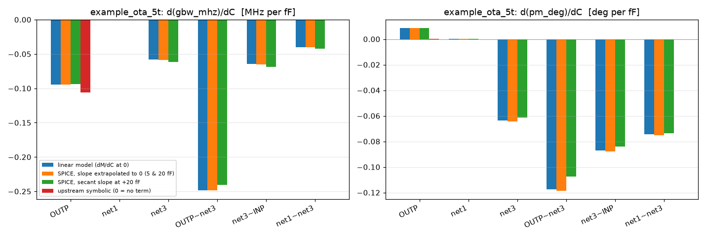

*Sensitivities: linear model against SPICE finite differences.*

> **How to read it.** For each net or coupling, how much GBW (MHz per fF, left) and PM (degrees per fF, right) change when capacitance is added there. Blue: the linear model; orange and green: SPICE, measured two ways; red: the hand equations (no red bar: they have no term for that capacitance). Bars of one group that agree mean the model's sensitivities can be trusted (G1.3). Negative bars hurt the spec, positive bars help it.

**What it shows here:** GBW falls fastest with capacitance on `OUTP~net3` (-0.25 MHz per fF); capacitance on `net1~INN` raises GBW (0.0068 MHz per fF); PM falls fastest with capacitance on `OUTP~net3` (-0.12 deg per fF); capacitance on `OUTP~INP` raises PM (0.037 deg per fF).

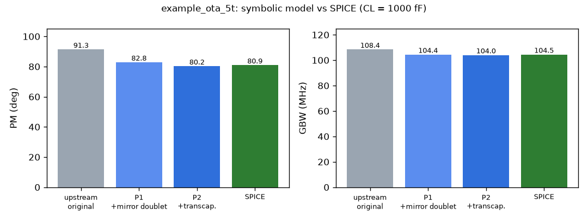

*Hand model against SPICE: the table above as bars (grey: original; blue: with the missing effects; green: SPICE).*

### S2

Budgets: shares a fraction eta of each spec margin between all layout parasitics (fF, Ω) by a joint max-min fair allocation, floors every budget at what the cheapest library cell already adds, verifies the budgets in SPICE, and scores five other budget rules on the same data.

Outputs: `outputs/S2/example_ota_5t/` (report: `s2_report.json`).

| Gate | Result | What it checks |
|---|---|---|
| G2.9 pvt constraints (info) | info | use of each PVT point's margin by the final budgets, first order (reported) |
| G2.0 expected layout use (info) | info | share of each margin a compact layout would use (expected need), before any budget |
| G2.7 library floors feasible | PASS | the S3 library's cheapest cells fit inside the budgets (library floors) |
| G2.3 allocation | PASS | the joint allocation (max-min fair + refinement) is feasible and reproducible |
| G2.5 spice budget verification | PASS | SPICE verification: each check with all its harmful budgets inserted stays within eta × margin |
| G2.8 baselines (info) | info | five other budget rules scored on the same sensitivities (reported) |
| G2.10 model agreement (info) | info | first order against SPICE for every simulated check (reported) |
| G2.4 linear all budgets at once | info | first-order use against the linear model with all budgets inserted (reported) |
| G2.6 hierarchy sums | PASS | block-level shares add up to the budgets |
| G2.1 names resolve | PASS | every rule names a net, device or terminal that exists |
| G2.2 units and provenance | PASS | every rule has units and provenance |

- **eta = 0.5**: layout may use 50 % of each margin. Budgets are set at the nominal corner; round-1 t (budget / expected need of the tightest elements) = 3.93.

**Expected layout use (G2.0):** the share of each margin a compact layout would use (above eta, the budgets fall below the expected need).

| Check | Share of margin |
|---|---|
| gain_db | 0.0857 |
| gbw_mhz | 0.0536 |
| pm_deg | 0.0747 |
| vnoise_nv_rthz | 0.0131 |
| sat_XM3 | 0.00191 |
| sat_XM4 | 0.00191 |
| sat_XM1 | 0.0202 |
| sat_XM2 | 0.0202 |
| sat_XM5 | 0.127 |

> **How to read it.** Before any budget is set: the share of each margin that a compact layout would use, with every net and terminal at its expected need. Above eta, the layout cannot fit within that allowance, so the budgets of the parasitics that affect it must fall below their expected need.

**What it shows here:** every share is below eta = 0.5: a compact layout fits inside every allowance, with room.

**Budgets** (21 elements; the 10 tightest relative to their expected need):

| Element | Kind | Expected need | Budget | Budget / need | Binding check |
|---|---|---|---|---|---|
| `XM5.d` | terminal resistance | 20.1 ohm | 74.9 ohm | 3.73 | sat_XM5 |
| `XM3+XM4.s` | terminal resistance | 33.2 ohm | 132 ohm | 3.97 | sat_XM5 |
| `XM1+XM2.s` | terminal resistance | 20.7 ohm | 86.7 ohm | 4.2 | sat_XM5 |
| `XM1+XM2.g` | terminal resistance | 286 ohm | 1.82e+03 ohm | 6.36 | pm_deg |
| `net3` | net capacitance | 6.97 fF | 44.3 fF | 6.36 | pm_deg |
| `OUTP~net3` | coupling | 0.727 fF | 5.14 fF | 7.06 | pm_deg |
| `net1~net3` | coupling | 1.06 fF | 8.12 fF | 7.63 | pm_deg |
| `XM1+XM2.d` | terminal resistance | 20.7 ohm | 160 ohm | 7.73 | sat_XM5 |
| `XM3+XM4.d` | terminal resistance | 33.2 ohm | 299 ohm | 9.02 | pm_deg |
| `OUTP~net1` | coupling | 0.879 fF | 8.79 fF | 10 | cap_kappa |

> **How to read it.** A budget is the most parasitic capacitance (fF) or series resistance (Ω) the layout may put on one net, coupling or transistor terminal. 'Expected need' is what a compact layout puts there anyway. Budget / need above 1 leaves the layout room; below 1 asks for less than a compact layout gives. 'Binding check' is the spec or saturation check that stopped the budget from growing.

**What it shows here:** every budget is at least 3.73 × its expected need (the tightest is `XM5.d`).

**SPICE verification (G2.5,** 2 iteration(s)**):** for each check, every harmful budget inserted at once in the transistor-level circuit.

| Check | Allowed use | First order | SPICE | Within |
|---|---|---|---|---|
| gain_db | 0.848 | 0.902 × | 0.972 × | yes |
| gbw_mhz | 42.2 | 0.722 × | 0.587 × | yes |
| pm_deg | 10.5 | 1 × | 0.825 × | yes |
| vnoise_nv_rthz | 30.5 | 0.176 × | 0.151 × | yes |
| sat_XM3 | 0.524 | 0.0345 × | 0.0299 × | yes |
| sat_XM4 | 0.524 | 0.0345 × | 0.0299 × | yes |
| sat_XM1 | 0.065 | 0.211 × | 0.21 × | yes |
| sat_XM2 | 0.065 | 0.211 × | 0.21 × | yes |
| sat_XM5 | 0.00978 | 0.997 × | 0.983 × | yes |

*Within: SPICE use at most 1.02 × the allowed use (`TOL_USE` = 0.02, `src/common/tolerance.py`; PREREG amendment of 2026-11-01).*

> **How to read it.** Every budget that hurts a check is inserted at once into the transistor-level circuit, and SPICE measures how much of the allowance (eta × margin) that check then uses: 1 × is the whole allowance. 'First order' is the prediction S2 made. A check is a spec or the saturation headroom of one transistor (sat_<device>).

**What it shows here:** with all the budgets in place at once, SPICE uses at most 0.983 × the allowance (on sat_XM5); every check is within it.

*Closure step: XM1+XM2.d, XM3+XM4.d, XM3+XM4.s scaled down so that SPICE stays within the allowance.*

**Other budget rules on the same data (G2.8):** outcome over every simulated check (nominal and each rule's most-used PVT points), and at the nominal corner alone.

| Rule | Outcome | Nominal only | Worst SPICE use of allowed | Budget / need (min) |
|---|---|---|---|---|
| per_net | unsafe | unsafe | 1.84 | 6.06 |
| equal | unsafe | ok | 2.76 | 0.942 |
| lp_sum | unsafe | unsafe | 1.09 | 0.748 |
| lp_floor | ok | ok | 0.254 | 1 |
| lp_floor_k | unsafe | unsafe | 1.09 | 0.748 |
| ours | unsafe | unsafe | 1.09 | 3.73 |

> **How to read it.** Six ways to share the same margins among the same parasitics, scored the same way. per_net: each parasitic may use the whole allowance on its own, as if no other existed. equal: an equal share for every parasitic that affects a check. lp_sum: a linear program that maximises the total budget. lp_floor and lp_floor_k: the same with the library's minimum cells, capped at 1 × and 10 × need. ours: S2's joint max-min fair sharing. Outcome: 'unsafe' = in SPICE a spec is missed or more than the allowance is used (beyond 2 %); 'infeasible' = some budget is below what the cheapest library cell already adds; 'ok' = neither.

**What it shows here:** at the nominal corner, unsafe: per_net, lp_sum, lp_floor_k, ours; ok: equal, lp_floor.

*G2.8 scores every rule before G2.5's closure step, which is fair to all of them, so 'ours' here is the allocation before the closure. The budgets S2 hands to S3 are the closed ones that pass G2.5 above (flow record 7.13). The budgets are set at the nominal corner, so a rule can be ok there and unsafe at a PVT point (G2.9 below).*

**PVT points (G2.9, reported):** worst first-order use 6.34 × at gbw_mhz tt_v0.9_t27; 16 point-spec checks above 1.

> **How to read it.** First-order use of each PVT point's allowance by the final budgets, which are set at the nominal corner. Above 1, the budgets would use more than that point's allowance. Where a point's margin is nearly zero, any use divided by it gives a very large number.

**First order against SPICE (G2.10):** 126 checks compared, 18 flagged (sign disagreement, or a difference above 0.25 of the margin).

> **How to read it.** How often S1's first-order prediction and SPICE disagree, over every check S2 simulated.

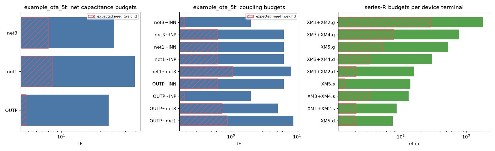

*Budgets against expected need.*

> **How to read it.** One bar per parasitic, on a log scale: capacitance on each net (left) and between nets (middle), in fF, and series resistance at each transistor terminal (right), in Ω. The bar is the budget; the red hatched box is the expected need. A bar longer than its box leaves the layout room; a shorter one is a budget below what a compact layout needs.

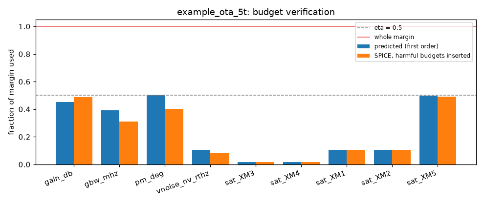

*SPICE verification.*

> **How to read it.** The G2.5 table as bars, as a fraction of the whole margin. Blue: predicted; orange: SPICE with all budgets inserted. The dashed line is eta (the allowance); the red line is the whole margin. Orange at or under the dashed line means the budgets are safe all together.

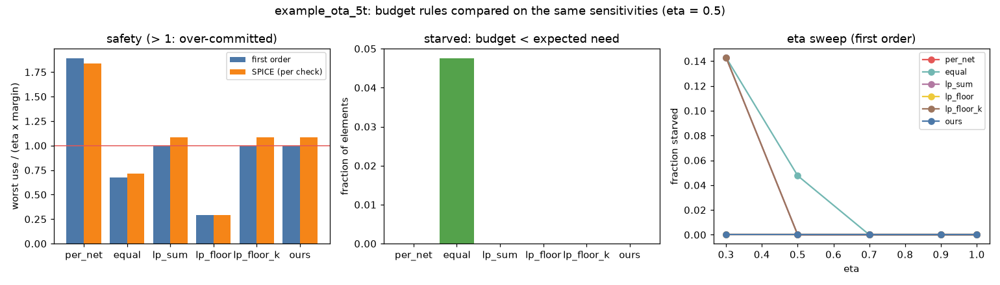

*The six budget rules.*

> **How to read it.** The G2.8 table as bars. Left: the worst use ÷ allowance, first order (blue) and SPICE (orange); above 1 is over-committed. Middle: the share of parasitics whose budget is below its expected need ('starved'). Right: that share at other values of eta.

### S3

Devices: builds a library of layout cells per device type (fingers, gate and diffusion options; each DRC/LVS-signed and extracted), picks for every type the smallest cell that stays within its S2 allowance, and simulates the whole circuit with all chosen cells.

Outputs: `outputs/S3/example_ota_5t/` (report: `s3_report.json`).

| Gate | Result | What it checks |
|---|---|---|
| G3.4 option table complete | PASS | every option of the library was built and signed off |
| G3.7 modes (info) | info | option modes (reported) |
| G3.3 all chosen devices in circuit | PASS | the circuit with every chosen cell meets every spec in SPICE, saturated, within its allowance |
| G3.1 chosen DRC | PASS | the chosen cells are DRC-clean (Magic) |
| G3.2 chosen LVS W L nf | PASS | the chosen cells are LVS-correct for W, L and nf (Netgen) |
| G3.5 no relaxation | PASS | no device type had to be relaxed (every type has an option within its allowance) |
| G3.6 model has no gate resistance | PASS | the transistor model has no gate resistance, so S3 adds the cells' own |

**Chosen cells** (3 device types; 84 options built and signed off):

| Device type | Devices | Chosen option | Area (µm²) | Relaxed | Why |
|---|---|---|---|---|---|
| `pfet_01v8_W8_L1_m1` | XM3, XM4 | `nf1_gtop_sdfull` | 29.13 | no | smallest area among the 4 of 4 options that stay within the allowance |
| `nfet_01v8_W24_L0p5_m1` | XM1, XM2 | `nf2_gtop_sdfull_outS` | 42.95 | no | smallest area among the 12 of 12 options that stay within the allowance |
| `nfet_01v8_W24_L1_m1` | XM5 | `nf2_gtop_sdfull_outD` | 56.63 | no | smallest area among the 10 of 12 options that stay within the allowance |

Total device area (every device counted): 200.8 µm².

> **How to read it.** S3 builds many layout cells for each device type and keeps the smallest one that stays within its S2 allowance; when none does, it keeps the least-bad one and flags the type (Relaxed = yes, G3.5). The option name says how the cell is built: nf<N> = N fingers; gtop or gboth = the gate contacted at the top only or at both ends (both ends lowers the gate resistance); sdfull or sdhalf = full or half contact coverage on source and drain; outS or outD = source or drain on the outer strips.

**What it shows here:** 3 of 3 device types have a cell within their allowance.

**Option modes (G3.7, reported):** S3 decides in its main mode, A-bin; the others are reported for comparison (B: nf as in the netlist; A-bin: each finger stays in the sized device's SKY130 model bin; A-free: no bin restriction; RoT: a rule-of-thumb folding baseline).

| Mode | Total area (µm²) | Relaxed types | Types with fingers outside the sized bin |
|---|---|---|---|
| B | 254.5 | 0 | 0 |
| **A-bin** (main) | 200.8 | 0 | 0 |
| A-free | 187.2 | 0 | 2 |
| RoT | 190.5 | 2 | 3 |

**The circuit with every chosen cell, in SPICE (G3.3):**

| Spec | Schematic | With the chosen cells | Meets the spec |
|---|---|---|---|
| gain_db | 31.697 | 31.8685 | yes |
| gbw_mhz | 104.455 | 102.953 | yes |
| pm_deg | 80.9348 | 79.9497 | yes |
| power_uw | 152.599 | 150.285 | yes |
| vnoise_nv_rthz | 339.064 | 339.775 | yes |

> **How to read it.** The final check of S0–S3: the whole circuit simulated with every chosen cell in place (its own extracted capacitance and contact resistance), against each spec, next to the schematic's value.

**What it shows here:** with every chosen cell in place, the circuit meets all 5 specs in SPICE.

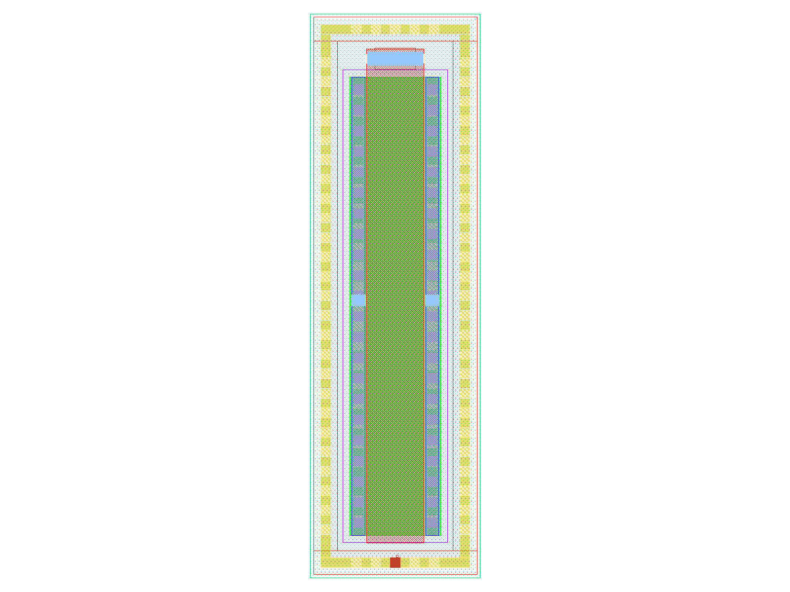 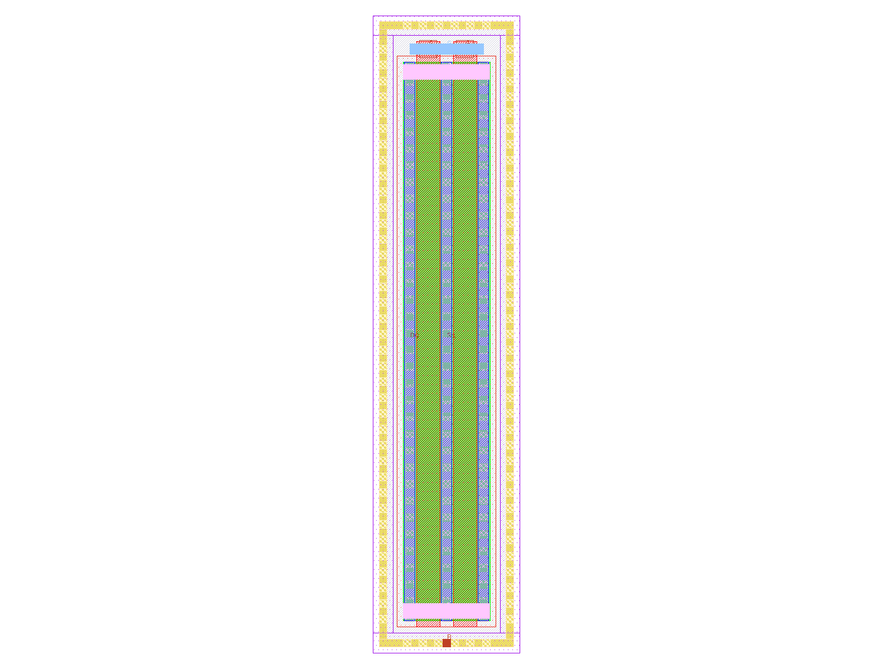 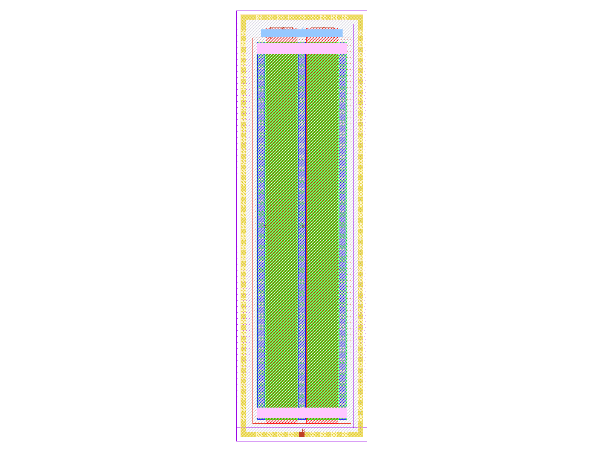

*Chosen cells (DRC- and LVS-signed, G3.1 and G3.2).*

> **How to read it.** The cells S3 chose, in the same colours as the S0 pictures. Each red stripe is one gate finger; the magenta bars at the top and bottom are metal-2 straps that join all the sources and all the drains (one bar per terminal). Unlike S0's bare PCells, these are complete cells, DRC-clean and LVS-checked for W, L and the number of fingers.

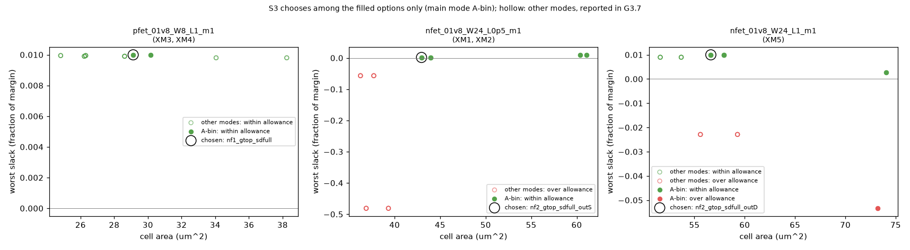

*Every option built per device type: area against worst slack.*

> **How to read it.** One dot per cell built for that device type. x: cell area; y: the worst slack, i.e. the room left on the tightest check (a spec effect or a terminal resistance) as a fraction of the margin. Above 0 the cell fits its allowance (green), below 0 it does not (red). Filled dots are the options of S3's main mode, which it chooses from: the smallest that fits, or the least-bad when none fits. Hollow dots are the other modes' options, reported in G3.7 but never chosen here, so a smaller green option that was not taken is hollow. The circle marks the choice.

## loadbench_miller

Run: `./flow run loadbench_miller` (all four stages). Status, run time and the files of each stage:

| Stage | Status | Started | Run time | Steps |
|---|---|---|---|---|
| S0 | **FAIL** | 2026-11-02T19:44:43 | 10.8 min | ingest, pcell_binding, pvt |
| S1 | **FAIL** | 2026-11-02T19:55:33 | 0.3 min | run, symbolic_patch_miller |
| S2 | **PASS** | 2026-11-02T19:55:52 | 7.9 min | cells, run |
| S3 | **FAIL** | 2026-11-02T20:03:47 | 0.7 min | run |

**In short** (built from the reports):

- **Run:** all four stages ran without an ERROR; findings, explained below: S0 G0.7; S1 G1.6; S3 G3.5.
- **Budgets (S2):** 40 parasitics at eta = 0.5; 29 of 40 budgets are below what a compact layout needs (lowest 0.497 ×), because a compact layout alone would use more than eta of the gain_db and pm_deg margins; in SPICE, with all of them in place at once, every check stays within its allowance (G2.5).
- **Devices (S3):** 6 device types; 3 have no cell within the allowance and are flagged (G3.5); device area 2079 µm²; with every chosen cell the circuit meets every spec in SPICE (G3.3).

**Known findings** (failed gates and why; none is a crash):

- **G0.7 (PDK finding, not a flow error).** 8 of 9 devices pass. `XNormalTransistorNmos3`: 6 DRC errors, LVS match. The SKY130 PCell drawn at the netlist's exact size (one 484 µm finger) breaks the PDK's minimum metal-area rule at its gate contact pad (met1.6). S3 builds its own cells and widens that pad (flow record row 37), so every cell S3 chooses is DRC-clean (G3.1).
- **G1.6 (a modelling limit, reported).** 53 of 54 resistance checks pass. `XNormalTransistorPmos5.s` on gain_db: first-order error at 100 Ω = 0.49 of the margin (limit 0.05), mechanism: bias shift (DC operating point), confirmed. The resistor shifts the bias point; re-solving the linear model at the shifted operating point explains the effect, but the first-order prediction misses by more than the limit. S2 uses the SPICE-measured rate for such terminals.
- **G3.5 (the budgets are tighter than any cell, flagged).** 3 device type(s) relaxed: `nfet_01v8_lvt_W66p13_L2p03_m1`, `nfet_01v8_lvt_W484p2_L0p24_m1`, `pfet_01v8_lvt_W14p21_L0p89_m1`. No option of these types stays within its S2 allowance, so S3 keeps the option whose worst check is broken least ('least-bad', access resistance included) and flags the type. The circuit with every chosen cell is then simulated (G3.3).

### S0

Ingest: reads the sized netlist and the package, freezes the sources by hash, builds the circuit IR (devices, nets, blocks), draws every device with the SKY130 PCell and signs it off (DRC, LVS), reproduces the testbenches, and simulates 45 PVT points and a mismatch Monte Carlo.

Outputs: `outputs/S0/loadbench_miller/` (report: `s0_report.json`).

| Gate | Result | What it checks |
|---|---|---|
| G0.1 inventory | PASS | every element of the netlist is recognised (MOSFETs, sources, passives counted) |
| G0.2 validation | PASS | netlist and package are consistent (no undefined nodes, models or ports) |
| G0.3 hash freeze | PASS | the design sources match their frozen SHA-256 hashes |
| G0.4 name map | PASS | the upstream names map onto this netlist |
| G0.11 designer groups (info) | info | the designer's groups compared with the automatic blocks |
| G0.5 round trip lvs | PASS | the IR written back as SPICE is LVS-identical to the source netlist (Netgen) |
| G0.6 testbench reproduction | PASS | the testbenches run and reproduce the performance; the specs are fixed from it |
| G0.8 external reference | PASS | this flow's simulation reproduces the external reference values |
| G0.7 pcell binding drc lvs | **FAIL** | each device, drawn by the SKY130 PCell at its exact size, passes Magic DRC and Netgen LVS (both with negative controls) |
| G0.9 pvt (info) | info | 45 PVT points (5 corners × 3 supplies × 3 temperatures) simulated |
| G0.10 mismatch mc (info) | info | mismatch Monte Carlo (200 runs) |

- **Netlist:** 8 MOSFETs, 1 source(s), 1 passive(s); 9 nets; 4 blocks.

| Block | Kind | Devices | Source |
|---|---|---|---|
| cs_stage | common-source-stage | XNormalTransistorNmos3, XNormalTransistorPmos5 | designer |
| input_pair | pmos-differential-pair | XNormalTransistorPmos7, XNormalTransistorPmos6 | designer |
| nmos_mirror_load | nmos-current-mirror-load | XDiodeTransistorNmos1, XNormalTransistorNmos4 | designer |
| pmos_bias_bank | pmos-current-mirror-bank | XDiodeTransistorPmos2, XNormalTransistorPmos8, XNormalTransistorPmos5 | designer |

**Testbench reproduction (G0.6), schematic, nominal corner:**

| gain (dB) | GBW (MHz) | PM (deg) | supply current (µA) | power (µW) | input noise at 1 kHz (nV/√Hz) |
|---|---|---|---|---|---|
| 57.9997 | 23.387 | 65.32 | 310.2 | 558.4 | 149.1 |

**Specs and margins** (margin = how far the schematic is from the spec):

| Spec | Kind | Limit | Schematic | Margin |
|---|---|---|---|---|
| pm_deg | min | 60 | 65.3233 | 5.323 deg |
| power_uw | max | 614.2 | 558.446 | 55.75 uW |
| gain_db | min | 56.9997 | 57.9997 | 1 dB |
| gbw_mhz | min | 21.0484 | 23.3871 | 2.339 MHz |

> **How to read it.** The margin is how far the schematic is from each spec. The layout's parasitics use up part of it; the smaller a margin, the less room the layout has on that spec.

**What it shows here:** where the specs come from: pm_deg: config.yaml; power_uw: config.yaml; gain_db: package rule min_delta = -1.0 on the simulated 57.9997; gbw_mhz: package rule min_factor = 0.9 on the simulated 23.3871.

**External reference (G0.8):** gain_db 58 vs 58; gbw_mhz 23.41 vs 23.39; pm_deg 65.33 vs 65.32; power_uw 558.4 vs 558.4.

**PCell binding (G0.7):** every device drawn by the SKY130 PCell at its exact size, then Magic DRC and Netgen LVS, each with a negative control that must fail.

| Device | DRC errors | DRC control caught | LVS | LVS control caught | Pass |
|---|---|---|---|---|---|
| XDiodeTransistorNmos1 | 0 | yes | match | yes | PASS |
| XDiodeTransistorPmos2 | 0 | yes | match | yes | PASS |
| XNormalTransistorNmos3 | 6 | yes | match | yes | **FAIL** |
| XNormalTransistorNmos4 | 0 | yes | match | yes | PASS |
| XNormalTransistorPmos5 | 0 | yes | match | yes | PASS |
| XNormalTransistorPmos6 | 0 | yes | match | yes | PASS |
| XNormalTransistorPmos7 | 0 | yes | match | yes | PASS |
| XNormalTransistorPmos8 | 0 | yes | match | yes | PASS |
| Capacitor2 | 0 | yes | match | yes | PASS |

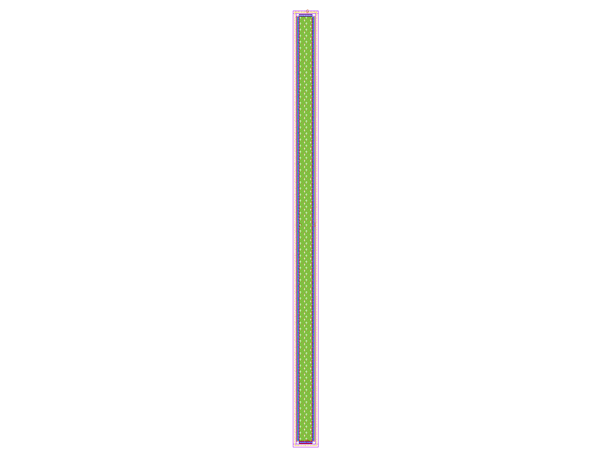 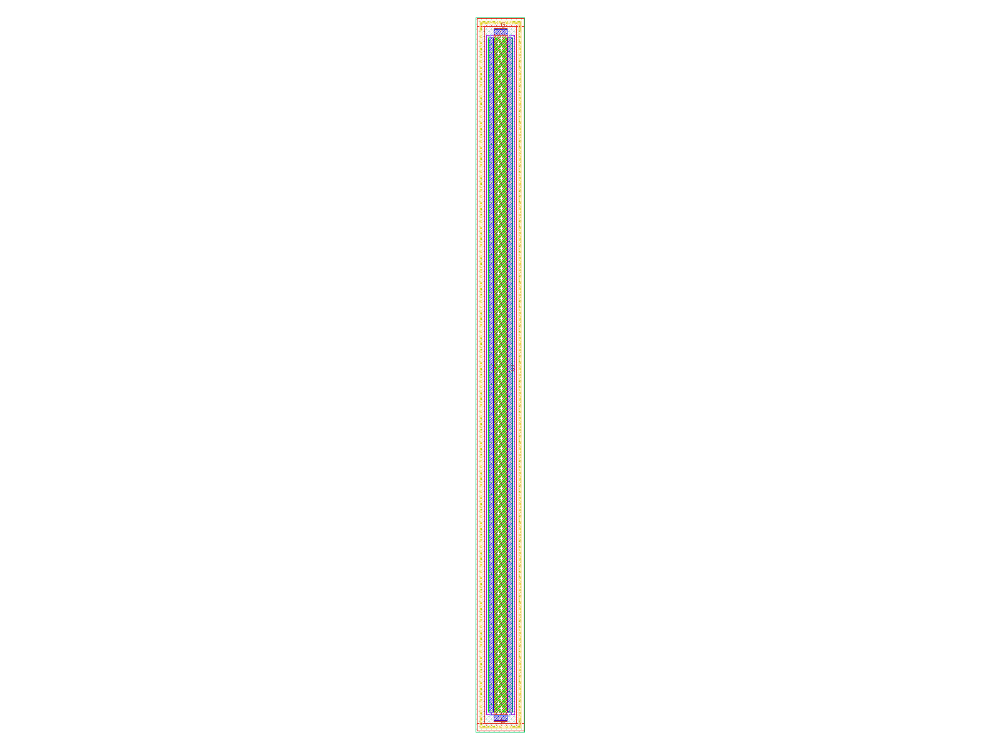 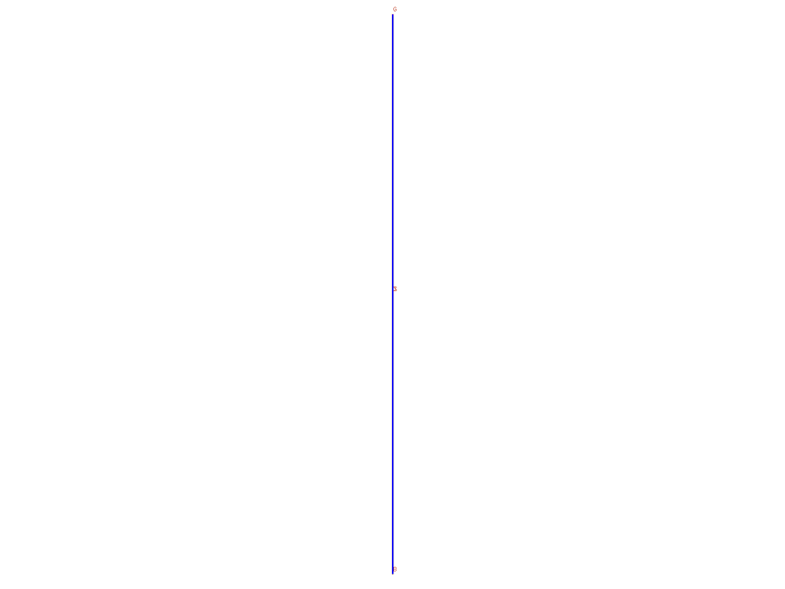

*PCells as drawn: XDiodeTransistorNmos1, XDiodeTransistorPmos2, XNormalTransistorNmos3.*

> **How to read it.** Each transistor is drawn by the SKY130 PCell at exactly its netlist size (W, L, fingers) and checked on its own with Magic DRC and Netgen LVS. 'Control caught' means a deliberately broken copy was also checked and correctly failed, which shows the check really ran. In the pictures (KLayout, in the PDK's own colours): red is the polysilicon gate, blue the metal-1 on the source and drain contacts, the green outline the active (diffusion) area, and the yellow dotted frame the substrate or well tap.

**What it shows here:** 8 of 9 devices pass DRC and LVS; `XNormalTransistorNmos3` fails (see Known findings). `XNormalTransistorNmos3` is one finger of W = 484.2 µm (L = 0.24 µm), so drawn to scale its picture is a thin line.

**PVT (G0.9):** 45 points; the schematic meets every spec at 18 of them.

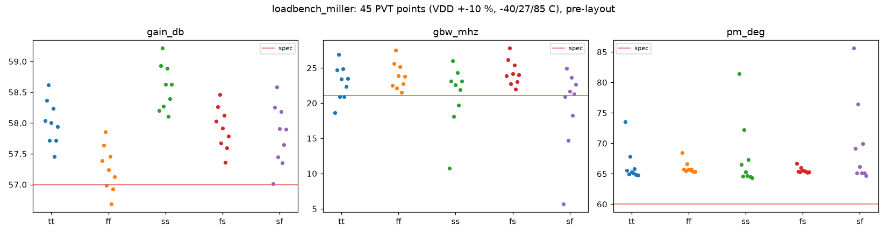

*Specs at the 45 PVT points.*

> **How to read it.** 45 simulations of the schematic before layout: 5 process corners on the x-axis (tt typical, ff and ss fast and slow, fs and sf fast NMOS with slow PMOS and the reverse) × supply 0.9, 1.0 and 1.1 × VDD × −40, 27 and 85 °C, so 9 dots per corner. The red line is the spec. Where the circuit collapses, the other specs can show meaningless values (e.g. a large PM where the gain barely reaches 0 dB). This is reported, not gated: S2 sets the budgets at the nominal corner and reports in G2.9 what they would use at these points.

**What it shows here:** pm_deg is met at every point (smallest margin 4.3, at ss_v1.1_t85); power_uw misses at 14 of 45 points, at 1.1 × VDD (worst fs_v1.1_t85, margin -86.4); gain_db misses at 3 of 45 points, at 0.9 and 1 × VDD (worst ff_v0.9_t85, margin -0.319); gbw_mhz misses at 10 of 45 points, at 0.9 and 1 × VDD (worst sf_v0.9_t-40, margin -15.4).

**Mismatch Monte Carlo (G0.10):** gain_db 58 ± 0.023 (n = 200); gbw_mhz 23.4 ± 0.47 (n = 200); pm_deg 65.35 ± 0.21 (n = 200); offset_v 0.00168 ± 0.0041 (n = 200).

> **How to read it.** The same circuit simulated many times with random transistor mismatch (SKY130's mismatch models): the mean ± one standard deviation of each result. offset_v is the circuit's offset voltage.

### S1

Electrical intent: extracts the operating point, builds the exact small-signal (linear) model and checks it against SPICE, computes how every net capacitance, coupling and terminal resistance moves gain, GBW, PM and noise (checked against SPICE finite differences), and finds the matching groups.

Outputs: `outputs/S1/loadbench_miller/` (report: `s1_report.json`).

| Gate | Result | What it checks |
|---|---|---|
| G1.1 operating point | PASS | operating point: functional devices saturated, supply current reproduced, charge conservation |
| G1.2 linear model vs spice | PASS | the exact linear model reproduces SPICE's gain, GBW and PM |
| G1.3 sensitivity vs spice | PASS | capacitance sensitivities of the linear model agree with SPICE finite differences |
| G1.4 matching groups | PASS | matching groups (differential pair, mirrors) are present and consistent |
| G1.5 symbolic vs spice (reported, not gated) | info | hand (symbolic) model against SPICE: reported, not gated |
| G1.6 resistance sensitivity vs spice | **FAIL** | resistance sensitivities agree with SPICE (small-signal, or a confirmed bias shift) |

- **Operating point (G1.1):** supply current 310.2 µA (testbench 310.2 µA); devices not saturated: none; smallest vds − vdsat: XNormalTransistorPmos8 0.205 V.

> **How to read it.** Vds − vdsat is each transistor's distance from the edge of saturation. The smallest one belongs to the transistor that leaves saturation first when layout resistance shifts its voltages; S2 budgets that headroom as a check of its own (sat_<device>).

**Linear model against SPICE (G1.2):**

| | gain (dB) | GBW (MHz) | PM (deg) |
|---|---|---|---|
| linear model | 58.0164 | 23.4702 | 65.2948 |
| SPICE | 57.9997 | 23.3871 | 65.3233 |
| difference | 0.017 dB | 0.36 % | -0.029 deg |

> **How to read it.** S1 builds an exact small-signal model of the circuit at its operating point and checks it against transistor-level SPICE. When the two agree, S1 can compute every sensitivity from the model, quickly, instead of running SPICE once per parasitic.

- **Sensitivities checked against SPICE:** capacitance (G1.3) 24 of 24 checks pass; resistance (G1.6) 53 of 54.

**The most critical capacitances** (fF that alone would use the whole margin; smallest first):

| Net or coupling | Spec | fF to use the margin | Change per fF |
|---|---|---|---|
| `outFirstStage~in2` | pm_deg | 58.7 | -0.0907 |
| `FirstStageYout1~out` | pm_deg | 76.8 | -0.0693 |
| `out~outFirstStage` | gbw_mhz | 83 | -0.0282 |
| `FirstStageYsourceTransconductance~outFirstStage` | pm_deg | 154 | -0.0345 |
| `FirstStageYsourceTransconductance~out` | gbw_mhz | 218 | -0.0107 |
| `FirstStageYout1~outFirstStage` | pm_deg | 256 | -0.0208 |
| `ibias~out` | pm_deg | 262 | -0.0203 |
| `FirstStageYout1~outFirstStage` | gbw_mhz | 298 | -0.00786 |

> **How to read it.** Capacitance on one net, or between two nets ('A~B', a coupling), changes a spec by 'change per fF'. 'fF to use the margin' is margin ÷ change: the capacitance that would use up the whole margin on its own. The smallest numbers mark the nets the layout must keep short and apart.

**What it shows here:** `outFirstStage~in2` leaves the least room: 58.7 fF there alone would use the whole pm_deg margin.

**Matching groups (G1.4):** diff pair: XNormalTransistorPmos7, XNormalTransistorPmos6; mirror: XDiodeTransistorNmos1, XNormalTransistorNmos4; mirror: XDiodeTransistorPmos2, XNormalTransistorPmos8, XNormalTransistorPmos5.

**Hand model against SPICE (G1.5, report only):**

| Model | gain (dB) | GBW (MHz) | PM (deg) |
|---|---|---|---|
| original | 58.05 | 30.08 | 82.35 |
| P1 | 58.05 | 25.54 | 66.99 |
| SPICE | 58 | 23.39 | 65.32 |

> **How to read it.** Textbook hand equations for the circuit (the 'original' row; PREDICTED when the upstream stage did not give them) against SPICE. Each further row adds one effect the hand model missed. Reported, not gated: the flow itself uses the exact model, and this table shows why.

**What it shows here:** the original hand model is +17.0 deg off SPICE in PM; with P1 it is +1.7 deg.

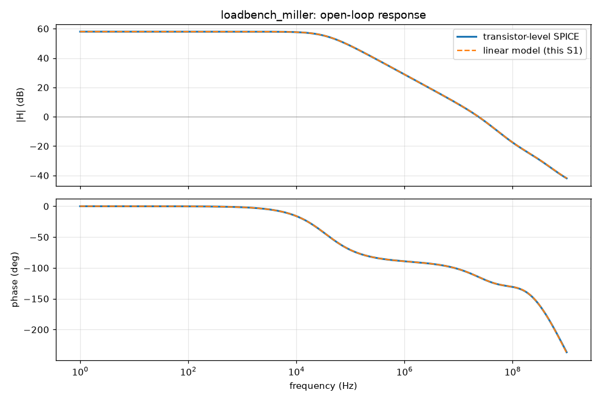

*Open-loop response: linear model against SPICE.*

> **How to read it.** Open-loop gain (top) and phase (bottom) against frequency. Solid: transistor-level SPICE; dashed: S1's linear model. Lines lying on top of each other mean the model can stand in for SPICE (G1.2).

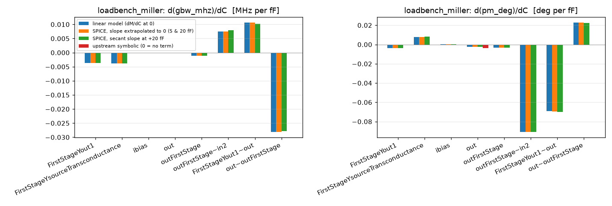

*Sensitivities: linear model against SPICE finite differences.*

> **How to read it.** For each net or coupling, how much GBW (MHz per fF, left) and PM (degrees per fF, right) change when capacitance is added there. Blue: the linear model; orange and green: SPICE, measured two ways; red: the hand equations (no red bar: they have no term for that capacitance). Bars of one group that agree mean the model's sensitivities can be trusted (G1.3). Negative bars hurt the spec, positive bars help it.

**What it shows here:** GBW falls fastest with capacitance on `out~outFirstStage` (-0.028 MHz per fF); capacitance on `FirstStageYout1~out` raises GBW (0.011 MHz per fF); PM falls fastest with capacitance on `outFirstStage~in2` (-0.091 deg per fF); capacitance on `FirstStageYout1~in2` raises PM (0.053 deg per fF).

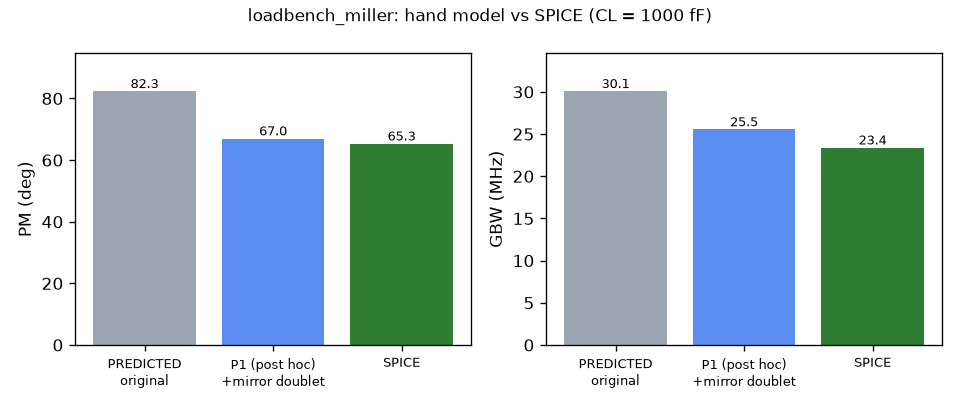

*Hand model against SPICE: the table above as bars (grey: original; blue: with the missing effects; green: SPICE).*

### S2

Budgets: shares a fraction eta of each spec margin between all layout parasitics (fF, Ω) by a joint max-min fair allocation, floors every budget at what the cheapest library cell already adds, verifies the budgets in SPICE, and scores five other budget rules on the same data.

Outputs: `outputs/S2/loadbench_miller/` (report: `s2_report.json`).

| Gate | Result | What it checks |
|---|---|---|
| G2.9 pvt constraints (info) | info | use of each PVT point's margin by the final budgets, first order (reported) |
| G2.0 expected layout use (info) | info | share of each margin a compact layout would use (expected need), before any budget |
| G2.7 library floors feasible | PASS | the S3 library's cheapest cells fit inside the budgets (library floors) |
| G2.3 allocation | PASS | the joint allocation (max-min fair + refinement) is feasible and reproducible |
| G2.5 spice budget verification | PASS | SPICE verification: each check with all its harmful budgets inserted stays within eta × margin |
| G2.8 baselines (info) | info | five other budget rules scored on the same sensitivities (reported) |
| G2.10 model agreement (info) | info | first order against SPICE for every simulated check (reported) |
| G2.4 linear all budgets at once | info | first-order use against the linear model with all budgets inserted (reported) |
| G2.6 hierarchy sums | PASS | block-level shares add up to the budgets |
| G2.1 names resolve | PASS | every rule names a net, device or terminal that exists |
| G2.2 units and provenance | PASS | every rule has units and provenance |

- **eta = 0.5**: layout may use 50 % of each margin. Budgets are set at the nominal corner; round-1 t (budget / expected need of the tightest elements) = 0.497.

**Expected layout use (G2.0):** the share of each margin a compact layout would use (above eta, the budgets fall below the expected need).

| Check | Share of margin |
|---|---|
| gain_db | 0.999 |
| gbw_mhz | 0.34 |
| pm_deg | 0.793 |
| sat_XDiodeTransistorNmos1 | 0.00131 |
| sat_XDiodeTransistorPmos2 | 0.000531 |
| sat_XNormalTransistorNmos3 | 0.0213 |
| sat_XNormalTransistorNmos4 | 0.0281 |
| sat_XNormalTransistorPmos5 | 0.0277 |
| sat_XNormalTransistorPmos6 | 0.0141 |
| sat_XNormalTransistorPmos7 | 0.00138 |
| sat_XNormalTransistorPmos8 | 0.00744 |

> **How to read it.** Before any budget is set: the share of each margin that a compact layout would use, with every net and terminal at its expected need. Above eta, the layout cannot fit within that allowance, so the budgets of the parasitics that affect it must fall below their expected need.

**What it shows here:** a compact layout alone would use 0.999 of the gain_db margin and 0.793 of the pm_deg margin, more than eta = 0.5 allows.

**Budgets** (40 elements; the 10 tightest relative to their expected need):

| Element | Kind | Expected need | Budget | Budget / need | Binding check |
|---|---|---|---|---|---|
| `FirstStageYsourceTransconductance~out` | coupling | 0.404 fF | 0.201 fF | 0.497 | gain_db |
| `outFirstStage~in2` | coupling | 1.01 fF | 0.502 fF | 0.497 | gain_db |
| `XNormalTransistorNmos3.d` | terminal resistance | 33.3 ohm | 16.5 ohm | 0.497 | gain_db |
| `XDiodeTransistorNmos1+XNormalTransistorNmos4.d` | terminal resistance | 20.2 ohm | 10 ohm | 0.497 | gain_db |
| `FirstStageYsourceTransconductance~outFirstStage` | coupling | 1.23 fF | 0.611 fF | 0.497 | gain_db |
| `ibias~outFirstStage` | coupling | 1.02 fF | 0.506 fF | 0.497 | gain_db |
| `XNormalTransistorNmos3.s` | terminal resistance | 32.7 ohm | 16.3 ohm | 0.497 | gain_db |
| `out~in2` | coupling | 0.094 fF | 0.0467 fF | 0.497 | gain_db |
| `outFirstStage~in1` | coupling | 0.094 fF | 0.0467 fF | 0.497 | gain_db |
| `XNormalTransistorPmos5.d` | terminal resistance | 59.2 ohm | 29.4 ohm | 0.497 | gain_db |

> **How to read it.** A budget is the most parasitic capacitance (fF) or series resistance (Ω) the layout may put on one net, coupling or transistor terminal. 'Expected need' is what a compact layout puts there anyway. Budget / need above 1 leaves the layout room; below 1 asks for less than a compact layout gives. 'Binding check' is the spec or saturation check that stopped the budget from growing.

**What it shows here:** 29 of 40 budgets are below their expected need (lowest 0.497 × need, `FirstStageYsourceTransconductance~out`).

**SPICE verification (G2.5,** 1 iteration(s)**):** for each check, every harmful budget inserted at once in the transistor-level circuit.

| Check | Allowed use | First order | SPICE | Within |
|---|---|---|---|---|
| gain_db | 0.5 | 1 × | 0.976 × | yes |
| gbw_mhz | 1.17 | 1 × | 0.982 × | yes |
| pm_deg | 2.66 | 1 × | 1.01 × | yes |
| sat_XDiodeTransistorNmos1 | 0.2 | 0.00506 × | 0.00495 × | yes |
| sat_XDiodeTransistorPmos2 | 0.202 | 0.0106 × | 0.0106 × | yes |
| sat_XNormalTransistorNmos3 | 0.425 | 0.0217 × | 0.0223 × | yes |
| sat_XNormalTransistorNmos4 | 0.229 | 0.0352 × | 0.0314 × | yes |
| sat_XNormalTransistorPmos5 | 0.402 | 0.0321 × | 0.0289 × | yes |
| sat_XNormalTransistorPmos6 | 0.415 | 0.0169 × | 0.0172 × | yes |
| sat_XNormalTransistorPmos7 | 0.445 | 0.00284 × | 0.00265 × | yes |
| sat_XNormalTransistorPmos8 | 0.102 | 0.0624 × | 0.0629 × | yes |

*Within: SPICE use at most 1.02 × the allowed use (`TOL_USE` = 0.02, `src/common/tolerance.py`; PREREG amendment of 2026-11-01).*

> **How to read it.** Every budget that hurts a check is inserted at once into the transistor-level circuit, and SPICE measures how much of the allowance (eta × margin) that check then uses: 1 × is the whole allowance. 'First order' is the prediction S2 made. A check is a spec or the saturation headroom of one transistor (sat_<device>).

**What it shows here:** with all the budgets in place at once, SPICE uses at most 1.01 × the allowance (on pm_deg); every check is within it.

**Other budget rules on the same data (G2.8):** outcome over every simulated check (nominal and each rule's most-used PVT points), and at the nominal corner alone.

| Rule | Outcome | Nominal only | Worst SPICE use of allowed | Budget / need (min) |
|---|---|---|---|---|
| per_net | unsafe | unsafe | 124 | 0.526 |
| equal | unsafe + infeasible | infeasible | 6.31 | 0.0292 |
| lp_sum | unsafe + infeasible (unverified: failed runs) | infeasible (unverified: failed runs) | 1.02e+03 | 0 |
| lp_floor | unsafe | unsafe | 75.6 | 0.307 |
| lp_floor_k | unsafe | ok | 8.37 | 0.00581 |
| ours | unsafe | ok | 75.8 | 0.497 |

> **How to read it.** Six ways to share the same margins among the same parasitics, scored the same way. per_net: each parasitic may use the whole allowance on its own, as if no other existed. equal: an equal share for every parasitic that affects a check. lp_sum: a linear program that maximises the total budget. lp_floor and lp_floor_k: the same with the library's minimum cells, capped at 1 × and 10 × need. ours: S2's joint max-min fair sharing. Outcome: 'unsafe' = in SPICE a spec is missed or more than the allowance is used (beyond 2 %); 'infeasible' = some budget is below what the cheapest library cell already adds; 'ok' = neither.

**What it shows here:** at the nominal corner, unsafe: per_net, lp_floor; infeasible: equal; infeasible (unverified: failed runs): lp_sum; ok: lp_floor_k, ours.

*G2.8 scores every rule before G2.5's closure step, which is fair to all of them, so 'ours' here is the allocation before the closure. The budgets S2 hands to S3 are the closed ones that pass G2.5 above (flow record 7.13). The budgets are set at the nominal corner, so a rule can be ok there and unsafe at a PVT point (G2.9 below).*

**PVT points (G2.9, reported):** worst first-order use 78.7 × at gain_db sf_v0.9_t-40; 57 point-spec checks above 1.

> **How to read it.** First-order use of each PVT point's allowance by the final budgets, which are set at the nominal corner. Above 1, the budgets would use more than that point's allowance. Where a point's margin is nearly zero, any use divided by it gives a very large number.

**First order against SPICE (G2.10):** 118 checks compared, 25 flagged (sign disagreement, or a difference above 0.25 of the margin).

> **How to read it.** How often S1's first-order prediction and SPICE disagree, over every check S2 simulated.

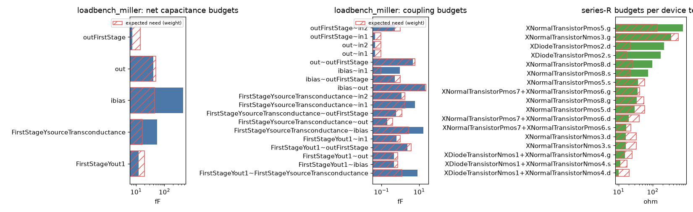

*Budgets against expected need.*

> **How to read it.** One bar per parasitic, on a log scale: capacitance on each net (left) and between nets (middle), in fF, and series resistance at each transistor terminal (right), in Ω. The bar is the budget; the red hatched box is the expected need. A bar longer than its box leaves the layout room; a shorter one is a budget below what a compact layout needs.

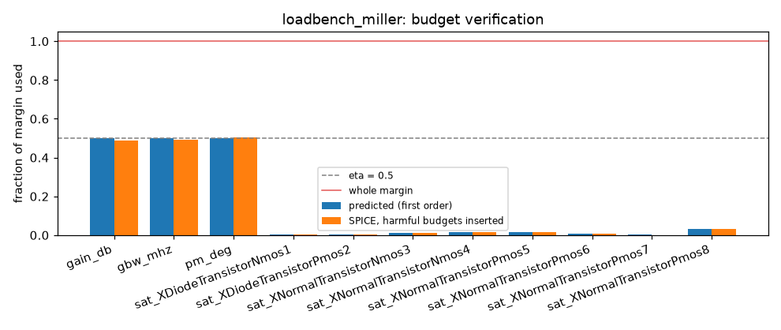

*SPICE verification.*

> **How to read it.** The G2.5 table as bars, as a fraction of the whole margin. Blue: predicted; orange: SPICE with all budgets inserted. The dashed line is eta (the allowance); the red line is the whole margin. Orange at or under the dashed line means the budgets are safe all together.

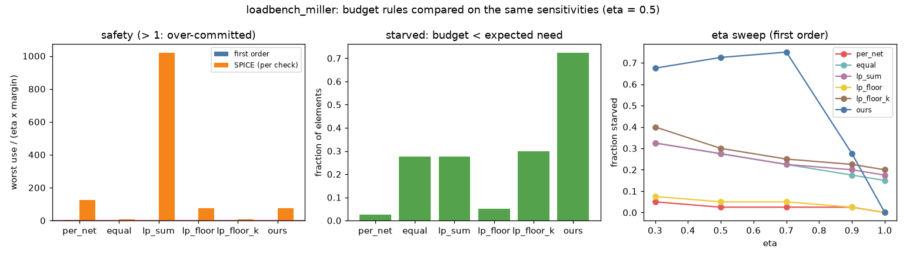

*The six budget rules.*

> **How to read it.** The G2.8 table as bars. Left: the worst use ÷ allowance, first order (blue) and SPICE (orange); above 1 is over-committed. Middle: the share of parasitics whose budget is below its expected need ('starved'). Right: that share at other values of eta.

### S3

Devices: builds a library of layout cells per device type (fingers, gate and diffusion options; each DRC/LVS-signed and extracted), picks for every type the smallest cell that stays within its S2 allowance, and simulates the whole circuit with all chosen cells.

Outputs: `outputs/S3/loadbench_miller/` (report: `s3_report.json`).

| Gate | Result | What it checks |
|---|---|---|
| G3.4 option table complete | PASS | every option of the library was built and signed off |
| G3.7 modes (info) | info | option modes (reported) |
| G3.3 all chosen devices in circuit | PASS | the circuit with every chosen cell meets every spec in SPICE, saturated, within its allowance |
| G3.1 chosen DRC | PASS | the chosen cells are DRC-clean (Magic) |
| G3.2 chosen LVS W L nf | PASS | the chosen cells are LVS-correct for W, L and nf (Netgen) |
| G3.5 no relaxation | **FAIL** | no device type had to be relaxed (every type has an option within its allowance) |
| G3.6 model has no gate resistance | PASS | the transistor model has no gate resistance, so S3 adds the cells' own |

**Chosen cells** (6 device types; 216 options built and signed off):

| Device type | Devices | Chosen option | Area (µm²) | Relaxed | Why |
|---|---|---|---|---|---|
| `nfet_01v8_lvt_W66p13_L2p03_m1` | XDiodeTransistorNmos1, XNormalTransistorNmos4 | `nf8_gboth_sdfull_outS` | 206.4 | **yes** | no option met the allowance |
| `pfet_01v8_lvt_W37p3_L0p74_m1` | XDiodeTransistorPmos2 | `nf1_gboth_sdhalf` | 106.6 | no | smallest area among the 4 of 20 options that stay within the allowance |
| `nfet_01v8_lvt_W484p2_L0p24_m1` | XNormalTransistorNmos3 | `nf32_gtop_sdhalf_outS` | 311.3 | **yes** | no option met the allowance |
| `pfet_01v8_lvt_W887p03_L0p74_m1` | XNormalTransistorPmos5 | `nf16_gtop_sdhalf_outS` | 1040 | no | smallest area among the 8 of 52 options that stay within the allowance |
| `pfet_01v8_lvt_W14p21_L0p89_m1` | XNormalTransistorPmos6, XNormalTransistorPmos7 | `nf2_gboth_sdfull_outS` | 37.48 | **yes** | no option met the allowance |
| `pfet_01v8_lvt_W90p63_L0p74_m1` | XNormalTransistorPmos8 | `nf8_gboth_sdfull_outS` | 134 | no | smallest area among the 1 of 28 options that stay within the allowance |

Total device area (every device counted): 2079 µm².

> **How to read it.** S3 builds many layout cells for each device type and keeps the smallest one that stays within its S2 allowance; when none does, it keeps the least-bad one and flags the type (Relaxed = yes, G3.5). The option name says how the cell is built: nf<N> = N fingers; gtop or gboth = the gate contacted at the top only or at both ends (both ends lowers the gate resistance); sdfull or sdhalf = full or half contact coverage on source and drain; outS or outD = source or drain on the outer strips.

**What it shows here:** 3 of 6 device types have a cell within their allowance; 3 are flagged (G3.5).

**Option modes (G3.7, reported):** S3 decides in its main mode, A-bin; the others are reported for comparison (B: nf as in the netlist; A-bin: each finger stays in the sized device's SKY130 model bin; A-free: no bin restriction; RoT: a rule-of-thumb folding baseline).

| Mode | Total area (µm²) | Relaxed types | Types with fingers outside the sized bin |
|---|---|---|---|
| B | 4396 | 5 | 0 |
| **A-bin** (main) | 2079 | 3 | 0 |
| A-free | 2093 | 3 | 1 |
| RoT | 2112 | 6 | 2 |

**The circuit with every chosen cell, in SPICE (G3.3):**

| Spec | Schematic | With the chosen cells | Meets the spec |
|---|---|---|---|
| pm_deg | 65.3233 | 65.1728 | yes |
| power_uw | 558.446 | 554.199 | yes |
| gain_db | 57.9997 | 58.0072 | yes |
| gbw_mhz | 23.3871 | 23.0185 | yes |

> **How to read it.** The final check of S0–S3: the whole circuit simulated with every chosen cell in place (its own extracted capacitance and contact resistance), against each spec, next to the schematic's value.

**What it shows here:** with every chosen cell in place, the circuit meets all 4 specs in SPICE.

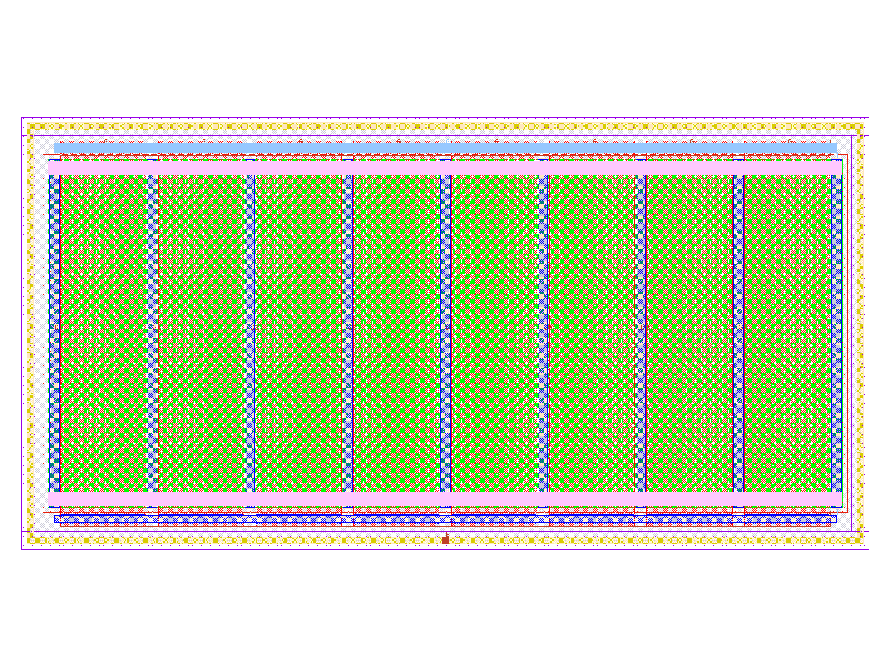 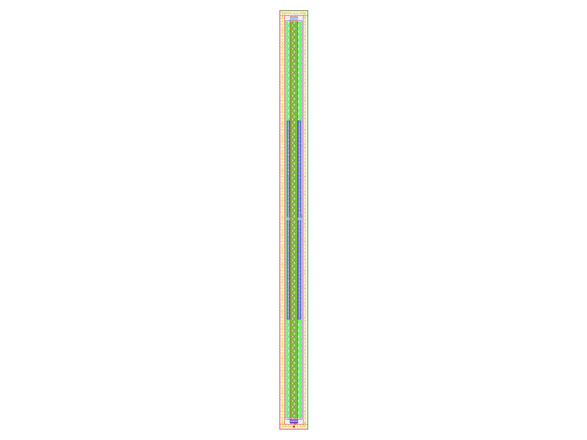 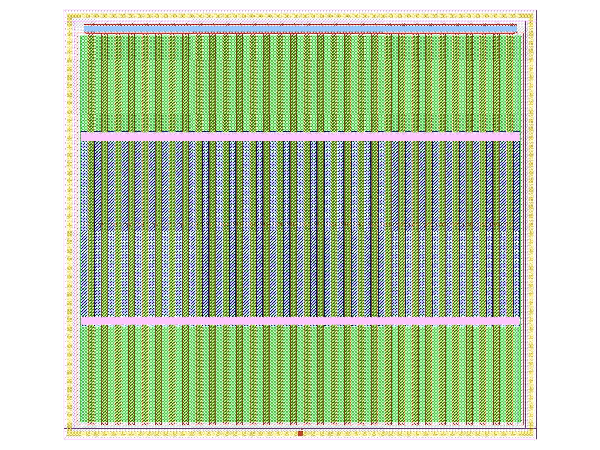 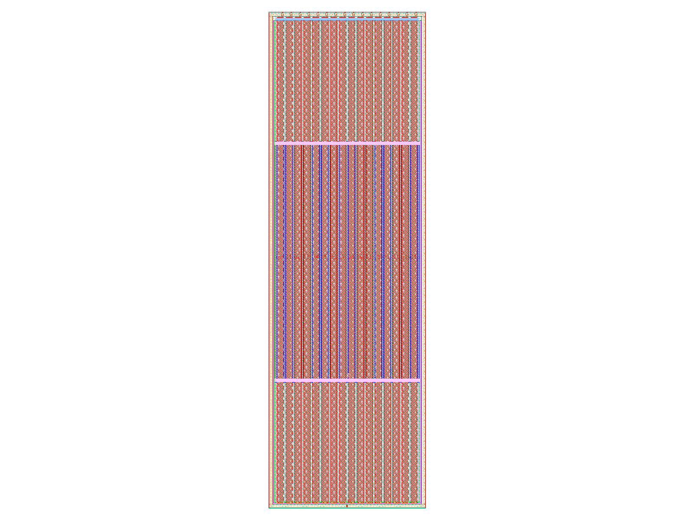 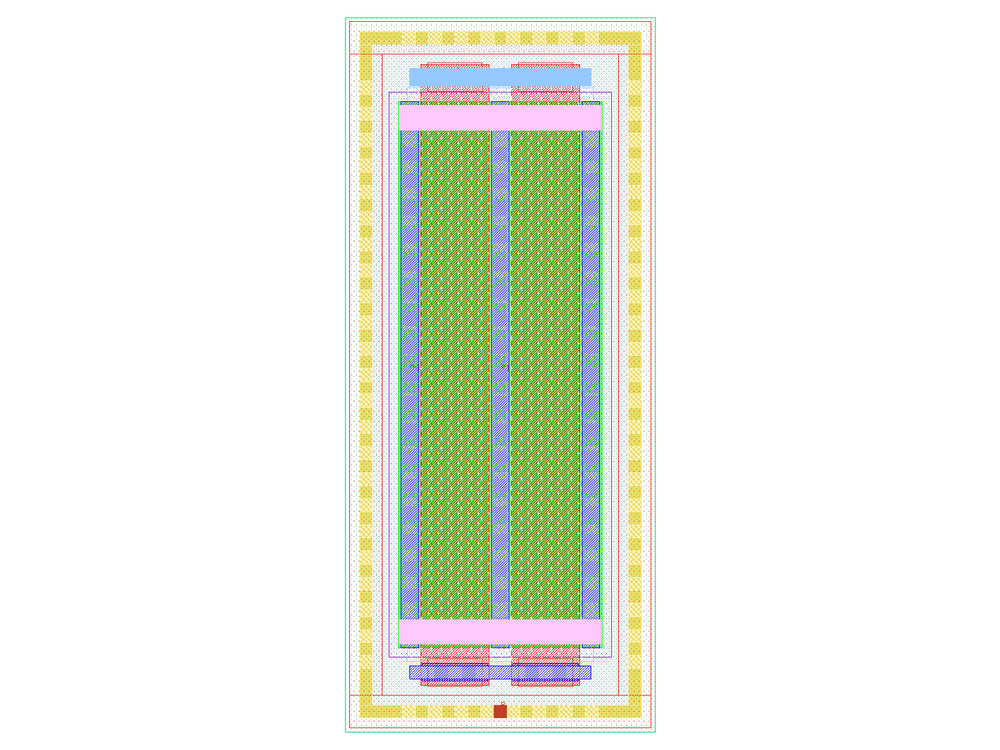 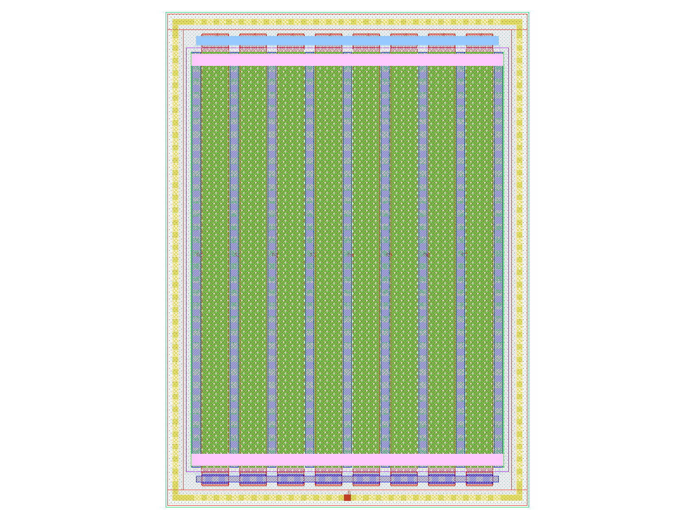

*Chosen cells (DRC- and LVS-signed, G3.1 and G3.2).*

> **How to read it.** The cells S3 chose, in the same colours as the S0 pictures. Each red stripe is one gate finger; the magenta bars at the top and bottom are metal-2 straps that join all the sources and all the drains (one bar per terminal). Unlike S0's bare PCells, these are complete cells, DRC-clean and LVS-checked for W, L and the number of fingers.

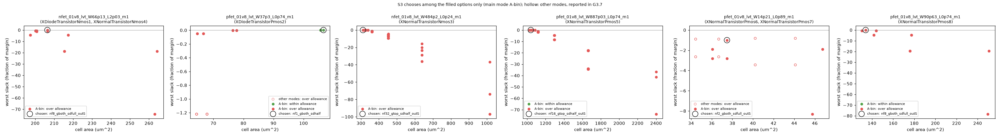

*Every option built per device type: area against worst slack.*

> **How to read it.** One dot per cell built for that device type. x: cell area; y: the worst slack, i.e. the room left on the tightest check (a spec effect or a terminal resistance) as a fraction of the margin. Above 0 the cell fits its allowance (green), below 0 it does not (red). Filled dots are the options of S3's main mode, which it chooses from: the smallest that fits, or the least-bad when none fits. Hollow dots are the other modes' options, reported in G3.7 but never chosen here, so a smaller green option that was not taken is hollow. The circle marks the choice.

