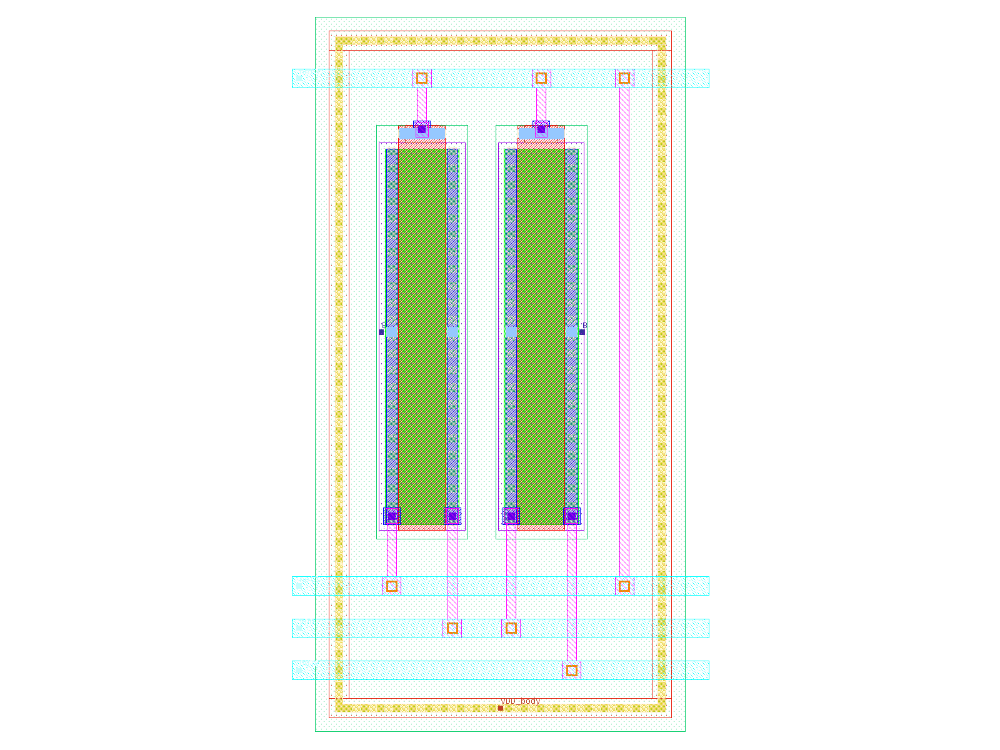
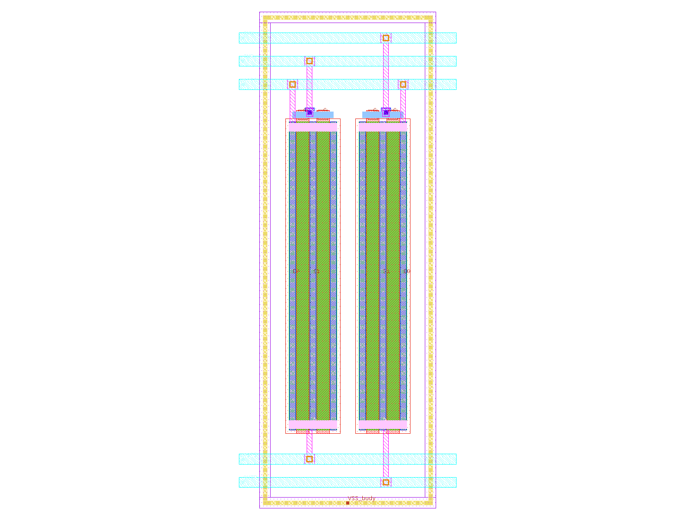
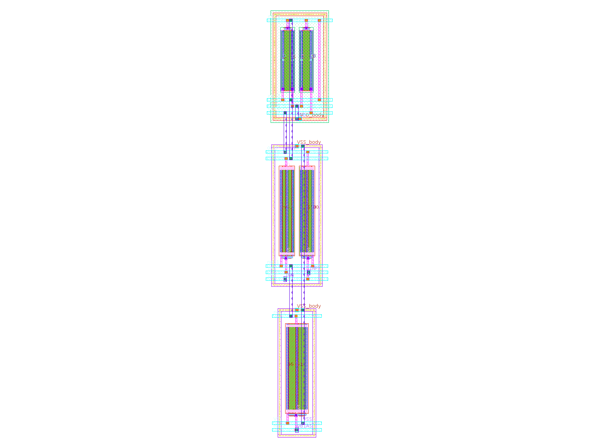
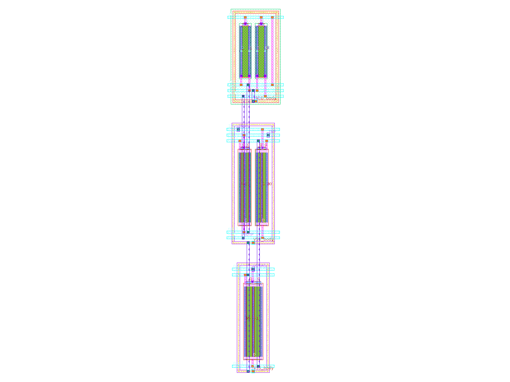
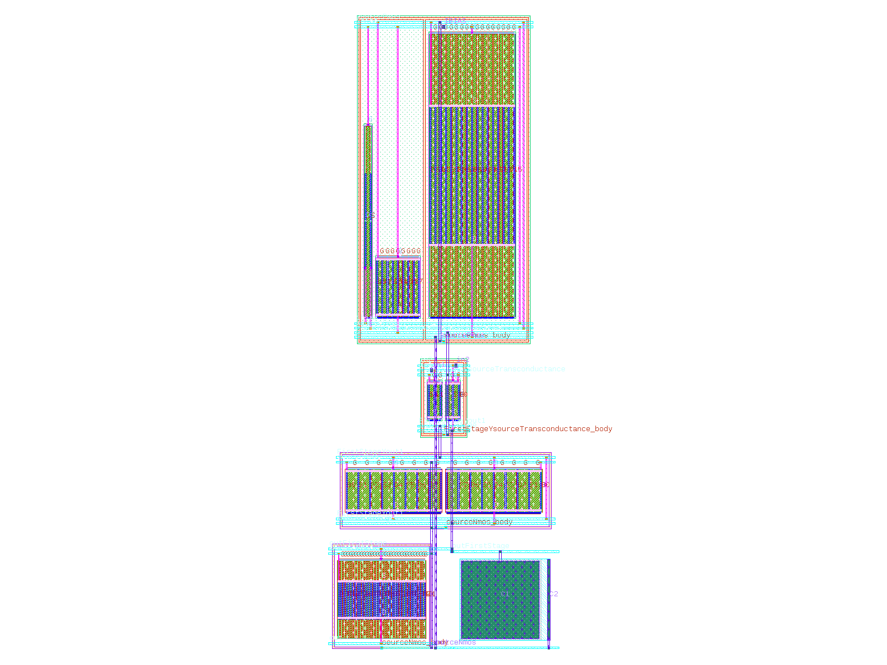

# S4–S7 walkthrough: blocks, placement, routing, extraction and post-layout SPICE

Generated by `python3 scripts/make_s4s7_walkthrough.py` from the run's own output files (repo at 6d0c6bb73 2026-11-04). Every number below is read from `outputs/`. Typed by hand: the meaning of each gate, the explanation of each known finding, and the *How to read it* notes. The companion page `docs/s0_s3_walkthrough.html` covers S0–S3 (its reading guide applies here too); the plan is `docs/plan_v4_S4_S7.md`, the record `docs/flow_record.md` sections 7.15–7.20.

**The four stages:**

- **S4**: Blocks: groups S3's ringless cells into blocks (matching groups first; one device type and one body per block), draws the variants (A, AB mirror image, ABBA common centroid, ABAB interdigitated, or a row), closes each with one tap ring (tap strips where a row is too wide), draws a bound MIM capacitor as its own block, and signs every variant off with DRC and LVS.
- **S5**: Placement and routing: enumerates every row partition (PMOS above NMOS, in the designer's row order), variant and flip, scores each twice (budget-aware: area plus S2's wire budgets; area-only: the AICL-like baseline), routes both winners with one metal-4 spine per net, and signs them off (DRC, LVS, S2's route rules).
- **S6**: Extraction: Magic extracts each routed layout capacitance-only and R+C, LVS-checks the extraction, and compares every budgeted parasitic of S2 with what was extracted.
- **S7**: Post-layout SPICE: the schematic, the drawn devices, the C-only and the R+C netlists in S0's own benches; each spec's loss against eta × margin.

**Status per design:**

| Design | S4 | S5 | S6 | S7 |
|---|---|---|---|---|
| example_ota_5t | PASS | PASS | PASS | PASS |
| loadbench_miller | PASS | FAIL | FAIL | FAIL |

**Two more ideas this page uses** (the rest are in the S0–S3 page's reading guide):

- **Budget-aware and area-only.** S5 scores every placement twice: by area plus S2's wire budgets (the flow's own rule) and by area alone (the baseline of the AICL paper). Both winners are routed by the same router, so the two layouts differ only in the placement; that comparison is hypothesis H5.
- **H4.** If every parasitic stays within its S2 budget (G6.2), the layout should keep every spec within eta × margin (G7.1, G7.2).

## example_ota_5t

Run: `./flow run example_ota_5t --from S4`. Status, run time and the steps of each stage:

| Stage | Status | Started | Run time | Steps |
|---|---|---|---|---|
| S4 | **PASS** | 2026-11-04T05:15:58 | 0.4 min | run |
| S5 | **PASS** | 2026-11-04T05:16:23 | 0.6 min | run |
| S6 | **PASS** | 2026-11-04T05:17:02 | 0.4 min | run |
| S7 | **PASS** | 2026-11-04T05:17:29 | 1.6 min | run |

**Known findings** (failed gates and why; none is a crash):

- none: every gate passes.

### S4

Blocks: groups S3's ringless cells into blocks (matching groups first; one device type and one body per block), draws the variants (A, AB mirror image, ABBA common centroid, ABAB interdigitated, or a row), closes each with one tap ring (tap strips where a row is too wide), draws a bound MIM capacitor as its own block, and signs every variant off with DRC and LVS.

Outputs: `outputs/S4/example_ota_5t/` (report: `s4_report.json`).

| Gate | Result | What it checks |
|---|---|---|
| G4.1 one type and body per block | PASS | every block holds one device type with one body net, and every device is in exactly one block |
| G4.2 DRC every variant | PASS | every block variant passes Magic DRC with nothing deferred (its ring meets the tap rules) |
| G4.3 LVS every variant | PASS | every block variant passes Netgen LVS against the IR's devices (negative control caught) |
| G4.4 symmetry | PASS | every matched pair or mirror has a signed-off variant that is a mirror image about its centre |
| G4.5 latchup tap distance | PASS | no diffusion is farther from a tap than S2's latch-up distance (ring and tap strips) |
| G4.6 port capacitance (info) | info | block port capacitance (reported; comes with S6) |

| Block | Devices | Variant | Area (µm²) | Worst tap distance (µm) | Tap strips | DRC errors | LVS | Mirror image |
|---|---|---|---|---|---|---|---|---|
| pmos_current_mirror_load | XM3, XM4 | AB | 135.1 | 3.34 | 0 | 0 | yes | yes |
| nmos_differential_pair | XM1, XM2 | AB | 163 | 2.92 | 0 | 0 | yes | yes |
| nmos_differential_pair | XM1, XM2 | ABBA | 207 | 4.06 | 0 | 0 | yes | yes |
| nmos_differential_pair | XM1, XM2 | ABAB | 207 | 4.06 | 0 | 0 | yes | no |
| nmos_current_mirror_bias | XM5 | A | 117.7 | 2.36 | 0 | 0 | yes | – |

> **How to read it.** One row per drawn variant of each block. The tap distance is how far the farthest diffusion stands from its ring or a tap strip; S2's latch-up rule allows 15 µm. A mirror image means every unit faces a flipped copy across the centre (AB, ABBA); ABAB is interdigitated, not a mirror image.

**What it shows here:** 3 blocks, 5 variants, all signed off; no block needed a tap strip.

  

> **How to read it.** The first variant of each block as drawn: the units in a row, metal-2 stubs to one metal-3 track per net above and below, and the ring around everything (n-well for PMOS).

### S5

Placement and routing: enumerates every row partition (PMOS above NMOS, in the designer's row order), variant and flip, scores each twice (budget-aware: area plus S2's wire budgets; area-only: the AICL-like baseline), routes both winners with one metal-4 spine per net, and signs them off (DRC, LVS, S2's route rules).

Outputs: `outputs/S5/example_ota_5t/` (report: `s5_report.json`).

| Gate | Result | What it checks |
|---|---|---|
| G5.1 placement legal | PASS | the placements are legal: blocks apart, PMOS above NMOS, symmetric blocks on the axis, unrouted DRC clean |
| G5.5 area vs area only (info) | info | budget-aware against the area-only baseline (reported) |
| G5.2 top DRC | PASS | the routed top cell passes Magic DRC (negative control caught) |
| G5.3 top LVS | PASS | the routed top cell passes LVS against S0's layout view with the drawn finger counts (control caught) |
| G5.4 route rules | PASS | the routes meet S2's route rules: length, parallel runs, series R against what S3 left, symmetry |

96 candidate placements were scored.

| | budget-aware | area-only |
|---|---|---|
| Rows (top to bottom) | pmos_current_mirror_load / nmos_differential_pair / nmos_current_mirror_bias | pmos_current_mirror_load / nmos_differential_pair / nmos_current_mirror_bias |
| Variants (flipped) | pmos_current_mirror_load AB, nmos_differential_pair AB (flipped), nmos_current_mirror_bias A (flipped) | pmos_current_mirror_load AB, nmos_differential_pair AB, nmos_current_mirror_bias A |
| Area (µm²) | 525.8 | 525.8 |
| OUTP: wire-budget use, estimate → routed | 0.0841 → 0.0841 | 0.358 → 0.358 |
| net1: wire-budget use, estimate → routed | 0.0696 → 0.0696 | 0.367 → 0.367 |
| net3: wire-budget use, estimate → routed | 0.179 → 0.179 | 0.526 → 0.526 |

> **How to read it.** Each column is the winner of one cost. A net's wire-budget use is its length over S2's maximum length for it (1.0 = the limit): first the placer's half-perimeter estimate, then the routed spine and runs. The budget-aware cost adds 10 × any excess and the uses themselves to the area; the area-only cost is the area alone.

**What it shows here:** at 1 × the area-only area, the budget-aware placement uses less of the budget on OUTP, net1 and net3; after routing, every net is within its length budget.

 

> **How to read it.** The routed layouts, budget-aware first. PMOS blocks are above NMOS; the vertical purple lines are the metal-4 spines, one per net, joined to the blocks' metal-3 tracks by vias.

### S6

Extraction: Magic extracts each routed layout capacitance-only and R+C, LVS-checks the extraction, and compares every budgeted parasitic of S2 with what was extracted.

Outputs: `outputs/S6/example_ota_5t/` (report: `s6_report.json`).

| Gate | Result | What it checks |
|---|---|---|
| G6.1 extracted and LVS | PASS | both layouts extracted (C-only and R+C) and the flat extraction LVS-matched |
| G6.2 parasitics within budgets | PASS | every budgeted net capacitance, coupling and terminal R of the budget-aware layout within S2's budget |
| G6.4 c only netlist complete (info) | info | Magic's C-only netlist against its own .ext (reported) |
| G6.5 mim self coupling (info) | info | a MIM capacitor's plate-to-plate coupling extracted alone (reported) |
| G6.3 kpex cross check (info) | info | kpex 2.5D against Magic (reported) |

| Element | Kind | Budget | Budget-aware | Use | Area-only | Use |
|---|---|---|---|---|---|---|
| OUTP | net capacitance | 37.59 fF | 4.954 | 0.132 | 5.294 | 0.141 |
| net1 | net capacitance | 77.76 fF | 11.23 | 0.144 | 12.6 | 0.162 |
| net3 | net capacitance | 44.31 fF | 6.409 | 0.145 | 6.316 | 0.142 |
| OUTP~net1 | coupling | 8.792 fF | 1.309 | 0.149 | 1.614 | 0.184 |
| OUTP~net3 | coupling | 5.138 fF | 1.477 | 0.287 | 2.338 | 0.455 |
| OUTP~INP | coupling | 1.998 fF | 0.008 | 0.004 | 0.1498 | 0.075 |
| OUTP~INN | coupling | 6.286 fF | 0.9303 | 0.148 | 1.075 | 0.171 |
| net1~net3 | coupling | 8.124 fF | 1.341 | 0.165 | 1.971 | 0.243 |
| net1~INP | coupling | 6.286 fF | 1.609 | 0.256 | 1.53 | 0.243 |
| net1~INN | coupling | 6.286 fF | 1.305 | 0.208 | 1.253 | 0.199 |
| net3~INP | coupling | 6.286 fF | 0.982 | 0.156 | 1.113 | 0.177 |
| net3~INN | coupling | 1.998 fF | 0.0477 | 0.0239 | 0.1245 | 0.0623 |
| XM3+XM4.d | terminal resistance | 299.4 ohm | 35.07 | 0.117 | 36.89 | 0.123 |
| XM3+XM4.g | terminal resistance | 783.3 ohm | 216.9 | 0.277 | 218.8 | 0.279 |
| XM3+XM4.s | terminal resistance | 131.6 ohm | 34.37 | 0.261 | 34.37 | 0.261 |
| XM1+XM2.d | terminal resistance | 159.7 ohm | 19.75 | 0.124 | 21.57 | 0.135 |
| XM1+XM2.g | terminal resistance | 1820 ohm | 276.9 | 0.152 | 276.9 | 0.152 |
| XM1+XM2.s | terminal resistance | 86.68 ohm | 13.62 | 0.157 | 17.05 | 0.197 |
| XM5.d | terminal resistance | 74.9 ohm | 13.62 | 0.182 | 17.05 | 0.228 |
| XM5.g | terminal resistance | 523.6 ohm | 140.1 | 0.268 | 140.1 | 0.268 |
| XM5.s | terminal resistance | 140.9 ohm | 26.84 | 0.191 | 24.82 | 0.176 |

> **How to read it.** Every parasitic S2 budgeted, as extracted from the routed layout: net capacitance to an AC ground, coupling between two signal nets (fF), and terminal resistance (Ω, S3's cell plus S5's wires and vias). Use is extracted / budget; bold marks an element over its budget.

**What it shows here:** 0 of 21 elements are over budget, the worst OUTP~net3 at 0.287 ×; Magic's C-only netlist holds 3.6 % less capacitance than its .ext (G6.4), none on INN to ground.

### S7

Post-layout SPICE: the schematic, the drawn devices, the C-only and the R+C netlists in S0's own benches; each spec's loss against eta × margin.

Outputs: `outputs/S7/example_ota_5t/` (report: `s7_report.json`).

| Gate | Result | What it checks |
|---|---|---|
| G7.1 specs met post layout | PASS | every spec met post-layout (R+C), with no failed simulation |
| G7.2 loss within eta margin | PASS | each spec loses at most eta × margin from schematic to post-layout |
| G7.3 G2.0 prediction (info) | info | S2's G2.0 prediction against the actual loss (reported) |
| G7.4 pvt (info) | info | PVT points post-layout (reported: not simulated here) |
| G7.5 mim self coupling cancelled (info) | info | post-layout AC with the MIM capacitor's own plate coupling cancelled (reported) |
| H4 (info) | info | hypothesis: parasitics within their budgets (G6.2) keep every spec within eta × margin (G7.1, G7.2) |
| H5 (info) | info | hypothesis: the budget-aware placement loses less than the area-only one (reported per spec) |

| Spec | Limit | Schematic | Drawn devices | C-only | R+C | Loss / (eta × margin) | Area-only R+C (use) |
|---|---|---|---|---|---|---|---|
| gain (dB) | ≥ 30 | 31.697 | 31.814 | 31.814 | 31.694 | 0.0031 | 31.681 (0.0189) |
| gbw (MHz) | ≥ 20 | 104.45 | 105.42 | 104.03 | 101.32 | 0.0742 | 100.73 (0.0882) |
| pm (deg) | ≥ 60 | 80.935 | 81.182 | 80.606 | 79.423 | 0.144 | 79.212 (0.165) |
| power (uW) | ≤ 1000 | 152.6 | 152.4 | 152.4 | 150.51 | -0.0049 | 150.48 (-0.005) |
| vnoise_nv (nV/sqrt(Hz)) | ≤ 400 | 339.06 | 339.63 | 339.63 | 339.54 | 0.0156 | 339.53 (0.0152) |

> **How to read it.** The same benches as S0, with the circuit replaced by each view of the layout: drawn devices only, then every capacitance, then capacitance and wire resistance (the post-layout result). The loss is how much of the margin the layout takes; 1.0 is all that eta allows (bold: more).

**What it shows here:** every spec is met post-layout; the largest loss is pm_deg at 0.144 of eta × margin; H4: G6.2 passed and G7.1/G7.2 passed.

## loadbench_miller

Run: `./flow run loadbench_miller --from S4`. Status, run time and the steps of each stage:

| Stage | Status | Started | Run time | Steps |
|---|---|---|---|---|
| S4 | **PASS** | 2026-11-04T05:19:03 | 0.8 min | run |
| S5 | **FAIL** | 2026-11-04T05:19:48 | 1.2 min | run |
| S6 | **FAIL** | 2026-11-04T05:21:02 | 1.8 min | run |
| S7 | **FAIL** | 2026-11-04T05:22:49 | 32.5 min | run |

**Known findings** (failed gates and why; none is a crash):

- **S5 G5.4** (the routes meet S2's route rules: length, parallel runs, series R against what S3 left, symmetry): outFirstStage joins the input pair, the mirror, N3's gate and the Miller capacitor, and S2 allows it 16.3 µm of metal3; no row placement of these blocks gets it under 1.65 × that. The input pair's series-R budget was already used by S3's cells (the known G3.5 relaxation), so no wire fits in it.
- **S6 G6.2** (every budgeted net capacitance, coupling and terminal R of the budget-aware layout within S2's budget): the largest excesses sit at the Miller capacitor: its own fringe and bottom-plate capacitance land on out and outFirstStage, and S2's budgets were set without them (G6.5 shows the part that is very likely counted twice). The input pair's terminal R is over because S3's cells already used it.
- **S7 G7.2** (each spec loses at most eta × margin from schematic to post-layout): GBW loses more than eta × its 2.34 MHz margin. GBW is about gm1 / Cc, and the out~outFirstStage coupling sits beside the 0.5 pF Miller capacitor; most of it is the capacitor's own plate-to-plate coupling as Magic extracts it, very likely counted twice (G6.5). With that coupling cancelled (G7.5) every spec stays within eta × margin; every spec is met either way (G7.1).

### S4

Blocks: groups S3's ringless cells into blocks (matching groups first; one device type and one body per block), draws the variants (A, AB mirror image, ABBA common centroid, ABAB interdigitated, or a row), closes each with one tap ring (tap strips where a row is too wide), draws a bound MIM capacitor as its own block, and signs every variant off with DRC and LVS.

Outputs: `outputs/S4/loadbench_miller/` (report: `s4_report.json`).

| Gate | Result | What it checks |
|---|---|---|
| G4.1 one type and body per block | PASS | every block holds one device type with one body net, and every device is in exactly one block |
| G4.2 DRC every variant | PASS | every block variant passes Magic DRC with nothing deferred (its ring meets the tap rules) |
| G4.3 LVS every variant | PASS | every block variant passes Netgen LVS against the IR's devices (negative control caught) |
| G4.4 symmetry | PASS | every matched pair or mirror has a signed-off variant that is a mirror image about its centre |
| G4.5 latchup tap distance | PASS | no diffusion is farther from a tap than S2's latch-up distance (ring and tap strips) |
| G4.6 port capacitance (info) | info | block port capacitance (reported; comes with S6) |

| Block | Devices | Variant | Area (µm²) | Worst tap distance (µm) | Tap strips | DRC errors | LVS | Mirror image |
|---|---|---|---|---|---|---|---|---|
| input_pair | Pmos7, Pmos6 | AB | 157.6 | 3.81 | 0 | 0 | yes | yes |
| input_pair | Pmos7, Pmos6 | ABBA | 196.1 | 5.06 | 0 | 0 | yes | yes |
| input_pair | Pmos7, Pmos6 | ABAB | 196.1 | 5.06 | 0 | 0 | yes | no |
| nmos_mirror_load | Nmos1, Nmos4 | AB | 648.4 | 7.29 | 0 | 0 | yes | yes |
| nmos_mirror_load | Nmos1, Nmos4 | ABBA | 682.6 | 7.29 | 0 | 0 | yes | yes |
| nmos_mirror_load | Nmos1, Nmos4 | ABAB | 682.6 | 7.29 | 0 | 0 | yes | no |
| pmos_bias_bank | Pmos2, Pmos8, Pmos5 | row | 2269 | 10.1 | 1 | 0 | yes | – |
| cs_stage | Nmos3 | A | 436.6 | 9.55 | 0 | 0 | yes | – |
| Capacitor2 | Capacitor2 | A | 414.7 | – | 0 | 0 | yes | – |

> **How to read it.** One row per drawn variant of each block. The tap distance is how far the farthest diffusion stands from its ring or a tap strip; S2's latch-up rule allows 15 µm. A mirror image means every unit faces a flipped copy across the centre (AB, ABBA); ABAB is interdigitated, not a mirror image.

**What it shows here:** 5 blocks, 9 variants, all signed off; pmos_bias_bank__row needed a tap strip; Capacitor2 is drawn as sky130_fd_pr__cap_mim_m3_1 (15.7 × 15.7 µm, PREDICTED binding (ASSUMPTION)), top plate on outFirstStage, bottom plate on out.

    

> **How to read it.** The first variant of each block as drawn: the units in a row, metal-2 stubs to one metal-3 track per net above and below, and the ring around everything (n-well for PMOS).

### S5

Placement and routing: enumerates every row partition (PMOS above NMOS, in the designer's row order), variant and flip, scores each twice (budget-aware: area plus S2's wire budgets; area-only: the AICL-like baseline), routes both winners with one metal-4 spine per net, and signs them off (DRC, LVS, S2's route rules).

Outputs: `outputs/S5/loadbench_miller/` (report: `s5_report.json`).

| Gate | Result | What it checks |
|---|---|---|
| G5.1 placement legal | PASS | the placements are legal: blocks apart, PMOS above NMOS, symmetric blocks on the axis, unrouted DRC clean |
| G5.5 area vs area only (info) | info | budget-aware against the area-only baseline (reported) |
| G5.2 top DRC | PASS | the routed top cell passes Magic DRC (negative control caught) |
| G5.3 top LVS | PASS | the routed top cell passes LVS against S0's layout view with the drawn finger counts (control caught) |
| G5.4 route rules | **FAIL** | the routes meet S2's route rules: length, parallel runs, series R against what S3 left, symmetry |

20736 candidate placements were scored.

| | budget-aware | area-only |
|---|---|---|
| Rows (top to bottom) | pmos_bias_bank / input_pair / nmos_mirror_load / cs_stage, Capacitor2 | pmos_bias_bank / input_pair / nmos_mirror_load / cs_stage, Capacitor2 |
| Variants (flipped) | pmos_bias_bank row, input_pair AB, nmos_mirror_load AB, cs_stage A, Capacitor2 A | pmos_bias_bank row, input_pair AB, nmos_mirror_load AB, cs_stage A, Capacitor2 A |
| Area (µm²) | 5679.5 | 5679.5 |
| FirstStageYout1: wire-budget use, estimate → routed | 0.499 → 0.499 | 0.499 → 0.499 |
| FirstStageYsourceTransconductance: wire-budget use, estimate → routed | 0.286 → 0.297 | 0.286 → 0.297 |
| ibias: wire-budget use, estimate → routed | 0 → 0 | 0 → 0 |
| out: wire-budget use, estimate → routed | 0.79 → 0.8 | 0.79 → 0.8 |
| outFirstStage: wire-budget use, estimate → routed | 1.65 → 1.7 | 1.65 → 1.7 |

> **How to read it.** Each column is the winner of one cost. A net's wire-budget use is its length over S2's maximum length for it (1.0 = the limit): first the placer's half-perimeter estimate, then the routed spine and runs. The budget-aware cost adds 10 × any excess and the uses themselves to the area; the area-only cost is the area alone.

**What it shows here:** both costs chose the same placement, so this design cannot tell them apart (H5 not testable); after routing, outFirstStage still exceeds its budget.

 

> **How to read it.** The routed layouts, budget-aware first. PMOS blocks are above NMOS; the vertical purple lines are the metal-4 spines, one per net, joined to the blocks' metal-3 tracks by vias.

### S6

Extraction: Magic extracts each routed layout capacitance-only and R+C, LVS-checks the extraction, and compares every budgeted parasitic of S2 with what was extracted.

Outputs: `outputs/S6/loadbench_miller/` (report: `s6_report.json`).

| Gate | Result | What it checks |
|---|---|---|
| G6.1 extracted and LVS | PASS | both layouts extracted (C-only and R+C) and the flat extraction LVS-matched |
| G6.2 parasitics within budgets | **FAIL** | every budgeted net capacitance, coupling and terminal R of the budget-aware layout within S2's budget |
| G6.4 c only netlist complete (info) | info | Magic's C-only netlist against its own .ext (reported) |
| G6.5 mim self coupling (info) | info | a MIM capacitor's plate-to-plate coupling extracted alone (reported) |
| G6.3 kpex cross check (info) | info | kpex 2.5D against Magic (reported) |

| Element | Kind | Budget | Budget-aware | Use | 
|---|---|---|---|---|
| FirstStageYout1 | net capacitance | 12.36 fF | 37.06 | **3** |
| FirstStageYsourceTransconductance | net capacitance | 55.84 fF | 27.83 | 0.498 |
| ibias | net capacitance | 451.7 fF | 58.04 | 0.129 |
| out | net capacitance | 40.34 fF | 67.06 | **1.66** |
| outFirstStage | net capacitance | 7.538 fF | 20.68 | **2.74** |
| FirstStageYout1~FirstStageYsourceTransconductance | coupling | 8.281 fF | 1.442 | 0.174 |
| FirstStageYout1~ibias | coupling | 0.4514 fF | 0 | 0 |
| FirstStageYout1~out | coupling | 0.4514 fF | 0.7677 | **1.7** |
| FirstStageYout1~outFirstStage | coupling | 2.356 fF | 9.657 | **4.1** |
| FirstStageYout1~in1 | coupling | 0.6376 fF | 1.068 | **1.68** |
| FirstStageYsourceTransconductance~ibias | coupling | 16.83 fF | 5.098 | 0.303 |
| FirstStageYsourceTransconductance~out | coupling | 0.2007 fF | 2.255 | **11.2** |
| FirstStageYsourceTransconductance~outFirstStage | coupling | 0.6111 fF | 1.405 | **2.3** |
| FirstStageYsourceTransconductance~in1 | coupling | 5.978 fF | 2.803 | 0.469 |
| FirstStageYsourceTransconductance~in2 | coupling | 1.135 fF | 2.561 | **2.26** |
| ibias~out | coupling | 20.39 fF | 22.81 | **1.12** |
| ibias~outFirstStage | coupling | 0.5065 fF | 0 | 0 |
| ibias~in1 | coupling | 0.9399 fF | 0 | 0 |
| out~outFirstStage | coupling | 4.732 fF | 29.26 | **6.18** |
| out~in1 | coupling | 0.0467 fF | 0.2069 | **4.43** |
| out~in2 | coupling | 0.0467 fF | 0.1459 | **3.12** |
| outFirstStage~in1 | coupling | 0.0467 fF | 0.0087 | 0.186 |
| outFirstStage~in2 | coupling | 0.5017 fF | 0.981 | **1.96** |
| XDiodeTransistorNmos1+XNormalTransistorNmos4.d | terminal resistance | 10.04 ohm | 20.37 | **2.03** |
| XDiodeTransistorNmos1+XNormalTransistorNmos4.g | terminal resistance | 15.58 ohm | 11.29 | 0.725 |
| XDiodeTransistorNmos1+XNormalTransistorNmos4.s | terminal resistance | 11.26 ohm | 22.21 | **1.97** |
| XDiodeTransistorPmos2.d | terminal resistance | 217.4 ohm | 17.87 | 0.0822 |
| XDiodeTransistorPmos2.s | terminal resistance | 170.7 ohm | 28.75 | 0.169 |
| XNormalTransistorNmos3.d | terminal resistance | 16.55 ohm | 18.8 | **1.14** |
| XNormalTransistorNmos3.g | terminal resistance | 351.6 ohm | 53.58 | 0.152 |
| XNormalTransistorNmos3.s | terminal resistance | 16.26 ohm | 20.29 | **1.25** |
| XNormalTransistorPmos5.d | terminal resistance | 29.42 ohm | 19.94 | 0.678 |
| XNormalTransistorPmos5.g | terminal resistance | 768.1 ohm | 24.74 | 0.0322 |
| XNormalTransistorPmos5.s | terminal resistance | 36.84 ohm | 16.14 | 0.438 |
| XNormalTransistorPmos7+XNormalTransistorPmos6.d | terminal resistance | 19.84 ohm | 50.87 | **2.56** |
| XNormalTransistorPmos7+XNormalTransistorPmos6.g | terminal resistance | 36.2 ohm | 39.61 | **1.09** |
| XNormalTransistorPmos7+XNormalTransistorPmos6.s | terminal resistance | 16.99 ohm | 29.68 | **1.75** |
| XNormalTransistorPmos8.d | terminal resistance | 98.43 ohm | 18.77 | 0.191 |
| XNormalTransistorPmos8.g | terminal resistance | 34.41 ohm | 16.14 | 0.469 |
| XNormalTransistorPmos8.s | terminal resistance | 72.74 ohm | 19.17 | 0.264 |

> **How to read it.** Every parasitic S2 budgeted, as extracted from the routed layout: net capacitance to an AC ground, coupling between two signal nets (fF), and terminal resistance (Ω, S3's cell plus S5's wires and vias). Use is extracted / budget; bold marks an element over its budget.

**What it shows here:** 21 of 40 elements are over budget, the worst FirstStageYsourceTransconductance~out at 11.2 ×; Magic's C-only netlist holds 8.9 % less capacitance than its .ext (G6.4), none on FirstStageYout1 and outFirstStage to ground; the Capacitor2 block alone carries 22.5 fF between its plates (very likely counted twice, G6.5) and 10.2 fF from its bottom plate to the substrate; both costs chose one layout, so it is extracted once.

### S7

Post-layout SPICE: the schematic, the drawn devices, the C-only and the R+C netlists in S0's own benches; each spec's loss against eta × margin.

Outputs: `outputs/S7/loadbench_miller/` (report: `s7_report.json`).

| Gate | Result | What it checks |
|---|---|---|
| G7.1 specs met post layout | PASS | every spec met post-layout (R+C), with no failed simulation |
| G7.2 loss within eta margin | **FAIL** | each spec loses at most eta × margin from schematic to post-layout |
| G7.3 G2.0 prediction (info) | info | S2's G2.0 prediction against the actual loss (reported) |
| G7.4 pvt (info) | info | PVT points post-layout (reported: not simulated here) |
| G7.5 mim self coupling cancelled (info) | info | post-layout AC with the MIM capacitor's own plate coupling cancelled (reported) |
| H4 (info) | info | hypothesis: parasitics within their budgets (G6.2) keep every spec within eta × margin (G7.1, G7.2) |
| H5 (info) | info | hypothesis: the budget-aware placement loses less than the area-only one (reported per spec) |

| Spec | Limit | Schematic | Drawn devices | C-only | R+C | Loss / (eta × margin) | Area-only R+C (use) | R+C, MIM self-coupling cancelled (use) |
|---|---|---|---|---|---|---|---|---|
| pm (deg) | ≥ 60 | 65.323 | 65.873 | 65.792 | 65.259 | 0.0243 | 65.259 (0.0243) | 64.766 (0.209) |
| power (uW) | ≤ 614.2 | 558.45 | 557.43 | 557.43 | 553.28 | -0.185 | 553.28 (-0.185) | – |
| gain (dB) | ≥ 57 | 58 | 58.014 | 58.014 | 57.983 | 0.0336 | 57.983 (0.0336) | 57.983 (0.0336) |
| gbw (MHz) | ≥ 21.048 | 23.387 | 23.491 | 22.454 | 22.125 | **1.08** | 22.125 (1.08) | 22.714 (0.575) |

> **How to read it.** The same benches as S0, with the circuit replaced by each view of the layout: drawn devices only, then every capacitance, then capacitance and wire resistance (the post-layout result). The loss is how much of the margin the layout takes; 1.0 is all that eta allows (bold: more).

**What it shows here:** every spec is met post-layout; the largest loss is gbw_mhz at 1.08 of eta × margin (over); H4: G6.2 failed and G7.1/G7.2 did not both pass; with the capacitor's own plate coupling cancelled, gain_db uses 0.0336, gbw_mhz uses 0.575, pm_deg uses 0.209.

