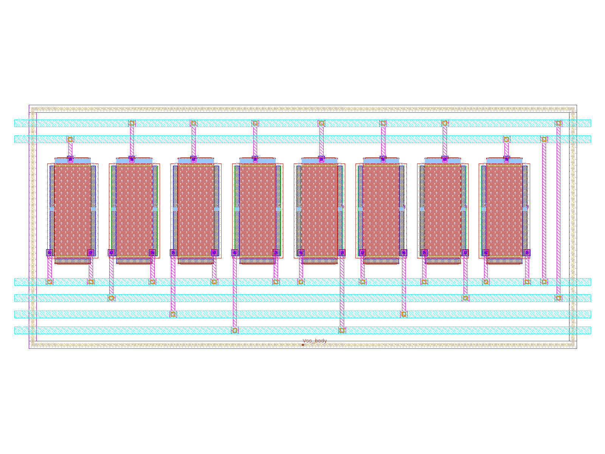
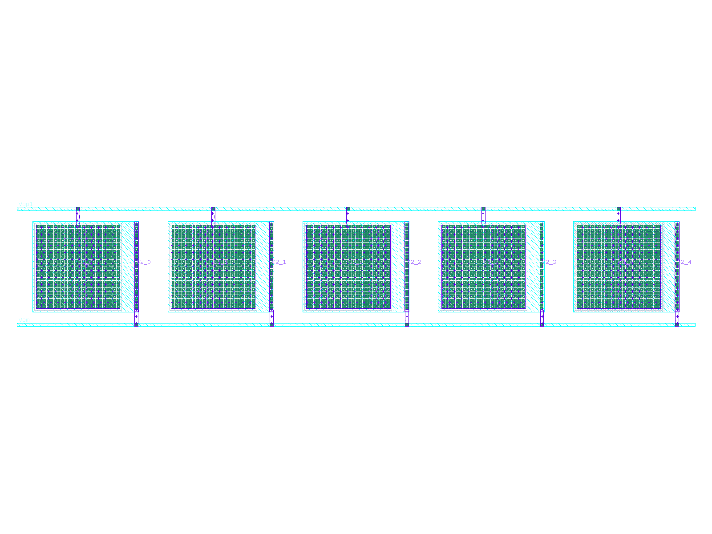
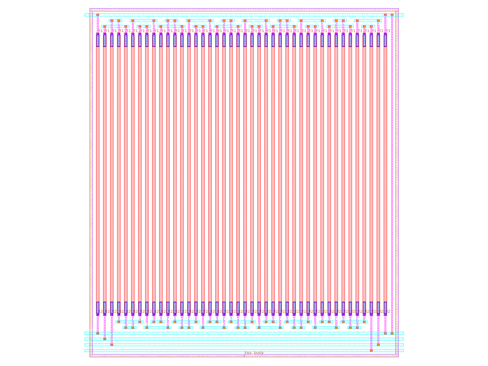
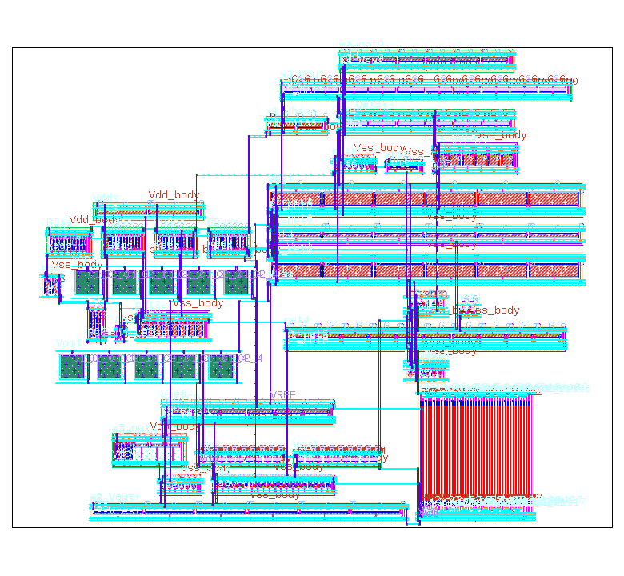
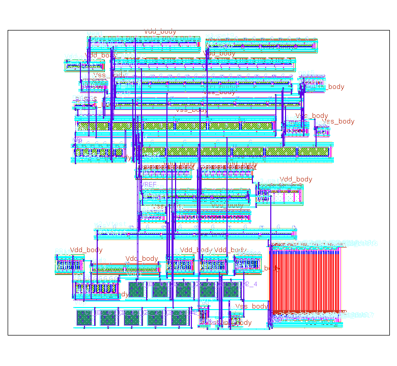
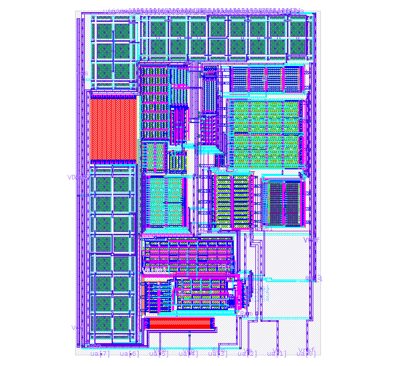
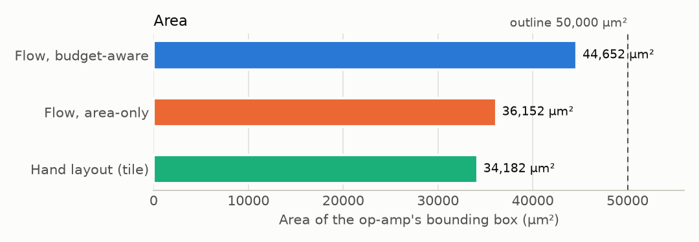
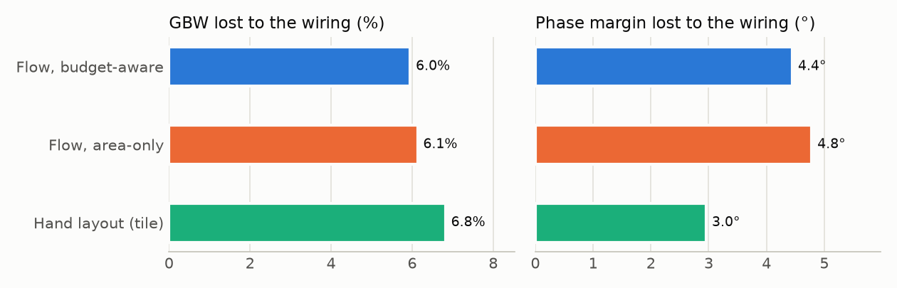

# Automatic layout of `ttsky25a_fd`, and how it compares with the hand layout

*Generated by `python3 scripts/make_ttsky_report.py` from the flow's own output files (repo at f99774b4a 2026-11-04). Every number is read from `outputs/`; only the explanations are typed. Assumptions are marked ASSUMPTION; figures taken from elsewhere are marked reported.*

## 1. Summary

`ttsky25a_fd` is Imasha's fully differential op-amp, taped out on Tiny Tapeout (SKY130). Its schematic (`Opamp_with_bias`) has 54 transistors (139 transistor pieces once each multiplier m is drawn), 2 Miller capacitors and 40 resistors. The flow took that schematic and, with no hand editing, drew two complete layouts inside a 250 × 200 µm outline, checked them, read their wiring back and simulated them. S4–S7 took 15 minutes of computer time.

**What came out:**

- **Both layouts are clean and correct:** 0 design-rule errors (DRC) and the layout matches the schematic (LVS), for both.
- **Every spec is still met after layout.** GBW 1.922 MHz (spec ≥ 1.847), phase margin 73.68° (≥ 60), gain 98.25 dB (≥ 97.4), power 456.3 µW (≤ 497.2).
- **One check fails: GBW.** The wiring takes 63 % of the GBW margin; the flow allows 50 %. About two thirds of that is a capacitance inside the Miller capacitors that the extraction very likely counts twice; without it the wiring takes 23 %.
- **Against the hand layout:** the flow's wiring costs less bandwidth (GBW −6.0 % against −6.8 %) but more phase margin (−4.4° against −3.0°). It needs more area: 1.31 × the hand layout's op-amp (budget-aware) and 1.06 × (area-only).
- **A caution:** the taped-out tile is not exactly the schematic (it adds enable switches and its devices differ; section 7). So the two are compared on what the wiring costs and on area, not on absolute speed.

| | Flow, budget-aware | Flow, area-only | Hand layout (tile) |
|---|---|---|---|
| Size of the op-amp (µm) | 227.0 × 196.7 | 188.8 × 191.4 | 156.8 × 218.0 |
| Area (µm²) | 44,652 | 36,152 | 34,182 |
| DRC errors / LVS | 0 / match | 0 / match | taped out (not checked here) / does not match the schematic (by design: switches added) |
| GBW lost to the wiring | −6.0 % | −6.1 % | −6.8 % |
| Phase margin lost to the wiring | −4.4° | −4.8° | −3.0° |
| GBW after layout (MHz) | 1.922 | 1.918 | 1.426 (its own devices give 1.53 before wiring) |
| Phase margin after layout (°) | 73.68 | 73.34 | 77.6 |

> **How to read it.** "lost to the wiring" compares the same layout simulated twice, with its drawn devices only and with every wire's capacitance (C-only extraction, Magic, same bench, same conditions). It isolates what the wiring and placement cost, which is the fair comparison between two layouts of slightly different circuits.

## 2. The circuit and what was asked

The design's own hierarchy (from its xschem schematic) splits it into sub-circuits; the flow keeps them as units ("macros"):

| Sub-circuit | What it is | Elements |
|---|---|---|
| top | Opamp_with_bias (bias: beta multiplier, start-up, current outputs; Miller capacitors) | 18 |
| x1 | Diff_opamp (folded-cascode first stage + its CMFB + bias diodes) | 27 |
| x2 | Common_source_stage (second stage + resistive-sense CMFB) | 12 |
| x2/x1 | res_pack (CM sense resistors, OUTP side) | 20 |
| x2/x2 | res_pack (CM sense resistors, OUTN side) | 20 |

**The specs** (each 0.9 × the schematic's own result: ASSUMPTION):

| Spec | Schematic | Limit | Margin | Allowance for the layout (η × margin) |
|---|---|---|---|---|
| Phase margin (PM) (°) | 78.231 | ≥ 60 | 18.23 | 9.117 |
| DC gain (dB) | 98.392 | ≥ 97.401 | 1 | 0.5 |
| Unity-gain bandwidth (GBW) (MHz) | 2.0517 | ≥ 1.8465 | 0.2052 | 0.1026 |
| Power (µW) | 451.98 | ≤ 497.18 | 45.2 | 22.6 |

**Imasha's decisions for this layout** (2026-11-04; `inputs/ttsky25a_fd/layout.yaml`):

- Use the design's own hierarchy; the code arranges the floorplan.
- A hard outline of 250 × 200 µm.
- Matched transistors as common centroid or interdigitated, as needed; the choice follows the spec- and area-driven cost, with no extra rule where there is no reason for one.
- Dummies at the ends of every matched row.
- The two resistor packs interleaved, so they match each other.

## 3. How the layout was made

The flow runs in stages; each ends with automatic checks (gates). S0–S3 prepare (read the design, model it, set the budgets, size the transistor cells); S4–S7 build and judge the layout.

| Stage | What it does, in one line | Result | Time (min) |
|---|---|---|---|
| S0 | reads the schematic, the specs and the test benches; checks they agree | PASS | 22.7 |
| S1 | builds a simple model of the amplifier and checks it against simulation | FAIL (G1.2) | 3.8 |
| S2 | turns the specs into budgets: how much capacitance and wire length each net may have | PASS | 77.0 |
| S3 | chooses how each transistor is drawn (fingers, cell shape) and checks it in simulation | FAIL (G3.3, G3.5) | 53.0 |
| S4 | groups transistors into matched blocks, draws each (with dummies and a tap ring), checks each | PASS | 4.2 |
| S5 | places the blocks inside the outline and wires them; checks DRC and LVS | FAIL (G5.4) | 6.4 |
| S6 | reads the finished layout back with its wiring capacitance; compares with S2's budgets | FAIL (G6.2) | 3.6 |
| S7 | simulates the read-back layout in the original benches; compares with the specs | FAIL (G7.2) | 1.0 |

**Who decides what.** No AI model takes any decision in this flow. The code decides, by fixed rules and by scoring candidates with a cost function; Imasha decides the constraints (the outline, matching style, dummies, which resistors match). The cost the flow minimises is area plus how much of each net's wire-length budget it uses; those budgets come from the specs (S2), so the placement is driven by the specs and the area. Section 8 lists the gates that fail and why; none is a crash.

## 4. The building blocks (S4)

S4 grouped the 54 transistors into blocks (every matched group in one block), plus one block per Miller capacitor and one for the 40 resistors: 33 blocks. It drew 53 versions (variants) of them, e.g. a matched pair as A B B A and as A B A B, and checked every one alone: all DRC-clean and LVS-matched, each with a deliberately broken copy that the check must reject.

  

> **How to read it.** Left to right: a matched transistor row (common centroid, a dummy at each end, the tap ring around it), a Miller capacitor as 5 MIM units, the 40 resistors of the two packs, interleaved. Blue/purple lines above and below are the metal tracks each block offers for wiring.

**Matching in the final layouts** (gate G5.7). Where a matched block has both a common-centroid and an interdigitated version, S5 takes the one that costs less (area and wire budgets), as Imasha decided:

| Matched block | Budget-aware | Area-only |
|---|---|---|
| mirror_XX1_M1_XX1_M2_XX1_M7_XX1_M9 | interdigitated, centres 17.1 µm off | centroid, common centroid |
| mirror_XX1_M22_XX1_M15 | ABBA, common centroid | ABAB, centres 10.7 µm off |
| nmos_current_mirror | centroid, common centroid | interdigitated, centres 3.4 µm off |
| nmos_current_mirror_2 | ABBA, common centroid | ABBA, common centroid |
| nmos_current_mirror_3 | ABBA, common centroid | ABAB, centres 1.2 µm off |
| nmos_current_mirror_load | ABBA, common centroid | ABBA, common centroid |
| nmos_differential_pair | ABBA, common centroid | ABAB, centres 2.7 µm off |
| nmos_differential_pair_2 | ABBA, common centroid | ABAB, centres 10.7 µm off |
| nmos_differential_pair_3 | ABBA, common centroid | ABAB, centres 10.7 µm off |
| nmos_matched_cascode_pair | ABBA, common centroid | ABBA, common centroid |
| nmos_matched_cascode_pair_2 | ABBA, common centroid | ABAB, centres 1.2 µm off |
| nmos_matched_current_source_pair | ABAB, centres 1.2 µm off | ABAB, centres 1.2 µm off |
| pmos_current_mirror | ABAB, centres 1.3 µm off | ABAB, centres 1.3 µm off |
| pmos_current_mirror_load | ABAB, centres 5.8 µm off | ABAB, centres 5.8 µm off |
| pmos_differential_pair | ABBA, common centroid | ABBA, common centroid |
| pmos_matched_cascode_pair | ABAB, centres 5.9 µm off | ABAB, centres 5.9 µm off |
| pmos_matched_current_source_pair | ABAB, centres 1.3 µm off | ABBA, common centroid |
| pmos_matched_current_source_pair_2 | ABAB, centres 1.3 µm off | ABAB, centres 1.3 µm off |
| pmos_matched_current_source_pair_3 | ABBA, common centroid | ABAB, centres 1.3 µm off |
| pmos_matched_current_source_pair_4 | ABBA, common centroid | ABAB, centres 5.9 µm off |

**What it shows here:** 13 of 20 matched blocks are common centroid in the budget-aware layout, 6 of 20 in the area-only one. "Centres off" is how far one device's centre sits from the row's centre in an interdigitated row.

## 5. The layouts (S5)

All three pictures are at the same scale. The box around the flow's layouts is the 250 × 200 µm outline; the hand layout is the whole Tiny Tapeout tile (161 × 226 µm), whose op-amp (`Diff_Opamp`) measures 156.8 × 218.0 µm.

  

*Left to right: Flow, budget-aware, Flow, area-only, Hand layout (tile).*

**How the placement was found.** Each sub-circuit is placed on its own: its blocks in rows (PMOS above NMOS), arranged by simulated annealing (a seeded random search that keeps improvements), in three widths. Then every arrangement of the four sub-circuits' shapes is tried, and anything outside the outline is rejected. Both winners are wired by a router that lays metal-3 horizontally and metal-4 vertically on a 0.8 µm grid, shortest path first.

| | Budget-aware | Area-only |
|---|---|---|
| Sub-circuits, top to bottom | top, x1 / x2, res_packs | x1 / x2 / top, res_packs |
| Size (µm) | 227.0 × 196.7 | 188.8 × 191.4 |
| Area (µm²) | 44,652 | 36,152 |
| Top-level wire (µm) | 1,746 | 2,601 |
| Sum of wire-budget use (lower is better) | 119.3 | 199.0 |
| Nets longer than their budget | 16 of 69 | 17 of 69 |
| DRC errors / LVS | 0 / match | 0 / match |

**What it shows here:** the budget-aware layout uses 40 % less of the wire budgets for 24 % more area. Most nets that run between sub-circuits are still far over the length budgets from S2, which assumed a much more compact layout (section 8).

> **How to read it.** The bounding box of each op-amp; the dashed line is the outline's area. The hand layout's op-amp also holds the tile's enable switches.

## 6. After layout: what the wiring costs (S6, S7)

S6 reads each finished layout back with the capacitance of every wire and S7 simulates it in the same test benches as the schematic. Resistance is not included (capacitance-only, "C-only"; section 9).

| Spec | Limit | Schematic | Drawn devices | After layout, budget-aware | Use of the allowance | After layout, area-only | Use of the allowance |
|---|---|---|---|---|---|---|---|
| Phase margin (PM) (°) | ≥ 60 | 78.231 | 78.128 | 73.678 | 0.499 | 73.343 | 0.536 |
| DC gain (dB) | ≥ 97.401 | 98.392 | 98.252 | 98.252 | 0.28 | 98.252 | 0.28 |
| Unity-gain bandwidth (GBW) (MHz) | ≥ 1.8465 | 2.0517 | 2.0432 | 1.9216 | **1.27** | 1.9179 | **1.3** |
| Power (µW) | ≤ 497.18 | 451.98 | 456.27 | 456.27 | 0.19 | 456.27 | 0.19 |

> **How to read it.** "use of the allowance" is (schematic − after layout) / (η × margin): 1.0 is all the flow allows the layout to take; bold is more. Every value still meets its spec (G7.1 passes).

**Why GBW fails, and the double count.** GBW is set mainly by the Miller capacitors. Extracted alone, each Miller capacitor block shows 48.5 fF between its own plates on top of the capacitor itself. The capacitor's model already contains that, so the extraction very likely counts it twice (it is how Magic's SKY130 rules treat metal-4 over metal-3). With it removed, GBW after layout is 2.005 MHz, using 0.455 of the allowance, and every spec is within it (phase margin 0.593). The gate keeps the extraction's number; which one should count is an open question (section 10).

**Budgets.** S2 had set a capacitance budget for every net and every pair of nets. 195 of them are exceeded in the budget-aware layout (209 in the area-only one). The budgets assumed a far tighter layout; the simulation above is the real judge, and it passes every spec.

> **How to read it.** The drop from drawn devices to the extracted layout, for each of the three layouts, measured the same way. Shorter bars are better.

## 7. Comparison with the hand layout

**What the hand layout is.** The taped-out Tiny Tapeout tile `tt_um_diff` (`circuits/ttsky25a_fd/upstream_src/gds/tt_um_diff.gds`), drawn by hand by the designers. The flow extracted it with the same tool and settings (Magic, capacitance only) and simulated it in the same benches (flow record 7.7).

**Why it is not the same circuit.** LVS of the tile against the schematic does not match: the tile adds enable switches and its device sizes differ. Its drawn devices alone give GBW 1.53 MHz and gain 108.1 dB, against the schematic's 2.052 MHz and 98.39 dB. Its absolute numbers therefore cannot be set against the flow's specs; what compares fairly is:

| | Flow, budget-aware | Flow, area-only | Hand layout |
|---|---|---|---|
| Area of the op-amp (µm²) | 44,652 (1.31 ×) | 36,152 (1.06 ×) | 34,182 (1.00 ×) |
| GBW lost to the wiring | 6.0 % | 6.1 % | 6.8 % |
| Phase margin lost to the wiring | 4.45° | 4.78° | 2.96° |
| Gain lost to the wiring | 0.001 dB | 0.001 dB | 0.014 dB |

**What it shows.**

- **Bandwidth:** the flow's wiring costs less GBW than the hand layout's (6.0 % against 6.8 %).
- **Phase margin:** the flow's wiring costs more (4.4° against 3.0°). A likely reason (not measured separately): the design's hierarchy puts the Miller capacitors in the `top` sub-circuit, and the flow places each sub-circuit as a unit, so the capacitors stand away from the first-stage outputs (Vop1, Vom1, in x1) they connect to; those nets and the outputs run long between sub-circuits (the worst net, net6, uses 34 × its length budget).
- **Area:** the hand layout is denser. The flow's blocks each carry their own tap ring and stand 3 µm apart, and the outline (not the area) was the target; the area-only layout comes within 6 % of the hand layout.
- **Effort:** the flow's layouts took minutes of computer time, with every DRC, LVS and simulation check run automatically; the hand layout's design time is not recorded here.

*For reference, the designers' paper reports post-layout simulation of the tile (reported, ICM 2026 paper text, supplied by the designer in the chat on 2026-10-26 (hand-entered; not generated)): about 100 dB gain, 2.3 MHz bandwidth and 52° phase margin, under the paper's own load and conditions, which differ from the flow's bench.*

## 8. What did not pass, and why

None of these is a crash; each stage finished and reported.

- **S1 G1.2:** the simple model and the simulation define phase margin slightly differently (the model rounds the 1 Hz phase); with one definition they agree within 0.06°. Open question to Imasha (flow record row 81).
- **S3 G3.3:** some transistor types use their "least bad" drawn cell; every spec is still met in simulation.
- **S3 G3.5:** same as G3.3: a relaxation was needed for some cells.
- **S5 G5.4:** S2's wire-length budgets assume a far more compact layout than blocks with tap rings, dummies and 3 µm gaps in this outline; nets between sub-circuits are over (the worst, net6, at 34 × its budget in the budget-aware layout).
- **S6 G6.2:** follows from G5.4: the long nets and their couplings exceed S2's capacitance budgets.
- **S7 G7.2:** GBW loses more than η × its margin (above); within it once the likely double count is removed.

## 9. Assumptions and limits

- The specs are 0.9 × the schematic's own results (ASSUMPTION, kept by Imasha's decision).
- The outline is 250 µm wide and 200 µm tall (ASSUMPTION on the orientation; Imasha gave 250 × 200 µm).
- The two resistor packs' tap ring and dummies are on Vss (ASSUMPTION).
- Capacitance-only extraction: Magic's resistance extraction ran out of memory on this layout's supply rings (flow record row 87). The hand layout is measured the same way, so the comparison holds; the absolute post-layout numbers leave out wire resistance.
- One condition only (typical corner, 27 °C, the bench's own bias); no PVT corners after layout.
- Electromigration limits for SKY130 were not found in the PDK; wire widths are not checked against current.

## 10. Open questions (FEEDBACK NEEDED)

1. Capacitance-only extraction is accepted for this design for now; should resistance extraction be tried another way (e.g. per sub-circuit)?
2. Which GBW number should the G7.2 gate use: the extraction's, or the one with the Miller capacitors' likely double count removed? (The same question stands for LOADBench.)
3. Is the outline 250 µm wide and 200 µm tall, or the other way round?
4. S1's G1.2: align the two phase-margin definitions in S1, or keep it as a reported finding?

## Glossary

- **Schematic:** the circuit as drawn by the designer: which transistors, resistors and capacitors connect to which.
- **Layout:** the drawing of the chip itself: the shapes on each layer that the factory makes. Every wire in it has length, so it adds capacitance and resistance the schematic does not have.
- **Op-amp:** operational amplifier. This one is fully differential: two inputs, two outputs (Vop, Vom).
- **GBW:** unity-gain bandwidth: the frequency at which the amplifier's gain has fallen to 1. Higher is faster.
- **Phase margin (PM):** how far the amplifier is from oscillating in feedback. Above about 60° is comfortable.
- **DC gain:** how much the amplifier multiplies a slow input signal, in dB (98 dB is about 80 000 times).
- **Spec:** a required value, e.g. GBW ≥ 1.85 MHz. Here the specs are 0.9 × what the schematic achieves (ASSUMPTION; the design's README gives results, not specs).
- **Margin, η and allowance:** margin = schematic value − spec limit. The flow lets the layout use at most η = 0.5 of it (the allowance); the other half is kept for everything the flow does not model (process corners, temperature). "Use 1.27" means 1.27 × the allowance.
- **DRC:** design rule check: are all shapes wide enough and far enough apart for the factory? 0 errors = clean.
- **LVS:** layout versus schematic: is the drawn layout the same circuit as the schematic? "Match" = yes.
- **Extraction (PEX):** reading the finished layout back into a netlist that includes the wires' capacitance (here capacitance only, "C-only"), so it can be simulated.
- **Drawn devices:** the layout's transistors as drawn, simulated without any wiring: shows what the layout's device shapes alone change. "Drawn → extracted" is then the cost of the wiring.
- **Common centroid:** matched transistors split into pieces arranged A B B A, so both have the same centre and a gradient across the chip affects them equally.
- **Interdigitated:** pieces alternating A B A B: both spread over the same area, but their centres differ slightly.
- **Dummy:** an unused transistor or resistor at the end of a row, so the real ones at the ends see the same surroundings as those in the middle.
- **Tap ring:** a ring of substrate (or well) contact around a block, which prevents latch-up.
- **MIM capacitor:** metal–insulator–metal capacitor: the Miller capacitors here, 5 units of 10 × 10 µm each.
- **Budget-aware / area-only:** the flow scores every placement two ways and lays out both winners: by area plus how much of each wire's length budget it uses (the flow's own rule), and by area alone (the usual baseline). Comparing them tests whether the budgets help.
- **Macro:** one sub-circuit of the design's own hierarchy (x1, x2, top, the resistor packs), placed as a unit.
- **Gate (G4.1, G5.4 …):** an automatic pass/fail check at the end of a stage.

## Where everything is

- Layouts: `outputs/S5/ttsky25a_fd/routed_budget_aware/` and `routed_area_only/` (GDS, Magic, picture).
- Blocks: `outputs/S4/ttsky25a_fd/blocks/`; extraction: `outputs/S6/ttsky25a_fd/`; simulations: `outputs/S7/ttsky25a_fd/`.
- Hand layout measurements: `outputs/reference_layout/ttsky25a_fd/reference_layout.json`.
- The full record: `docs/flow_record.md` (sections 7.7 and 7.22–7.24); the plan: `docs/plan_v5_ttsky25a.md`; the stage-by-stage tables: `docs/s4_s7_walkthrough.html`.

