# Automatic layout of `ttsky25a_fd`, and how it compares with the hand layout

*Generated by `python3 scripts/make_ttsky_report.py` from the flow's own output files (repo at 6c0a04496 2026-11-04). Every number is read from `outputs/` or from the flow's code; only the explanations are typed. Assumptions are marked ASSUMPTION; figures taken from elsewhere are marked reported.*

**How to read this report.** Section 1 is the result on one page. Sections 2–3 show the circuit and what the flow learned about it before drawing anything. Section 4 says who decided what. Sections 5–6 show how the layout was built (with the exact algorithms), section 7 what it costs after layout, and section 8 the comparison with the hand layout. Sections 9–10 are the novelty and the planned LLM work; 11–13 the failed checks, assumptions and open questions. Each picture has a *How to read it* note (the same for any design) and a *What it shows here* line (built from this run's numbers). A glossary is at the end.

## 1. Summary

`ttsky25a_fd` is Imasha's fully differential op-amp, taped out on Tiny Tapeout (SKY130). Its schematic (`Opamp_with_bias`) has 54 transistors (139 transistor pieces once each multiplier m is drawn), 2 Miller capacitors and 40 resistors. The flow took that schematic and, with no hand editing, drew two complete layouts inside a 250 × 200 µm outline, checked them, read their wiring back and simulated them. S4–S7 took 15 minutes of computer time.

**What came out:**

- **Both layouts are clean and correct:** 0 design-rule errors (DRC) and the layout matches the schematic (LVS), for both.
- **Every spec is still met after layout.** GBW 1.922 MHz (spec ≥ 1.847), phase margin 73.68° (≥ 60), gain 98.25 dB (≥ 97.4), power 456.3 µW (≤ 497.2).
- **One check fails: GBW.** The wiring takes 63 % of the GBW margin; the flow allows 50 %. About two thirds of that is a capacitance inside the Miller capacitors that the extraction very likely counts twice; without it the wiring takes 23 %.
- **Against the hand layout:** the flow's wiring costs less bandwidth (GBW −6.0 % against −6.8 %) but more phase margin (−4.4° against −3.0°). It needs more area: 1.31 × the hand layout's op-amp (budget-aware) and 1.06 × (area-only).
- **No AI model decided anything in these runs:** every layout decision is made by the flow's code, within the constraints Imasha set (section 4). An LLM wrote and reviewed the code; an LLM *taking* layout decisions is the next step (section 10).
- **A caution:** the taped-out tile is not exactly the schematic (it adds enable switches and its devices differ; section 8). So the two are compared on what the wiring costs and on area, not on absolute speed.

| | Flow, budget-aware | Flow, area-only | Hand layout (tile) |
|---|---|---|---|
| Size of the op-amp (µm) | 227.0 × 196.7 | 188.8 × 191.4 | 156.8 × 218.0 |
| Area (µm²) | 44,652 | 36,152 | 34,182 |
| DRC errors / LVS | 0 / match | 0 / match | taped out (not checked here) / does not match the schematic (by design: switches added) |
| GBW lost to the wiring | −6.0 % | −6.1 % | −6.8 % |
| Phase margin lost to the wiring | −4.4° | −4.8° | −3.0° |
| GBW after layout (MHz) | 1.922 | 1.918 | 1.426 (its own devices give 1.53 before wiring) |
| Phase margin after layout (°) | 73.68 | 73.34 | 77.6 |

> **How to read it.** "lost to the wiring" compares the same layout simulated twice, with its drawn devices only and with every wire's capacitance (C-only extraction, Magic, same bench, same conditions). It isolates what the wiring and placement cost, which is the fair comparison between two layouts of slightly different circuits.

## 2. The circuit, its sub-circuits and what was asked

The designer's schematic is split into sub-circuits (xschem hierarchy). The flow keeps them as units ("macros"); each has one colour throughout this report: on the schematics, the block gallery and the layouts.

| Colour | Sub-circuit | What it is | Elements |
|---|---|---|---|
| ■ | **top** | Opamp_with_bias (bias: beta multiplier, start-up, current outputs; Miller capacitors) | 18 |
| ■ | **x1** | Diff_opamp (folded-cascode first stage + its CMFB + bias diodes) | 27 |
| ■ | **x2** | Common_source_stage (second stage + resistive-sense CMFB) | 12 |
| ■ | **res_packs** | the two res_packs inside x2 (x2/x1, x2/x2: common-mode sense resistors), drawn as one interleaved block | 40 |

**The top schematic** (`Opamp_with_bias`): the bias circuit (start-up, beta multiplier, current outputs) and the two Miller capacitors are drawn here; the first and second stages are the symbols x1 and x2.

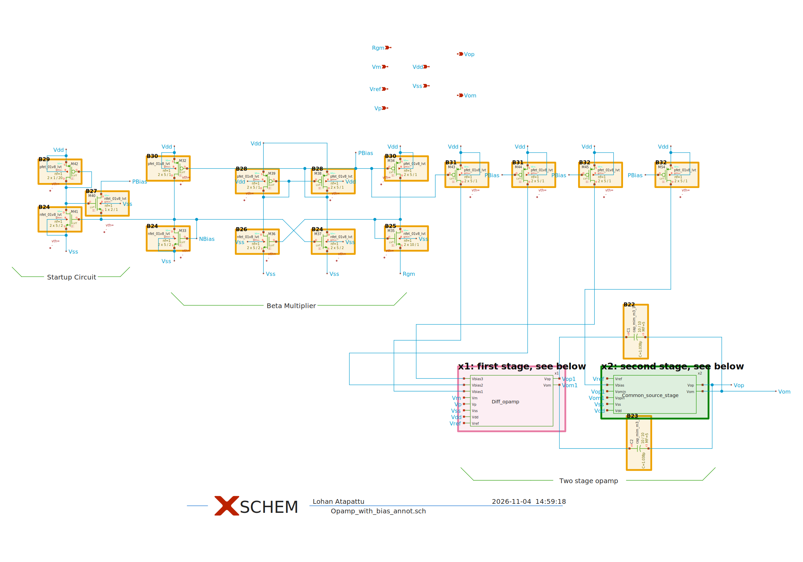

> **How to read it.** The designer's own schematic (xschem), unchanged. A coloured box marks every device the flow lays out, in its sub-circuit's colour, with the number of the block it went into (B1 …, section 5). The two large boxes are the sub-circuits x1 and x2, shown below.

**x1, the first stage** (`Diff_opamp`): folded-cascode input stage with its common-mode feedback and bias diodes.

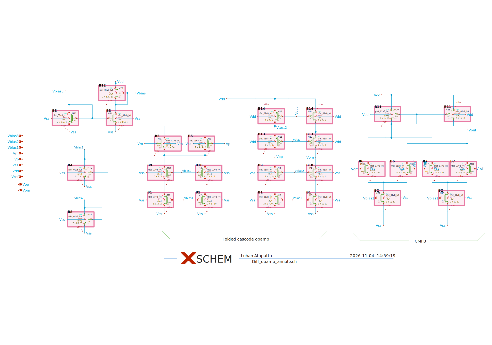

**x2, the second stage** (`Common_source_stage`): common-source output stage and the resistive common-mode sense (the two res_packs).

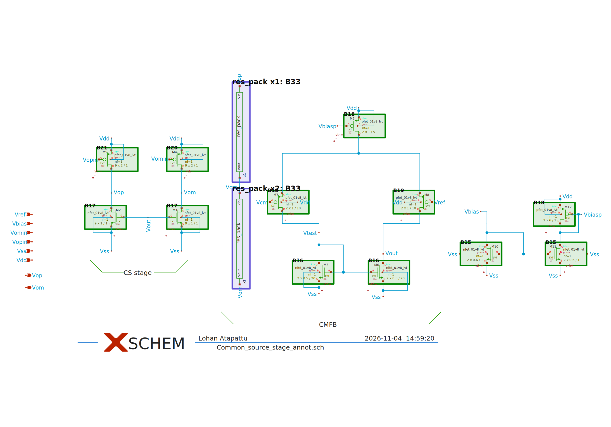

**res_pack** (x2/x1; x2/x2 is the same schematic): 20 poly resistors in series. Both packs go into one interleaved block.

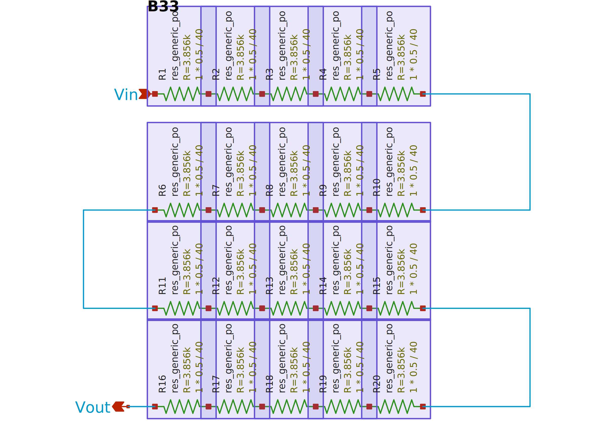

**The specs** (each 0.9 × the schematic's own result: ASSUMPTION):

| Spec | Schematic | Limit | Margin | Allowance for the layout (η × margin) |
|---|---|---|---|---|
| Phase margin (PM) (°) | 78.231 | ≥ 60 | 18.23 | 9.117 |
| DC gain (dB) | 98.392 | ≥ 97.401 | 1 | 0.5 |
| Unity-gain bandwidth (GBW) (MHz) | 2.0517 | ≥ 1.8465 | 0.2052 | 0.1026 |
| Power (µW) | 451.98 | ≤ 497.18 | 45.2 | 22.6 |

**Imasha's decisions for this layout** (2026-11-04; `inputs/ttsky25a_fd/layout.yaml`):

- Use the design's own hierarchy; the code arranges the floorplan.
- A hard outline of 250 × 200 µm.
- Matched transistors as common centroid or interdigitated, as needed; the choice follows the spec- and area-driven cost, with no extra rule where there is no reason for one.
- Dummies at the ends of every matched row.
- The two resistor packs interleaved, so they match each other.

## 3. What the flow learned before drawing: main nodes, nets and budgets (S1, S2)

Before any layout, S1 builds a linear (small-signal) model of the amplifier from its operating point and checks it against transistor-level SPICE; S2 turns the specs into budgets for every net.

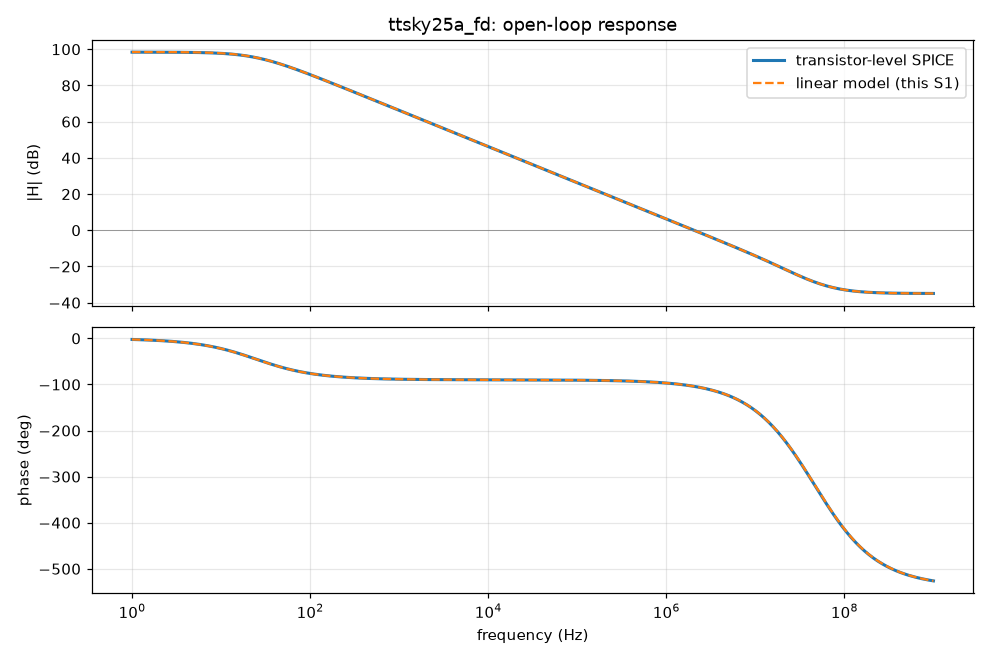

> **How to read it.** The amplifier's open-loop gain (top) and phase (bottom) against frequency: SPICE on the real transistors (solid) and S1's linear model (dashed). Where the gain crosses 0 dB is the GBW; how far the phase is above −180° there is the phase margin.

**What it shows here:** the two curves lie on top of each other: the model S1 uses for every later estimate is faithful (gate G1.3, sensitivities against SPICE: PASS).

**The main nodes.** S1 tags every node (dominant pole, tail, diode-connected, output …), estimates its pole, and measures how much each spec drops per fF added on it; S2 then gives each net a capacitance budget and a wire-length budget. The nodes that matter most, and what the budget-aware layout gave them:

| Node | Role (S1) | Pole rank | GBW lost per fF (kHz) | PM lost per fF (m°) | Capacitance budget (fF) | Extracted (fF) | Use | Wire length use |
|---|---|---|---|---|---|---|---|---|
| Vop1 | dominant_pole | 1 | 0.0572 | 0.615 | 17.4 | 72.5 | **4.17** | 4.83 |
| Vom1 | non_dominant_pole | 2 | 0.0572 | 0.615 | 17.4 | 73.1 | **4.2** | 4.61 |
| x1_net7 | source_coupled (tail) | 3 | 0.00735 | 0.402 | 3.68 | 13.4 | **3.65** | 2.66 |
| x1_net8 | source_coupled (tail) | 4 | 0.00735 | 0.402 | 3.68 | 58.6 | **15.9** | 1.28 |
| x2_Vtest | mirror_node (diode-connected) | 5 | ≈ 0 | ≈ 0 | 239 | 61.1 | 0.255 | 0.153 |
| x1_net6 | – | 6 | 0.000709 | 0.0068 | 0.787 | 8.7 | **11.1** | 3.83 |
| x1_net5 | – | 7 | 0.000709 | 0.0068 | 0.787 | 4.59 | **5.83** | 10 |
| x1_Vtest2 | – | 8 | 0.137 | 42.4 | 1.86 | 44.6 | **24** | 6.2 |
| x1_net1 | – | 9 | 0.137 | 42.4 | 1.86 | 24.7 | **13.3** | 5.66 |
| Vop | signal_output | 12 | 0.00149 | 1.14 | 5.08 | 65 | **12.8** | 10.8 |
| Vom | signal_output | 13 | 0.00149 | 1.14 | 5.08 | 132 | **25.9** | 14.1 |
| x2_x1_net4 | – | 42 | 0.00135 | 1.03 | 1.88 | 1.33 | 0.706 | 0 |
| x2_x2_net16 | – | 55 | 0.00135 | 1.03 | 1.88 | 1.02 | 0.54 | 0 |

> **How to read it.** Pole rank 1 is the lowest-frequency pole (the dominant one). The two sensitivity columns say how much GBW and phase margin drop for each fF of wiring added on that node. "Use" is extracted / budget (bold: over); "wire length use" is the routed length over S2's length budget.

**What it shows here:** Vop1 and Vom1, the first-stage outputs, carry the dominant pole: they set the GBW (with the Miller capacitors) and are high-impedance, so every fF there counts. x1_Vtest2 and x1_net1 are the nodes where added capacitance costs the most phase margin. Most main nodes end up over their capacitance budget, which is why G6.2 fails (section 11); the simulation in section 7 shows the specs are still met, because the budgets assume a far tighter layout.

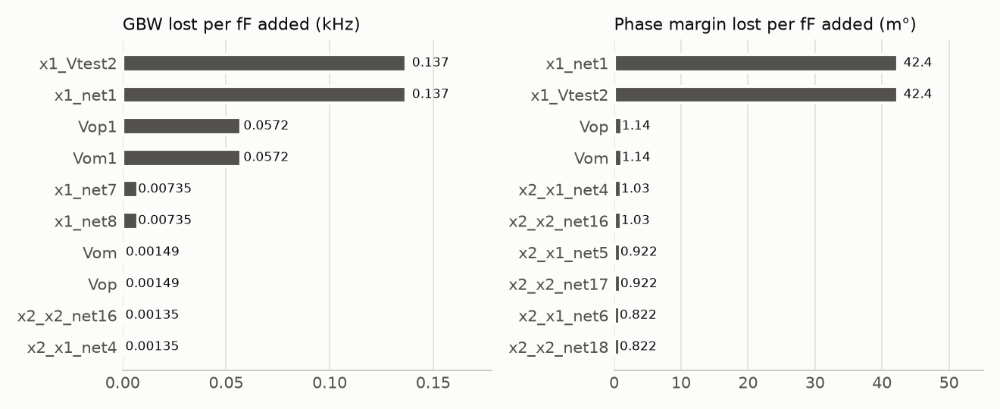

> **How to read it.** The ten nodes where added capacitance costs the most GBW (left) and phase margin (right), from S1's linear model. These are the nodes whose wires the layout should keep short.

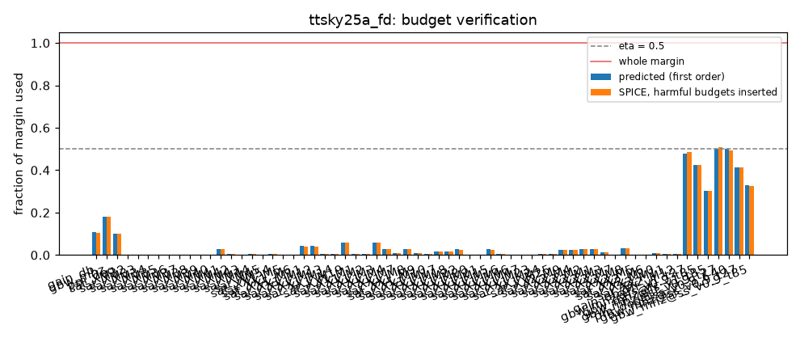

> **How to read it.** S2's own check of its budgets: for each spec and corner (x axis), the share of the margin used if every harmful budget were filled at once, predicted (blue) and simulated in SPICE (orange). Every bar must stay under η (dashed line).

**What it shows here:** every bar stays under 0.5: if the layout keeps within its budgets, the specs keep half their margin.

**Matching groups** (S1, rule: *diff pair: identical W, L, nf, m; mirror: same L and model (ratio allowed)*): 12 groups were found; each becomes one S4 block, so its devices are drawn together and matched.

## 4. Who decides what: code, Imasha, and the LLM

Three contributors shape this layout:

- **Code** (the flow): makes every decision at run time, by fixed rules and by searching for the lowest cost. Its settings (seeds, schedules, gaps, thresholds) are fixed in PREREG before the runs.
- **Imasha** (the definition): the design, the constraints and the policies (outline, matching style, dummies, which resistors match, use of the hierarchy), and approval of the plans.
- **LLM** (Claude, while building the flow): wrote the code, proposed the algorithms, the rules and the ASSUMPTIONs, drafted PREREG, and reviewed the code independently. **No LLM is called during a run.**

| Decision | What was decided here | Why | Code | Imasha | LLM |
|---|---|---|---|---|---|
| Specs | each spec 0.9 × the schematic's own result | the design's README gives results, not specs; a 10 % margin is what the layout may cost | applies them in every check | accepted (kept) | proposed the ASSUMPTION |
| Share of the margin for layout (η) | 0.5 | the other half stays for what the flow does not model (corners, temperature, mismatch) | applies it to every budget and to G7.2 | accepted | proposed (ASSUMPTION) |
| Main nodes and sensitivities | the first poles, the high-impedance and the most sensitive nodes (section 3) | they decide which wires must stay short | computes them (S1: linear model, checked against SPICE) | – | wrote the S1 method |
| Budgets | a capacitance, coupling, resistance and length budget per net | shares the allowance so that all parasitics together stay within it | computes them (S2: max-min fair sharing) | – | designed the sharing rule |
| Transistor cells | fingers, contacts, cell shape per device type | the smallest cell that keeps each node within budget | chooses them (S3) | – | wrote the rule base |
| Blocks | matched devices in one block; one type and one body per block | matched devices must be drawn together; a ring holds one body | groups them (S4, from S1's matching rule) | approved the plan | proposed the rule (plan v4) |
| Matching style | common centroid or interdigitated, as needed | both cancel gradients; the cheaper one wins | draws both, S5 picks by the cost | decided the policy | implemented the sequences |
| Dummies | one at each end of every matched row | ends see the same surroundings as the middle | adds them, wired to the body | decided | implemented |
| Resistors | the two packs interleaved A B B A | the two common-mode sense strings must match | draws and checks the block | decided | implemented the string order |
| Capacitors | each Miller capacitor as 5 MIM units of 10 × 10 µm | as the schematic gives them (MF = 5) | draws the array | (the design) | implemented |
| Sub-circuits as macros | x1, x2, top and the resistor packs placed as units | keeps the designer's grouping and makes the search smaller | places each, then arranges them | decided ("use the given hierarchy") | implemented |
| Outline | 250 × 200 µm, hard | a fixed area to fit, never traded against wire length | rejects anything outside (G5.6) | decided (orientation: ASSUMPTION) | proposed reject-not-trade |
| Floorplan | which block goes where | the lowest cost (area and wire budgets) | searches and decides (annealing, enumeration) | decided that the code arranges it | designed the search; its settings are fixed in PREREG |
| Routing | metal-3/metal-4 grid router | many blocks side by side; a grid keeps wires legal by construction | routes every net | – | designed |
| Extraction | capacitance only | resistance extraction ran out of memory here | extracts | open question | proposed, flagged |
| Checks | DRC, LVS, budgets, specs, η, at every stage | nothing passes on trust | runs them | approved PREREG | drafted PREREG |

## 5. The building blocks (S4)

S4 grouped the 54 transistors into blocks (every matched group in one block), plus one block per Miller capacitor and one for the 40 resistors: 33 blocks. It drew 53 versions (variants) of them and checked every one alone: all DRC-clean and LVS-matched, each with a deliberately broken copy that the check must reject.

**The algorithm, step by step** (`src/s4/run.py`, `src/s4/block.py`):

1. **Group:** S1's matching groups first, then S0's blocks for the rest; one device type and one body net per block; every device in exactly one block.
2. **Units:** a device with multiplier m is drawn as m copies (units) of the cell S3 chose.
3. **Variants** (with `matching: centroid`):
   - *common centroid*: each device's copies halved on each side of the centre and interleaved in turn (A B B A; A B C C B A for three devices); a device with an odd count takes the centre;
   - *interdigitated*: one copy of each in turn (A B A B …);
   - *mirror* (two odd counts, e.g. m = 9, cannot share a centre): the best mirror-image row;
   - *resistors*: the two strings interleaved A B B A …, each string alternating orientation so that two neighbours share a node on one side;
   - a single device: one row (A).
4. **Dummies:** one unit at each end of every matched row, every terminal on the body net.
5. **Draw the row:** units left to right, 0.6 µm apart; a metal-2 stub from each terminal to one metal-3 track per net above or below the row (0.4 µm wide, 0.9 µm pitch); a net used only inside the block gets a short track, packed with others in rows by the left-edge rule; a net with pins on both sides gets a metal-2 column joining its two tracks.
6. **Ring:** one tap ring 0.8 µm outside the tracks (n-well for PMOS); a tap strip inside the row where a diffusion would be farther from a tap than the latch-up limit.
7. **Sign off:** Magic DRC; Netgen LVS against the block's own netlist (with m and the dummies); a negative control (one length changed) must fail.

**Every block** (numbered as on the schematics; the colour bar is the sub-circuit; the picture is the variant the budget-aware layout chose):

<figure style="display:inline-block;width:31%;margin:4px;vertical-align:top;border-top:5px solid #e87ba4;">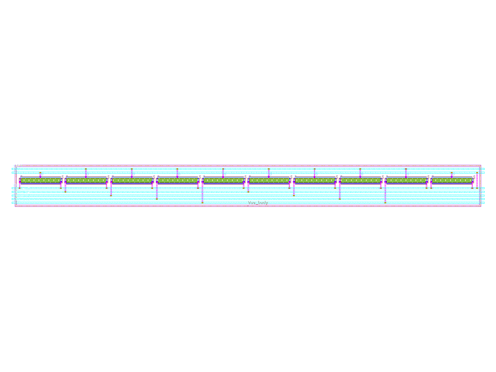<figcaption style="font-size:0.8em"><b>B1 mirror_XX1_M1_XX1_M2_XX1_M7_XX1_M9</b> x1 · XX1_M1, XX1_M2, XX1_M7, XX1_M9 variant interdigitated (area-only: centroid) · 118.1 × 10.4 µm</figcaption></figure><figure style="display:inline-block;width:31%;margin:4px;vertical-align:top;border-top:5px solid #e87ba4;">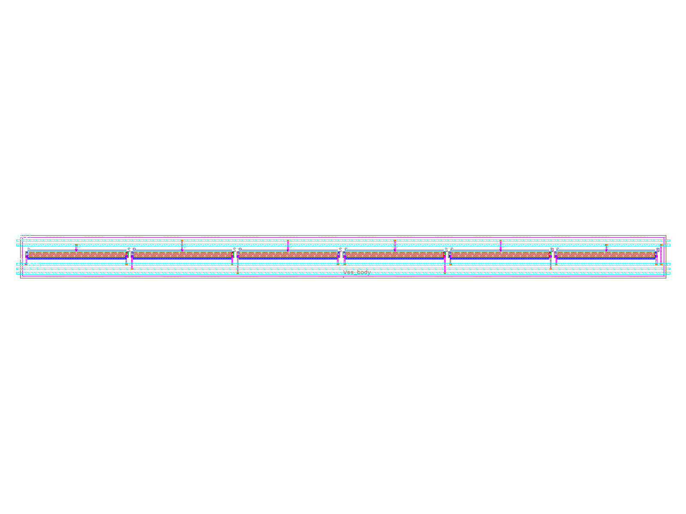<figcaption style="font-size:0.8em"><b>B2 mirror_XX1_M22_XX1_M15</b> x1 · XX1_M22, XX1_M15 variant ABBA (area-only: ABAB) · 132.4 × 8.6 µm</figcaption></figure><figure style="display:inline-block;width:31%;margin:4px;vertical-align:top;border-top:5px solid #e87ba4;">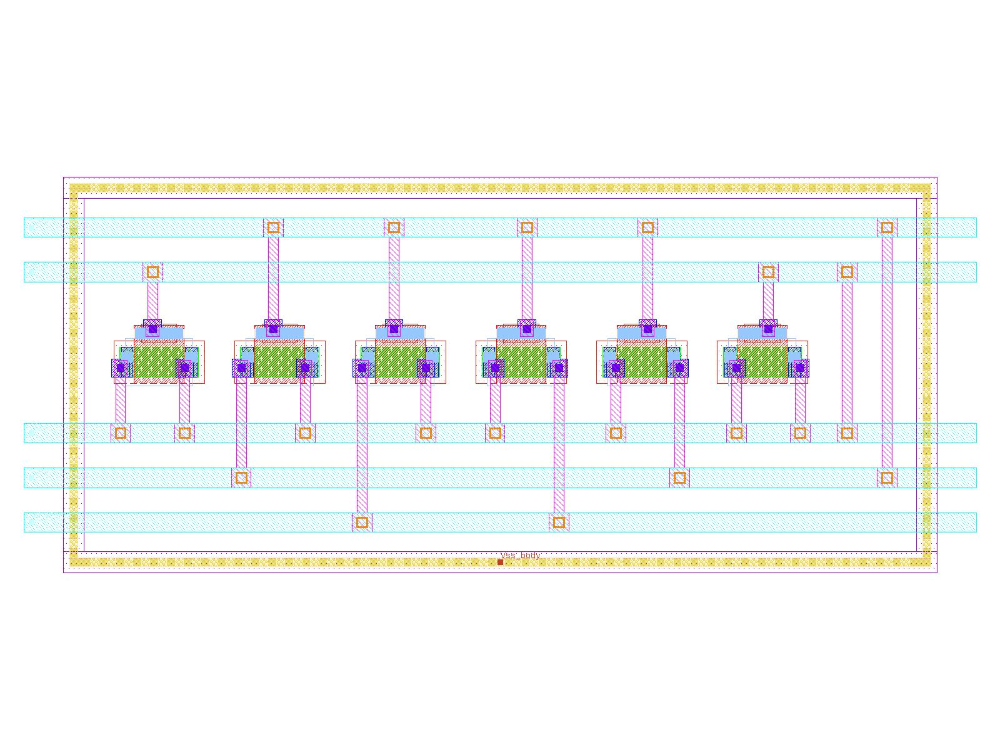<figcaption style="font-size:0.8em"><b>B3 nmos_current_mirror_2</b> x1 · XX1_M23, XX1_M24 variant ABBA · 19.2 × 8.0 µm</figcaption></figure><figure style="display:inline-block;width:31%;margin:4px;vertical-align:top;border-top:5px solid #e87ba4;">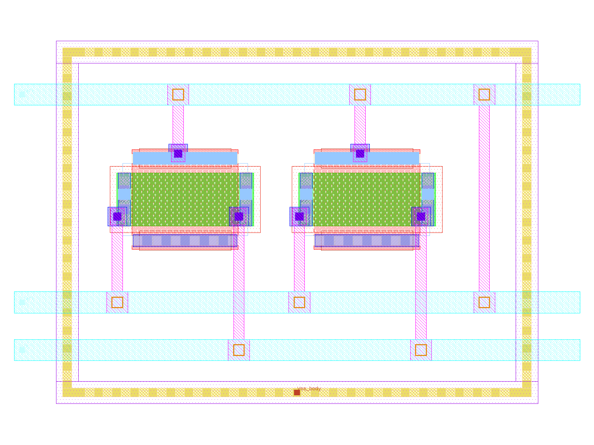<figcaption style="font-size:0.8em"><b>B4 nmos_current_mirror_4</b> x1 · XX1_M46 variant A · 10.7 × 6.8 µm</figcaption></figure><figure style="display:inline-block;width:31%;margin:4px;vertical-align:top;border-top:5px solid #e87ba4;">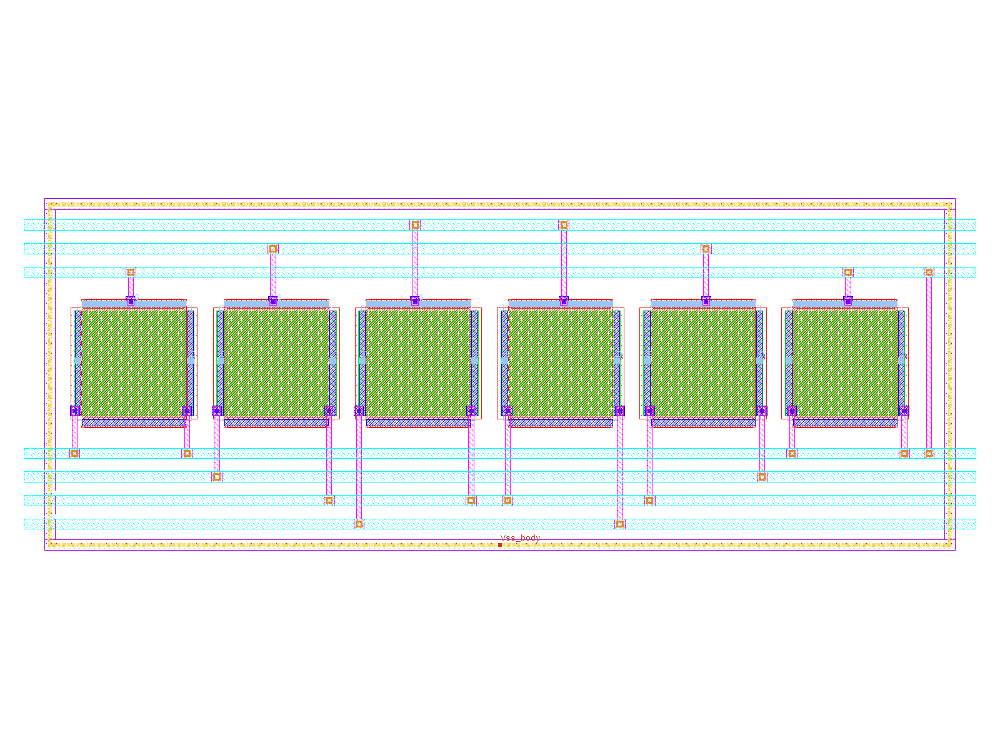<figcaption style="font-size:0.8em"><b>B5 nmos_differential_pair</b> x1 · XX1_M5, XX1_M6 variant ABBA (area-only: ABAB) · 36.4 × 13.4 µm</figcaption></figure><figure style="display:inline-block;width:31%;margin:4px;vertical-align:top;border-top:5px solid #e87ba4;">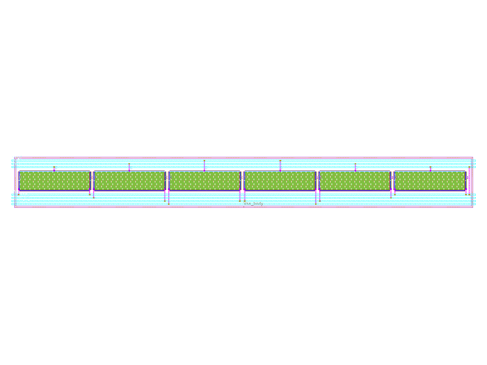<figcaption style="font-size:0.8em"><b>B6 nmos_differential_pair_2</b> x1 · XX1_M18, XX1_M16 variant ABBA (area-only: ABAB) · 132.4 × 14.4 µm</figcaption></figure><figure style="display:inline-block;width:31%;margin:4px;vertical-align:top;border-top:5px solid #e87ba4;"><figcaption style="font-size:0.8em"><b>B7 nmos_differential_pair_3</b> x1 · XX1_M10, XX1_M17 variant ABBA (area-only: ABAB) · 132.4 × 14.4 µm</figcaption></figure><figure style="display:inline-block;width:31%;margin:4px;vertical-align:top;border-top:5px solid #e87ba4;">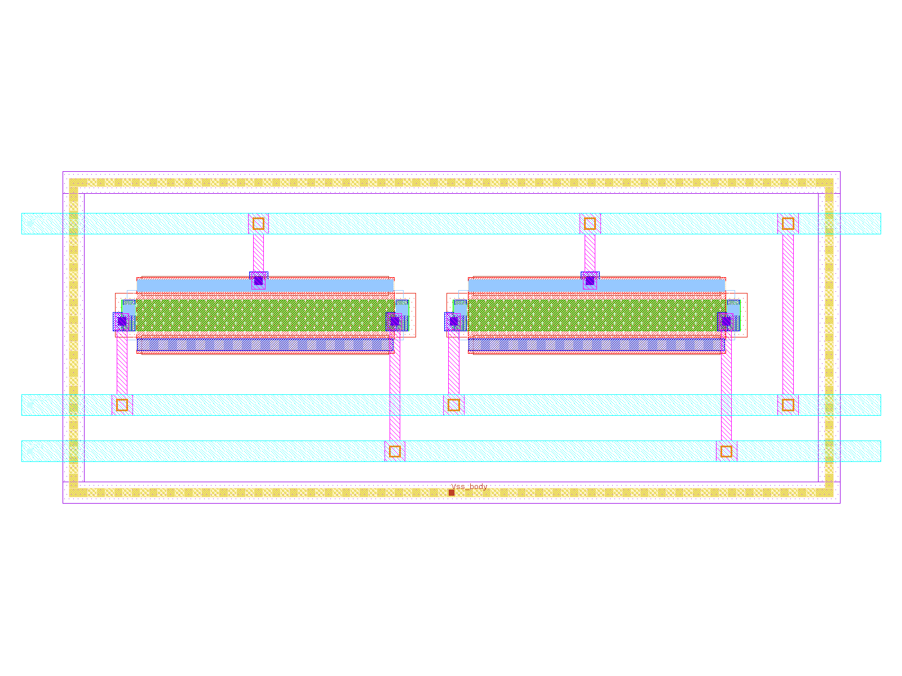<figcaption style="font-size:0.8em"><b>B8 nmos_diode_2</b> x1 · XX1_M47 variant A · 16.7 × 6.4 µm</figcaption></figure><figure style="display:inline-block;width:31%;margin:4px;vertical-align:top;border-top:5px solid #e87ba4;">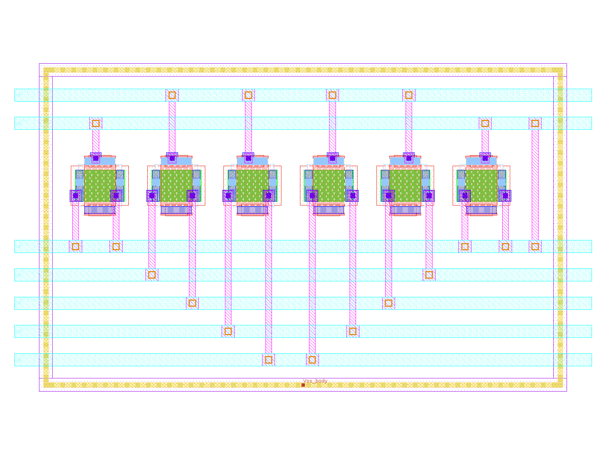<figcaption style="font-size:0.8em"><b>B9 nmos_matched_cascode_pair</b> x1 · XX1_M19, XX1_M4 variant ABBA · 18.4 × 10.4 µm</figcaption></figure><figure style="display:inline-block;width:31%;margin:4px;vertical-align:top;border-top:5px solid #e87ba4;"><figcaption style="font-size:0.8em"><b>B10 nmos_matched_cascode_pair_2</b> x1 · XX1_M3, XX1_M8 variant ABBA (area-only: ABAB) · 18.4 × 10.4 µm</figcaption></figure><figure style="display:inline-block;width:31%;margin:4px;vertical-align:top;border-top:5px solid #e87ba4;">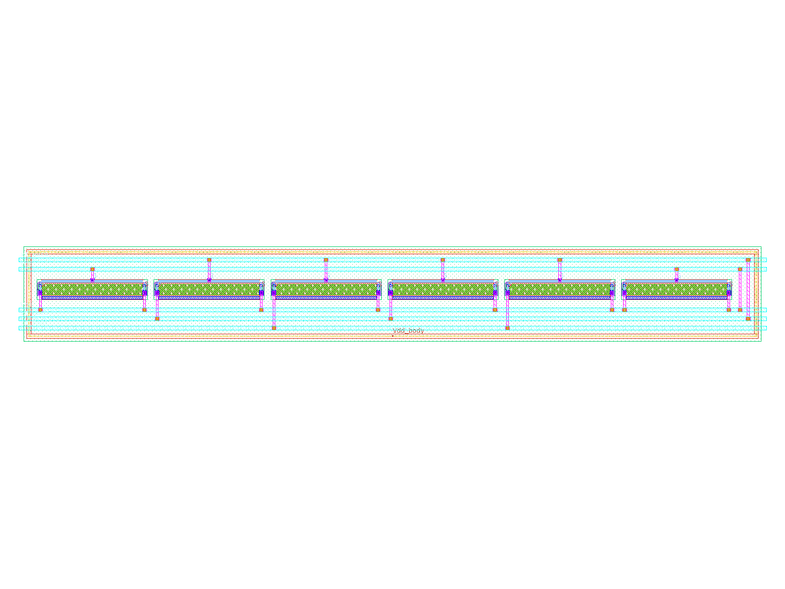<figcaption style="font-size:0.8em"><b>B11 pmos_current_mirror_load</b> x1 · XX1_M20, XX1_M21 variant ABAB · 73.8 × 9.3 µm</figcaption></figure><figure style="display:inline-block;width:31%;margin:4px;vertical-align:top;border-top:5px solid #e87ba4;">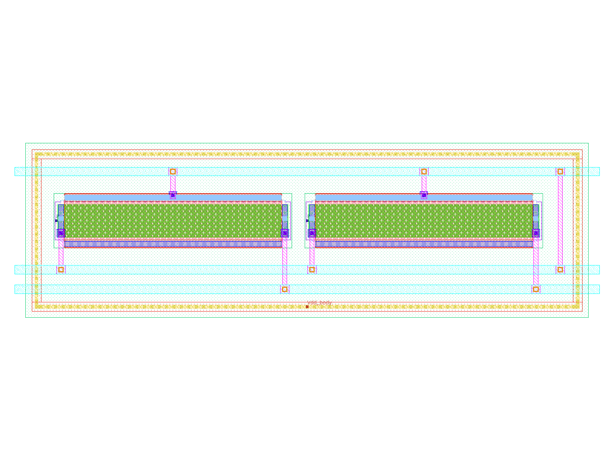<figcaption style="font-size:0.8em"><b>B12 pmos_diode_2</b> x1 · XX1_M25 variant A · 26.9 × 8.0 µm</figcaption></figure><figure style="display:inline-block;width:31%;margin:4px;vertical-align:top;border-top:5px solid #e87ba4;">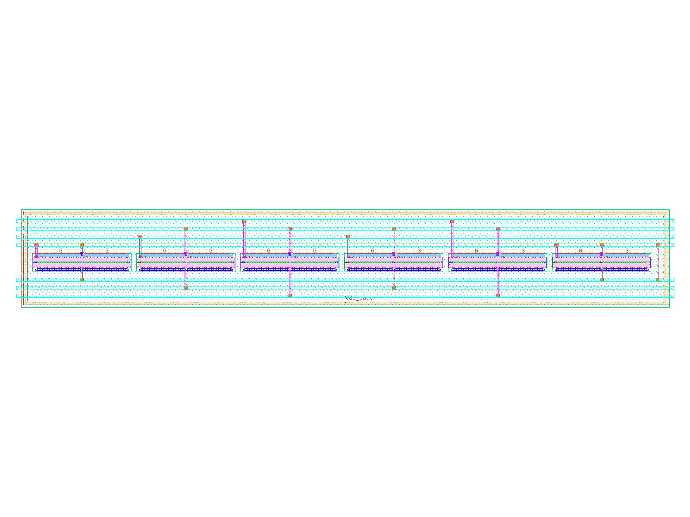<figcaption style="font-size:0.8em"><b>B13 pmos_matched_cascode_pair</b> x1 · XX1_M11, XX1_M12 variant ABAB · 74.8 × 11.1 µm</figcaption></figure><figure style="display:inline-block;width:31%;margin:4px;vertical-align:top;border-top:5px solid #e87ba4;">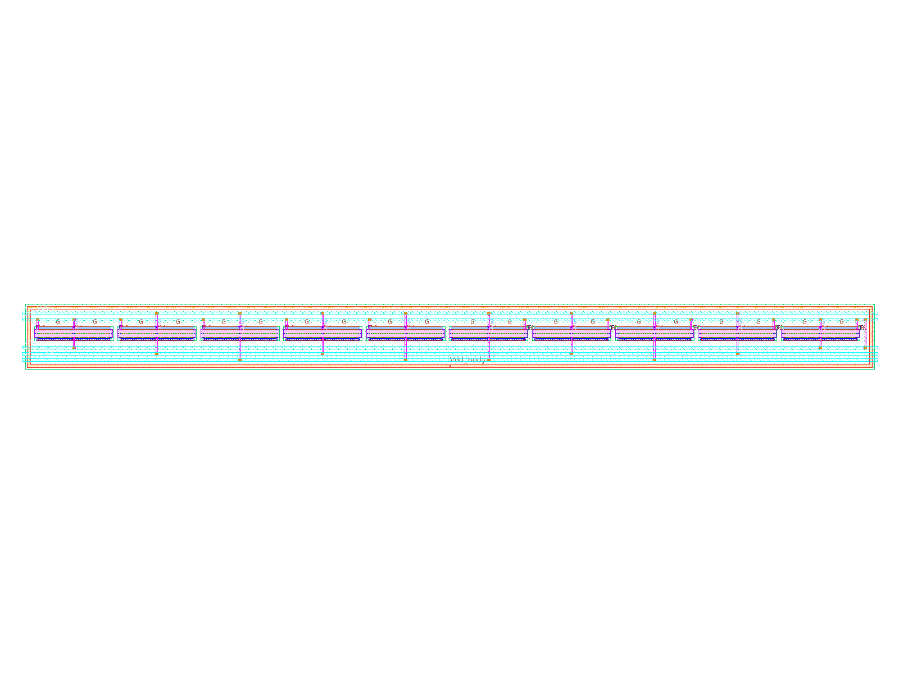<figcaption style="font-size:0.8em"><b>B14 pmos_matched_current_source_pair_4</b> x1 · XX1_M13, XX1_M14 variant ABBA (area-only: ABAB) · 122.1 × 9.3 µm</figcaption></figure><figure style="display:inline-block;width:31%;margin:4px;vertical-align:top;border-top:5px solid #008300;"><figcaption style="font-size:0.8em"><b>B15 nmos_current_mirror_3</b> x2 · XX2_M10, XX2_M11 variant ABBA (area-only: ABAB) · 19.2 × 8.0 µm</figcaption></figure><figure style="display:inline-block;width:31%;margin:4px;vertical-align:top;border-top:5px solid #008300;">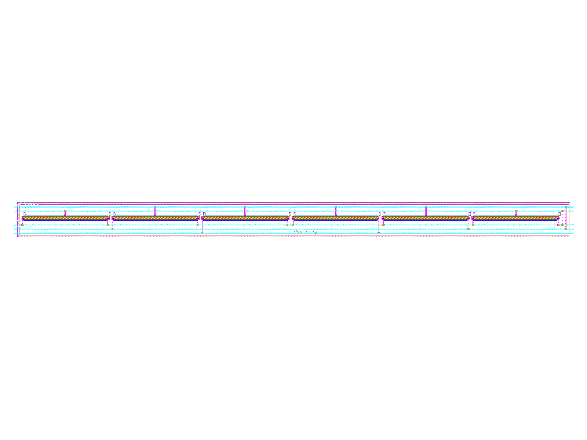<figcaption style="font-size:0.8em"><b>B16 nmos_current_mirror_load</b> x2 · XX2_M5, XX2_M6 variant ABBA · 133.2 × 8.1 µm</figcaption></figure><figure style="display:inline-block;width:31%;margin:4px;vertical-align:top;border-top:5px solid #008300;">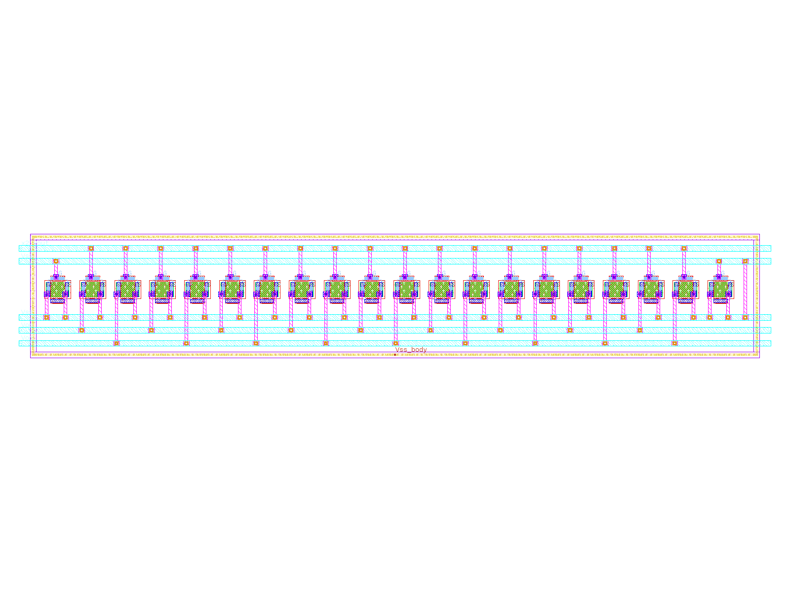<figcaption style="font-size:0.8em"><b>B17 nmos_matched_current_source_pair</b> x2 · XX2_M2, XX2_M1 variant ABAB · 52.4 × 8.6 µm</figcaption></figure><figure style="display:inline-block;width:31%;margin:4px;vertical-align:top;border-top:5px solid #008300;">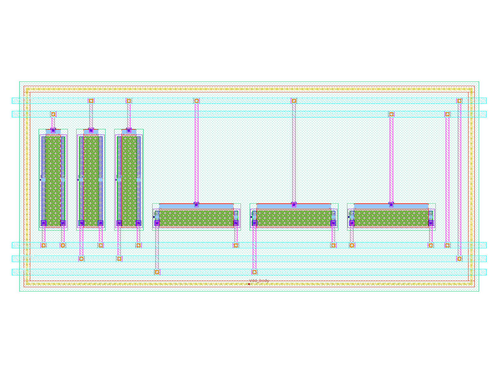<figcaption style="font-size:0.8em"><b>B18 pmos_current_mirror_2</b> x2 · XX2_M12, XX2_M3 variant row · 31.8 × 14.1 µm</figcaption></figure><figure style="display:inline-block;width:31%;margin:4px;vertical-align:top;border-top:5px solid #008300;">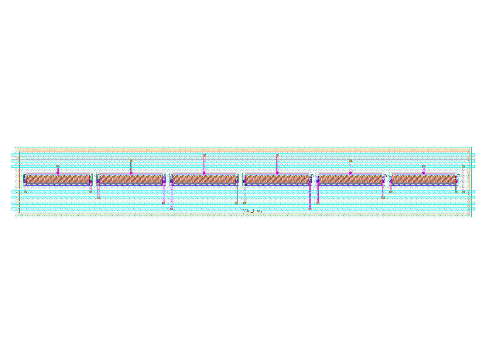<figcaption style="font-size:0.8em"><b>B19 pmos_differential_pair</b> x2 · XX2_M7, XX2_M8 variant ABBA · 73.0 × 11.1 µm</figcaption></figure><figure style="display:inline-block;width:31%;margin:4px;vertical-align:top;border-top:5px solid #008300;">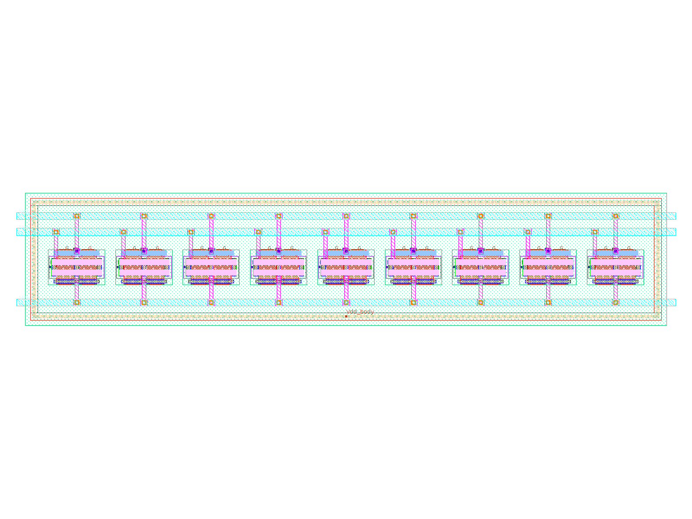<figcaption style="font-size:0.8em"><b>B20 pmos_single</b> x2 · XX2_M4 variant A · 37.5 × 7.5 µm</figcaption></figure><figure style="display:inline-block;width:31%;margin:4px;vertical-align:top;border-top:5px solid #008300;"><figcaption style="font-size:0.8em"><b>B21 pmos_single_2</b> x2 · XX2_M9 variant A · 37.5 × 7.5 µm</figcaption></figure><figure style="display:inline-block;width:31%;margin:4px;vertical-align:top;border-top:5px solid #eda100;"><figcaption style="font-size:0.8em"><b>B22 XC1</b> top · XC1 variant A · 77.7 × 13.7 µm</figcaption></figure><figure style="display:inline-block;width:31%;margin:4px;vertical-align:top;border-top:5px solid #eda100;"><figcaption style="font-size:0.8em"><b>B23 XC2</b> top · XC2 variant A · 77.7 × 13.7 µm</figcaption></figure><figure style="display:inline-block;width:31%;margin:4px;vertical-align:top;border-top:5px solid #eda100;"><figcaption style="font-size:0.8em"><b>B24 nmos_current_mirror</b> top · XM33, XM37, XM41 variant centroid (area-only: interdigitated) · 32.0 × 13.5 µm</figcaption></figure><figure style="display:inline-block;width:31%;margin:4px;vertical-align:top;border-top:5px solid #eda100;">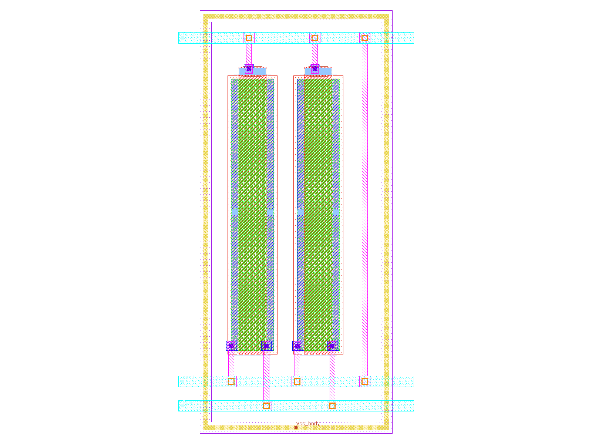<figcaption style="font-size:0.8em"><b>B25 nmos_diode</b> top · XM35 variant A · 8.7 × 15.6 µm</figcaption></figure><figure style="display:inline-block;width:31%;margin:4px;vertical-align:top;border-top:5px solid #eda100;">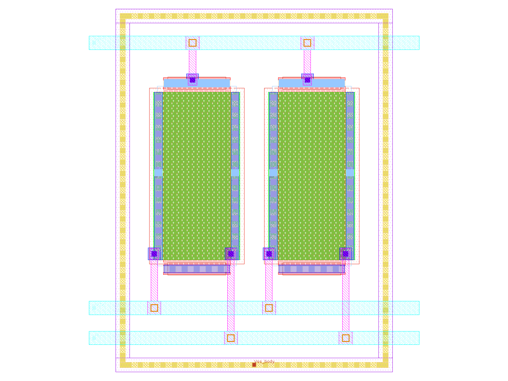<figcaption style="font-size:0.8em"><b>B26 nmos_single</b> top · XM36 variant A · 9.9 × 10.8 µm</figcaption></figure><figure style="display:inline-block;width:31%;margin:4px;vertical-align:top;border-top:5px solid #eda100;">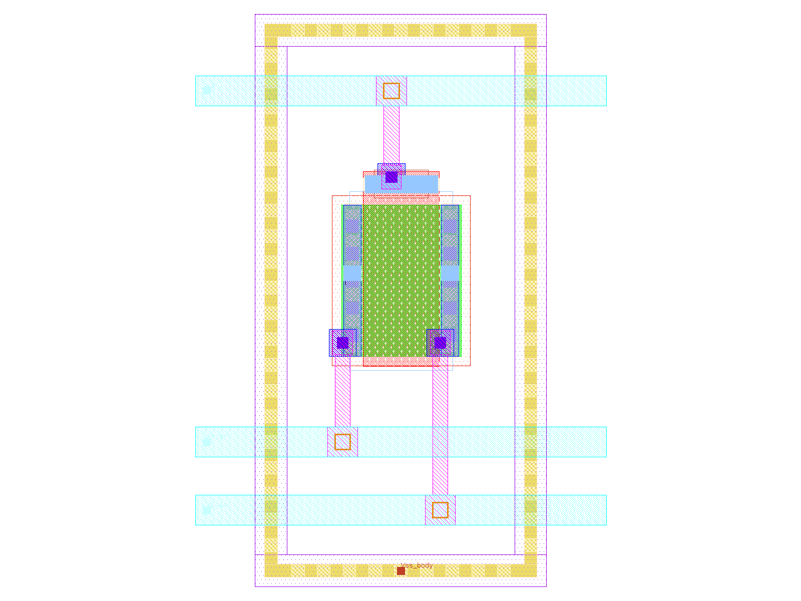<figcaption style="font-size:0.8em"><b>B27 nmos_single_2</b> top · XM40 variant A · 5.4 × 7.6 µm</figcaption></figure><figure style="display:inline-block;width:31%;margin:4px;vertical-align:top;border-top:5px solid #eda100;">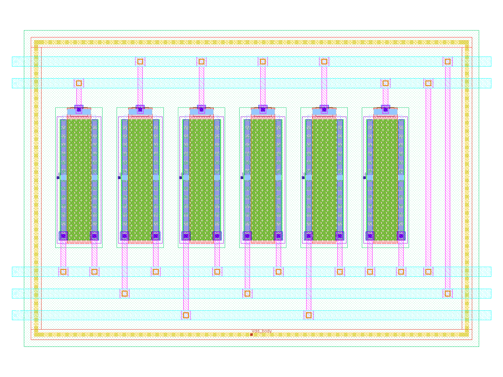<figcaption style="font-size:0.8em"><b>B28 pmos_current_mirror</b> top · XM39, XM38 variant ABAB · 19.8 × 13.1 µm</figcaption></figure><figure style="display:inline-block;width:31%;margin:4px;vertical-align:top;border-top:5px solid #eda100;">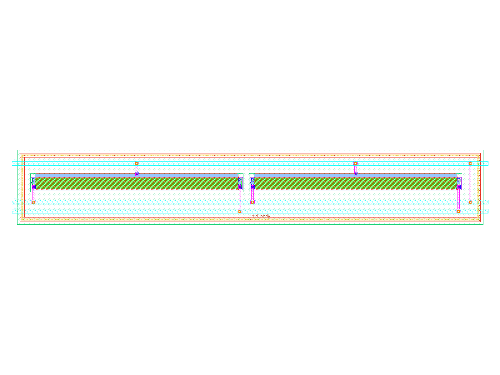<figcaption style="font-size:0.8em"><b>B29 pmos_diode</b> top · XM42 variant A · 46.9 × 7.3 µm</figcaption></figure><figure style="display:inline-block;width:31%;margin:4px;vertical-align:top;border-top:5px solid #eda100;">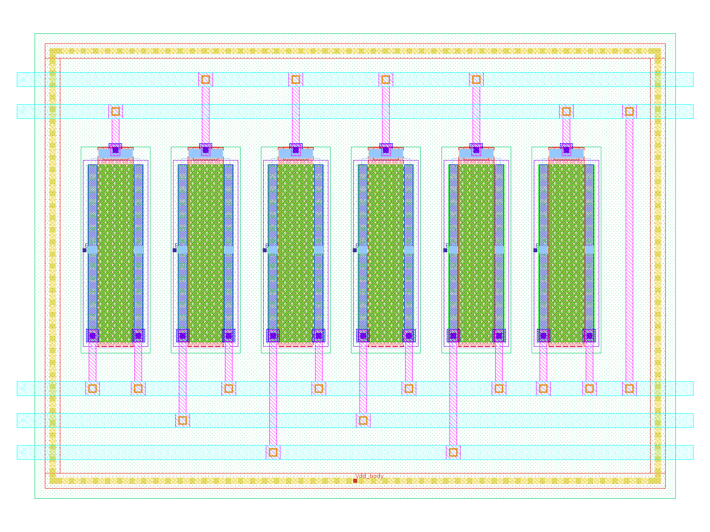<figcaption style="font-size:0.8em"><b>B30 pmos_matched_current_source_pair</b> top · XM32, XM34 variant ABAB (area-only: ABBA) · 19.0 × 13.1 µm</figcaption></figure><figure style="display:inline-block;width:31%;margin:4px;vertical-align:top;border-top:5px solid #eda100;"><figcaption style="font-size:0.8em"><b>B31 pmos_matched_current_source_pair_2</b> top · XM43, XM44 variant ABAB · 19.0 × 13.1 µm</figcaption></figure><figure style="display:inline-block;width:31%;margin:4px;vertical-align:top;border-top:5px solid #eda100;"><figcaption style="font-size:0.8em"><b>B32 pmos_matched_current_source_pair_3</b> top · XM45, XM54 variant ABBA (area-only: ABAB) · 19.0 × 13.1 µm</figcaption></figure><figure style="display:inline-block;width:31%;margin:4px;vertical-align:top;border-top:5px solid #6250d6;"><figcaption style="font-size:0.8em"><b>B33 res_packs</b> res_packs · XX2_X1_R1, XX2_X1_R2, XX2_X1_R3, … (40) variant interleaved · 50.0 × 54.7 µm</figcaption></figure>

> **How to read it.** Each block as drawn: the transistor units in a row (dummies at the ends), metal tracks above and below for the wiring, and the tap ring around it. Appendix A shows every variant of every block.

**Matching in the final layouts** (gate G5.7). Where a matched block has both a common-centroid and an interdigitated version, S5 takes the one that costs less (area and wire budgets), as Imasha decided:

| Matched block | Budget-aware | Area-only |
|---|---|---|
| B1 mirror_XX1_M1_XX1_M2_XX1_M7_XX1_M9 | interdigitated, centres 17.1 µm off | centroid, common centroid |
| B2 mirror_XX1_M22_XX1_M15 | ABBA, common centroid | ABAB, centres 10.7 µm off |
| B3 nmos_current_mirror_2 | ABBA, common centroid | ABBA, common centroid |
| B5 nmos_differential_pair | ABBA, common centroid | ABAB, centres 2.7 µm off |
| B6 nmos_differential_pair_2 | ABBA, common centroid | ABAB, centres 10.7 µm off |
| B7 nmos_differential_pair_3 | ABBA, common centroid | ABAB, centres 10.7 µm off |
| B9 nmos_matched_cascode_pair | ABBA, common centroid | ABBA, common centroid |
| B10 nmos_matched_cascode_pair_2 | ABBA, common centroid | ABAB, centres 1.2 µm off |
| B11 pmos_current_mirror_load | ABAB, centres 5.8 µm off | ABAB, centres 5.8 µm off |
| B13 pmos_matched_cascode_pair | ABAB, centres 5.9 µm off | ABAB, centres 5.9 µm off |
| B14 pmos_matched_current_source_pair_4 | ABBA, common centroid | ABAB, centres 5.9 µm off |
| B15 nmos_current_mirror_3 | ABBA, common centroid | ABAB, centres 1.2 µm off |
| B16 nmos_current_mirror_load | ABBA, common centroid | ABBA, common centroid |
| B17 nmos_matched_current_source_pair | ABAB, centres 1.2 µm off | ABAB, centres 1.2 µm off |
| B19 pmos_differential_pair | ABBA, common centroid | ABBA, common centroid |
| B24 nmos_current_mirror | centroid, common centroid | interdigitated, centres 3.4 µm off |
| B28 pmos_current_mirror | ABAB, centres 1.3 µm off | ABAB, centres 1.3 µm off |
| B30 pmos_matched_current_source_pair | ABAB, centres 1.3 µm off | ABBA, common centroid |
| B31 pmos_matched_current_source_pair_2 | ABAB, centres 1.3 µm off | ABAB, centres 1.3 µm off |
| B32 pmos_matched_current_source_pair_3 | ABBA, common centroid | ABAB, centres 1.3 µm off |

**What it shows here:** 13 of 20 matched blocks are common centroid in the budget-aware layout, 6 of 20 in the area-only one. "Centres off" is how far one device's centre sits from the row's centre in an interdigitated row.

## 6. Placement and routing (S5)

**How the placement is found** (`src/s5/macro.py`, `src/s5/place.py`):

1. **Sub-circuits:** every block belongs to the sub-circuit of its devices (x1, x2, top); a block whose devices span several (the interleaved res_packs) is a sub-circuit of its own.
2. **Rows:** inside a sub-circuit, blocks stand in rows, PMOS rows above NMOS rows, 3.0 µm between rows and 3.0 µm between blocks; matched blocks may share a row.
3. **Search inside a sub-circuit:** up to 6 blocks, every arrangement is tried (all row partitions × variants × flips). Beyond that, *simulated annealing*: start from PMOS rows above NMOS rows; 40,000 random moves, each one of: swap two blocks, move a block to another (or a new) row, change a block's variant, flip a block. A better placement is always kept; a worse one with probability exp(−Δcost / T), where T starts at 0.05 × the starting cost and is multiplied by 0.9998 after every move. Seed 20261104, so every run gives the same result.
4. **Three shapes:** each sub-circuit is placed three times, at widths 1.0, 0.65, 0.5 × the outline's width (tall and narrow to wide and short).
5. **Top level:** every arrangement of the four sub-circuits' shapes in rows is tried; anything outside the outline is rejected (never traded).
6. **Both costs:** the whole search runs twice with the same seed: once with the budget-aware cost, once with the area-only cost. Both winners are routed and checked.

**How area and wire length are optimised.** Both enter one number, the cost, which the search minimises:

- area term: A / A_ref, the bounding box's area over the sum of the blocks' smallest variants;
- each net's wire use: u = (estimated length) / (S2's length budget for that net), where the length is the half-perimeter of the box around the net's pins;
- **budget-aware cost** = A / A_ref + 10 × Σ max(0, u − 1) + 1 × Σ u. An excess over a budget costs 10 × more than use within it;
- **area-only cost** = A / A_ref (the usual baseline).

Area is also kept small one level down: S3 picks the smallest cell that keeps each node in budget, and S4 draws compact blocks; among a block's variants the smaller ones cost less here.

**How the wires are routed** (`src/s5/grid.py`):

- a grid of points 0.8 µm apart; metal-3 runs horizontally, metal-4 vertically, 0.4 µm wide, so wires on neighbouring grid lines are legal by construction;
- each net is a tree: A* search from the part already routed to the nearest pin not yet joined, cost = length + 2 µm per via; nets in order of least budget slack (the tightest first);
- obstacles: every block's tracks and keep-outs and the contact stacks to the rings, grown by half a wire plus the spacing rule;
- a net the router cannot finish is reported, never left silently open; DRC and LVS then check the result.

**The layouts.** All three pictures below are at the same scale. The box around the flow's layouts is the 250 × 200 µm outline; the hand layout is the whole Tiny Tapeout tile (161 × 226 µm), whose op-amp (`Diff_Opamp`) measures 156.8 × 218.0 µm.

  

*Left to right: Flow, budget-aware, Flow, area-only, Hand layout (tile).*

**Flow, budget-aware, annotated:**

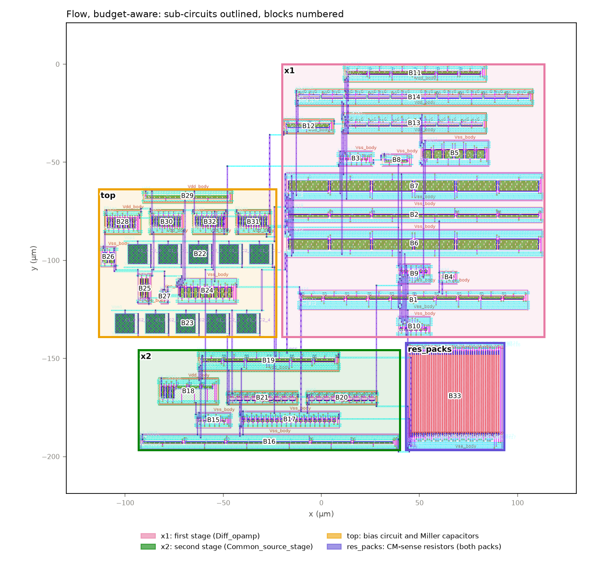

**Flow, area-only, annotated:**

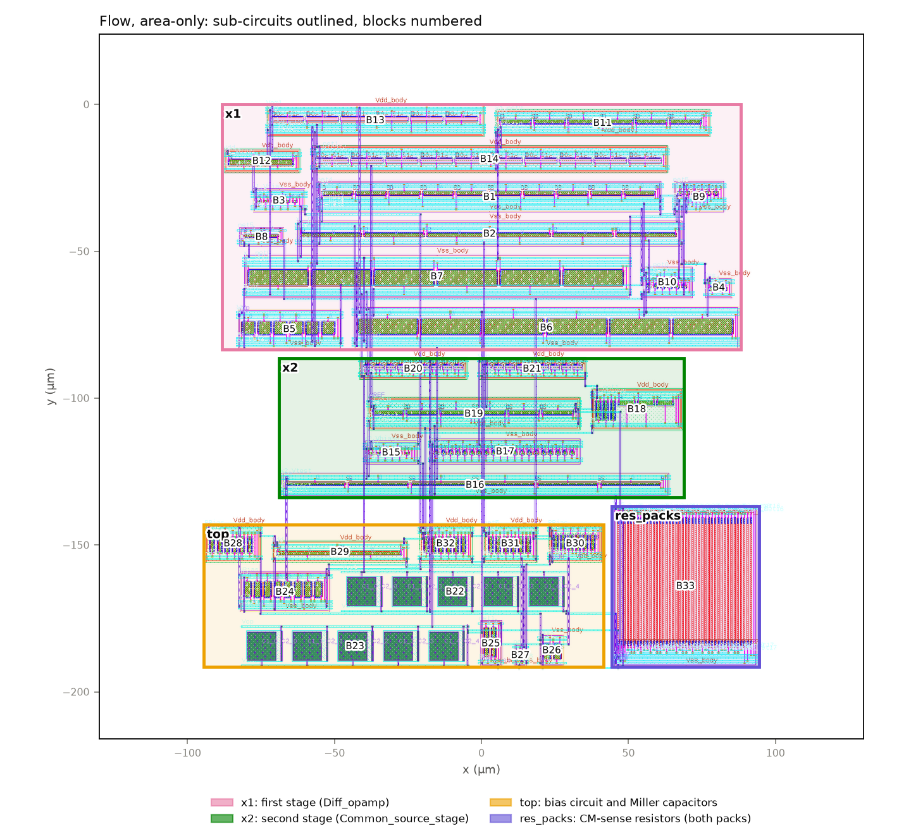

> **How to read it.** The routed layout with each sub-circuit's area outlined in its colour and every block's number (B1 … as in section 5) at its centre. The thin vertical lines are metal-4 wires, the horizontal ones metal-3.

| | Budget-aware | Area-only |
|---|---|---|
| Sub-circuits, top to bottom | top, x1 / x2, res_packs | x1 / x2 / top, res_packs |
| Shape of each sub-circuit | top w65 (annealing), x1 w65 (annealing), x2 w100 (annealing), res_packs w100 (enumeration) | x1 w100 (annealing), x2 w65 (annealing), top w65 (annealing), res_packs w100 (enumeration) |
| Size (µm) | 227.0 × 196.7 | 188.8 × 191.4 |
| Area (µm²) | 44,652 | 36,152 |
| Top-level wire (µm) | 1,746 | 2,601 |
| Sum of wire-budget use (lower is better) | 119.3 | 199.0 |
| Nets longer than their budget | 16 of 69 | 17 of 69 |
| DRC errors / LVS | 0 / match | 0 / match |

> **How to read it.** "w100", "w65", "w50" name the width limit a sub-circuit was placed under (× the outline's width); "annealing" or "enumeration" is how it was searched.

**What it shows here:** the budget-aware layout uses 40 % less of the wire budgets for 24 % more area. Most nets that run between sub-circuits are still far over the length budgets from S2, which assumed a much more compact layout (section 11).

> **How to read it.** The bounding box of each op-amp; the dashed line is the outline's area. The hand layout's op-amp also holds the tile's enable switches.

## 7. After layout: what the wiring costs (S6, S7)

S6 reads each finished layout back with the capacitance of every wire and S7 simulates it in the same test benches as the schematic. Resistance is not included (capacitance-only, "C-only"; section 12).

| Spec | Limit | Schematic | Drawn devices | After layout, budget-aware | Use of the allowance | After layout, area-only | Use of the allowance |
|---|---|---|---|---|---|---|---|
| Phase margin (PM) (°) | ≥ 60 | 78.231 | 78.128 | 73.678 | 0.499 | 73.343 | 0.536 |
| DC gain (dB) | ≥ 97.401 | 98.392 | 98.252 | 98.252 | 0.28 | 98.252 | 0.28 |
| Unity-gain bandwidth (GBW) (MHz) | ≥ 1.8465 | 2.0517 | 2.0432 | 1.9216 | **1.27** | 1.9179 | **1.3** |
| Power (µW) | ≤ 497.18 | 451.98 | 456.27 | 456.27 | 0.19 | 456.27 | 0.19 |

> **How to read it.** "use of the allowance" is (schematic − after layout) / (η × margin): 1.0 is all the flow allows the layout to take; bold is more. Every value still meets its spec (G7.1 passes).

**What it shows here:** GBW is the only spec over its allowance (1.27 budget-aware, 1.3 area-only); phase margin uses about half; gain and power little.

**Why GBW fails, and the double count.** GBW is set mainly by the Miller capacitors. Extracted alone, each Miller capacitor block shows 48.5 fF between its own plates on top of the capacitor itself. The capacitor's model already contains that, so the extraction very likely counts it twice (it is how Magic's SKY130 rules treat metal-4 over metal-3). With it removed, GBW after layout is 2.005 MHz, using 0.455 of the allowance, and every spec is within it (phase margin 0.593). The gate keeps the extraction's number; which one should count is an open question (section 13).

**Budgets.** S2 had set a capacitance budget for every net and every pair of nets. 195 of them are exceeded in the budget-aware layout (209 in the area-only one). The budgets assumed a far tighter layout; the simulation above is the real judge, and it passes every spec.

> **How to read it.** The drop from drawn devices to the extracted layout, for each of the three layouts, measured the same way. Shorter bars are better.

**What it shows here:** the flow loses less GBW than the hand layout (6.0 % against 6.8 %) and more phase margin (4.4° against 3.0°).

## 8. Comparison with the hand layout

**What the hand layout is.** The taped-out Tiny Tapeout tile `tt_um_diff` (`circuits/ttsky25a_fd/upstream_src/gds/tt_um_diff.gds`), drawn by hand by the designers. The flow extracted it with the same tool and settings (Magic, capacitance only) and simulated it in the same benches (flow record 7.7).

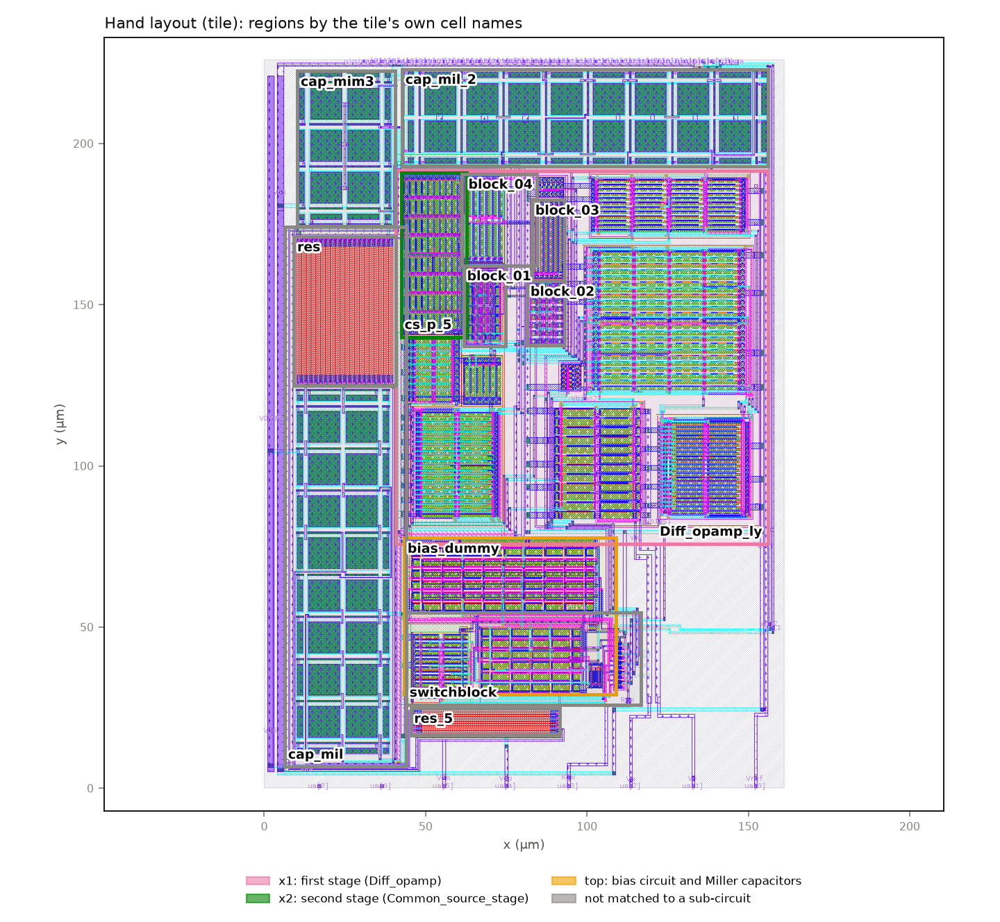

> **How to read it.** The tile with its main regions outlined, named by the tile's own cell names. A region is coloured only where its name says which sub-circuit it is (Diff_opamp_ly: the first stage; cs_p_5: the second stage's PMOS; bias_dummy: the bias circuit); the others are grey (ASSUMPTION; to confirm). The boxes are the cells' bounding boxes, so they can overlap: cs_p_5 and block_01 to block_04 lie inside Diff_opamp_ly's box.

**Why it is not the same circuit.** LVS of the tile against the schematic does not match: the tile adds enable switches and its device sizes differ. Its drawn devices alone give GBW 1.53 MHz and gain 108.1 dB, against the schematic's 2.052 MHz and 98.39 dB. Its absolute numbers therefore cannot be set against the flow's specs; what compares fairly is:

| | Flow, budget-aware | Flow, area-only | Hand layout |
|---|---|---|---|
| Area of the op-amp (µm²) | 44,652 (1.31 ×) | 36,152 (1.06 ×) | 34,182 (1.00 ×) |
| GBW lost to the wiring | 6.0 % | 6.1 % | 6.8 % |
| Phase margin lost to the wiring | 4.45° | 4.78° | 2.96° |
| Gain lost to the wiring | 0.001 dB | 0.001 dB | 0.014 dB |

**What it shows.**

- **Bandwidth:** the flow's wiring costs less GBW than the hand layout's (6.0 % against 6.8 %).
- **Phase margin:** the flow's wiring costs more (4.4° against 3.0°). A likely reason (not measured separately): the design's hierarchy puts the Miller capacitors in the `top` sub-circuit, and the flow places each sub-circuit as a unit, so the capacitors stand away from the first-stage outputs (Vop1, Vom1, in x1) they connect to; those nets and the outputs run long between sub-circuits (the worst net, net6, uses 34 × its length budget).
- **Area:** the hand layout is denser. The flow's blocks each carry their own tap ring and stand 3 µm apart, and the outline (not the area) was the target; the area-only layout comes within 6 % of the hand layout.
- **Effort:** the flow's layouts took minutes of computer time, with every DRC, LVS and simulation check run automatically; the hand layout's design time is not recorded here.

*For reference, the designers' paper reports post-layout simulation of the tile (reported, ICM 2026 paper text, supplied by the designer in the chat on 2026-10-26 (hand-entered; not generated)): about 100 dB gain, 2.3 MHz bandwidth and 52° phase margin, under the paper's own load and conditions, which differ from the flow's bench.*

## 9. What is new in this flow

The project's literature review (`docs/05_literature_novelty_remap.md`) sets out what is already published and must not be claimed (per-net parasitic budgets in general, LLM-generated constraints, common-centroid pattern selection, symmetry extraction …) and five contributions this flow aims at. Where each stands after this run:

| Contribution | What it means | Shown on this design |
|---|---|---|
| C1. Intent compiled from the circuit's own model | per-node sensitivities from a small-signal model of the hierarchy turn the specs into budgets and routing rules *before* any layout, each traceable to a node and its pole | partly: S1's linear model (checked against SPICE) gives every node's sensitivity and pole, and S2 turns them into per-net budgets before layout (section 3); closed-form symbolic expressions are only reported, and variation ranges from a sizing front end are not used in this run |
| C2. Device cells chosen from the requirements | each SKY130 transistor cell (fingers, contacts, sharing) chosen to keep its node within budget | yes, with relaxations: S3 chose every cell; some types needed a relaxed (least-bad) option (G3.3/G3.5), and every spec is still met |
| C3. Budget-aware variants and placement | several signed-off variants per block, chosen and placed to minimise area *subject to the budgets* | yes: 53 signed-off variants; the budget-aware layout uses 40 % less wire budget and loses less GBW (1.27 against 1.3 of the allowance) and phase margin (0.499 against 0.536) than the area-only one (hypothesis H5) |
| C4. LLM decisions grounded in the equations, measured | an LLM proposes and explains decisions over the explicit budgets; what it adds is measured against the rule-only flow | not yet: the next step (section 10) |
| C5. Open, reproducible SKY130 flow | every block DRC/LVS-clean with Magic, Netgen and ngspice; public benchmarks; results that re-run identically | yes: every block and both layouts signed off with negative controls; seeded searches; golden results re-checked by `./flow test` |

Also new in this phase (engineering, not literature claims): placement by the design's own sub-circuits under a hard outline; an automatic check for the Miller capacitors' likely double-counted coupling (G6.5, G7.5); and an LVS check that accepts two crossed labels only when the schematic shows the nets are truly interchangeable.

## 10. The next step: LLM integration

**What is planned** (`docs/plan_v5_ttsky25a.md` §9, `docs/05_literature_novelty_remap.md` §4; nothing here is built yet). An independent LLM is given only the netlist, the hierarchy, the specs and the budgets of section 3, and proposes the floorplan and the matching, with its reasons (the AICL way). The same S4–S7 build and check its proposal exactly as they checked the code's, so the two are compared on the same numbers.

**What the LLM would do, and what it would not:**

| Task | LLM | Code |
|---|---|---|
| Propose constraints and resolve conflicts (e.g. which budgets cannot all be met) | proposes, explains | validates |
| Floorplan: which sub-circuits and blocks sit next to which | proposes, with reasons | builds and checks |
| Matching style per block (common centroid or interdigitated) | chooses, with reasons | draws and checks |
| Transistor cell options (S3) | chooses, with a justification | DRC/LVS and simulation |
| Block variants (S4) | prunes or ranks | enumerates; legality must be exact |
| Coordinates and wires (S5) | no (LLM coordinates are known to fail) | annealing, enumeration, router |
| Checks (DRC, LVS, simulation) | no | independent |

**What it should improve, on this design:**

- **Phase margin.** Section 8 points to the Miller capacitors standing away from the first-stage outputs. An LLM reading section 3's node table can propose placing them beside x1's outputs, across the sub-circuit boundary; the flow then measures whether the phase-margin loss shrinks.
- **Matching with reasons.** The code picks common centroid or interdigitated by cost alone; an LLM can argue per block (a signal-path pair against a bias mirror) and the result is checked the same way.
- **Budgets that cannot be met.** G5.4 and G6.2 fail because S2's budgets assume a far tighter layout; an LLM can spot such conflicts early and propose which budget to relax, with the equations behind it.
- **Fewer post-layout runs.** Tuning by an LLM has needed only about eleven post-layout simulations in the literature (ICPI), against many more for black-box search.

**How it is measured** (the ablation in `docs/05`): the same circuits and extraction with and without the LLM; post-layout spec retention, area, the number of extraction and SPICE runs, and how well the budgets predicted the measured loss. Every LLM call is journaled (inputs, prompt version, output, validation).

**Before it starts:** it needs an LLM API connection from outside the container, which needs Imasha's and her supervisor's permission (Imasha, 2026-11-04: not yet).

## 11. What did not pass, and why

None of these is a crash; each stage finished and reported.

| Stage | What it does, in one line | Result | Time (min) |
|---|---|---|---|
| S0 | reads the schematic, the specs and the test benches; checks they agree | PASS | 22.7 |
| S1 | builds a linear model of the amplifier, finds its main nodes and matching groups | FAIL (G1.2) | 3.8 |
| S2 | turns the specs into budgets: how much capacitance and wire length each net may have | PASS | 77.0 |
| S3 | chooses how each transistor is drawn (fingers, cell shape) and checks it in simulation | FAIL (G3.3, G3.5) | 53.0 |
| S4 | groups transistors into matched blocks, draws each (with dummies and a tap ring), checks each | PASS | 4.2 |
| S5 | places the blocks inside the outline and wires them; checks DRC and LVS | FAIL (G5.4) | 6.4 |
| S6 | reads the finished layout back with its wiring capacitance; compares with S2's budgets | FAIL (G6.2) | 3.6 |
| S7 | simulates the read-back layout in the original benches; compares with the specs | FAIL (G7.2) | 1.0 |

- **S1 G1.2:** the simple model and the simulation define phase margin slightly differently (the model rounds the 1 Hz phase); with one definition they agree within 0.06°. Open question to Imasha (flow record row 81).
- **S3 G3.3:** some transistor types use their "least bad" drawn cell; every spec is still met in simulation.
- **S3 G3.5:** same as G3.3: a relaxation was needed for some cells.
- **S5 G5.4:** S2's wire-length budgets assume a far more compact layout than blocks with tap rings, dummies and 3 µm gaps in this outline; nets between sub-circuits are over (the worst, net6, at 34 × its budget in the budget-aware layout).
- **S6 G6.2:** follows from G5.4: the long nets and their couplings exceed S2's capacitance budgets.
- **S7 G7.2:** GBW loses more than η × its margin (section 7); within it once the likely double count is removed.

## 12. Assumptions and limits

- The specs are 0.9 × the schematic's own results (ASSUMPTION, kept by Imasha's decision).
- The outline is 250 µm wide and 200 µm tall (ASSUMPTION on the orientation; Imasha gave 250 × 200 µm).
- The two resistor packs' tap ring and dummies are on Vss (ASSUMPTION).
- Capacitance-only extraction: Magic's resistance extraction ran out of memory on this layout's supply rings (flow record row 87). The hand layout is measured the same way, so the comparison holds; the absolute post-layout numbers leave out wire resistance.
- One condition only (typical corner, 27 °C, the bench's own bias); no PVT corners after layout.
- Electromigration limits for SKY130 were not found in the PDK; wire widths are not checked against current.
- The tile's regions are matched to the schematic's sub-circuits by their cell names only (Diff_opamp_ly to x1, cs_p_5 to x2, bias_dummy to the bias circuit); the other regions are left unassigned (ASSUMPTION, to confirm).

## 13. Open questions (FEEDBACK NEEDED)

1. Capacitance-only extraction is accepted for this design for now; should resistance extraction be tried another way (e.g. per sub-circuit)?
2. Which GBW number should the G7.2 gate use: the extraction's, or the one with the Miller capacitors' likely double count removed? (The same question stands for LOADBench.)
3. Is the outline 250 µm wide and 200 µm tall, or the other way round?
4. S1's G1.2: align the two phase-margin definitions in S1, or keep it as a reported finding?
5. The tile's regions (section 8): is Diff_opamp_ly the first stage, cs_p_5 the second stage's PMOS and bias_dummy the bias circuit, and what are block_01 to block_04, res, res_5 and the capacitor cells?

## Glossary

- **Schematic:** the circuit as drawn by the designer: which transistors, resistors and capacitors connect to which.
- **Layout:** the drawing of the chip itself: the shapes on each layer that the factory makes. Every wire in it has length, so it adds capacitance and resistance the schematic does not have.
- **Op-amp:** operational amplifier. This one is fully differential: two inputs, two outputs (Vop, Vom).
- **Node / net:** a point of the circuit where terminals connect (a net is its wire in the layout).
- **Pole:** a frequency where a node's resistance and capacitance start to cut the gain; the first (dominant) pole sets the bandwidth, the next ones eat phase margin.
- **GBW:** unity-gain bandwidth: the frequency at which the amplifier's gain has fallen to 1. Higher is faster.
- **Phase margin (PM):** how far the amplifier is from oscillating in feedback. Above about 60° is comfortable.
- **DC gain:** how much the amplifier multiplies a slow input signal, in dB (98 dB is about 80 000 times).
- **Spec:** a required value, e.g. GBW ≥ 1.85 MHz. Here the specs are 0.9 × what the schematic achieves (ASSUMPTION; the design's README gives results, not specs).
- **Margin, η and allowance:** margin = schematic value − spec limit. The flow lets the layout use at most η = 0.5 of it (the allowance); the other half is kept for everything the flow does not model (process corners, temperature). "Use 1.27" means 1.27 × the allowance.
- **Sensitivity:** how much a spec changes per fF of capacitance added on a node (S1).
- **Budget:** the most capacitance, coupling, resistance or wire length a net may get from the layout, so that all of them together stay within the allowance (S2).
- **DRC:** design rule check: are all shapes wide enough and far enough apart for the factory? 0 errors = clean.
- **LVS:** layout versus schematic: is the drawn layout the same circuit as the schematic? "Match" = yes.
- **Negative control:** a deliberately wrong copy (e.g. one transistor's length changed) that a check must reject; it proves the check can fail.
- **Extraction (PEX):** reading the finished layout back into a netlist that includes the wires' capacitance (here capacitance only, "C-only"), so it can be simulated.
- **Drawn devices:** the layout's transistors as drawn, simulated without any wiring: shows what the layout's device shapes alone change. "Drawn → extracted" is then the cost of the wiring.
- **Block:** a group of transistors drawn together as one piece (a matched pair, a mirror, a single device), with its own tap ring; numbered B1 … in this report.
- **Variant:** one way of drawing a block (e.g. A B B A or A B A B); S4 draws several, S5 picks one.
- **Common centroid:** matched transistors split into pieces arranged A B B A, so both have the same centre and a gradient across the chip affects them equally.
- **Interdigitated:** pieces alternating A B A B: both spread over the same area, but their centres differ slightly.
- **Dummy:** an unused transistor or resistor at the end of a row, so the real ones at the ends see the same surroundings as those in the middle.
- **Tap ring:** a ring of substrate (or well) contact around a block, which prevents latch-up.
- **MIM capacitor:** metal–insulator–metal capacitor: the Miller capacitors here, 5 units of 10 × 10 µm each.
- **Macro:** one sub-circuit of the design's own hierarchy (x1, x2, top, the resistor packs), placed as a unit.
- **Budget-aware / area-only:** the flow scores every placement two ways and lays out both winners: by area plus how much of each wire's length budget it uses (the flow's own rule), and by area alone (the usual baseline). Comparing them tests whether the budgets help.
- **Simulated annealing:** a search that makes random small changes to a placement, always keeps an improvement, sometimes keeps a worsening early on (to escape poor arrangements), and accepts fewer worsenings as it "cools".
- **A* (A-star):** a shortest-path search on a grid that heads towards the target first; used by the router.
- **Gate (G4.1, G5.4 …):** an automatic pass/fail check at the end of a stage.
- **PREREG:** the pre-registration file: the hypotheses, thresholds and fixed parameters, written down before the runs, changed only by dated amendments.

## Where everything is

- Layouts: `outputs/S5/ttsky25a_fd/routed_budget_aware/` and `routed_area_only/` (GDS, Magic, picture).
- Blocks: `outputs/S4/ttsky25a_fd/blocks/`; extraction: `outputs/S6/ttsky25a_fd/`; simulations: `outputs/S7/ttsky25a_fd/`.
- Main nodes and budgets: `outputs/S1/ttsky25a_fd/node_classes.json`, `sensitivity.json`; `outputs/S2/ttsky25a_fd/budgets.json`.
- Hand layout measurements: `outputs/reference_layout/ttsky25a_fd/reference_layout.json`.
- This report's pictures: `outputs/report/ttsky25a_fd/`.
- The full record: `docs/flow_record.md` (sections 7.7 and 7.22–7.24); the plan: `docs/plan_v5_ttsky25a.md`; the stage-by-stage tables: `docs/s4_s7_walkthrough.html`.

## Appendix A. Every variant of every block

All 53 variants S4 drew and signed off (DRC 0, LVS match, negative control rejected), grouped by block. ✓ marks the variant each layout chose (BA budget-aware, AO area-only).

<figure style="display:inline-block;width:23%;margin:4px;vertical-align:top;border-top:5px solid #e87ba4;">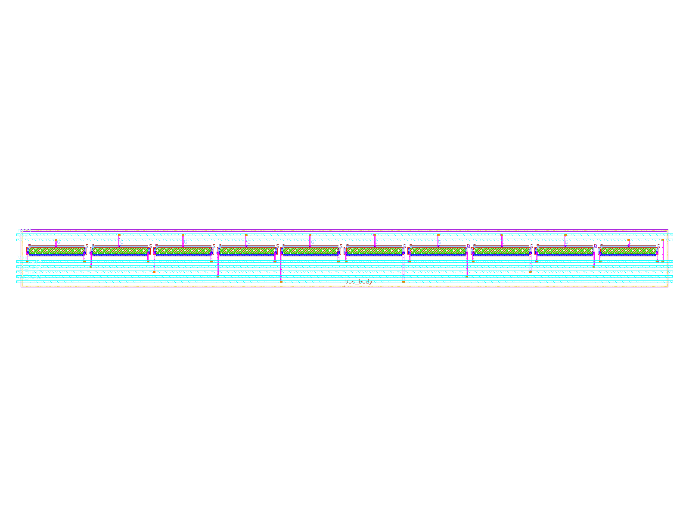<figcaption style="font-size:0.8em"><b>B1 mirror_XX1_M1_XX1_M2_XX1_M7_XX1_M9</b> · centroid AO ✓</figcaption></figure><figure style="display:inline-block;width:23%;margin:4px;vertical-align:top;border-top:5px solid #e87ba4;"><figcaption style="font-size:0.8em"><b>B1 mirror_XX1_M1_XX1_M2_XX1_M7_XX1_M9</b> · interdigitated BA ✓</figcaption></figure><figure style="display:inline-block;width:23%;margin:4px;vertical-align:top;border-top:5px solid #e87ba4;"><figcaption style="font-size:0.8em"><b>B2 mirror_XX1_M22_XX1_M15</b> · ABBA BA ✓</figcaption></figure><figure style="display:inline-block;width:23%;margin:4px;vertical-align:top;border-top:5px solid #e87ba4;">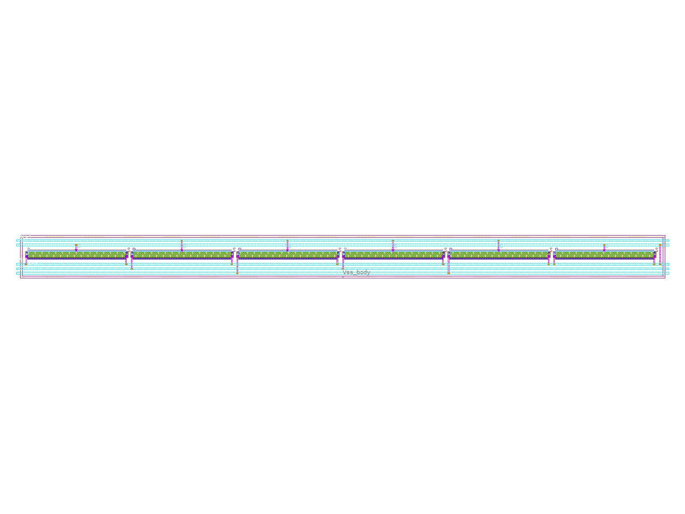<figcaption style="font-size:0.8em"><b>B2 mirror_XX1_M22_XX1_M15</b> · ABAB AO ✓</figcaption></figure><figure style="display:inline-block;width:23%;margin:4px;vertical-align:top;border-top:5px solid #e87ba4;"><figcaption style="font-size:0.8em"><b>B3 nmos_current_mirror_2</b> · ABBA BA ✓ AO ✓</figcaption></figure><figure style="display:inline-block;width:23%;margin:4px;vertical-align:top;border-top:5px solid #e87ba4;">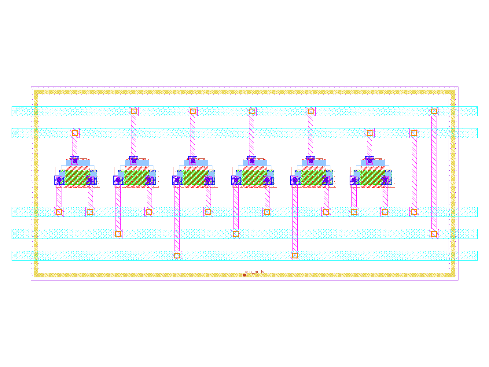<figcaption style="font-size:0.8em"><b>B3 nmos_current_mirror_2</b> · ABAB </figcaption></figure><figure style="display:inline-block;width:23%;margin:4px;vertical-align:top;border-top:5px solid #e87ba4;"><figcaption style="font-size:0.8em"><b>B4 nmos_current_mirror_4</b> · A BA ✓ AO ✓</figcaption></figure><figure style="display:inline-block;width:23%;margin:4px;vertical-align:top;border-top:5px solid #e87ba4;"><figcaption style="font-size:0.8em"><b>B5 nmos_differential_pair</b> · ABBA BA ✓</figcaption></figure><figure style="display:inline-block;width:23%;margin:4px;vertical-align:top;border-top:5px solid #e87ba4;">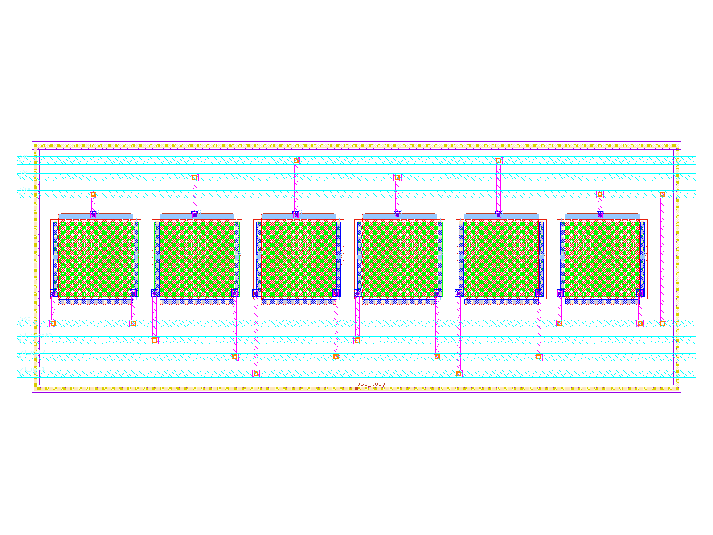<figcaption style="font-size:0.8em"><b>B5 nmos_differential_pair</b> · ABAB AO ✓</figcaption></figure><figure style="display:inline-block;width:23%;margin:4px;vertical-align:top;border-top:5px solid #e87ba4;"><figcaption style="font-size:0.8em"><b>B6 nmos_differential_pair_2</b> · ABBA BA ✓</figcaption></figure><figure style="display:inline-block;width:23%;margin:4px;vertical-align:top;border-top:5px solid #e87ba4;"><figcaption style="font-size:0.8em"><b>B6 nmos_differential_pair_2</b> · ABAB AO ✓</figcaption></figure><figure style="display:inline-block;width:23%;margin:4px;vertical-align:top;border-top:5px solid #e87ba4;"><figcaption style="font-size:0.8em"><b>B7 nmos_differential_pair_3</b> · ABBA BA ✓</figcaption></figure><figure style="display:inline-block;width:23%;margin:4px;vertical-align:top;border-top:5px solid #e87ba4;">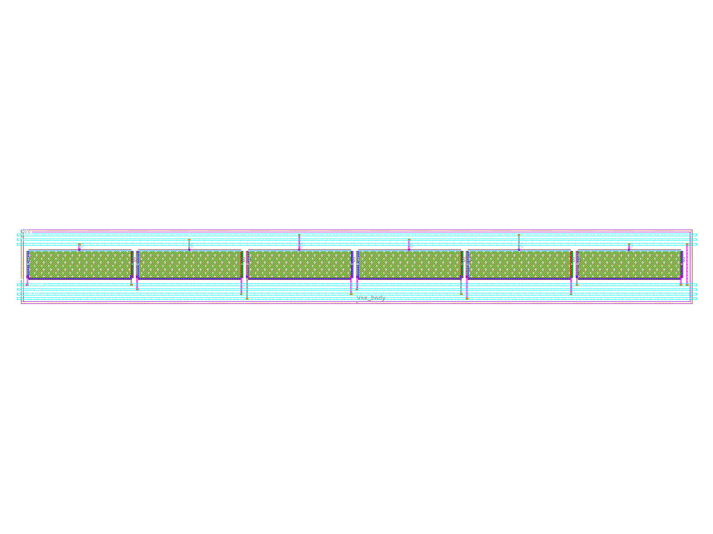<figcaption style="font-size:0.8em"><b>B7 nmos_differential_pair_3</b> · ABAB AO ✓</figcaption></figure><figure style="display:inline-block;width:23%;margin:4px;vertical-align:top;border-top:5px solid #e87ba4;"><figcaption style="font-size:0.8em"><b>B8 nmos_diode_2</b> · A BA ✓ AO ✓</figcaption></figure><figure style="display:inline-block;width:23%;margin:4px;vertical-align:top;border-top:5px solid #e87ba4;"><figcaption style="font-size:0.8em"><b>B9 nmos_matched_cascode_pair</b> · ABBA BA ✓ AO ✓</figcaption></figure><figure style="display:inline-block;width:23%;margin:4px;vertical-align:top;border-top:5px solid #e87ba4;">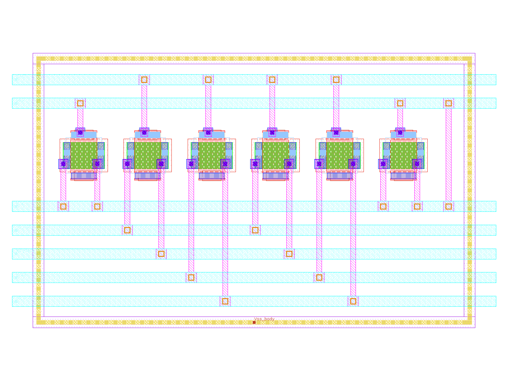<figcaption style="font-size:0.8em"><b>B9 nmos_matched_cascode_pair</b> · ABAB </figcaption></figure><figure style="display:inline-block;width:23%;margin:4px;vertical-align:top;border-top:5px solid #e87ba4;"><figcaption style="font-size:0.8em"><b>B10 nmos_matched_cascode_pair_2</b> · ABBA BA ✓</figcaption></figure><figure style="display:inline-block;width:23%;margin:4px;vertical-align:top;border-top:5px solid #e87ba4;"><figcaption style="font-size:0.8em"><b>B10 nmos_matched_cascode_pair_2</b> · ABAB AO ✓</figcaption></figure><figure style="display:inline-block;width:23%;margin:4px;vertical-align:top;border-top:5px solid #e87ba4;">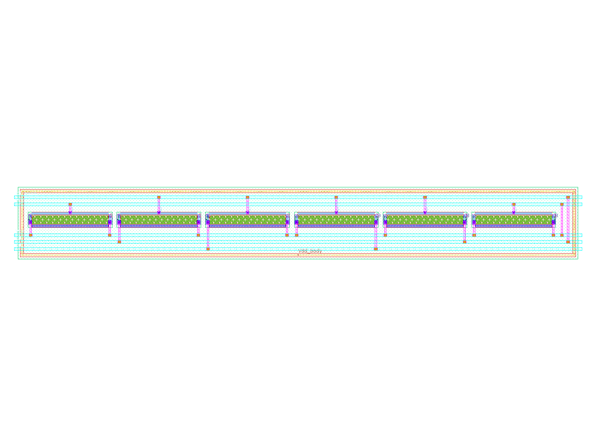<figcaption style="font-size:0.8em"><b>B11 pmos_current_mirror_load</b> · ABBA </figcaption></figure><figure style="display:inline-block;width:23%;margin:4px;vertical-align:top;border-top:5px solid #e87ba4;"><figcaption style="font-size:0.8em"><b>B11 pmos_current_mirror_load</b> · ABAB BA ✓ AO ✓</figcaption></figure><figure style="display:inline-block;width:23%;margin:4px;vertical-align:top;border-top:5px solid #e87ba4;"><figcaption style="font-size:0.8em"><b>B12 pmos_diode_2</b> · A BA ✓ AO ✓</figcaption></figure><figure style="display:inline-block;width:23%;margin:4px;vertical-align:top;border-top:5px solid #e87ba4;">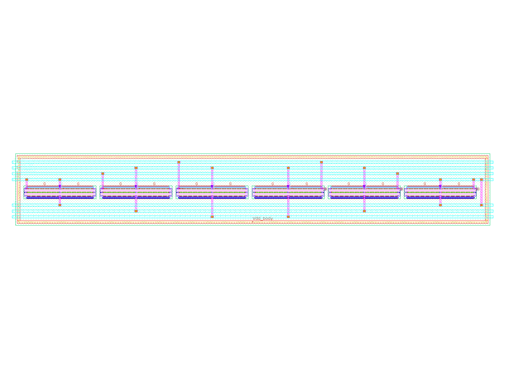<figcaption style="font-size:0.8em"><b>B13 pmos_matched_cascode_pair</b> · ABBA </figcaption></figure><figure style="display:inline-block;width:23%;margin:4px;vertical-align:top;border-top:5px solid #e87ba4;"><figcaption style="font-size:0.8em"><b>B13 pmos_matched_cascode_pair</b> · ABAB BA ✓ AO ✓</figcaption></figure><figure style="display:inline-block;width:23%;margin:4px;vertical-align:top;border-top:5px solid #e87ba4;"><figcaption style="font-size:0.8em"><b>B14 pmos_matched_current_source_pair_4</b> · ABBA BA ✓</figcaption></figure><figure style="display:inline-block;width:23%;margin:4px;vertical-align:top;border-top:5px solid #e87ba4;">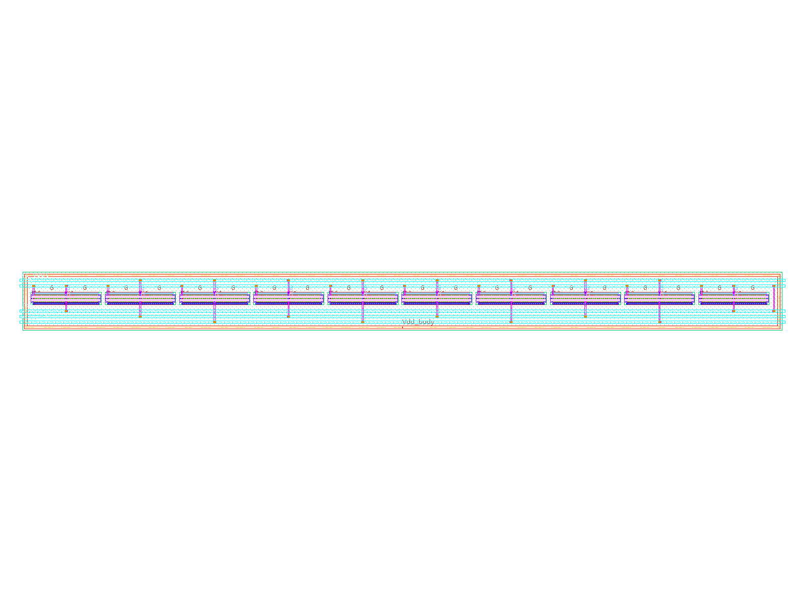<figcaption style="font-size:0.8em"><b>B14 pmos_matched_current_source_pair_4</b> · ABAB AO ✓</figcaption></figure><figure style="display:inline-block;width:23%;margin:4px;vertical-align:top;border-top:5px solid #008300;"><figcaption style="font-size:0.8em"><b>B15 nmos_current_mirror_3</b> · ABBA BA ✓</figcaption></figure><figure style="display:inline-block;width:23%;margin:4px;vertical-align:top;border-top:5px solid #008300;"><figcaption style="font-size:0.8em"><b>B15 nmos_current_mirror_3</b> · ABAB AO ✓</figcaption></figure><figure style="display:inline-block;width:23%;margin:4px;vertical-align:top;border-top:5px solid #008300;"><figcaption style="font-size:0.8em"><b>B16 nmos_current_mirror_load</b> · ABBA BA ✓ AO ✓</figcaption></figure><figure style="display:inline-block;width:23%;margin:4px;vertical-align:top;border-top:5px solid #008300;">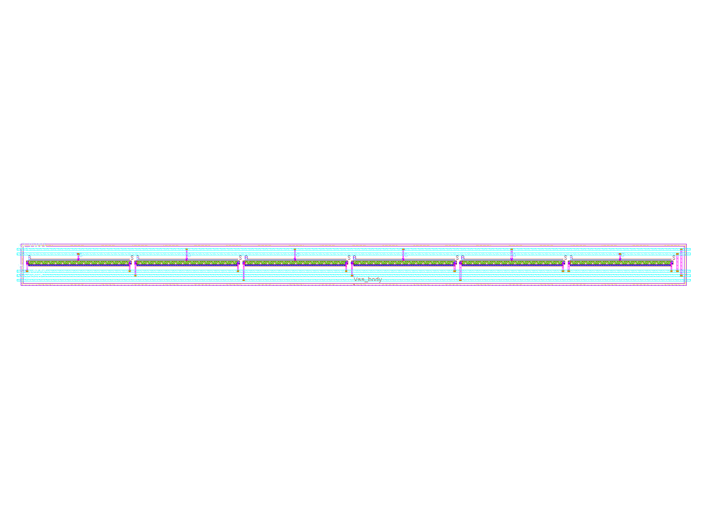<figcaption style="font-size:0.8em"><b>B16 nmos_current_mirror_load</b> · ABAB </figcaption></figure><figure style="display:inline-block;width:23%;margin:4px;vertical-align:top;border-top:5px solid #008300;">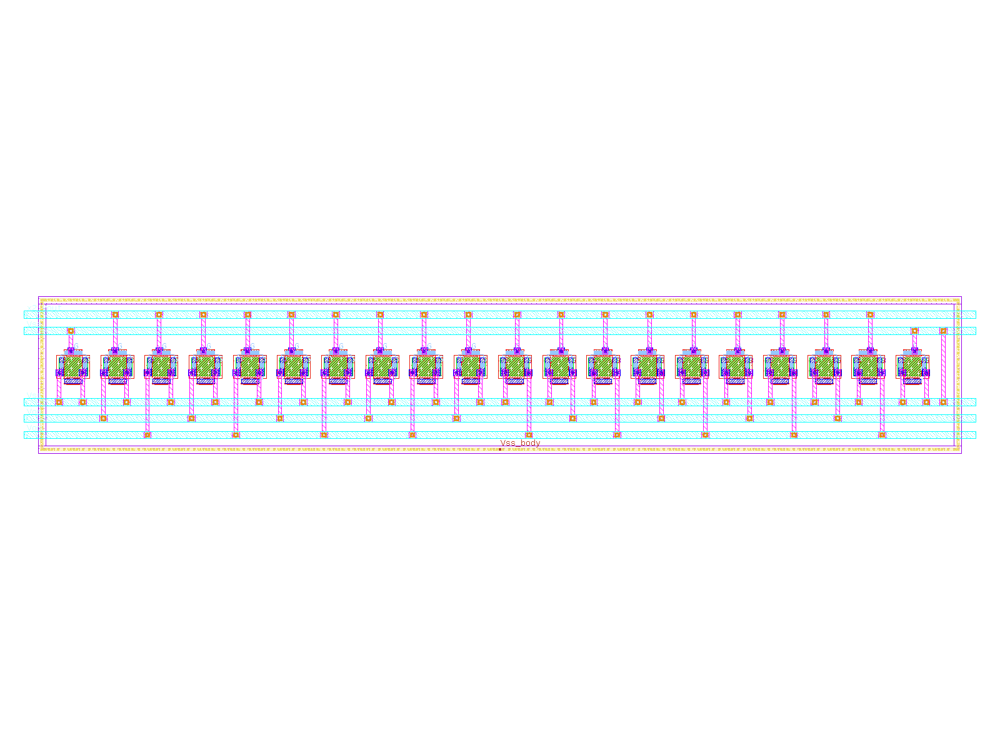<figcaption style="font-size:0.8em"><b>B17 nmos_matched_current_source_pair</b> · mirror </figcaption></figure><figure style="display:inline-block;width:23%;margin:4px;vertical-align:top;border-top:5px solid #008300;"><figcaption style="font-size:0.8em"><b>B17 nmos_matched_current_source_pair</b> · ABAB BA ✓ AO ✓</figcaption></figure><figure style="display:inline-block;width:23%;margin:4px;vertical-align:top;border-top:5px solid #008300;"><figcaption style="font-size:0.8em"><b>B18 pmos_current_mirror_2</b> · row BA ✓ AO ✓</figcaption></figure><figure style="display:inline-block;width:23%;margin:4px;vertical-align:top;border-top:5px solid #008300;"><figcaption style="font-size:0.8em"><b>B19 pmos_differential_pair</b> · ABBA BA ✓ AO ✓</figcaption></figure><figure style="display:inline-block;width:23%;margin:4px;vertical-align:top;border-top:5px solid #008300;">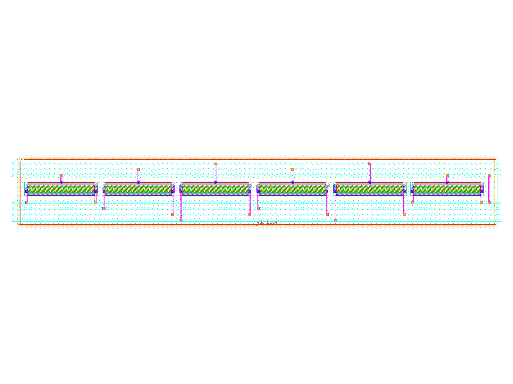<figcaption style="font-size:0.8em"><b>B19 pmos_differential_pair</b> · ABAB </figcaption></figure><figure style="display:inline-block;width:23%;margin:4px;vertical-align:top;border-top:5px solid #008300;"><figcaption style="font-size:0.8em"><b>B20 pmos_single</b> · A BA ✓ AO ✓</figcaption></figure><figure style="display:inline-block;width:23%;margin:4px;vertical-align:top;border-top:5px solid #008300;"><figcaption style="font-size:0.8em"><b>B21 pmos_single_2</b> · A BA ✓ AO ✓</figcaption></figure><figure style="display:inline-block;width:23%;margin:4px;vertical-align:top;border-top:5px solid #eda100;"><figcaption style="font-size:0.8em"><b>B22 XC1</b> · A BA ✓ AO ✓</figcaption></figure><figure style="display:inline-block;width:23%;margin:4px;vertical-align:top;border-top:5px solid #eda100;"><figcaption style="font-size:0.8em"><b>B23 XC2</b> · A BA ✓ AO ✓</figcaption></figure><figure style="display:inline-block;width:23%;margin:4px;vertical-align:top;border-top:5px solid #eda100;"><figcaption style="font-size:0.8em"><b>B24 nmos_current_mirror</b> · centroid BA ✓</figcaption></figure><figure style="display:inline-block;width:23%;margin:4px;vertical-align:top;border-top:5px solid #eda100;">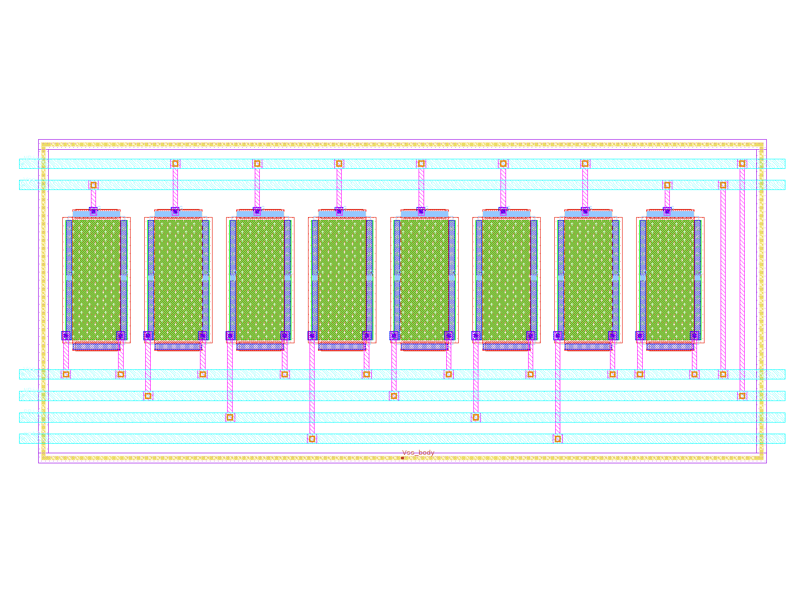<figcaption style="font-size:0.8em"><b>B24 nmos_current_mirror</b> · interdigitated AO ✓</figcaption></figure><figure style="display:inline-block;width:23%;margin:4px;vertical-align:top;border-top:5px solid #eda100;"><figcaption style="font-size:0.8em"><b>B25 nmos_diode</b> · A BA ✓ AO ✓</figcaption></figure><figure style="display:inline-block;width:23%;margin:4px;vertical-align:top;border-top:5px solid #eda100;"><figcaption style="font-size:0.8em"><b>B26 nmos_single</b> · A BA ✓ AO ✓</figcaption></figure><figure style="display:inline-block;width:23%;margin:4px;vertical-align:top;border-top:5px solid #eda100;"><figcaption style="font-size:0.8em"><b>B27 nmos_single_2</b> · A BA ✓ AO ✓</figcaption></figure><figure style="display:inline-block;width:23%;margin:4px;vertical-align:top;border-top:5px solid #eda100;"><figcaption style="font-size:0.8em"><b>B28 pmos_current_mirror</b> · ABBA </figcaption></figure><figure style="display:inline-block;width:23%;margin:4px;vertical-align:top;border-top:5px solid #eda100;"><figcaption style="font-size:0.8em"><b>B28 pmos_current_mirror</b> · ABAB BA ✓ AO ✓</figcaption></figure><figure style="display:inline-block;width:23%;margin:4px;vertical-align:top;border-top:5px solid #eda100;"><figcaption style="font-size:0.8em"><b>B29 pmos_diode</b> · A BA ✓ AO ✓</figcaption></figure><figure style="display:inline-block;width:23%;margin:4px;vertical-align:top;border-top:5px solid #eda100;"><figcaption style="font-size:0.8em"><b>B30 pmos_matched_current_source_pair</b> · ABBA AO ✓</figcaption></figure><figure style="display:inline-block;width:23%;margin:4px;vertical-align:top;border-top:5px solid #eda100;"><figcaption style="font-size:0.8em"><b>B30 pmos_matched_current_source_pair</b> · ABAB BA ✓</figcaption></figure><figure style="display:inline-block;width:23%;margin:4px;vertical-align:top;border-top:5px solid #eda100;"><figcaption style="font-size:0.8em"><b>B31 pmos_matched_current_source_pair_2</b> · ABBA </figcaption></figure><figure style="display:inline-block;width:23%;margin:4px;vertical-align:top;border-top:5px solid #eda100;"><figcaption style="font-size:0.8em"><b>B31 pmos_matched_current_source_pair_2</b> · ABAB BA ✓ AO ✓</figcaption></figure><figure style="display:inline-block;width:23%;margin:4px;vertical-align:top;border-top:5px solid #eda100;"><figcaption style="font-size:0.8em"><b>B32 pmos_matched_current_source_pair_3</b> · ABBA BA ✓</figcaption></figure><figure style="display:inline-block;width:23%;margin:4px;vertical-align:top;border-top:5px solid #eda100;"><figcaption style="font-size:0.8em"><b>B32 pmos_matched_current_source_pair_3</b> · ABAB AO ✓</figcaption></figure><figure style="display:inline-block;width:23%;margin:4px;vertical-align:top;border-top:5px solid #6250d6;"><figcaption style="font-size:0.8em"><b>B33 res_packs</b> · interleaved BA ✓ AO ✓</figcaption></figure>

